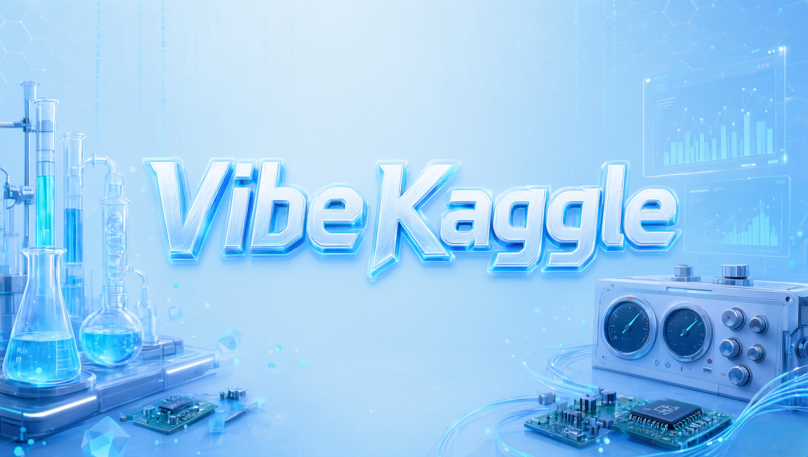

<h1 align="center">Vibe Kaggle</h1>

> [!WARNING]
> 🧪 Beta公测版本提示：教程主体已完成，正在优化细节，欢迎大家提Issue反馈问题或建议。

*从 TOP 方案中提炼核心洞见，助力选手跑通整个比赛流程。*

## 项目特色

1.  全书以 vibe 工作流贯穿始终，符合当今大模型时代的最佳实践
2.  所有实战章节换成近两年的比赛，避免知识点或方案过时
3.  表格和时序数据引入 AutoML（AutoGluon）减少试错成本
4.  图像比赛引入 DINO，文本比赛引入 BERT 和大模型作为解题工具，符合最新的解决方案
5.  基线和细节完全交给大模型，API 讲解全部放进附录，专注于方案选择/模型融合/结果验证这种有意义的部分
6.  强调“Agent不是万能的，人要对其有所约束”，避免完全放手导致毫无意义的结果
7.  从 TOP 方案中提炼经验教训，一开始就避免走弯路

## 项目受众

机器学习入门者，想要打比赛获得荣誉的人。

## 在线阅读
https://datawhalechina.github.io/baizhan-kaggle

## 目录

| 章节名 | 简介 | 状态 |
| ---- | ---- | ---- |
| [前言：VibeKaggle 不是用 AI 写代码](docs/chapters/preface.md) | 为什么这本书教的是"设计并运行一条人机协作的竞赛工作流" | 已完成 |
| [第1章 VibeKaggle 的工作流全景](docs/chapter01/index.md) | Kaggle 页面导览、选比赛、三份核心文件与提交格式、搭好"工地"跑通常数基线 | 已完成 |
| [第2章 VibeKaggle 的操作系统](docs/chapter02/index.md) | 工件规范、验证优先、Agent 能力边界、带护栏的 MCP 流水线 | 已完成 |
| [第3章 表格数据的 Vibe 工作流](docs/chapter03/index.md) | 从自动基线到人机迭代的五步循环模板 | 已完成 |
| [第4章 表格比赛详解：Playground S6E3 客户流失预测](docs/chapter04/index.md) | 2026，NVIDIA LLM Agent 夺冠（850 实验 → 150 模型四级堆叠）的门控规则 | 已完成 |
| [第5章 表格比赛详解：Playground S5E10 道路事故风险预测](docs/chapter05/index.md) | 2025，AutoGluon 作为起点，Agent 扩候选池、人做减法 | 已完成 |
| [第6章 表格比赛详解：Playground S6E1 学生考试成绩预测](docs/chapter06/index.md) | 2025—2026，特征工程的深度挖掘 | 已完成 |
| [第7章 表格比赛详解：NeurIPS Open Polymer Prediction 2025](docs/chapter07/index.md) | 科学表格数据的验证特殊性：分数好 ≠ 结果对，领域合理性守门 | 已完成 |
| [第8章 时序数据的 Vibe 工作流](docs/chapter08/index.md) | 自动化枚举与人工时间纪律：为什么随机切分是头号大敌 | 已完成 |
| [第9章 时序比赛详解：Playground S5E1 贴纸销售预测](docs/chapter09/index.md) | 2025，时间纪律的入门标准，Group K-Fold 与"戳破自我欺骗" | 已完成 |
| [第10章 时序比赛详解：Playground S5E10 道路事故风险预测](docs/chapter10/index.md) | 2025，Agent 枚举与人做互补性选择，残差建模与 NNLS | 已完成 |
| [第11章 时序比赛详解：Jane Street Real-Time Market Data Forecasting](docs/chapter11/index.md) | 2024—2025，非平稳时序的验证极限，在线学习 | 已完成 |
| [第12章 图像数据的 Vibe 工作流](docs/chapter12/index.md) | 基础模型时代的人机分工：冻结骨干 + 轻量头 | 已完成 |
| [第13章 图像比赛详解：CSIRO Image2Biomass Prediction](docs/chapter13/index.md) | 2025—2026，DINOv3 多模态融合与人工数据清洗 | 已完成 |
| [第14章 图像比赛详解：RSNA Knee Abnormality Detection](docs/chapter14/index.md) | 2026，医学影像 + LLM Agent 监督，98.7% 数据无标准答案 | 已完成 |
| [第15章 图像比赛详解：Image Matching Challenge 2025](docs/chapter15/index.md) | 2025，几何视觉中的 Agent 实验管理 | 已完成 |
| [第16章 文本数据的 Vibe 工作流](docs/chapter16/index.md) | LLM 原生赛道的双重角色：既是选手又是裁判 | 已完成 |
| [第17章 文本比赛详解：Jigsaw — Agile Community Rules Classification](docs/chapter17/index.md) | 2025，LLM 微调与验证策略的判断（信 CV 还是信 LB） | 已完成 |
| [第18章 文本比赛详解：LLM Prompt Recovery](docs/chapter18/index.md) | 2024，生成式任务中的混合策略判断 | 已完成 |
| [第19章 文本比赛详解：Make Data Count — Finding Data References](docs/chapter19/index.md) | 2025，检索 + 分类的混合流程与阶段误差传播 | 已完成 |
| [第20章 验证与评估：Vibe 时代更不可让渡的判断](docs/chapter20/index.md) | 验证污染、目标泄漏、公私榜差异、提交预算纪律 | 已完成 |
| [第21章 调优与集成：Agent 搜索，人选择](docs/chapter21/index.md) | 超参搜索、Stacking、NNLS、多样性选择 | 已完成 |
| [第22章 VibeKaggle 的策略与心态](docs/chapter22/index.md) | 选比赛、提交预算、人类队友 + Agent 队友、从运动员到教练 | 已完成 |
| [第23章 从 VibeKaggle 到实际项目](docs/chapter23/index.md) | 竞赛经验迁移生产、可维护项目结构、模型部署 | 已完成 |
| [附录A NumPy / pandas / matplotlib 快速参考](docs/appendices/appendix_a.md) | 数组、DataFrame、常见图表（精简合并版） | 已完成 |
| [附录B scikit-learn / XGBoost / LightGBM 速查](docs/appendices/appendix_b.md) | 预处理、模型、交叉验证、评估 | 已完成 |
| [附录C AutoGluon 快速参考](docs/appendices/appendix_c.md) | Tabular / TimeSeries 用法 | 已完成 |
| [附录D PyTorch / HuggingFace Transformers 速查](docs/appendices/appendix_d.md) | Tensor、nn.Module、训练循环、Transformers | 已完成 |
| [附录E 表格基础模型速查](docs/appendices/appendix_e.md) | TabPFN 等表格基础模型 | 已完成 |
| [附录F Kaggle MCP 配置与安全实践](docs/appendices/appendix_f.md) | MCP 接入、护栏与审计 | 已完成 |
| [附录G Kaggle 评估指标速查](docs/appendices/appendix_g.md) | 回归/分类指标公式与适用场景 | 已完成 |
| [附录H 工件管理与实验日志规范](docs/appendices/appendix_h.md) | 完整版工件元数据与日志规范 | 已完成 |

## 贡献者名单

| 姓名 | 职责 | 简介 |
| :----| :---- | :---- |
| [张子辰](https://github.com/wizardforcel/) | 项目负责人 | 专注于模型量化、端侧推理和注意力机制改进 |

## 参与贡献

- 如果你发现了一些问题，可以提Issue进行反馈，如果提完没有人回复你可以联系[保姆团队](https://github.com/datawhalechina/DOPMC/blob/main/OP.md)的同学进行反馈跟进~
- 如果你想参与贡献本项目，可以提Pull Request，如果提完没有人回复你可以联系[保姆团队](https://github.com/datawhalechina/DOPMC/blob/main/OP.md)的同学进行反馈跟进~
- 如果你对 Datawhale 很感兴趣并想要发起一个新的项目，请按照[Datawhale开源项目指南](https://github.com/datawhalechina/DOPMC/blob/main/GUIDE.md)进行操作即可~

## 关注我们

扫描下方二维码关注公众号：Datawhale

## LICENSE

 本作品采用<a rel="license" href="http://creativecommons.org/licenses/by-nc-sa/4.0/">知识共享署名-非商业性使用-相同方式共享 4.0 国际许可协议</a>进行许可。

