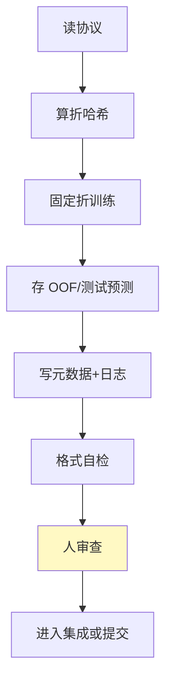

# 附录H：工件管理与实验日志规范（完整版）

> 本附录是全书工件规范的“完整合同”。前面各章是按需引用，这里一次性给全，方便你直接复制到项目里用。

---

## H.1 目录结构（完整版）

```
<project_root>/
├── artifacts/
│   ├── oof/            # train_oof_[MODEL]_[VERSION].npy
│   ├── test_preds/     # test_preds_[MODEL]_[VERSION].npy
│   ├── logs/           # exp_[MODEL]_[VERSION].jsonl
│   ├── configs/        # cfg_[MODEL]_[VERSION].yaml
│   ├── submissions/    # submission_[MODEL]_[VERSION].csv
│   ├── ensembles/      # oof_ensemble_[NAME]_[VERSION].npy 等
│   └── reports/        # 汇总报告
├── data/               # 原始数据（只读）
├── src/
│   ├── utils/          # submission_check / cv_protocol / leakage_check ...
│   ├── baselines/
│   ├── features/
│   ├── models/
│   └── ensembles/
├── configs/
│   ├── cv_protocol.yaml
│   ├── agent_policy.yaml
│   └── rules.yaml
├── notebooks/
└── scripts/
```

---

## H.2 命名约定

| 产物 | 格式 | 示例 |
|------|------|------|
| OOF | `train_oof_{MODEL}_{VERSION}.npy` | `train_oof_LGBM_v001.npy` |
| 测试预测 | `test_preds_{MODEL}_{VERSION}.npy` | `test_preds_LGBM_v001.npy` |
| 日志 | `exp_{MODEL}_{VERSION}.jsonl` | `exp_LGBM_v001.jsonl` |
| 配置快照 | `cfg_{MODEL}_{VERSION}.yaml` | `cfg_LGBM_v001.yaml` |
| 提交文件 | `submission_{MODEL}_{VERSION}.csv` | `submission_LGBM_v001.csv` |
| 集成 OOF | `oof_ensemble_{NAME}_{VERSION}.npy` | `oof_ensemble_NNLS_v001.npy` |

**MODEL**：`[A-Z0-9_]+`（大写，下划线分隔）；**VERSION**：`v` + 三位数字，严格递增。

---

## H.3 工件元数据字段（必填）

| 字段 | 类型 | 说明 |
|------|------|------|
| `model` | str | 模型标识 |
| `version` | str | 版本号 |
| `task_type` | str | binary / multiclass / regression / ranking |
| `cv_scheme` | str | 验证方案描述 |
| `cv_fold_indices_hash` | str | **折索引哈希（防验证污染的关键）** |
| `cv_scores` | list[float] | 每折分数 |
| `cv_mean` / `cv_std` | float | 均值 / 标准差 |
| `metric` | str | 指标名 |
| `oof_path` / `test_path` | str | 工件相对路径 |
| `n_train` / `n_test` | int | 样本数 |
| `change_desc` | str | **一行改动描述** |
| `agent_model` | str | 哪个 Agent 产出 |
| `human_reviewed` | bool | 人是否已审查 |
| `created_at` | str | ISO 时间戳 |

完整 Schema 见第 2 章 `src/utils/artifact_schema.py`。

---

## H.4 实验日志格式（JSON Lines）

一行一个 JSON 对象，方便流式读取和追加：

```jsonl
{"model":"LGBM","version":"v001","task_type":"binary","cv_scheme":"StratifiedKFold_5_42","cv_fold_indices_hash":"a1b2c3d4e5f6a7b8","cv_scores":[0.851,0.849,0.853,0.850,0.852],"cv_mean":0.851,"cv_std":0.0015,"metric":"auc","oof_path":"oof/train_oof_LGBM_v001.npy","test_path":"test_preds/test_preds_LGBM_v001.npy","n_train":160000,"n_test":80000,"change_desc":"新增 tenure_x_monthlycharges 交互特征","agent_model":"claude-opus-4-8","human_reviewed":true,"created_at":"2026-03-15T10:30:00"}
```

---

## H.5 标准工作流（每一次实验）

1. 读 `configs/cv_protocol.yaml`（只读）；
2. 计算并记录 `cv_fold_indices_hash`；
3. 在固定折上训练，产出 OOF；
4. 训练全量模型，产出测试预测；
5. 存两个 `.npy` 工件；
6. 生成元数据，写入 `.jsonl` 日志和 `.yaml` 配置；
7. 运行 `assert_submission_format` 自检；
8. 人审查：CV、OOF 质量、泄漏风险；
9. 人确认后，才进入集成/提交。



---

## H.6 完整检查清单

**项目启动时**
- [ ] 建好 `artifacts/` 全部子目录
- [ ] 写好 `cv_protocol.yaml`（人写，锁死）
- [ ] 写好 `agent_policy.yaml`（预算 + 工具白名单）
- [ ] 写好 `rules.yaml`（比赛红线）
- [ ] 跑通常数基线，产出第一组合规工件

**每次实验后**
- [ ] 工件命名符合规范
- [ ] 元数据字段齐全（尤其 `change_desc`、`cv_fold_indices_hash`）
- [ ] 折索引哈希与协议一致
- [ ] OOF 与测试预测形状正确
- [ ] 提交文件通过格式自检

**每次提交前**
- [ ] 本地 CV 有真实提升（超过噪声）
- [ ] 多模型/多种子结论一致
- [ ] OOF 质量检查过（分布、校准、泄漏）
- [ ] 物理/业务约束检查过
- [ ] 提交预算充足、值得花
- [ ] `dry_run` 预览信息已读
- [ ] 人明确批准

---

> **本附录是全书的“合同书”。** 把这一份放进你的项目仓库，你的 Agent 就有了一份明确的施工规范——而这，正是 VibeKaggle 一切的开始。