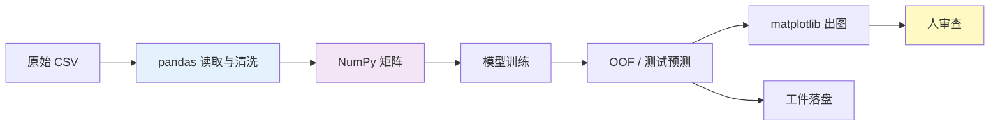
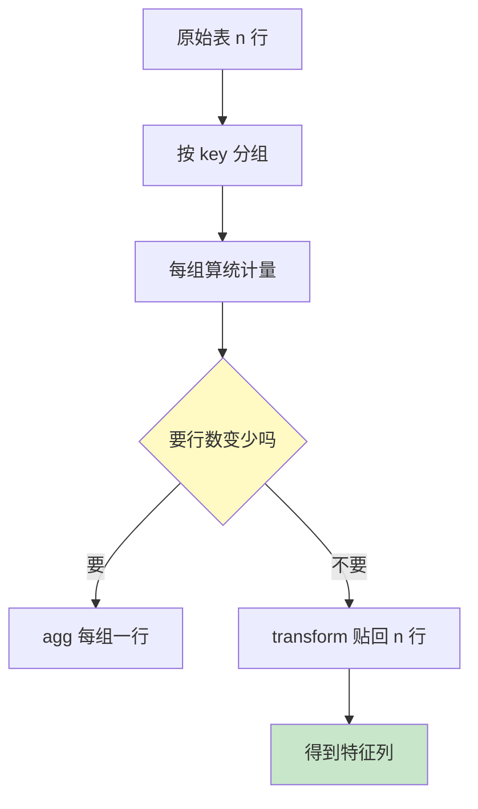

# 附录A：NumPy / pandas / matplotlib 快速参考（精简合并版）

> 本附录是全书代码里反复出现的三个库的速查表。定位很明确：**不追求 API 全量，只保留"写竞赛代码真的会用到"的那 20%**。忘了某个语法，回来翻一翻就行，不需要背。

先给你一句话的分工，后面每一节都会再展开：

- **NumPy** 管"一堆数字怎么算得快"——它是数值内核；
- **pandas** 管"带表头和行号的表格怎么切怎么并"——它是表格管家；
- **matplotlib** 管"算出来的东西怎么画出来给人看"——它是画笔。

---

## A.1 NumPy 数组创建与形状变换

NumPy 的核心对象叫 `ndarray`，翻译成人话就是"一个规规矩矩的多维数组"。它最大的好处是**整块算**，而不是像 Python 列表那样一个元素一个元素地循环——后者慢几十倍甚至上百倍。

```python
import numpy as np

# ---- 创建数组 ----
a = np.array([1, 2, 3])          # 从 Python 列表创建，最常用
b = np.zeros((3, 4))             # 全 0 的 3 行 4 列矩阵
c = np.ones(5)                   # 全 1 的一维向量
d = np.arange(0, 10, 2)          # 等差：0,2,4,6,8（像 range，但能带小数）
e = np.linspace(0, 1, 5)         # 等间隔：0, 0.25, 0.5, 0.75, 1（要几个点就写几个）

# ---- 形状操作（竞赛里天天用） ----
a.reshape(3, 1)                  # 从 (3,) 变成 (3,1)，注意元素总数必须一致
a.ravel()                        # 拉平成一维（"摊煎饼"）
np.concatenate([a, b], axis=0)   # 拼接：axis=0 是"上下接"，行数相加
np.stack([a, b], axis=0)         # 堆叠：会多出一个新维度
```

这里最容易懵的是 `reshape` 和 `stack` 的区别。一句话记法：**`concatenate` 是"接水管"，水还是那么多，只是管子变长；`stack` 是"叠盘子"，多出来一层。** 竞赛里把多个模型的预测拼成矩阵时用 `np.column_stack`，本质就是 `stack` 的按列版本。

**什么时候会用到**：读进 CSV 之后转成矩阵喂给模型、把 5 折的 OOF 拼成 (n_samples, n_models) 的矩阵做集成。

---

## A.2 NumPy 索引、切片与广播

切片是 NumPy 的看家本领，但它有个**新手最容易踩的坑**：切片拿到的往往是"视图"（view）而不是"拷贝"（copy）。视图是原数组的一个"窗口"，你改视图，原数组也跟着变。

```python
a = np.arange(10)                # [0,1,2,...,9]

# ---- 基本切片 ----
a[2:5]                           # [2,3,4]，左闭右开
a[::2]                           # 隔一个取一个：[0,2,4,6,8]
a[::-1]                          # 反转：[9,8,...,0]

# ---- 布尔掩码（筛选） ----
mask = a > 5                     # 得到一串 True/False
a[mask]                          # 只保留大于 5 的元素：[6,7,8,9]
np.where(a > 5, a, 0)            # 大于 5 保留原值，否则置 0（三目运算）

# ---- 广播（broadcast） ----
row = np.array([1, 2, 3])        # 形状 (3,)
col = np.array([[10], [20]])     # 形状 (2,1)
row + col                        # 形状变成 (2,3)：每行都加上 [1,2,3]
```

广播的规则说起来有点绕，但记住一句就够：**两个数组从右往左对齐，某一维长度是 1 的，就"复制"成另一个的长度。** 所以 `(2,1)` 和 `(3,)` 能相加，结果 `(2,3)`——这也是为什么书里写 `oof.reshape(-1, 1)` 之后能和 `(n,)` 的向量做运算。

**什么时候会用到**：筛选异常样本（`oof[mask]`）、给整列加同一个偏置、构造交互特征时的形状对齐。

---

## A.3 NumPy 统计与聚合

这一节的函数你几乎每章都会遇到，重点在 `axis` 参数——它决定"沿哪个方向压扁"。

```python
a = np.arange(12).reshape(3, 4)  # 3 行 4 列

a.sum()                          # 全部求和（一个数）
a.sum(axis=0)                    # 按列求和，得到 4 个数（"压掉行"）
a.sum(axis=1)                    # 按行求和，得到 3 个数（"压掉列"）

a.mean(), a.std()                # 均值、标准差
a.min(), a.max()                 # 最小、最大
a.argmin(), a.argmax()           # 最小/最大值所在的位置（下标）
np.percentile(a, [25, 50, 75])   # 分位数：四分之一、一半、四分之三
np.median(a)                     # 中位数
```

`axis` 的记法：**`axis=k` 表示"把第 k 个维度压掉"**。`axis=0` 压掉行（第 0 维），所以结果是"每一列一个数"；`axis=1` 压掉列，结果是"每一行一个数"。绕不明白的时候，先 `print(a.shape)`，再想"我想让结果剩几维"，答案就出来了。

还有一个实战里很常见的需求：**带 NaN 的统计**。普通 `mean()` 遇到 NaN 会直接返回 NaN，这时候要用 `np.nanmean` / `np.nanstd` / `np.nanpercentile`，它们会"跳过"缺失值。

**什么时候会用到**：算 OOF 的整体 RMSE、看某个特征的分位数分布、判断目标是否长尾。

---

## A.4 pandas Series 与 DataFrame 基础

pandas 的两块积木：**Series**（一列带标签的数据）和 **DataFrame**（多列拼成的表）。DataFrame 你可以理解成"Excel 表"，只不过每一列都有自己的类型。

```python
import pandas as pd

s = pd.Series([1, 2, 3], index=["a", "b", "c"])   # 带标签的一列
s["b"]                                            # 按标签取：2
s.iloc[1]                                         # 按位置取：2

df = pd.DataFrame({"城市": ["北京", "上海", "北京"],
                   "销量": [10, 20, 30]})          # 两列拼成表

df.shape                                          # (3, 2)：3 行 2 列
df.columns                                        # 列名列表
df.dtypes                                         # 每列的类型
df.info()                                         # 概览：行数、列数、缺失、类型
df.describe()                                     # 数值列的统计摘要
df.head()                                         # 前 5 行，肉眼检查用
```

这里要建立一个重要直觉：**DataFrame 是"按列存"的**。所以"选列、算列"很快，"逐行遍历"很慢。新手最爱写的 `df.iterrows()` 是公认的性能反模式——能向量化就别逐行。

**什么时候会用到**：读三份核心文件之后的第一眼检查（`df.shape` / `df.info()` / `df.head()`），以及所有特征工程的起点。

---

## A.5 pandas 读写与筛选

```python
# ---- 读写 ----
df = pd.read_csv("train.csv")                    # 读 CSV
df = pd.read_csv("train.csv", nrows=1000)        # 只读前 1000 行（大文件先探路）
df = pd.read_csv("train.csv", usecols=["a", "b"])# 只读需要的列，省内存
df = pd.read_csv("train.csv", parse_dates=["date"])  # 读进来就是日期类型
df.to_csv("out.csv", index=False)                # 写 CSV，不写行号（提交文件必须这样）

# ---- 选行选列 ----
df["col"]                                        # 单列（返回 Series）
df[["a", "b"]]                                   # 多列（返回 DataFrame）
df.loc[0:10, "a"]                                # 按"标签"选：行 0 到 10 的 a 列
df.iloc[0:10, 0]                                 # 按"位置"选：前 10 行的第 0 列
df.query("销量 > 20")                            # 表达式筛选，读起来像人话
df[df["销量"].between(10, 30)]                   # 区间筛选
df[df["城市"].isin(["北京", "上海"])]             # 属于某几个值

# ---- 缺失值 ----
df.isna().sum()                                  # 每列缺了多少（先看这个）
df.fillna(df.median())                           # 用中位数填充
df.dropna()                                      # 删掉有缺失的行（谨慎）
```

`loc` 和 `iloc` 的区别一句话：**`loc` 认标签，`iloc` 认位置**。`loc[0:10]` 是"标签 0 到 10"（含 10），`iloc[0:10]` 是"第 0 到 9 行"（不含 10）——这个"一个含一个不含"的差异，是新手最常写错的地方。

**什么时候会用到**：读数据、按条件筛样本、检查缺失、写提交文件（`index=False` 千万别忘）。

---

## A.6 pandas 分组聚合与透视

`groupby` 是表格特征工程的心脏。它的动作可以拆成三步：**分组 → 算 → 贴回去**。

```python
df = pd.DataFrame({"城市": ["北京", "北京", "上海", "上海"],
                   "品类": ["A", "B", "A", "B"],
                   "销量": [10, 20, 30, 40]})

# ---- 聚合：每组压成一行 ----
df.groupby("城市")["销量"].mean()                # 每个城市的平均销量
df.groupby("城市")["销量"].agg(["mean", "std", "count"])  # 一次算多个
df.groupby("城市").agg(total=("销量", "sum"))    # 命名聚合，结果列名清晰

# ---- 变换：算完贴回原来的行 ----
df.groupby("城市")["销量"].transform("mean")     # 每个城市均值，广播回每一行
```

**`agg` 和 `transform` 的差别，是这一节最值钱的一句话**：`agg` 是"每组压成一行"（行数变少），`transform` 是"算完再贴回每一行"（行数不变）。做特征时必须用 `transform`，因为你要的是"每一行都有一个特征值"，行数一变，训练矩阵就对不上了。

还有一句社区里反复验证过的经验：**`transform("median")` 这种广播式写法，比 `apply(lambda ...)` 快一个量级**。能用内置函数就别自己写 lambda。

`pivot_table` 则用来做"交叉表"，比如"行是城市、列是品类、值是销量合计"，一眼看出结构：

```python
df.pivot_table(index="城市", columns="品类", values="销量", aggfunc="sum")
```

**什么时候会用到**：目标编码（用 `transform` 算每个类别的历史均值）、按用户/店铺分组做统计特征、做交叉表看分布。

---

## A.7 pandas 合并与连接

竞赛里数据很少只有一张表，常见的是"主表 + 补充表"，这时候要 merge。

```python
left = pd.DataFrame({"id": [1, 2, 3], "x": ["a", "b", "c"]})
right = pd.DataFrame({"id": [2, 3, 4], "y": [20, 30, 40]})

pd.merge(left, right, on="id", how="inner")   # 只留两边都有的 id：2,3
pd.merge(left, right, on="id", how="left")    # 保留左表全部：1,2,3（1 的 y 是 NaN）
pd.merge(left, right, on="id", how="outer")   # 两边全部：1,2,3,4

pd.concat([left, right], axis=0)              # 上下摞（行数相加，列名对齐）
pd.concat([left, right], axis=1)              # 左右拼（列数相加，索引对齐）
```

`how` 的四个值怎么记：**`inner` 取交集、`left` 保左、`right` 保右、`outer` 取并集**。

这里有个**必须警惕的坑**：如果右表的 `id` 有重复，`merge` 会让左表的行"膨胀"（一对多），行数凭空变多，后面训练时标签和特征就对不上了。所以 merge 之后一定要 `print(len(df))` 确认行数符合预期。

**什么时候会用到**：把原始数据和补充特征表拼起来、把 OOF 和测试预测按 id 对齐、多表 EDA。

---

## A.8 matplotlib 常见图表与样式

```python
import matplotlib.pyplot as plt

# ---- 折线图 ----
plt.plot(x, y, label="line")
plt.legend(); plt.show()

# ---- 柱状图 / 直方图 ----
plt.bar(categories, values)                      # 类别对比
plt.hist(data, bins=30)                          # 看分布形状

# ---- 散点图 ----
plt.scatter(x, y, c=colors, s=1, alpha=0.3)      # 点太多时调小 s、加透明度

# ---- 子图（一次画多张） ----
fig, axes = plt.subplots(2, 2, figsize=(10, 8))  # 2x2 四张图
axes[0, 0].imshow(img)                           # 显示图像

# ---- 保存（书里都用这个） ----
plt.savefig("out.png", dpi=120, bbox_inches="tight")  # tight 防止裁切
plt.close()                                      # 画完关掉，释放内存
```

三个实战要点：

1. **画完必须 `plt.close()`**。循环里画 100 张图不关，内存会一路涨到崩掉。
2. **`bbox_inches="tight"`** 能防止标签被裁掉，出图给读者看时几乎是默认要加的。
3. **点太多就降密度**：几十万点直接 `scatter` 会糊成一团，改 `s=1, alpha=0.3` 或者用 `hexbin`。

还有一个隐蔽的坑：**`plt.plot` 传 DataFrame 的一列时，如果忘了取 `.values`，而 x 是日期或类别，matplotlib 可能把它当"分类轴"等距排列**，时间间距就失真了。稳妥做法是显式传 numpy 数组。

**什么时候会用到**：EDA 出图（目标分布、箱线图、相关性热力图）、生成"接触表"供人审查、画匹配可视化。

---

## A.9 三件套的分工与数据流

把三件套串起来看，一次典型的实验是这样流动的：



再看 `groupby` 那一步的"贴回去"过程，你就明白为什么特征工程离不开它：



**什么时候会用到**：任何时候你写 `df = pd.read_csv(...)` 开始、`plt.savefig(...)` 结束的流程，都是这条链。

写代码时最常卡住的就是 `agg` 和 `transform`，可以直接问模型：

```
df.groupby("城市")["销量"].agg("mean") 和 .transform("mean")
我老是搞混，帮我记一个最简单的判断方法，别讲原理。
```

模型会这样答：

```
> （思考过程）用户要"记忆方法"，不要原理。那就给一个动作层面的判据：
> 看结果行数。行数变少是 agg，行数不变是 transform。再补一句使用场景。

判断方法一句话：**看结果的行数。**

- 行数变少（每组一行）→ 用 `agg`，你要的是"汇总表"；
- 行数不变（每行一个值）→ 用 `transform`，你要的是"新特征列"。

做特征工程时，你要的是"每一行都有一个特征值"，所以永远用 `transform`。
```

---

## 小结

这三个库是全书代码的"字母表"：

- **NumPy** 负责算得快（向量化、广播、布尔掩码）；
- **pandas** 负责表格的切、并、聚（`loc`/`iloc`、`merge`、`groupby` + `transform`）；
- **matplotlib** 负责把结果画出来给人看（记得 `close()` 和 `bbox_inches="tight"`）。

不需要一次记住，用到时回来查。下一个附录是机器学习库的速查——scikit-learn、XGBoost、LightGBM、CatBoost 的对照表。