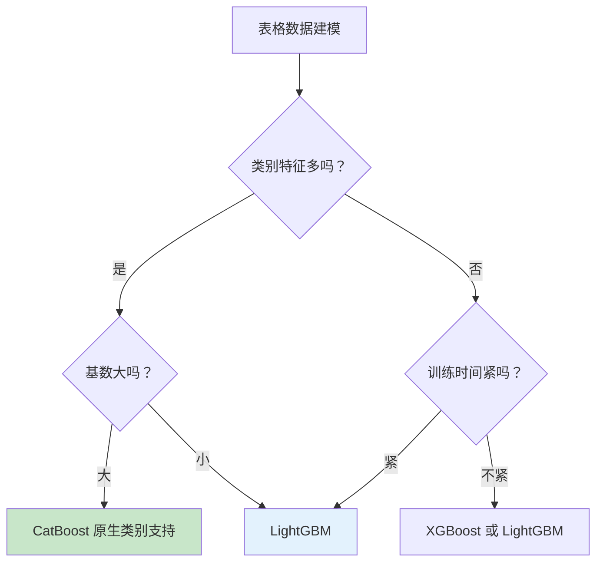

# 附录B：scikit-learn / XGBoost / LightGBM 速查

> 本附录是树模型与通用机器学习 API 的对照表。重点不是参数大全，而是回答**同一个动作在三个库里分别怎么写**。全书表格章的代码几乎都出自这里，先把这节看透，代码就不容易混。

先给一个决策直觉：sklearn 是"通用机器学习的语言"，XGBoost/LGBM/CatBoost 是"表格里最能打的三个梯度提升树实现"。它们共享 `fit/predict/predict_proba/score` 这套语言，所以换库不换语法，集成起来就简单。

---

## B.1 估计器 API 三件套

无论你用 sklearn 的随机森林还是 XGBoost，第一次接触一个新模型时，只需记这四个动作：

```python
from sklearn.ensemble import RandomForestClassifier

model = RandomForestClassifier(n_estimators=100, random_state=42)
model.fit(X_train, y_train)                  # 训练
pred = model.predict(X_test)                 # 预测类别（0/1）
pred_proba = model.predict_proba(X_test)[:, 1]  # 预测为正类的概率
score = model.score(X_test, y_test)          # 准确率（分类）/ R²（回归）
```

三件套要点：
- `fit`：给数据看，让模型学规律；
- `predict`：给新数据，让模型下结论；
- `predict_proba`：输出每个样本属于各类别的概率，是 AUC/LogLoss 的基础；
- `random_state`：固定随机种子，让"这次运行"和"下次运行"结果一致，**竞赛里必须固定**，否则你改了代码分数涨了，不知道是不是因为随机种子换了。

`n_jobs` 是另一个要写的参数：它控制用几个 CPU 核并行。设成 `-1` 代表用尽所有核，训练更快；但在 Kaggle Notebook 里有时会因为核心争用变慢，不确定时先设 `1` 跑通，再改。

**什么时候会用到**：每次 new 一个模型都要写这四行，是表格代码最固定的模板。

---

## B.2 预处理：缩放、编码、缺失值

树模型对缩放不敏感，但特征工程里还是要会几个常用工具。

```python
from sklearn.preprocessing import StandardScaler, MinMaxScaler, RobustScaler, OneHotEncoder, OrdinalEncoder, SimpleImputer
from sklearn.compose import ColumnTransformer
from sklearn.pipeline import Pipeline

# ---- 缩放（数值特征） ----
ss = StandardScaler()              # 0 均值、1 标准差，最常用
mm = MinMaxScaler()                # 缩到 [0,1] 区间
rs = RobustScaler()                # 用中位数和四分位间距，对异常值不敏感
X_num_scaled = ss.fit_transform(X_train[["age", "income"]])

# ---- 编码（类别特征） ----
ohe = OneHotEncoder(handle_unknown="ignore")  # 独热编码，未见类别直接忽略
oe = OrdinalEncoder()                        # 序数编码，0/1/2...

# ---- 缺失值 ----
imp = SimpleImputer(strategy="median")       # 用中位数填：mean / median / most_frequent / constant
X_num_imputed = imp.fit_transform(X_train[["age"]])
```

**预处理最重要的铁律：只在训练折上 `fit`，验证集/测试集只用 `transform`。** 如果你在验证集上重新 fit，缺失值的均值、缩放的均值标准差都会泄露验证信息，CV 分数就会虚高。这是目标泄漏最隐蔽的一种。

**什么时候会用到**：数值特征放进对灵敏模型（神经网络、逻辑回归）前；类别特征放进不原生支持类别的模型（XGBoost）前；任何填补缺失之前。

---

## B.3 交叉验证与网格搜索

```python
from sklearn.model_selection import KFold, StratifiedKFold, GroupKFold, TimeSeriesSplit
from sklearn.model_selection import cross_val_score, cross_val_predict
from sklearn.model_selection import GridSearchCV, RandomizedSearchCV

# ---- 切分方式（按任务类型选） ----
kf = KFold(n_splits=5, shuffle=True, random_state=42)                    # 随机切分，i.i.d 数据可用
skf = StratifiedKFold(n_splits=5, shuffle=True, random_state=42)         # 二分类/多分类：保持类别比例
gkf = GroupKFold(n_splits=5)                                             # 同组样本不跨折（贴纸销量按商店+产品）
tscv = TimeSeriesSplit(n_splits=5)                                       # 时序：只能过去预测未来

# ---- 模型评估 ----
scores = cross_val_score(model, X, y, cv=skf, scoring="roc_auc")
oof = cross_val_predict(model, X, y, cv=skf, method="predict_proba")[:, 1]  # 出 OOF 概率

# ---- 超参数搜索 ----
param_grid = {"max_depth": [3, 5, 7], "learning_rate": [0.01, 0.1]}
gs = GridSearchCV(model, param_grid, cv=5, scoring="roc_auc", n_jobs=-1)
gs.fit(X_train, y_train)
print(gs.best_params_, gs.best_score_)
```

切分方式怎么选，有一张对照表更直观：

| 数据特征 | 推荐切分 | 原因 |
|----------|---------|------|
| i.i.d 表格，回归 | `KFold` | 没有时间/组结构，随机切最稳 |
| i.i.d 表格，分类（类别不平衡） | `StratifiedKFold` | 每折正负例比例保持一致，方差小 |
| 有组结构（用户/商店/产品） | `GroupKFold` | 同组样本不能跨折，否则泄漏 |
| 时序数据 | `TimeSeriesSplit` | 严格按时间，不能随机 |

`cross_val_score` 只能算分数，`cross_val_predict` 才能"出预测"——做 OOF（折外预测）必须用后者，指定 `method="predict_proba"` 取概率列，存进 `train_oof_[MODEL]_[VERSION].npy` 才是合规工件。

网格搜索（`GridSearchCV`）穷举所有组合，慢但稳；`RandomizedSearchCV` 随机采样，快且大多够用。竞赛里时间紧，通常先随机搜索定大方向，再网格搜索细调。

**什么时候会用到**：评估一个新模型、选超参、出合规的 OOF 工件。所有章的基线都离不开这套。

---

## B.4 管道与列变换

手动对每列做缩放/编码，很容易漏掉一列、写错顺序，而且预处理的参数（比如 `StandardScaler` 的均值标准差）要随数据一起保存。`Pipeline` 和 `ColumnTransformer` 解决这个问题。

```python
from sklearn.compose import ColumnTransformer
from sklearn.pipeline import Pipeline

num_cols = ["age", "income"]
cat_cols = ["city", "gender"]

preprocess = ColumnTransformer([
    ("num", StandardScaler(), num_cols),
    ("cat", OneHotEncoder(handle_unknown="ignore"), cat_cols),
])

pipe = Pipeline([
    ("preprocess", preprocess),
    ("model", RandomForestClassifier(n_estimators=100, random_state=42)),
])

pipe.fit(X_train, y_train)   # 预处理 + 模型，一次 fit 完成
pipe.predict(X_test)         # 预测时自动套同样的预处理
```

`Pipeline` 把"预处理 → 模型"串成一条流水线，`fit` 时自动按顺序执行，`predict` 时也自动套同样的预处理。关键好处：**预处理的参数是随模型一起保存的**，部署时不会出现"训练缩小了 0~1，线上却缩小了 0~100"这种错位。

`ColumnTransformer` 解决"不同列用不同处理"：数值列缩放，类别列独热，两者分开算再拼回一起。

**什么时候会用到**：需要把多列特征分别处理、部署时要保证训练/预测预处理一致、模型要交给别人复现。

---

## B.5 评估指标速查

指标是"人不可让渡的判断"的第一项。下面给常用公式和可运行的代码：

```python
from sklearn.metrics import (roc_auc_score, log_loss, f1_score,
                             accuracy_score, mean_squared_error,
                             mean_absolute_error, average_precision_score)

# 分类
auc = roc_auc_score(y_true, y_proba)          # 排序能力，越接近 1 越好
ll = log_loss(y_true, y_proba)                # 对概率敏感，越小越好
f1 = f1_score(y_true, y_pred)                 # 精确率和召回率的调和平均
acc = accuracy_score(y_true, y_pred)          # 准确率，不平衡数据慎用

# 回归
rmse = mean_squared_error(y_true, y_pred, squared=False)  # 对异常值敏感
mae = mean_absolute_error(y_true, y_pred)           # 对异常值相对稳
rmsle = np.sqrt(mean_squared_error(np.log1p(y_true), np.log1p(y_pred)))  # 对比例误差敏感

# 排序/多标签
mapk = average_precision_score(y_true, y_proba)   # 适用于排序场景
```

指标选表（按任务类型）：

| 任务 | 推荐主指标 | 辅助指标 | 注意 |
|------|-----------|---------|------|
| 二分类 | AUC | LogLoss | AUC 不敏感概率校准，LogLoss 敏感 |
| 二分类（不平衡） | F1 | AUC | Accuracy 在不平衡下会骗你 |
| 回归 | RMSE | MAE / RMSPE | RMSE 对极端值敏感 |
| 排序 | MAP / NDCG | — | 多标签用列平均 AUC |

**什么时候会用到**：选比赛、跑基线、提交前自检。至于"Agent 容易在哪个指标上骗你"，见附录 G 的 G.5。

---

## B.6 XGBoost 核心参数与早停

```python
from xgboost import XGBRegressor, XGBClassifier

xgb = XGBRegressor(
    n_estimators=1000,          # 最多棵树，配合 early stopping
    max_depth=6,                # 树深，控制拟合能力
    learning_rate=0.05,         # 学习率，越小越稳，需更多树
    subsample=0.8,              # 每棵树用多少比例的行，防过拟合
    colsample_bytree=0.8,       # 每棵树用多少比例的列，加速且防过拟合
    reg_lambda=1.0,             # L2 正则化
    random_state=42,
    n_jobs=-1,
    tree_method="hist",         # 直方图算法，快且省内存
)

xgb.fit(X_train, y_train,
        eval_set=[(X_val, y_val)],
        early_stopping_rounds=50,   # 验证集分数 50 轮不升就停
        verbose=False)
```

早停是 XGBoost 的"减压阀"：`eval_set` 给一份验证数据，`early_stopping_rounds` 说"验证集分数 50 轮不提升就收手"。这样`n_estimators` 设大一点也没关系，模型会自动停在最佳点。

**什么时候会用到**：表格回归/分类的默认首选模型之一，尤其当你有验证集且不想手动调树数时。

---

## B.7 LightGBM 核心参数与类别特征

```python
from lightgbm import LGBMClassifier

lgb = LGBMClassifier(
    n_estimators=1000,
    num_leaves=31,              # 叶子数，控制复杂度，比 max_depth 更直接
    max_depth=-1,               # -1 表示不限制深度，靠 num_leaves 控
    learning_rate=0.05,
    subsample=0.8,              # 行采样
    colsample_bytree=0.8,       # 列采样
    min_child_samples=20,       # 叶子最少样本数，防过拟合
    random_state=42,
    n_jobs=-1,
)

# 类别特征：LightGBM 原生支持，直接传列名
lgb.fit(X_train, y_train,
        categorical_feature=["city", "gender"],
        eval_set=[(X_val, y_val)],
        callbacks=[lgb.early_stopping(50)])
```

LightGBM 的树生长是"按叶生长"（leaf-wise），容易快也容易过拟合，所以 `num_leaves` 和 `min_child_samples` 是防过拟合的两个主要杠杆。它最大的杀手锏是**原生支持类别特征**：把类别列名传给 `categorical_feature`，内部自动处理，不用手动独热。

**什么时候会用到**：大规模表格、类别特征多、训练时间紧——LightGBM 通常是三大模型里训练最快的。

---

## B.8 CatBoost 与 GPU 加速要点

```python
from catboost import CatBoostClassifier

cb = CatBoostClassifier(
    iterations=1000,
    depth=6,
    learning_rate=0.05,
    l2_leaf_reg=3.0,
    random_state=42,
    task_type="GPU",            # 用 GPU，CPU 用 "CPU"
    devices="0",
    verbose=50,
)

cb.fit(X_train, y_train,
       cat_features=["city", "gender"],  # 原生类别特征支持
       eval_set=(X_val, y_val),
       early_stopping_rounds=50,
       verbose=False)
```

CatBoost 的两个杀手锏：**原生类别特征支持**（`cat_features`，自动编码 + 自动特征组合）和**对称树**（默认生长结构更规整，减少过拟合）。代价是训练速度通常慢于 LightGBM，尤其大数据时。

它的类别处理在类别基数大（比如用户 ID、商品 ID）时尤其有效，很多表格赛的冠军解法里都有 CatBoost。

**什么时候会用到**：类别特征多且基数大、不想花时间手动编码、愿意牺牲一点训练时间换精度。

---

## B.9 三者怎么选



三大模型在表格赛里的地位可以总结成一张对照表：

| 维度 | XGBoost | LightGBM | CatBoost |
|------|---------|----------|----------|
| 树生长 | 按层（稳） | 按叶（快、易过拟合） | 对称树 |
| 类别特征 | 不支持，需手动编码 | `categorical_feature` | `cat_features` 原生最强 |
| 训练速度 | 中等 | 最快 | 较慢 |
| 精度 | 高 | 高 | 类别特征多时常更高 |
| GPU | 支持 | 支持 | 支持，且类别处理更省显存 |

**怎么选**：先跑 LightGBM 当基线（快、参数少）；如果类别特征很多，加一份 CatBoost；如果需要最稳的基准，加 XGBoost。三者误差模式不同，放一起做集成（stacking）效果通常比单模型好。

**什么时候会用到**：每一章选主力模型、做集成时都会翻这张表。

调参时最常撞上的就是早停不生效，可以这样问：

```
我用 XGBRegressor 加了 early_stopping_rounds=50，但模型还是跑满了
n_estimators，早停好像没生效。帮我列可能原因，不要改我的代码。
```

模型会这样答：

```
> （思考过程）早停不生效最常见就三种：eval_set 没传、fit 里没把
> early_stopping_rounds 传进去（新版 XGBoost 要放 fit 参数里）、
> 或者验证集上分数一直在涨。按可能性排序，给排查动作。

按可能性从高到低：

1. **`eval_set` 没传或传错了**：早停必须有验证数据，没有它无从判断。
   检查 `fit(..., eval_set=[(X_val, y_val)])` 是否真的传了。
2. **参数传错位置**：新版 XGBoost 的 `early_stopping_rounds` 要放在
   `fit()` 里，不是构造函数里。放错位置会被静默忽略。
3. **验证集分数一直在涨**：那说明模型还没到头，跑满 `n_estimators`
   是正确行为，不是 bug。看 `evals_result()` 里的分数曲线确认。
4. **`eval_metric` 与你的目标不一致**：比如回归却用 `auc`，分数不动。

先看第 1、2 条，九成问题在这。
```

---

## 小结

这一节是全书表格代码的底座：

- sklearn 的 `fit/predict/predict_proba` 是通用语法；
- `StandardScaler` / `OneHotEncoder` / `SimpleImputer` 是预处理三件套，**只在训练折 fit**；
- `StratifiedKFold` / `GroupKFold` / `TimeSeriesSplit` 是验证切分，**选错就泄漏**；
- XGBoost / LightGBM / CatBoost 是三大树模型，选型看"类别特征多不多、基数大不大、时间紧不紧"。

不需要一次记住参数，用到时回来查。下一个附录是 AutoGluon——全书表格章的"自动基线"主力。