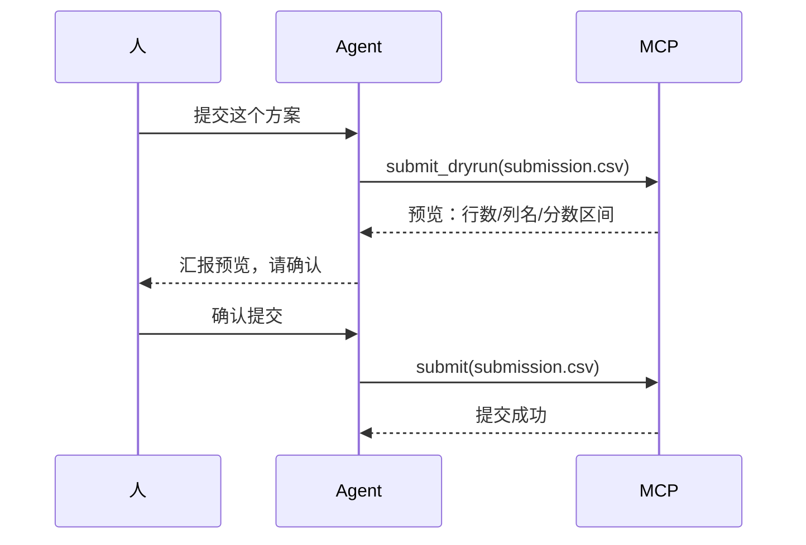

# 附录F：Kaggle MCP 配置与安全实践

> 本附录是全书安全边界的落地页。定位只有一条：**让 Agent 能持续操作平台（下载 → EDA → 训练 → 落盘 → 提交预演），同时把"不可逆"关在笼子里。** MCP 让 Agent 有了"手和脚"，但护栏决定了这双手是帮手还是祸害。

---

## F.1 MCP 是什么、解决什么问题

MCP（Model Context Protocol，模型上下文协议）你可以理解成 **Agent 的"手和脚"**。

没有 MCP，Agent 只能跟你聊天、写代码——它写得再好，也得你手动复制粘贴去跑。有了 MCP，Agent 能真正去下载数据、跑训练、存工件、提交比赛，一条流水线全包。

但"全包"是把双刃剑：Agent 能一键提交，也能一键删库。所以 MCP 的核心不是"能做什么"，而是**"安全地能做什么"**。这也是为什么本附录把"安全实践"和"配置"放在同等位置。

**什么时候会用到**：你想让 Agent 端到端跑完一场比赛的流水线，而不是只做"代码生成器"。

---

## F.2 安装与配置

MCP 的配置一般写在项目的 MCP 配置文件里（比如 `.mcp.json`），声明要启动哪些 MCP server、用什么命令启动。

```json
{
  "mcpServers": {
    "kaggle": {
      "command": "uvx",
      "args": ["kaggle-mcp-server"],
      "env": {
        "KAGGLE_USERNAME": "<你的用户名>",
        "KAGGLE_KEY": "<你的 API Key>"
      }
    }
  }
}
```

配置完之后，**第一步不要急着让 Agent 干活，先做连通性自检**：让它调用一个只读工具（比如 `list_experiments` 或 `read_data`），确认能通。只读的连通性没问题，再逐步放开写操作。

社区里还有一类"MCP 安全网关"（比如 `agentsec-gateway` 这种），它在 MCP server 前面加一层代理，做实时扫描、审计日志和策略执行——所有 MCP 流量都先过网关再转发。对生产环境或多人协作，这层网关值得考虑。

**什么时候会用到**：第一次接入 MCP、换机器、换环境时。

---

## F.3 工具清单与权限白名单

MCP 暴露给 Agent 的工具，应该按"读 / 写 / 提交"分层，用白名单控制：

| 层级 | 工具 | 说明 |
|------|------|------|
| 只读 | `read_data` / `list_experiments` / `compute_oof_corr` | 不改任何东西，随便调 |
| 写工件 | `write_artifact` / `train_model` / `predict` | 产出工件，可覆盖需谨慎 |
| 提交 | `submit_dryrun` / `submit` | `submit` 必须人批准 |
| 禁止 | `shell_exec` / `rm` / `wget` | 任意命令执行，默认关 |

白名单的意义是"划圈子"：Agent 只能在圈里跑，圈外的工具它根本调不到。`forbidden_tools` 里必须有 `shell_exec`——一旦放开，Agent 就能执行任意命令，护栏形同虚设。

**什么时候会用到**：给 Agent 配置权限时；审计"Agent 到底能做什么"时。

---

## F.4 预览-确认双调用与提交预算

这是全书最重要的一条护栏：**所有写操作默认 `dry_run=true`，人确认后才 `false`。**



提交预算是第二道闸：`daily_submit_limit` 限制每天真提交次数。这个数字不是随便定的——正式赛每个团队每天大约 5 次，Playground 系列给到 9 次左右，计数器在 GMT 午夜重置。所以 `daily_limit: 3` 这种保守设定是合理的：它保证 Agent 就算全力跑，也吃不掉你一整天的额度。

**什么时候会用到**：每次 Agent 要提交时；给 Agent 配置 `agent_policy.yaml` 时。

---

## F.5 审计日志与不可逆操作

审计日志（比如 `mcp_audit.jsonl`）记录每一次 MCP 调用：谁调的、调了什么、参数是什么、结果如何。它的价值在事后追溯——当分数莫名其妙掉了、工件莫名其妙少了，你能查到"Agent 到底动了什么"。

不可逆操作（删除、覆盖、真提交）默认关闭（`allow_destructive: false`），要人显式打开。这一条和 F.4 的预览-确认是配套的：**预览-确认防"误提交"，默认关闭防"误删除"。**

**什么时候会用到**：出事后排查；给 Agent 开权限时；团队多人协作时。

---

## F.6 常见故障排查

| 现象 | 可能原因 | 处理 |
|------|---------|------|
| 下载失败 | 门控权重未同意 / 网络 | 先去 Hugging Face 同意许可；检查网络 |
| 提交被拒 | 格式错 / 额度用完 | 跑格式自检；看 `daily_submit_limit` |
| 工件写不进去 | 路径不存在 / 权限 | 先建目录；检查磁盘权限 |
| 训练超时 | `time_limit` 太小 / 平台时限 | 调大 `time_limit`；用 `fast` preset 探路 |
| Agent 调不到工具 | 白名单没放开 | 检查 `allowed_tools` 配置 |

排查顺序建议：**先只读、再写、最后提交**——每一步都确认通了，再放开下一步。

**什么时候会用到**：MCP 流水线跑不通时，按这张表逐项排查。

提交前最容易含糊的是"到底要不要交"，可以这样问：

> **提示词**：我今天还有 2 次提交额度。候选 A CV 比上次高 0.0004，B 引入了新模型家族但 CV 低一点。哪个更值得交？别替我提交。

模型会这样答：

> **AI 输出**
>
> （思考过程）用户要"判断依据"，不要替提交。核心逻辑是"提交是
> 买信息"，A 是"买噪声"，B 是"买探索"。最后留决定权给用户，并
> 明确说可以不交。
>
> 核心逻辑：**提交是买信息。**
>
> - A（+0.0004，与上次高度相似）：信息量低，大概率是噪声，花额度
>   去确认一个"几乎确定"的结果，性价比差。
> - B（略低但新家族）：信息量高，能验证"这个家族在 LB 上表现如何"，
>   即使 LB 略低，也买到了"这个方向行不行"的答案。
>
> 另外：**不提交也是一种决策**，常常是更好的决策。留额度给明天
> 更有把握的方向。
>
> 决定权在你，我没有执行提交。

---

## 小结

MCP 让 Agent 从"代码生成器"变成"流水线工人"，但护栏决定了它是帮手还是祸害：

- MCP 是 Agent 的"手和脚"，配置后先做只读连通性自检；
- 工具按"读 / 写 / 提交"分层，白名单划圈，`shell_exec` 默认关；
- 预览-确认双调用 + 每日提交预算，是防误提交的两道闸；
- 审计日志 + 不可逆操作默认关，是防误删除和事后追溯的两道闸。

下一个附录是评估指标速查——全书"人不可让渡的判断"的第一项。