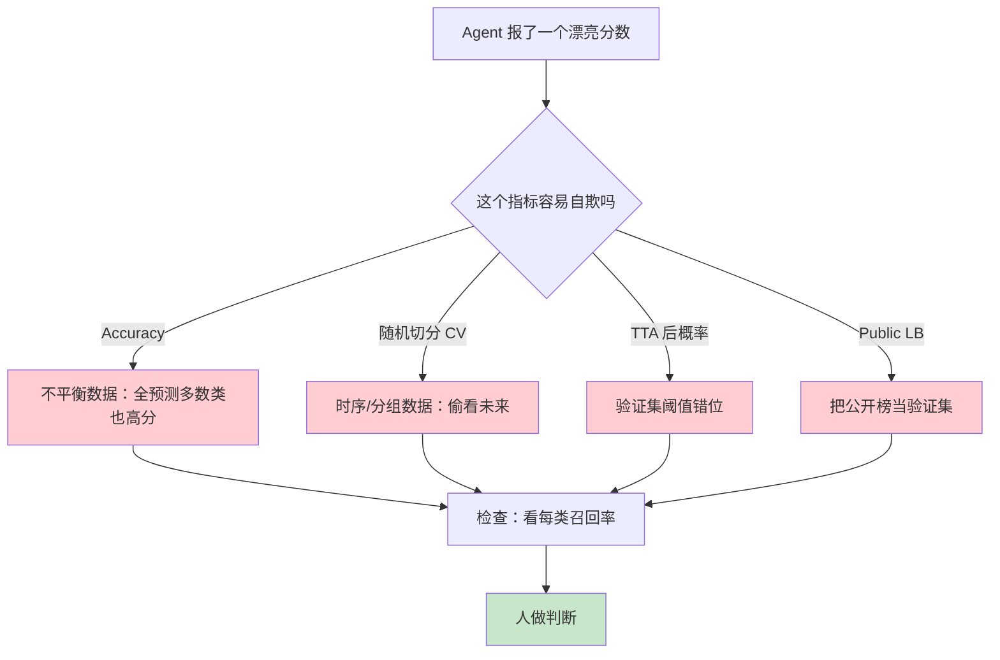

# 附录G：Kaggle 评估指标速查（含“Agent 容易在哪个指标上骗你”的提示）

> 本附录是"人不可让渡的判断"的第一项。它既给公式，也给**"这个指标在什么情况下会骗你"**。指标选错，后面所有努力都白费——所以这一节值得反复翻。

先给一句总纲：**指标决定"优化什么"，验证决定"分数可不可信"。** 两者都是人定的，Agent 只能在既定标准下跑。

---

## G.1 回归指标

```python
import numpy as np
from sklearn.metrics import mean_squared_error, mean_absolute_error

# RMSE：均方根误差，对异常值敏感
rmse = mean_squared_error(y_true, y_pred, squared=False)

# MAE：平均绝对误差，对异常值相对稳
mae = mean_absolute_error(y_true, y_pred)

# RMSLE：对数均方根误差，对"比例误差"敏感（预测 100 实际 110 和预测 10 实际 11 同等惩罚）
rmsle = np.sqrt(mean_squared_error(np.log1p(y_true), np.log1p(y_pred)))

# RMSPE：均方根百分比误差
rmspe = np.sqrt(np.mean(((y_true - y_pred) / y_true) ** 2)) * 100

# MAPE：平均绝对百分比误差（真实值接近 0 时会爆炸）
mape = np.mean(np.abs((y_true - y_pred) / y_true)) * 100
```

| 指标 | 对异常值 | 对比例误差 | 典型场景 |
|------|---------|-----------|---------|
| RMSE | 敏感（平方放大） | 不敏感 | 房价、销量，异常值有意义 |
| MAE | 相对稳 | 不敏感 | 异常值多、想要稳健 |
| RMSLE | 较敏感 | 敏感 | 对数正态分布、比例更重要 |
| RMSPE / MAPE | 敏感 | 敏感 | 销量预测、真实值远离 0 |

**MAPE 的坑**：真实值接近 0 时，分母趋近 0，误差会被放大到无穷大。所以真实值里有 0 或接近 0 的样本时，MAPE 会失真，要兜底（比如分母加一个小常数）或换指标。

**什么时候会用到**：回归赛选指标、跑基线、提交前自检。

---

## G.2 分类指标

```python
from sklearn.metrics import roc_auc_score, log_loss, f1_score, accuracy_score

# AUC：排序能力，随机抽一正一负，正样本排在负样本前面的概率
auc = roc_auc_score(y_true, y_proba)

# LogLoss：对概率敏感，概率错得越离谱罚得越狠
ll = log_loss(y_true, y_proba)

# F1：精确率和召回率的调和平均
f1 = f1_score(y_true, y_pred)

# Accuracy：准确率（不平衡数据下会骗你）
acc = accuracy_score(y_true, y_pred)
```

| 指标 | 需要概率吗 | 对不平衡 | 典型场景 |
|------|-----------|---------|---------|
| AUC | 是 | 相对稳 | 二分类默认首选 |
| LogLoss | 是 | 敏感 | 需要校准概率、概率质量重要 |
| F1 | 否（需阈值） | 较稳 | 关注少数类、需要定阈值 |
| Accuracy | 否 | **会骗你** | 类别平衡时才可靠 |

**Accuracy 的坑**：如果正类只占 1%，模型全预测负类也有 99% 准确率，但一个正例都没抓到。所以不平衡数据下，别用 Accuracy 当主指标。

**什么时候会用到**：分类赛选指标、评估基线、判断"要不要调阈值"。

---

## G.3 排序与多标签指标

```python
from sklearn.metrics import average_precision_score, ndcg_score

# MAP / Average Precision：排序场景，关注"排在前面的正例多不多"
ap = average_precision_score(y_true, y_proba)

# NDCG：折损累计增益，考虑位置权重（排第 1 和第 10 的贡献不同）
ndcg = ndcg_score([y_true], [y_proba])
```

多标签任务（每行有多个标签）常用**列平均 AUC**（macro AUC）：每个标签单独算 AUC，再平均。它的坑是"稀有类别被平均稀释"——一个只在 1% 样本里出现的标签，算出来的 AUC 波动很大，平均之后可能看不出来。所以多标签任务要**逐标签看**，不能只看平均。

**什么时候会用到**：排序赛、推荐、多标签分类（如 RSNA Knee 的 12 类异常）。

---

## G.4 加权与自定义指标怎么读

有些比赛用**加权指标**（比如加权 MAE、加权 R²），权重里同时考虑了"数值范围"和"标签数量"：

- 数值范围大的目标，除以范围，免得它一家独大；
- 标签数量少的目标，给更高权重，补偿不平衡。

读不懂权重就先别调模型——**指标怎么加权，你的模型就该往哪儿使劲**。这比闷头调参有用得多。一个真实例子：NeurIPS Open Polymer 2025 的官方指标就是加权 MAE，权重里对"标签少的目标"做了根号倒数补偿，你不理解这个设计，就会把精力全砸在标签最多的那个目标上。

**什么时候会用到**：遇到自定义/加权指标时，先读官方说明，再决定优化方向。

---

## G.5 Agent 容易在哪个指标上骗你



四种最常见的"指标自欺"：

1. **用 Accuracy 掩盖不平衡**：正类 1% 时全预测负类也 99%。检查动作：看每类的召回率 / F1。
2. **用随机切分抬高 CV**：时序/分组数据随机切会偷看未来。检查动作：看折索引是否符合时间/分组约束。
3. **用 TTA 后概率套验证集阈值**：TTA 会改变概率分布，验证集阈值和提交概率口径不一致。检查动作：验证和提交用同一种概率。
4. **把 Public LB 当验证集**：反复刷公开榜，过拟合那 30% 的小样本。检查动作：看 CV 与 LB 的相关性，相关性低就别信 LB。

**什么时候会用到**：每次 Agent 报分数时，先对照这张图问一句"这个分数可信吗"。

---

## G.6 指标与验证方案的搭配表

| 指标类型 | 数据分布 | 时间性 | 推荐验证切分 |
|----------|---------|--------|-------------|
| AUC / LogLoss | i.i.d 分类 | 无 | `StratifiedKFold` |
| RMSE / MAE | i.i.d 回归 | 无 | `KFold` |
| 任意 | 有组结构 | 无 | `GroupKFold` |
| 任意 | 时序 | 有 | `TimeSeriesSplit`（过去预测未来） |
| 任意 | 分布漂移 | 有 | 对抗验证 + 时间切分 |

这张表是"指标 × 切分"的速查：**先定指标（人定），再定切分（人定），最后让 Agent 在固定协议下跑。**

**什么时候会用到**：每场比赛开赛时，先查这张表定下指标和验证方案，再让 Agent 开工。

指标之间打架时最该问模型，比如：

```
我的模型 AUC 0.85 看着不错，但 LogLoss 0.62 很差。这说明什么？
该往哪个方向优化？只给判断，不要改代码。
```

模型会这样答：

```
> （思考过程）AUC 高但 LogLoss 差，典型是"排序对、概率不准"。
> 核心是校准问题。给方向：校准 / 概率质量，而不是继续调排序。

说明：**排序能力还行，但概率不准。**

AUC 只看"谁排前面"，LogLoss 还看"概率数值对不对"。两者背离，
通常是概率校准出了问题——模型把 0.9 的样本预测成 0.7，排序没变，
但概率偏了。

优化方向（按性价比排序）：

1. **概率校准**：Isotonic Regression / Platt scaling，最便宜；
2. **检查标签是否被平滑/裁剪**：有些比赛的标签做过处理；
3. **换损失函数**：如果你一直在优化 AUC 相关的代理损失，换成
   直接优化 LogLoss。

不要继续调排序——那已经是强项了。
```

---

## 小结

指标是全书"人不可让渡的判断"的第一项：

- 回归看 RMSE / MAE / RMSLE / MAPE，注意异常值和真实值接近 0 的坑；
- 分类看 AUC / LogLoss / F1，Accuracy 在不平衡下会骗你；
- 排序/多标签看 MAP / NDCG / 列平均 AUC，稀有类别要逐标签看；
- 加权指标先读官方说明，别瞎调；
- **Agent 最容易在 Accuracy、随机切分、TTA 概率、Public LB 这四处骗你**，对照 G.5 逐项检查。

最后一个附录是工件管理与实验日志规范——全书"可组合、可追溯、可审计"的完整落地版。