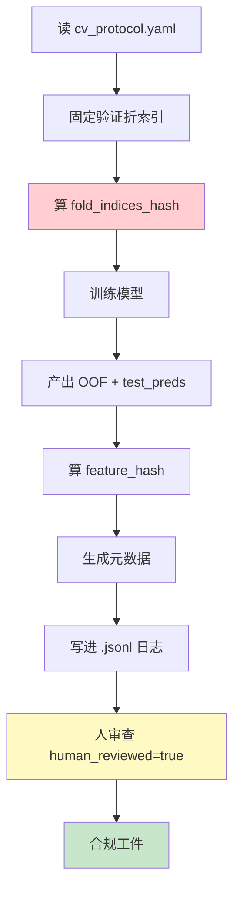

# 附录H：工件管理与实验日志规范（完整版）

> 本附录是第 2 章工件规范的完整落地版，也是全书的收束。定位只有一句：**把"可组合、可追溯、可审计"这三件事的全部细节写清楚。** 没有这套规范，Agent 的高吞吐只会制造混乱；有了它，850 个实验才能变成冠军的零件库。

---

## H.1 目录结构（完整版）

全书统一的目录树如下，建议从第一个实验就照这个建：

```
<project_root>/
├── artifacts/                    # 所有工件的根目录（建议加进 .gitignore，或用 DVC 管理）
│   ├── oof/                      # 折外预测，形状 (n_train,)
│   │   └── train_oof_[模型]_[版本].npy
│   ├── test_preds/               # 测试集预测，形状 (n_test,)
│   │   └── test_preds_[模型]_[版本].npy
│   ├── logs/                     # 实验日志，JSON Lines，一行一个实验
│   │   └── exp_[模型]_[版本].jsonl
│   ├── configs/                  # 配置快照，YAML，方便人看
│   │   └── cfg_[模型]_[版本].yaml
│   ├── submissions/              # 生成的提交文件备份
│   │   └── submission_[模型]_[版本].csv
│   └── ensembles/                # 集成产出的工件
│       ├── oof_ensemble_[名字]_[版本].npy
│       └── test_ensemble_[名字]_[版本].npy
├── data/                         # 原始数据（只读，别改）
├── src/                          # 可复用源码（utils / baselines / features / models / ensembles）
├── configs/                      # 项目级配置（rules.yaml / cv_protocol.yaml / agent_policy.yaml）
├── notebooks/                    # 探索性笔记本（不产出正式工件）
└── scripts/                      # 一次性脚本
```

为什么 `artifacts/` 要进 `.gitignore` 或用 DVC：工件文件可能很大（几百 MB 到几 GB），塞进 Git 仓库会让仓库爆炸。用 DVC / MLflow 这类工具管理大文件，Git 只管代码和配置。

**什么时候会用到**：建项目时；每章"第 1 章搭工地"之后的所有实验。

---

## H.2 命名约定与版本号规则

命名是"可组合"的前提。文件名里必须能一眼看出"这是什么模型、第几版"：

| 要素 | 格式 | 例子 |
|------|------|------|
| 模型标识 | 大写字母 + 下划线 | `AUTOGLUON` / `LGBM` / `XGB` / `TABPFN` / `NN` |
| 版本号 | `v` + 三位数字 | `v001` / `v012` / `v100` |
| 任务后缀 | 可选 | `_cls` / `_reg` |

完整文件名：

- OOF：`train_oof_{模型}_{版本}.npy`
- 测试预测：`test_preds_{模型}_{版本}.npy`
- 日志：`exp_{模型}_{版本}.jsonl`
- 配置：`cfg_{模型}_{版本}.yaml`
- 提交：`submission_{模型}_{版本}.csv`
- 集成 OOF：`oof_ensemble_{名字}_{版本}.npy`

版本号严格递增、三位数字，排序不会乱（`v009` < `v010` < `v100`）。**不要出现 `final_v7_really_final.csv` 这种命名**——社区里流传的这类"命名混乱"轶事，就是工件管理失败的典型症状。

**什么时候会用到**：每次产出工件时；写脚本批量读取工件时（命名规范让批量读取不用写正则去猜）。

---

## H.3 元数据 Schema（完整字段）

每个实验跑完，日志里必须记清楚"这次实验到底是怎么回事"。用 Pydantic 定义一个"身份证"模板，强制填满：

```python
from pydantic import BaseModel, Field
from typing import List, Optional, Literal
from datetime import datetime

class ArtifactMetadata(BaseModel):
    # ---- 身份 ----
    model: str                    # 模型标识，如 "AUTOGLUON"
    version: str                  # 版本，如 "v001"
    task_type: Literal["binary", "multiclass", "regression", "ranking"]

    # ---- 验证协议（最关键，防作弊） ----
    cv_scheme: str                # 验证方案描述，如 "StratifiedKFold_5_42"
    cv_fold_indices_hash: str     # 验证折索引的哈希，确保协议没被偷偷改

    # ---- 性能 ----
    cv_scores: List[float]        # 每一折的分数
    cv_mean: float                # 平均分
    cv_std: float                 # 标准差（衡量稳定性）
    metric: str                   # 指标名，如 "auc"

    # ---- 工件路径 ----
    oof_path: str
    test_path: str
    submission_path: Optional[str] = None

    # ---- 数据血统 ----
    n_train: int
    n_test: int
    feature_hash: str             # 特征矩阵的哈希
    preprocessing_hash: str       # 预处理管线的哈希

    # ---- 变更描述 ----
    change_desc: str              # 一句话说清这次改了什么

    # ---- 时间与来源 ----
    created_at: datetime = Field(default_factory=datetime.utcnow)
    agent_model: Optional[str] = None   # 哪个 Agent 干的
    human_reviewed: bool = False        # 人审过了没
```

最不显眼但最重要的字段是 `cv_fold_indices_hash`——它是验证折索引的哈希值。有了它，事后能检查"Agent 有没有偷偷换验证方案"（见 H.5）。

**什么时候会用到**：每个实验结束时；写日志、做审计、判断是否可进集成时。

---

## H.4 JSON Lines 日志写入与读取

日志用 JSON Lines 格式：**一行一个实验**，追加写，不覆盖。

```python
import json
from pathlib import Path

def log_experiment(log_path, meta: dict):
    """追加一条实验记录到 JSON Lines 日志。"""
    with open(log_path, "a", encoding="utf-8") as f:
        f.write(json.dumps(meta, ensure_ascii=False) + "\n")

def read_experiments(log_dir, model=None):
    """读取日志，可按模型过滤。"""
    out = []
    for p in Path(log_dir).glob("exp_*.jsonl"):
        for line in open(p, encoding="utf-8"):
            line = line.strip()
            if not line:
                continue
            try:
                e = json.loads(line)
            except json.JSONDecodeError:
                continue          # 半行写入（进程被杀）容错跳过
            if model is None or e.get("model") == model:
                out.append(e)
    return out
```

两个要点：
- **追加写**（`"a"` 模式），不覆盖历史；
- **容错读**：进程被杀可能留下半行，`json.JSONDecodeError` 要跳过而不是崩掉。

**什么时候会用到**：每次实验结束写日志；做集成前筛选候选；审计时追溯历史。

---

## H.5 折索引哈希与验证协议校验

这是防作弊的锚点。做法：把验证折索引算一个哈希，存进元数据；之后扫描所有日志，比对哈希是否和当前协议一致。

```python
import hashlib
import json
from pathlib import Path
import numpy as np

def fold_indices_hash(splits):
    """把折索引拼成字符串，算 SHA256 哈希。"""
    h = hashlib.sha256()
    for tr, va in splits:
        h.update(np.asarray(tr).tobytes())
        h.update(np.asarray(va).tobytes())
    return h.hexdigest()

def audit_cv_consistency(log_dir, expected_hash):
    """扫描所有日志，找出验证协议不一致的实验。"""
    bad = []
    for p in Path(log_dir).glob("exp_*.jsonl"):
        for line in open(p, encoding="utf-8"):
            e = json.loads(line)
            if e.get("cv_fold_indices_hash") != expected_hash:
                bad.append((p.name, e["model"], e["version"], e.get("change_desc")))
    return bad
```

一旦发现哈希不一致，那个实验的工件**直接作废**——因为它的验证方式变了，分数不可比。这就是"验证污染"最硬的一道防线。

**什么时候会用到**：每次 Agent 跑完一批实验后；怀疑"分数涨了但不可信"时。

---

## H.6 工件清理、归档与版本管理

工件会越积越多，需要清理策略：

- **归档**：比赛结束或方向已定，把不再用的工件移到 `archive/` 子目录，不要直接删；
- **DVC / MLflow**：大文件用 DVC 管理（`dvc add` + `dvc push`），实验追踪用 MLflow（记录参数、指标、模型版本）；
- **清理前必须确认**：这个工件没有被任何集成引用。删之前先 `grep` 一下集成脚本里有没有引用它。

**什么时候会用到**：磁盘告急时；比赛结束收尾时；换方向决定弃用某批工件时。

---

## H.7 一次实验的完整检查清单

把一次实验从开始到"合规工件"拆成勾选项，任何一项没打勾就不算完成：



逐项清单：

1. 读了 `cv_protocol.yaml`，折数/分层/分组/时间切分与协议一致；
2. 折索引固定，算出了 `fold_indices_hash`；
3. 训练完成，OOF 和 test_preds 都落盘；
4. 特征矩阵算了 `feature_hash`，预处理管线算了 `preprocessing_hash`；
5. 元数据填满（H.3 全字段），写进 `.jsonl` 日志；
6. 人审查 CV 分数、OOF 质量、泄漏风险，`human_reviewed=true`；
7. 工件命名合规（H.2），版本号递增。

任何一项没打勾，这个实验就还只是"跑过了"，不是"合规工件"。

**什么时候会用到**：每次实验收尾；教 Agent 按规范产出工件时；团队 code review 时。

工件规范最容易被问的就是"这个文件名合规吗"，可以这样问：

```
我要检查一批工件文件名是否符合 train_oof_[模型]_[版本].npy 规范。
帮我写一个校验脚本，只检查文件名格式，不改文件。
```

模型会这样答：

```
> （思考过程）用户要脚本，只检查文件名格式，不改文件。用正则
> 做，返回合规/不合规列表，别有副作用。

import re
from pathlib import Path

PATTERN = re.compile(r"^(train_oof|test_preds|exp|cfg|submission)_([A-Z0-9_]+)_v(\d{3})\.(npy|jsonl|yaml|csv)$")

def check_artifact_names(dir_path):
    bad = []
    for p in Path(dir_path).iterdir():
        if not PATTERN.match(p.name):
            bad.append(p.name)
    return bad

# 返回不合规文件名列表，空列表表示全合规
```

这段脚本只读不写，你可以先跑在一份副本上，确认没问题后再用于正式目录。

---

## 小结

这套规范是全书"可组合、可追溯、可审计"的完整落地：

- 目录结构（H.1）+ 命名约定（H.2）让工件**可组合**；
- 元数据 Schema（H.3）+ JSON Lines 日志（H.4）让工件**可追溯**；
- 折索引哈希（H.5）+ 检查清单（H.7）让工件**可审计**；
- 归档与版本管理（H.6）让工件**可维护**。

**工件规范不是附录，而是 VibeKaggle 的物理基础。** 没有它，"人看 OOF 做判断"是空话，"Agent 自动做集成"无从谈起，"验证污染"也无从检查。

到这里，全书 23 章 + 8 个附录就全部结束了。回到第 1 章那句话：**VibeKaggle 的第一步不是写模型，而是搭工地。** 现在你手里有完整的工地图纸了——去跑你的第一个合规工件吧。