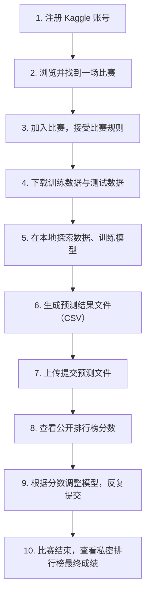

# 第1章 Kaggle 比赛流程与规则

本章带你从零开始，走一遍 Kaggle 竞赛的完整流程：注册账号、找比赛、加入比赛、下载数据、在本地训练一个简单模型、生成预测文件、提交到平台，最后查看排行榜分数。我们还会介绍 Kaggle 命令行工具（Kaggle CLI）和 Kaggle MCP 的基本配置，方便你以后在终端里直接下载数据与提交结果。

**本章受众**：假设你会一点点 Python，但从来没打过 Kaggle 比赛，不知道什么是“公开排行榜”“私密排行榜”，也没用过 Kaggle CLI。不需要任何机器学习背景，代码会一行一行地解释。

## 1.1 什么是 Kaggle

Kaggle 是全球最大的数据科学与机器学习社区，平台上经常举办各种奖金竞赛。公司或者研究机构会把一组数据和一个问题放上来（比如“根据房子的特征预测房价”“根据图片判断是不是猫”），参赛者下载数据、在本地建模、生成预测结果，再上传到平台打分。平台根据预测结果的好坏给出分数，所有人的分数排在一个排行榜上，分数高的排名靠前。

打 Kaggle 比赛和平时写作业最大的区别在于：**你拿到的训练数据里有“标准答案”（比如每栋房子的真实成交价），但平台最终打分用的测试数据里没有答案，答案被藏在了后台**。你提交预测文件后，平台拿你的预测和藏在后台的真实答案对比，算出分数。这也意味着，你不能只在训练数据上“背答案”，必须让模型真正学会规律，否则在测试数据上会得分很低。

为了方便你记忆，下面用一张流程图把整个比赛流程串起来：



## 1.2 注册 Kaggle 账号

打比赛的第一步是注册账号。打开浏览器，访问 https://www.kaggle.com/，页面右上角会有 "Sign in" 或者 "Register" 按钮。

Kaggle 提供两种常见的注册方式：

1. **用谷歌账号登录**：点击 "Sign in with Google"，如果你已经有谷歌邮箱（Gmail），这是最快的方式，几秒钟就能完成。
2. **用邮箱独立注册**：点击 "Register with Email"，填写用户名、密码、邮箱。注册完成后，Kaggle 会给你的邮箱发一封验证邮件，里面有一个 6 位数字的验证码，你需要在 6 小时内输入验证码才能激活账号。

国内用户注册时偶尔会遇到“人机验证”（reCAPTCHA）加载不出来的情况。这时候可以尝试：
- 换用 Chrome 或 Edge 浏览器；
- 开启无痕窗口再试一次；
- 如果还不行，可以借助能正常访问谷歌服务的网络环境完成验证。

激活账号后，Kaggle 会要求你绑定手机号并做一次短信验证。绑定成功后，你每周大约可以获得 30 小时的免费 GPU 算力和 20 小时的免费 TPU 算力，这在 Kaggle 云端 Notebook 里跑模型时非常有用。

注册完毕后，建议把个人资料（Profile）简单填完整，比如上传一张头像、写一句自我介绍。这不是强制的，但填得完整一些，在比赛讨论区提问时别人更愿意回应你。

## 1.3 找比赛，加入比赛，读规则

登录后，点击顶部导航栏的 "Competitions"，就能看到所有正在进行和最近结束的比赛。页面上方有筛选标签，比如 "Featured"（精选）、“Getting Started”（新手友好）、“Playground”（练习场）。**如果你是第一次打 Kaggle，强烈建议先从 "Getting Started" 类别里的入门比赛开始**，那些比赛数据简单，社区里的公开代码（Notebook）也多，很适合练手。

点进一场比赛的详情页，你会看到几个标签页：

- **Overview（概览）**：比赛的背景故事、奖金、截止日期、评分指标（比如用均方误差 MSE 还是对数损失 LogLoss 来打分）。
- **Data（数据）**：下载训练集 `train.csv`、测试集 `test.csv`，还有一个示例提交文件 `sample_submission.csv`，它告诉你提交文件长什么样。
- **Code（代码）**：社区里别人分享的公开 Notebook，可以直接复制到自己的账号里运行，是学习的好素材。
- **Discussion（讨论区）**：参赛者交流心得的地方，新手问题经常能在这里找到答案。
- **Leaderboard（排行榜）**：所有人的提交分数和排名。
- **Rules（规则）**：比赛的硬性规定，比如每天最多提交多少次、团队最多多少人、什么行为算作弊。**提交之前一定要把 Rules 过一眼**，不然可能白提交好几次。

找到一场感兴趣的比赛后，点击 "Join Competition" 按钮，系统会让你勾选接受比赛规则。勾选后，该比赛的数据才能下载，团队（Team）功能也会解锁。

**团队是可选的**。你可以一个人单打独斗，也可以和朋友组成一个团队，最多通常 5 人。组队后，团队里的成员共享排行榜名次，但不能共享代码文件（Kaggle 禁止不同账号之间提交完全一样的代码或预测文件，否则会被判定作弊）。

## 1.4 下载数据

加入比赛后，到 "Data" 标签页，你能看到 `train.csv`（带答案的训练数据）、`test.csv`（没有答案的测试数据，你要预测的就是这些行）和 `sample_submission.csv`（提交格式的示例）。

下载方式有两种：

1. **网页点击下载**：在浏览器里直接点文件名，下载 ZIP 压缩包，解压后得到 CSV 文件。适合偶尔下载一两次的场景。
2. **Kaggle CLI 命令行下载**：适合需要反复下载、或者在服务器/远程机器上工作的情况。下一节 1.8 会详细介绍 CLI 的安装和配置。

下载完成后，建议把文件放在一个专门的文件夹里，比如：

```
kaggle-first-competition/
├── train.csv
├── test.csv
└── sample_submission.csv
```

不要把训练数据和测试数据搞混了：**训练数据里有目标列（比如房价、是否违约），用来教模型；测试数据里没有目标列，用来让模型预测。**

## 1.5 在本地跑第一个基线模型

下载好数据后，我们先不要急着调超参数、搞复杂的特征，而是跑一个“最简单可用”的基线模型（Baseline）。基线模型的作用是：让整个“读数据 → 训练 → 预测 → 提交”的管线先跑通，得到了一个可以提交的分数，之后再在这个基础上慢慢优化。

下面这段代码使用一个**自己生成的小型示例数据**，所以你不需要下载真实的 Kaggle 比赛数据也能直接运行，看懂整个流程。代码里每一步都写了详细注释。

```python
# 第1章示例：从零生成数据、训练模型、生成 Kaggle 提交文件
# 适合完全没打过比赛的新手跑通一遍，代码本身不依赖任何 Kaggle 官方数据集

import os
import pandas as pd
import numpy as np
from sklearn.model_selection import train_test_split
from sklearn.linear_model import LogisticRegression
from sklearn.metrics import accuracy_score

# ---------------------------------------------------------
# 步骤 1：生成一份假的“比赛数据”
# 真实比赛中，这一步不需要你做，数据是 Kaggle 官方提供的。
# 这里只是为了让代码可以直接运行，你可以看到完整的流程。
# ---------------------------------------------------------
np.random.seed(42)
n_samples = 1000

# 假设有两个特征：特征 A 和特征 B，都是 0 到 10 之间的随机数
feature_a = np.random.uniform(0, 10, n_samples)
feature_b = np.random.uniform(0, 10, n_samples)

# 目标变量：用一个简单的规则生成，比如 A + B > 10 则标记为 1，否则为 0
# 加了一点随机噪声，让问题不至于太简单
noise = np.random.normal(0, 1.0, n_samples)
target = ((feature_a + feature_b + noise) > 10).astype(int)

# 把数据整理成 DataFrame，模仿 Kaggle 训练集 train.csv 的结构
train_df = pd.DataFrame({
    "Id": range(1, n_samples + 1),
    "FeatureA": feature_a,
    "FeatureB": feature_b,
    "Target": target
})

# 模仿测试集 test.csv：没有 Target 列，只有 Id 和特征
test_df = pd.DataFrame({
    "Id": range(n_samples + 1, n_samples + 201),
    "FeatureA": np.random.uniform(0, 10, 200),
    "FeatureB": np.random.uniform(0, 10, 200)
})

print("训练集前 5 行：")
print(train_df.head())
print("\n测试集前 5 行：")
print(test_df.head())

# ---------------------------------------------------------
# 步骤 2：划分本地验证集
# 我们把训练集再切成一小部分作为“本地验证集”，用来在提交前
# 先估计一下模型大约能得多少分。这是打比赛的重要习惯。
# ---------------------------------------------------------
X = train_df[["FeatureA", "FeatureB"]]
y = train_df["Target"]

X_train, X_val, y_train, y_val = train_test_split(
    X, y, test_size=0.2, random_state=42, stratify=y
)
print(f"\n本地训练样本数：{len(X_train)}，本地验证样本数：{len(X_val)}")

# ---------------------------------------------------------
# 步骤 3：训练一个简单的逻辑回归模型
# 逻辑回归是分类问题最经典的入门模型，原理是学习一个
# 将特征组合成概率的线性函数，输出 0 到 1 之间的数。
# ---------------------------------------------------------
model = LogisticRegression(max_iter=1000)
model.fit(X_train, y_train)

# 在本地验证集上预测，看看准确率
val_pred = model.predict(X_val)
val_acc = accuracy_score(y_val, val_pred)
print(f"本地验证集准确率：{val_acc:.4f}")

# ---------------------------------------------------------
# 步骤 4：用全部训练数据重新训练，然后对测试集预测
# 提交时，通常要用全部训练数据训练最终模型，这样模型
# 看到的信息最多，对测试数据的预测通常会更好。
# ---------------------------------------------------------
model.fit(X, y)
test_pred = model.predict(test_df[["FeatureA", "FeatureB"]])

# ---------------------------------------------------------
# 步骤 5：生成 Kaggle 提交文件
# Kaggle 比赛要求提交一个 CSV 文件，通常包含两列：
# 第一列是 Id（测试集每一行的编号），第二列是你的预测值。
# 具体的列名要以比赛页面的 sample_submission.csv 为准。
# ---------------------------------------------------------
submission = pd.DataFrame({
    "Id": test_df["Id"],
    "Target": test_pred
})

# 把提交文件保存到磁盘
submission_path = "submission.csv"
submission.to_csv(submission_path, index=False)
print(f"\n提交文件已保存：{submission_path}")
print(submission.head())

# ---------------------------------------------------------
# 步骤 6：（可选）检查提交文件格式是否和样例一致
# 如果你下载了真实的 sample_submission.csv，可以像下面这样对比列名
# ---------------------------------------------------------
# sample = pd.read_csv("sample_submission.csv")
# print("样例列名：", list(sample.columns))
# print("我的列名：", list(submission.columns))
```

运行这段代码，你会得到一个 `submission.csv` 文件，这就是可以上传到 Kaggle 的预测结果。如果你在跑真实比赛，把上面代码里的数据生成部分替换成 `pd.read_csv("train.csv")` 和 `pd.read_csv("test.csv")` 即可，后面的建模和提交逻辑完全一样。

## 1.6 生成提交文件并上传

模型训练好、预测文件生成后，就可以提交了。打开比赛详情页，找到 "Submit Predictions" 按钮（有些比赛叫 "Submit Results"）：

1. 点击按钮，上传刚才生成的 `submission.csv`。
2. 上传后，Kaggle 会检查文件格式（列名、行数、是否有缺失值等）。如果格式不对，会提示错误，你需要改对之后重新上传。
3. 格式通过后，Kaggle 拿你的预测和后台藏着的真实答案对比，算出分数，通常几秒钟到几分钟内就能在排行榜上看到你的名次。

**注意几点常见限制**（具体以比赛 Rules 页面为准）：

- **每天提交次数上限**：很多比赛限制每天最多提交 5 次或 10 次，不要随便提交，先在本地验证好再上传。
- **文件大小上限**：提交的 CSV 通常不能太大，几十 MB 以内一般没问题。
- **不要提交测试集的真实答案**：如果你碰巧拿到了测试集的答案（这在正规比赛里不应该发生），把它当预测提交会被判作弊，账号可能会被封禁。

## 1.7 查看排行榜：公开排行榜 vs 私密排行榜

这是新手最容易混淆的概念，我们单独解释一下。

Kaggle 绝大多数比赛的排行榜分为两部分：

- **公开排行榜（Public Leaderboard）**：你提交后立刻能看到的分数。它是基于测试数据的一部分（比如 30% 的行）计算出来的。
- **私密排行榜（Private Leaderboard）**：比赛结束后才揭晓的最终分数。它是基于测试数据的另一部分（剩下的 70% 左右）计算出来的，提交期间你看不到。

为什么要分成两部分？就是为了防止“过拟合排行榜”。有些参赛者会反复提交、不断试错，直到在公开排行榜上刷出很高的分数，但这种高分可能只是模型“背诵”了公开测试集的规律，在私密测试集上表现很差。比赛结束时，**最终名次是以私密排行榜的分数为准**。

下面用一个大模型来帮你把这两个概念区分开：

```
请用大白话解释一下 Kaggle 比赛中“公开排行榜”和“私密排行榜”的区别，为什么最终成绩以私密排行榜为准？
```

模型迅速给出了回答：

```
> （思考过程）
用户想要一个初学者友好的解释，不能太学术。需要覆盖：1) 公开排行榜是什么；2) 私密排行榜是什么；3) 为什么分两套；4) 最终为什么以私密为准。可以用“考试模考 vs 期末考”做类比，这样最容易理解。

公开排行榜就像学校发的模考卷，你做完能立刻知道分数，但模考卷只出了一部分考点；私密排行榜就像期末考试，成绩揭晓得晚，而且覆盖全部考点。分两套是为了防止学生“背模考答案”而不真正学本领。最终以私密为准，因为模考分数高不代表期末分数也高，只有期末才能客观反映真实水平。

Kaggle 的公开排行榜就像“模考成绩”，私密排行榜就像“期末考成绩”。

1. **公开排行榜**：你上传预测文件后，平台马上算出来的分数，基于测试数据的一部分（比如 30%）。你可以随时看到自己的排名，用来快速试错。
2. **私密排行榜**：比赛结束后才公布的最终分数，基于测试数据的另外一部分（比如剩下的 70%），提交期间你看不到。
3. **为什么要分两套？** 如果只有一个排行榜，有些人会提交几百次，不断试错，最终在测试数据的这部分上“刷”出虚高的分数，但实际上模型并没有学到真正的规律，换一组数据就预测不准了。这叫“过拟合排行榜”。
4. **为什么最终以私密为准？** 因为私密排行榜用的数据在比赛期间对所有参赛者都不可见，没有人能针对性地“背答案”，所以它更能反映模型真正的泛化能力。比赛冠军是私密排行榜排名第一的选手。
```

所以，打比赛时不要只盯着公开排行榜的分数高兴或沮丧，更要看**本地验证集的表现是否稳定**。如果本地验证分数高、公开排行榜分数也高，那私密排行榜大概率也不差。

## 1.8 Kaggle CLI 安装与配置

每次都打开浏览器下载数据、上传提交文件，比较麻烦。Kaggle 官方提供了一个命令行工具叫 **Kaggle CLI**，安装后你可以在终端里直接下载数据、提交结果，甚至管理自己的数据集和 Notebook。

### 1.8.1 安装

Kaggle CLI 是用 Python 写的，通过 pip 安装：

```bash
pip install kaggle
```

安装完成后，在终端输入 `kaggle --version`，如果看到版本号，就说明安装成功。

### 1.8.2 获取 API 密钥

CLI 需要验证你的身份，所以你需要下载一个 API 密钥文件：

1. 登录 Kaggle 网页版，点击右上角头像，选择 "Account"（账号设置）。
2. 向下滚动到 "API" 部分，点击 "Create New API Token"。
3. 浏览器会下载一个名为 `kaggle.json` 的小文件，内容长这样：

```json
{"username":"你的用户名","key":"你的 API 密钥"}
```

4. 把 `kaggle.json` 放到正确的位置：
   - Windows: `C:\Users\你的用户名\.kaggle\kaggle.json`
   - Mac / Linux: `~/.kaggle/kaggle.json`

如果 `.kaggle` 文件夹不存在，自己新建一个。放好后，CLI 就会自动读取这个文件进行身份验证，你不需要每次输入密码。

### 1.8.3 常用命令

假设你要参加一个名为 `house-prices` 的比赛（实际比赛的 URL 里通常包含这个名字，比如 https://www.kaggle.com/competitions/house-prices）：

```bash
# 下载比赛数据（会下载 train.csv、test.csv 等，并自动解压）
kaggle competitions download -c house-prices

# 查看自己的提交历史
kaggle competitions submissions -c house-prices

# 提交预测文件，-m 后面是对这次提交的简短描述
kaggle competitions submit -c house-prices -f submission.csv -m "第一个基线模型提交"
```

有了 CLI，你就可以把“训练模型 → 生成 submission.csv → 提交”整个过程写成一个脚本，一条命令就搞定，再也不用频繁切换浏览器了。

## 1.9 Kaggle MCP 配置（简单介绍）

除了命令行工具，Kaggle 还提供了 **MCP（Model Context Protocol）服务器**，主要用于让 AI 助手（比如支持 MCP 的代码编辑器）能够帮你查询比赛信息、读取数据集元数据、生成提交代码等。如果你使用支持 MCP 的编辑器（如 Cursor、VS Code + Copilot 等），可以按以下步骤大致配置：

1. 在编辑器的 MCP 设置里添加 Kaggle 服务器，通常需要提供你的 Kaggle 用户名和 API 密钥（和上面 CLI 用的同一份 `kaggle.json` 里的信息）。
2. 授权编辑器调用 Kaggle 的公开 API，它就能帮你列出比赛、读取讨论区热门帖子、甚至生成初步的建模代码片段。

**MCP 不是打比赛的必需品**，新手完全可以不用它，先熟练掌握网页端操作和 Kaggle CLI 即可。等你以后想用 AI 编程助手辅助打比赛时，再回来配置 MCP 也不迟。具体配置步骤会随编辑器更新而变化，以编辑器官方文档为准。

## 1.10 常见术语速查

打比赛时你会经常看到下面这些词，先记住就行，不用死记：

| 术语 | 大白话解释 |
|------|-----------|
| Competition | 一场数据竞赛，平台给数据、出题目、打分排名 |
| Kernel / Notebook | Kaggle 上的在线代码编辑环境，类似 Jupyter Notebook |
| Submission | 你上传到平台的预测结果文件，通常是一个 CSV |
| Leaderboard | 排行榜，显示所有参赛者的分数和排名 |
| Public Leaderboard | 公开排行榜，基于部分测试数据计算，随时可见 |
| Private Leaderboard | 私密排行榜，基于剩余测试数据，比赛结束后揭晓最终成绩 |
| Evaluation Metric | 评分指标，比如准确率、均方误差、对数损失等 |
| Baseline | 基线模型，最简单可用的模型，用来跑通整个流程 |
| Overfitting | 过拟合，模型把训练数据“背”了，换新数据就预测不准 |

## 本章小结

这一章我们走通了 Kaggle 比赛的完整流程：

1. 注册 Kaggle 账号，必要时完成手机号验证；
2. 浏览比赛，从新手友好的 "Getting Started" 比赛开始；
3. 加入比赛、接受规则，**一定要先读 Rules 页面**；
4. 下载 `train.csv`、`test.csv` 和 `sample_submission.csv`；
5. 用 Python 读数据、训练一个简单模型，生成符合格式的 `submission.csv`；
6. 通过网页或 Kaggle CLI 上传提交，查看公开排行榜分数；
7. 明白公开排行榜是“模考成绩”，私密排行榜才是“期末成绩”，最终以私密为准；
8. 安装配置 Kaggle CLI，以后可以在命令行里下载数据和提交结果。

跑通第一次提交后，你就已经跨过了打 Kaggle 比赛最困难的一步。接下来的章节会教你如何把分数一步步提高：探索数据、清洗特征、选对模型、调参数、做集成。不要追求第一次就拿高分，**先把提交按钮点出去，比什么都重要。**

---

*下一章：第2章 探索性数据分析（EDA）—— 先把数据摊开看，分布、缺失值、异常值与相关性*
