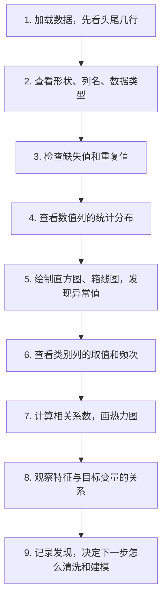

# 第2章 探索性数据分析（EDA）

本章教你拿到一张表格数据后，第一件事该干什么：把数据“摊开”仔细看一遍。这个过程叫**探索性数据分析（Exploratory Data Analysis，简称 EDA）**。

打 Kaggle 比赛时，很多数据初学者拿到数据就急着建模，结果模型跑出来分数很奇怪，最后发现是数据里藏着大量缺失值、异常值，或者特征之间有奇怪的关系。EDA 的作用就是让你在建模之前，先摸清数据的底细，避免踩坑。

**本章受众**：假设你已经安装了 Python 和 pandas，知道怎么读一个 CSV 文件，但不知道数据里到底该看什么、该怎么看。代码会一行一行地解释，关键概念用大白话讲清楚。

## 2.1 什么是 EDA，为什么要先做 EDA

你可以把 EDA 想象成“医生给病人做全面体检”。医生不会一见面就开药，先要量血压、抽血、拍片子，弄清楚身体哪里好、哪里不好。EDA 就是给数据做体检：看看有多少行多少列、哪些列有缺失、数值范围合不合理、各列之间有没有关系。

打 Kaggle 比赛做 EDA 至少能帮你回答下面这些问题：

- 数据一共有多少行、多少列？
- 哪些列是数字，哪些列是文字（类别）？
- 哪些列有缺失值，缺失得多不多？
- 数值列的分布是对称的，还是一尾很长（偏态）？
- 哪些数值看起来像“出错了”（异常值）？
- 哪些特征和我们要预测的目标（比如房价、是否违约）关系比较强？

带着这些问题的答案再去建模，你选模型、做特征、处理缺失值时都会有底气，不至于盲目尝试。

下面用一张流程图把 EDA 的一般步骤串起来：



## 2.2 初次接触数据：看几行、看形状、看类型

下面这段代码使用一个自己生成的小型示例数据，模仿 Kaggle 房价比赛的结构：每一行是一栋房子，包含面积、房龄、卧室数量、所在区域（类别）和房价（目标）。你不需要下载任何外部数据就能直接运行。

```python
# 第2章示例：探索性数据分析完整流程
# 使用自生成的示例数据，无需下载 Kaggle 数据集即可直接运行

import pandas as pd
import numpy as np
import matplotlib.pyplot as plt
import seaborn as sns

# 设置随机种子，保证每次运行生成的数据一样
np.random.seed(42)

# ---------------------------------------------------------
# 步骤 1：生成示例数据（模仿 Kaggle 训练集 train.csv）
# 真实比赛中，你直接用 pd.read_csv("train.csv") 读取即可
# ---------------------------------------------------------
n = 500

df = pd.DataFrame({
    "Id": range(1, n + 1),
    # 房屋面积（平方英尺），1000~4000 之间随机
    "GrLivArea": np.random.uniform(1000, 4000, n).round(0),
    # 房龄，0~100 年之间随机
    "YearBuilt": np.random.randint(1950, 2025, n),
    # 卧室数量，1~6 之间随机整数
    "BedroomAbvGr": np.random.randint(1, 7, n),
    # 所在区域，三个类别随机分配
    "Neighborhood": np.random.choice(["A", "B", "C"], size=n),
    # 房价（目标变量），跟面积、房龄正相关，加一些噪声
    "SalePrice": (np.random.uniform(1000, 4000, n).round(0) * 150
                  + (2025 - np.random.randint(1950, 2025, n)) * 500
                  + np.random.normal(0, 20000, n)).round(0)
})

# 故意制造一些缺失值，方便演示缺失值处理
missing_idx = np.random.choice(df.index, size=30, replace=False)
df.loc[missing_idx, "GrLivArea"] = np.nan

# 故意制造几个极端异常值（面积写成 50000，显然不合理）
df.loc[df.sample(3, random_state=1).index, "GrLivArea"] = 50000

print("数据前 5 行：")
print(df.head())
print("\n数据后 3 行：")
print(df.tail(3))
```

运行后你会看到类似下面的输出：

```
   Id  GrLivArea  YearBuilt  BedroomAbvG Neighborhood   SalePrice
0   1     2450.0       1987             3            A  412500.0
1   2     1800.0       2003             4            B  335000.0
2   3     3200.0       1975             2            C  489000.0
...
```

接下来看数据的“身份证”——形状、列名、数据类型：

```python
# ---------------------------------------------------------
# 步骤 2：查看数据形状、列名、数据类型
# ---------------------------------------------------------
print("数据形状（行数，列数）：", df.shape)
print("\n列名：", list(df.columns))
print("\n数据类型和非空值统计：")
print(df.info())
```

`df.shape` 会告诉你数据有多少行、多少列。`df.info()` 是一个非常好用的查看“身体状况”的函数，它会列出每一列的名称、非空值数量（non-null count）和数据类型（dtype）。如果某一列的非空值数量比总行数少，说明那一列有缺失值。

常见的数据类型有：
- `int64`：整数，比如卧室数量、房龄。
- `float64`：小数，比如面积、房价（有缺失值后 pandas 会自动把整数列变成浮点型，因为缺失值 NaN 是浮点数）。
- `object`：文字/字符串，比如区域名 "A"、"B"、"C"。

再用 `describe()` 看数值列的统计摘要：

```python
# ---------------------------------------------------------
# 步骤 3：查看数值列的统计摘要
# ---------------------------------------------------------
print(df.describe())
```

`describe()` 默认只针对数值列，输出包括：count（非空值个数）、mean（平均值）、std（标准差）、min（最小值）、25% / 50% / 75%（分位数，中位数就是 50%）、max（最大值）。

通过 `describe()` 你可以快速发现一些问题。比如如果最小值是 0 或负数，而这个特征不应该为负（比如面积、年龄），那很可能数据有问题；如果最大值远远大于其他值，那可能是个异常值。

你也可以只看某一列：

```python
print(df["SalePrice"].describe())
```

这样输出会更精简，只关注房价这一列的分布情况。

## 2.3 缺失值：哪些列缺了，缺多少，怎么办

缺失值（Missing Value）是表格数据里最常见的问题。简单说，就是某个单元格没有数据，是空的。在 pandas 里，缺失值通常用 `NaN`（Not a Number）表示。

先看看哪些列有缺失、各缺多少：

```python
# ---------------------------------------------------------
# 步骤 4：检查缺失值
# ---------------------------------------------------------
# 每一列缺失值的个数
missing_count = df.isnull().sum()
print("各列缺失值个数：")
print(missing_count)

# 只显示有缺失的列，并按缺失比例从高到低排序
missing_pct = (df.isnull().mean() * 100).round(2)
missing_info = pd.DataFrame({
    "缺失个数": missing_count,
    "缺失比例(%)": missing_pct
})
print("\n有缺失的列：")
print(missing_info[missing_info["缺失个数"] > 0].sort_values("缺失比例(%)", ascending=False))
```

`df.isnull()` 会返回一个和原数据一样大的布尔表格，位置是缺失值的地方是 `True`，不是的地方是 `False`。`.sum()` 把每一列的 `True`（相当于 1）加起来，就得到该列缺失值的个数。`df.isnull().mean()` 则是缺失值的比例（0~1 之间），乘以 100 就是百分比。

运行结果大概是这样：

```
各列缺失值个数：
Id                      0
GrLivArea              30
YearBuilt               0
BedroomAbvGr            0
Neighborhood            0
SalePrice               0
dtype: int64

有缺失的列：
        缺失个数  缺失比例(%)
GrLivArea           30        6.0
```

可以看到只有 `GrLivArea` 有缺失，缺失 30 个，占总行数的 6.0%。

### 缺失值怎么办？

缺失值不能直接扔给大多数机器学习模型，否则会报错。常见的处理方法有三类，选哪种取决于缺失比例和业务含义：

1. **删除**：如果某一列缺失比例非常高（比如超过 50%），或者缺失的行很少、删掉也不影响整体，可以直接删除。
2. **填充**：用某个统计值填补缺失，比如数值列用中位数、均值，类别列用众数（出现最多的类别）。
3. **保留并标记**：有时候“缺失”本身就有信息（比如某个特征不填可能意味着“未知”，这本身就是一种信号），可以先填一个占位值，再新增一列标记哪里原本是缺失的。

下面演示最常用的“均值/中位数填充”和“删除缺失行”：

```python
# ---------------------------------------------------------
# 步骤 5：处理缺失值（演示两种常见做法）
# ---------------------------------------------------------
import pandas as pd

# 做一个副本，不要直接改原数据，方便后面对比
df_clean = df.copy()

# 做法 A：用 GrLivArea 的中位数填充缺失值
# 中位数比均值更稳健，受极端大值影响小，推荐优先用中位数
median_grliv = df_clean["GrLivArea"].median()
df_clean["GrLivArea_filled"] = df_clean["GrLivArea"].fillna(median_grliv)

# 做法 B：直接删除 GrLivArea 缺失的那些行（适合缺失很少的情况）
df_dropped = df_clean.dropna(subset=["GrLivArea"])

print("填充后 GrLivArea 还缺多少：", df_clean["GrLivArea_filled"].isnull().sum())
print("删除缺失行后数据行数：", len(df_dropped), "（原行数：", len(df_clean), "）")
```

**一个非常重要的原则**（以后打比赛一直用得上）：填充缺失值时，必须**只用训练数据的统计量来填**，不能把测试数据的信息偷偷带进来。否则会造成“目标泄漏”，导致你在本地分数很高，提交到 Kaggle 后分数大幅下降。第3章会专门讲这个陷阱。

另外，如果你想保留“缺失”这个信息，可以这样做：

```python
# 新增一列标记：GrLivArea 原本是否缺失（1 表示缺失，0 表示正常）
df_clean["GrLivArea_is_missing"] = df_clean["GrLivArea"].isnull().astype(int)
```

模型就可以利用“是否缺失”这个特征本身，有时候反而能提高预测效果。

## 2.4 异常值：哪些数值“长得不一样”

异常值（Outlier）是指那些明显偏离大多数数值的数据点。比如房屋面积大多数在 1000~4000 平方英尺，突然出现一个 50000 平方英尺，那这个 50000 很可能是录入错误，或者是一个极特殊的豪宅。

异常值会拉高模型的误差，让模型“被带偏”，所以需要发现并决定怎么处理。

### 方法一：IQR 四分位距法（推荐，适用于任意分布）

IQR 是“四分位距”，等于第75百分位数（Q3）减去第25百分位数（Q1）。通常认为，小于 `Q1 - 1.5 × IQR` 或大于 `Q3 + 1.5 × IQR` 的值就是异常值。

```python
# ---------------------------------------------------------
# 步骤 6：用 IQR 法检测 GrLivArea 的异常值
# ---------------------------------------------------------
Q1 = df_clean["GrLivArea"].quantile(0.25)
Q3 = df_clean["GrLivArea"].quantile(0.75)
IQR = Q3 - Q1

lower_bound = Q1 - 1.5 * IQR
upper_bound = Q3 + 1.5 * IQR

outliers = df_clean[(df_clean["GrLivArea"] < lower_bound) | (df_clean["GrLivArea"] > upper_bound)]
print(f"Q1={Q1:.0f}, Q3={Q3:.0f}, IQR={IQR:.0f}")
print(f"异常值范围：小于 {lower_bound:.0f} 或 大于 {upper_bound:.0f}")
print("检测到的异常值行：")
print(outliers[["Id", "GrLivArea", "SalePrice"]])
```

IQR 法的好处是不需要假设数据服从正态分布，对大多数表格数据都管用。异常值检测出来后，你可以选择：
- **删除**这些行（异常值很少、且确认为录入错误时）；
- **截断（Clip）**：把超过上限的按上限算，低于下限的按下限算（`np.clip`）；
- **保留**：如果异常值是真实存在的（比如确实有超级豪宅），删除反而会丢失信息。

### 方法二：Z-Score 法（适用于近似正态分布）

Z-Score 衡量一个值离平均值有多少个标准差。通常 `|z| > 3` 被视为异常值。

```python
from scipy import stats

# 计算每个值的 Z 分数（先把缺失值去掉，否则算不了）
z_scores = np.abs(stats.zscore(df_clean["GrLivArea"].dropna()))
outliers_z = df_clean.loc[df_clean["GrLivArea"].dropna().index[z_scores > 3]]
print(f"Z-Score 法检测到异常值 {len(outliers_z)} 个")
```

Z-Score 法对偏态分布不太友好，数据有明显长尾时容易误判，所以优先推荐 IQR 法。

### 异常值处理示例

下面演示用 IQR 法把 GrLivArea 的异常值截断到合理范围内：

```python
# ---------------------------------------------------------
# 步骤 7：异常值截断（Winsorization）
# ---------------------------------------------------------
df_clean["GrLivArea_clipped"] = df_clean["GrLivArea_filled"].clip(lower=lower_bound, upper=upper_bound)
print("截断前最大值：", df_clean["GrLivArea_filled"].max())
print("截断后最大值：", df_clean["GrLivArea_clipped"].max())
```

`clip` 会把大于 `upper_bound` 的换成 `upper_bound`，小于 `lower_bound` 的换成 `lower_bound`，既保留了数据行数，又避免了极端值把模型带偏。

**不要盲目删除异常值！** 先问一下业务：这个极端值是录入错误，还是真实但罕见的情况？如果是真实情况（比如确实有几栋超级大豪宅），删除它们会让模型在遇到类似豪宅时预测很差。

## 2.5 数据分布可视化：直方图和箱线图

光看数字不够直观，画图能一眼看出数据的分布形态和异常值。我们用 `matplotlib` 和 `seaborn` 来画。

```python
# ---------------------------------------------------------
# 步骤 8：绘制直方图和箱线图
# ---------------------------------------------------------
plt.figure(figsize=(12, 5))

# 左图：房价的直方图，看分布形态
plt.subplot(1, 2, 1)
sns.histplot(df_clean["SalePrice"], bins=40, kde=True, color="steelblue")
plt.title("房价分布（直方图 + 密度曲线）")
plt.xlabel("房价")
plt.ylabel("频数")

# 右图：箱线图，看异常值和四分位数
plt.subplot(1, 2, 2)
sns.boxplot(x=df_clean["GrLivArea"], color="coral")
plt.title("房屋面积箱线图")
plt.xlabel("GrLivArea")

plt.tight_layout()
plt.show()
```

- **直方图（Histogram）**：横轴是数值范围，纵轴是出现次数。房价的直方图如果有一条长长的“尾巴”向右延伸，说明数据是**右偏**的（少数非常贵的房子拉高了平均值）。这种情况下，取对数变换（`np.log1p`）往往能让分布更对称，模型效果更好。
- **箱线图（Boxplot）**：箱子从 Q1 到 Q3，中间的线是中位数，箱子两边的“须”延伸到正常范围，超出须的单个点就是可能的异常值。箱线图能一眼看出哪些点是疑似异常值。

你也可以按类别分组画箱线图，看不同区域的房价分布是否不同：

```python
plt.figure(figsize=(6, 4))
sns.boxplot(data=df_clean, x="Neighborhood", y="SalePrice", palette="Set2")
plt.title("不同区域的房价分布")
plt.xlabel("区域")
plt.ylabel("房价")
plt.tight_layout()
plt.show()
```

如果某个区域的箱子明显高于其他区域，说明“区域”这个特征对房价预测很有用，建模时值得重点处理。

## 2.6 类别列：看取值和频次

除了数值列，表格里通常还有文字类型的类别列（比如区域、房型）。对于类别列，我们主要看每个取值出现了多少次，有没有拼写错误导致的“重复类别”，有没有某个类别极少见。

```python
# ---------------------------------------------------------
# 步骤 9：查看类别列的取值和频次
# ---------------------------------------------------------
print("区域列的取值频次：")
print(df_clean["Neighborhood"].value_counts())

# 也可以看比例
print("\n区域列的取值比例：")
print(df_clean["Neighborhood"].value_counts(normalize=True).round(3))
```

`value_counts()` 默认按出现次数从高到低排序。如果你发现有 "A"、"B"、"C" 之外还多了个 "a" 或 "A "（带空格），那说明数据录入不规范，需要先统一清洗（比如全转大写、去掉空格）。

如果某个类别只出现了一两次（基数很高但频次很低），建模时可以把这些罕见类别合并成一个 "Other" 类别，避免模型过拟合。

## 2.7 相关性：哪些特征和目标关系最强

打比赛的核心目标是预测某个目标（比如房价），那我们需要知道哪些特征和目标关系比较强。最简单的方法是计算**相关系数**（Correlation Coefficient），数值在 -1 到 1 之间，绝对值越大说明线性关系越强。

```python
# ---------------------------------------------------------
# 步骤 10：计算数值列之间的相关系数
# ---------------------------------------------------------
# 只选数值列计算相关性
numeric_cols = df_clean.select_dtypes(include=[np.number]).columns
corr_matrix = df_clean[numeric_cols].corr()

print("与房价 SalePrice 的相关性（按绝对值排序）：")
corr_with_price = corr_matrix["SalePrice"].abs().sort_values(ascending=False)
print(corr_with_price)
```

输出会列出每个数值特征和 SalePrice 的相关系数绝对值，排在前面的就是和房价线性关系最强的特征。

### 相关系数热力图

把整个相关系数矩阵画成热力图，一眼看出哪些特征两两之间也高度相关（这叫多重共线性，建模时可能需要留意）：

```python
# ---------------------------------------------------------
# 步骤 11：绘制相关系数热力图
# ---------------------------------------------------------
plt.figure(figsize=(8, 6))
sns.heatmap(corr_matrix, annot=True, fmt=".2f", cmap="coolwarm", center=0, square=True)
plt.title("数值特征相关系数热力图")
plt.tight_layout()
plt.show()
```

热力图里颜色越红（接近 1）表示正相关越强，越蓝（接近 -1）表示负相关越强，接近白色（接近 0）表示几乎没有线性关系。

**注意**：相关系数只能捕捉“线性关系”。如果两个变量是曲线关系，相关系数可能很低，但它们其实有很强的非线性关系。所以相关系数只是参考，不能完全依赖它来选特征。

你也可以直接画特征和目标的散点图，看两者是否呈现某种趋势：

```python
plt.figure(figsize=(6, 4))
sns.scatterplot(data=df_clean, x="GrLivArea", y="SalePrice", alpha=0.6)
plt.title("房屋面积 vs 房价")
plt.xlabel("GrLivArea")
plt.ylabel("SalePrice")
plt.tight_layout()
plt.show()
```

如果散点从左下到右上呈明显上升趋势，说明面积越大房价越高，两者正相关，这个特征很有价值。

## 本章小结

这一章我们走通了探索性数据分析（EDA）的完整流程：

1. **初次接触数据**：用 `head()`、`tail()`、`shape`、`info()`、`describe()` 看数据有多少行多少列、列名是什么、数据类型如何、数值分布大概怎样。
2. **缺失值检查**：用 `isnull().sum()` 和 `isnull().mean()` 找出哪些列缺失、缺失比例多少；处理方式有填充（中位数/均值/众数）、删除行、或保留并标记缺失。
3. **异常值检测**：用 IQR 法（`Q1 - 1.5×IQR` / `Q3 + 1.5×IQR`）或 Z-Score 法找出疑似异常值；处理方式有删除、截断（`clip`）、或保留。
4. **分布可视化**：用直方图看数值分布形态（是否偏态），用箱线图一眼看出异常值和四分位数，按类别分组画箱线图可以看不同组别的差异。
5. **类别列探索**：用 `value_counts()` 看每个类别出现的频次，发现拼写不一致或罕见类别。
6. **相关性分析**：用 `corr()` 计算特征与目标的相关系数，画热力图看两两特征之间的线性关系，画散点图直观观察趋势。

做完 EDA 后，你应该已经对数据有了比较清晰的认识：哪些列干净、哪些列需要清洗、哪些特征可能对预测有帮助。带着这些认识，下一章我们将进入数据清洗与特征构造，训练第一个真正的基线模型。

---

*下一章：第3章 表格数据的通用清洗与建模方法 —— 缺失值、类别编码、特征构造、数值变换、基线与主力模型*
