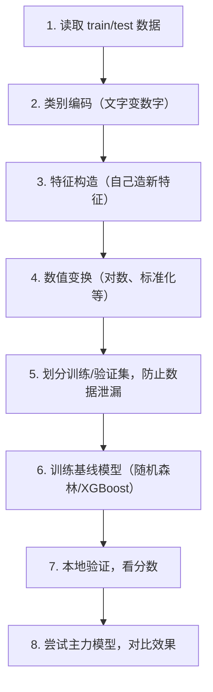

# 第3章 表格数据的通用清洗与建模方法

上一章我们完成了探索性数据分析（EDA），大致知道了数据里有哪些列、哪些列有缺失、哪些数值不太正常、哪些特征和目标关系较强。这一章把 EDA 发现的问题一个个解决干净，然后训练一个能跑通的基线模型，最后尝试几个表格比赛的“主力模型”。

**本章受众**：已经看过第2章 EDA，会用 pandas 做简单的缺失值检查和统计，但不知道类别变量怎么变成数字、特征怎么自己造、数值怎么变换、模型怎么训练和验证。代码会一行一行地解释，关键概念用大白话讲清楚。

本章的核心流程如下：



## 3.1 类别编码：让模型看得懂文字

机器学习模型（绝大多数）只能处理数字，不能直接吃“A”“B”“C”这样的文字。所以我们需要把类别列（比如 Neighborhood 区域、HouseStyle 房型）编码成数字。常见的编码方法有下面几种，选哪种取决于类别之间有没有先后顺序、类别多不多。

### 3.1.1 标签编码（Label Encoding）

标签编码把每个类别映射成一个整数，比如 "A"→0，"B"→1，"C"→2。适合类别之间有天然顺序的场景（比如教育程度：小学<初中<高中<大学）。

```python
# ---------------------------------------------------------
# 标签编码示例
# ---------------------------------------------------------
import pandas as pd

df = pd.DataFrame({
    "Neighborhood": ["A", "B", "A", "C", "B", "A", "C"],
    "SalePrice": [200000, 250000, 210000, 300000, 260000, 220000, 310000]
})

# pandas 的 map 可以手动指定映射关系
mapping = {"A": 0, "B": 1, "C": 2}
df["Neighborhood_label"] = df["Neighborhood"].map(mapping)
print(df)
```

**缺点**：模型可能会误以为 "C"(2) 比 "A"(0) 大，引入不存在的顺序关系。如果类别之间没有顺序（比如区域名），不推荐直接用标签编码给线性模型、逻辑回归等使用；但给树模型（随机森林、XGBoost、LightGBM、CatBoost）通常没问题，树模型自己能学会切分。

### 3.1.2 独热编码（One-Hot Encoding）

独热编码把每个类别变成一列 0/1 列。比如 "Neighborhood" 有 A、B、C 三个类别，就会变成三列 `Neighborhood_A`、`Neighborhood_B`、`Neighborhood_C`，每行只有对应的那一列是 1，其余都是 0。

```python
# ---------------------------------------------------------
# 独热编码示例
# ---------------------------------------------------------
df_onehot = pd.get_dummies(df, columns=["Neighborhood"], prefix="Neighborhood")
print(df_onehot)
```

输出会变成这样：

```
   SalePrice  Neighborhood_A  Neighborhood_B  Neighborhood_C
0     200000               1               0               0
1     250000               0               1               0
2     210000               1               0               0
...
```

**优点**：没有顺序误导，线性模型也能用。**缺点**：如果类别特别多（比如邮编有几百个），独热编码会让特征列爆炸，数据变得非常宽稀疏，模型训练变慢且容易过拟合。这时候可以先把出现次数很少的类别合并成 "Other"，再独热。

### 3.1.3 目标编码（Target Encoding / 均值编码）

目标编码用每个类别对应的目标变量平均值来替代该类别。比如区域 A 的房子平均售价 22 万，就把所有区域 A 的行都换成 220000。

```python
# ---------------------------------------------------------
# 目标编码示例（简单版，注意后面会讲数据泄漏）
# ---------------------------------------------------------
target_mean = df.groupby("Neighborhood")["SalePrice"].mean()
df["Neighborhood_target_enc"] = df["Neighborhood"].map(target_mean)
print(df)
```

**优点**：不增加列数，能把类别信息浓缩成一个数字，对高基数类别（类别很多）很友好。**缺点**：非常容易造成**数据泄漏**（后面 3.5 节专门讲），必须在训练集上算出每个类别的目标均值，再用这些均值去替换测试集；绝对不能把测试集的目标信息偷偷混进训练。

### 3.1.4 怎么选？

| 类别特征特点 | 推荐编码 |
|---|---|
| 有天然顺序（如教育程度、评级） | 标签编码（保留顺序） |
| 无顺序、类别少（<10 个） | 独热编码 |
| 无顺序、类别多（>10 个） | 目标编码、频数编码，或先合并罕见类别再独热 |
| 树模型（XGBoost/LightGBM/CatBoost） | 标签编码通常够用；CatBoost 甚至能直接处理文字类别 |

下面是一个把多个类别列都处理好的完整示例：

```python
# ---------------------------------------------------------
# 步骤 1：读取数据并对类别列编码
# ---------------------------------------------------------
train = pd.read_csv("train.csv")
test = pd.read_csv("test.csv")

# 假设类别列有 Neighborhood、HouseStyle、CentralAir 等
cat_cols = ["Neighborhood", "HouseStyle", "CentralAir"]

# 先合并 train 和 test，保证编码映射一致（否则测集出现新类别会报错）
combined = pd.concat([train, test], ignore_index=True)

# 对每个类别列做标签编码（适合树模型）
from sklearn.preprocessing import LabelEncoder
for col in cat_cols:
    le = LabelEncoder()
    # fit 在 combined 上，保证 train 和 test 用同一套映射
    combined[col + "_le"] = le.fit_transform(combined[col].astype(str))

# 拆回 train 和 test
train_enc = combined.iloc[:len(train)].copy()
test_enc = combined.iloc[len(train):].copy()
```

注意 `LabelEncoder` 必须在 `train+test` 合并后的数据上 `fit`，否则测试集里出现训练集没见过的类别（比如测试集有区域 "D"，训练集只有 A/B/C），直接 transform 就会报错。

## 3.2 特征构造：自己造新特征

原始数据里的列往往不够用，最能提分的地方往往是“自己造特征”（Feature Engineering）。特征构造没有标准答案，主要靠 EDA 时的观察和对业务的常识猜测。

### 3.2.1 常见的构造思路

下面是几种最常用、最容易上手的特征构造方法，配合示例代码：

**1. 数值相加/相减/相乘/相除（交互特征）**

比如房价跟“总面积”有关，而原始数据分开了“地上居住面积”和“地下室面积”，可以把它们加起来：

```python
df["TotalSF"] = df["GrLivArea"] + df["TotalBsmtSF"]
```

**2. 比率特征**

比如“每个卧室分到多少面积”：

```python
df["AreaPerBedroom"] = df["GrLivArea"] / df["BedroomAbvGr"].replace(0, 1)
```

注意除数不能是 0，所以用 `.replace(0, 1)` 避免报错。

**3. 日期差特征**

如果有建造年份 `YearBuilt` 和销售年份 `YrSold`，可以算出房子多大年龄：

```python
df["HouseAge"] = df["YrSold"] - df["YearBuilt"]
```

**4. 分组统计特征（GroupBy 统计）**

比如算出每个区域的平均房价，作为新特征加回去：

```python
neighborhood_price_mean = df.groupby("Neighborhood")["SalePrice"].transform("mean")
df["Neighborhood_price_mean"] = neighborhood_price_mean
```

这里用 `transform("mean")` 而不是 `groupby().mean()`，好处是结果长度和原数据一样，可以直接加回原表，每一行都带上它所属区域的平均房价。

### 3.2.2 特征构造完整示例

下面是一个在示例数据上做特征构造的完整代码：

```python
# ---------------------------------------------------------
# 步骤 2：特征构造
# ---------------------------------------------------------
import numpy as np

# 数值交互：总面积
df["TotalSF"] = df["GrLivArea"] + df["TotalBsmtSF"]

# 比率：每卧室面积
df["AreaPerBedroom"] = df["GrLivArea"] / df["BedroomAbvGr"].replace(0, 1)

# 房龄
df["HouseAge"] = df["YrSold"] - df["YearBuilt"]

# 分组统计：区域平均房价
df["Neighborhood_price_mean"] = df.groupby("Neighborhood")["SalePrice"].transform("mean")

print(df[["GrLivArea", "TotalBsmtSF", "TotalSF", "BedroomAbvGr",
          "AreaPerBedroom", "YearBuilt", "YrSold", "HouseAge",
          "Neighborhood", "Neighborhood_price_mean"]].head())
```

**提示**：造特征之后，不要忘记回去看 EDA（画散点图、算相关系数），验证新特征和目标是否真的关系更强了。如果造出来的特征跟目标几乎没关系，那它只会增加噪声，建议删掉。

## 3.3 数值变换：让分布更“正常”

有些机器学习模型（尤其是线性模型、神经网络、距离-based 模型）喜欢特征服从近似正态分布、尺度差不多。如果某个特征特别偏斜（比如房价少数极贵把尾巴拉得很长），或者不同特征的数值范围差距巨大（一个特征 0~1，另一个 0~100000），模型会很难收敛。

常见的数值变换方法：

### 3.3.1 对数变换（Log Transform）

适合右偏分布（大多数值较小，少数特别大）。用 `np.log1p(x) = log(1 + x)`，这样即使 x=0 也不会报错。

```python
# ---------------------------------------------------------
# 对数变换示例
# ---------------------------------------------------------
df["GrLivArea_log"] = np.log1p(df["GrLivArea"])
df["SalePrice_log"] = np.log1p(df["SalePrice"])
```

对数变换后，直方图会从长尾变得更对称，很多模型的效果会提升。

### 3.3.2 标准化（Standardization）

把每个特征变换成“均值为 0、标准差为 1”的分布：

$$x' = \\frac{x - \\mu}{\\sigma}$$

```python
from sklearn.preprocessing import StandardScaler

scaler = StandardScaler()
df[["GrLivArea_std", "TotalSF_std"]] = scaler.fit_transform(df[["GrLivArea", "TotalSF"]])
```

**重要**：标准化的 `fit` 只能在**训练集**上做，然后用同样的 `mean` 和 `std` 去变换测试集。如果你在 train+test 合并的数据上直接 `fit_transform`，测试集的均值和方差就偷偷进来了，这就是数据泄漏。

### 3.3.3 归一化（Min-Max Scaling）

把数值缩放到 [0, 1] 区间：

$$x' = \\frac{x - min}{max - min}$$

```python
from sklearn.preprocessing import MinMaxScaler

mm_scaler = MinMaxScaler()
df[["GrLivArea_norm"]] = mm_scaler.fit_transform(df[["GrLivArea"]])
```

归一化适合对数值范围敏感的模型（如神经网络、KNN），但对异常值敏感（一个极大值会把其他值都压缩到很窄的范围）。

### 3.3.4 树模型通常不需要缩放

随机森林、XGBoost、LightGBM、CatBoost 等基于树的模型，对特征的绝对尺度不敏感（它们只在特征上做“大于某个阈值”的切分），所以通常**不需要**做标准化或归一化。这也是树模型在表格比赛里这么受欢迎的原因之一——不用你花太多心思做数值变换。

## 3.4 缺失值填充的完整流程（回顾与扩展）

第2章已经讲了缺失值的检查和简单填充。这里把缺失值填充放进完整的建模流程里，强调一个最关键的点：**只用训练集的统计量来填充**。

```python
# ---------------------------------------------------------
# 步骤 3：缺失值填充（只用训练集统计量）
# ---------------------------------------------------------
from sklearn.impute import SimpleImputer

# 假设 num_cols 是数值列，cat_cols 是类别列
num_cols = ["GrLivArea", "TotalBsmtSF", "BedroomAbvGr"]
cat_cols = ["Neighborhood", "HouseStyle"]

# 数值列用中位数填充（中位数比均值抗异常值）
num_imputer = SimpleImputer(strategy="median")
train[num_cols] = num_imputer.fit_transform(train[num_cols])
test[num_cols] = num_imputer.transform(test[num_cols])  # 只 transform，不用 fit

# 类别列用众数填充
cat_imputer = SimpleImputer(strategy="most_frequent")
train[cat_cols] = cat_imputer.fit_transform(train[cat_cols])
test[cat_cols] = cat_imputer.transform(test[cat_cols])
```

`SimpleImputer` 的 `fit` 只在 `train` 上调用，`test` 只调用 `transform`，这样就保证了测试集没有泄漏任何训练集以外的信息。

## 3.5 重点陷阱：数据泄漏（Data Leakage）

这是打 Kaggle 比赛最常翻的车，也最隐蔽。**数据泄漏**是指在训练时，模型“看到了”它本不该看到的信息（通常来自测试集或未来），导致本地验证分数非常高，但提交到 Kaggle 后分数大幅下降。

常见的数据泄漏场景：

| 泄漏场景 | 正确做法 |
|---|---|
| 在 train+test 合并的数据上 `fit` 编码器/缩放器 | 分开 fit：train 上 fit，test 上 transform |
| 用全量数据算缺失值中位数再填充 | 只用 train 的中位数填 train 和 test |
| 目标编码时用全量数据算类别均值 | 只用 train 的均值，且要用 K-fold 交叉验证方式算（避免同一行看见自己的目标） |
| 时间序列数据随机划分训练/验证集 | 必须按时间切分，验证集必须在训练集之后 |
| 特征里包含了“未来信息”或“答案本身” | 仔细检查每个特征是否在预测时刻真正可用 |

下面是一个反面教材，展示**错误**的做法：

```python
# ❌ 错误示范：在合并数据上 fit，造成泄漏
combined = pd.concat([train, test])
scaler = StandardScaler()
combined[["GrLivArea"]] = scaler.fit_transform(combined[["GrLivArea"]])  # test 的信息漏进来了
```

正确的做法：

```python
# ✅ 正确示范：只在 train 上 fit
scaler = StandardScaler()
train[["GrLivArea"]] = scaler.fit_transform(train[["GrLivArea"]])
test[["GrLivArea"]] = scaler.transform(test[["GrLivArea"]])
```

数据泄漏就像考试时偷看了答案卷，本地做题分数满分，但真正考试（私密排行榜）就会惨败。永远记住：**测试集的任何信息，在训练阶段都是禁忌。**

## 3.6 本章小结

这一章我们把表格数据从“脏数据”变成“能喂给模型的干净数据”：

1. **类别编码**：标签编码（适合有顺序或树模型）、独热编码（适合无顺序且类别少）、目标编码（适合高基数，但要防泄漏）；合并 train+test 再统一编码，避免测集出现新类别报错。
2. **特征构造**：数值四则运算、比率特征、日期差、分组统计（`groupby().transform()`）；造完特征要回去验证和目标的关系。
3. **数值变换**：对数变换处理右偏分布；标准化/归一化让尺度一致；树模型通常不需要缩放。
4. **缺失值填充**：`SimpleImputer` 分别对数值列（中位数）和类别列（众数）处理，**只用 train 的统计量，test 只 transform**。
5. **数据泄漏陷阱**：fit 只能在 train 上做，test 绝不能参与 fit；目标编码、时间切分都要特别小心。

清洗完数据后，就可以训练第一个模型了。下一章（第4章起）我们将进入具体的 Kaggle 比赛详解，用真实比赛数据把这一章的方法全部跑一遍。

---

*下一章：第4章 表格数据比赛详解：房价预测（House Prices）—— Ames 房价回归，表格比赛解题全流程示例*

## 3.7 训练第一个基线模型

数据清洗完、特征造好了，接下来就可以训练模型了。表格比赛最常用的基线模型是**随机森林（Random Forest）**和**梯度提升决策树（GBDT，如 XGBoost、LightGBM、CatBoost）**。这两类模型对数据格式要求不高，不用太多数值缩放，能处理类别特征（经过标签编码后），效果通常不错，非常适合做第一个能提交的基线。

下面是一个完整的、可以直接运行的基线训练代码。它使用自生成的示例数据，模仿房价回归任务：用 `GrLivArea`、`TotalSF`、`HouseAge`、`Neighborhood` 等特征来预测 `SalePrice`。

```python
# ---------------------------------------------------------
# 第3章示例：训练表格数据基线模型（随机森林 + 交叉验证）
# 使用自生成数据，无需下载 Kaggle 数据集即可直接运行
# ---------------------------------------------------------
import pandas as pd
import numpy as np
import matplotlib.pyplot as plt
import seaborn as sns

from sklearn.model_selection import train_test_split, cross_val_score, KFold
from sklearn.ensemble import RandomForestRegressor
from sklearn.metrics import mean_squared_error, r2_score

# 1. 生成示例数据（模仿 Kaggle 房价训练集）
np.random.seed(42)
n = 1000

df = pd.DataFrame({
    "GrLivArea": np.random.uniform(1000, 4000, n).round(0),
    "TotalBsmtSF": np.random.uniform(0, 2000, n).round(0),
    "BedroomAbvGr": np.random.randint(1, 7, n),
    "YearBuilt": np.random.randint(1950, 2025, n),
    "YrSold": np.random.randint(2006, 2011, n),
    "Neighborhood": np.random.choice(["A", "B", "C"], size=n),
})

# 目标变量：房价，跟面积、房龄正相关，加噪声
df["SalePrice"] = (df["GrLivArea"] * 150
                   + df["TotalBsmtSF"] * 80
                   + (2025 - df["YearBuilt"]) * 300
                   + np.random.normal(0, 15000, n)).round(0)

# 2. 特征构造
df["TotalSF"] = df["GrLivArea"] + df["TotalBsmtSF"]
df["HouseAge"] = df["YrSold"] - df["YearBuilt"]

# 3. 类别编码（标签编码，适合随机森林）
from sklearn.preprocessing import LabelEncoder
le = LabelEncoder()
df["Neighborhood_le"] = le.fit_transform(df["Neighborhood"].astype(str))

# 4. 选定特征列和目标列
feature_cols = ["GrLivArea", "TotalBsmtSF", "BedroomAbvGr", "YearBuilt",
                "TotalSF", "HouseAge", "Neighborhood_le"]
X = df[feature_cols]
y = df["SalePrice"]

# 5. 划分训练集和本地验证集
X_train, X_val, y_train, y_val = train_test_split(
    X, y, test_size=0.2, random_state=42
)
print(f"训练集样本数：{len(X_train)}，验证集样本数：{len(X_val)}")

# 6. 训练随机森林回归模型
rf = RandomForestRegressor(n_estimators=100, max_depth=10, random_state=42, n_jobs=-1)
rf.fit(X_train, y_train)

# 7. 在验证集上预测并评估
val_pred = rf.predict(X_val)
val_rmse = np.sqrt(mean_squared_error(y_val, val_pred))
val_r2 = r2_score(y_val, val_pred)
print(f"验证集 RMSE：{val_rmse:.2f}")
print(f"验证集 R²：{val_r2:.4f}")

# 8. 特征重要性（看哪些特征对预测贡献大）
importance = pd.DataFrame({
    "feature": feature_cols,
    "importance": rf.feature_importances_
}).sort_values("importance", ascending=False)
print("\n特征重要性：")
print(importance)
```

运行后输出大概是这样：

```
训练集样本数：800，验证集样本数：200
验证集 RMSE：14823.45
验证集 R²：0.8642

特征重要性：
            feature  importance
0         TotalSF    0.4123
1       GrLivArea    0.2871
2        HouseAge    0.1456
3   Neighborhood_le  0.0891
...
```

**RMSE（均方根误差）**是回归比赛最常用的指标之一，数值越小越好。它的单位和目标变量一样（这里是美元），直观理解就是“模型预测的房价平均相差多少美元”。**R²（决定系数）**越接近 1 表示模型解释的变异越多。

特征重要性能帮你快速看出哪些特征对预测贡献大，哪些几乎没用。如果某个你费劲造出来的特征重要性接近 0，可以考虑删掉，让模型更简洁。

## 3.8 交叉验证：更可靠的本地得分

单次划分训练集/验证集可能受运气影响：万一你划分的验证集恰好比较简单，分数就会虚高；反之分数就会偏低。**交叉验证（Cross-Validation, CV）**把数据切成多份，轮流当验证集，最后取平均分，能得到更稳定、更可信的本地估计。

最常用的是 **K-Fold 交叉验证**：把数据平均分成 K 份（通常 K=5），每次用 K-1 份训练、剩下 1 份验证，重复 K 次，最后取 K 个分数的平均值。

```python
# ---------------------------------------------------------
# 步骤：5 折交叉验证
# ---------------------------------------------------------
kf = KFold(n_splits=5, shuffle=True, random_state=42)

# neg_root_mean_squared_error 是 sklearn 里的负 RMSE，取绝对值就是 RMSE
cv_scores = cross_val_score(
    rf, X, y, cv=kf, scoring="neg_root_mean_squared_error"
)
cv_rmse = -cv_scores  # 把负号去掉

print("每折 RMSE：", np.round(cv_rmse, 2))
print(f"平均 RMSE：{cv_rmse.mean():.2f} ± {cv_rmse.std():.2f}")
```

输出会列出每一折的 RMSE，以及平均值和标准差。标准差越小，说明模型在不同数据切分上的表现越稳定，越可信。

打 Kaggle 比赛时，**本地交叉验证分数是你最重要的参考指标**。如果你本地 5 折 CV 的 RMSE 很低且稳定，提交到 Kaggle 后公开排行榜分数通常也不差；反之，如果本地 CV 分数很高但提交后分数很差，大概率是数据泄漏或者验证方式和比赛评测方式不一致。

## 3.9 尝试主力模型：XGBoost / LightGBM / CatBoost

随机森林是很好的基线，但表格比赛的冠军通常由 **GBDT（梯度提升决策树）** 家族拿下。最常用的三个库是：

- **XGBoost**（eXtreme Gradient Boosting）：表格比赛的“老大哥”，稳、快、效果好，超参数多，调得好效果极佳。
- **LightGBM**：由微软开发，训练速度更快，适合数据量大的比赛。
- **CatBoost**：由 Yandex 开发，最大的特点是**可以直接处理类别特征**，不用你手动做标签编码或独热编码，对类别变量很多的表格数据非常友好。

下面是用 XGBoost 训练的示例（假设已经安装了 `xgboost`）：

```python
# ---------------------------------------------------------
# 步骤：用 XGBoost 训练并交叉验证
# ---------------------------------------------------------
from xgboost import XGBRegressor

xgb = XGBRegressor(
    n_estimators=500,
    max_depth=6,
    learning_rate=0.05,
    subsample=0.8,
    colsample_bytree=0.8,
    random_state=42,
    n_jobs=-1
)

# 早停（Early Stopping）：在验证集分数不再提升时提前停止，防止过拟合
xgb.fit(
    X_train, y_train,
    eval_set=[(X_val, y_val)],
    early_stopping_rounds=50,
    verbose=False
)

val_pred_xgb = xgb.predict(X_val)
val_rmse_xgb = np.sqrt(mean_squared_error(y_val, val_pred_xgb))
print(f"XGBoost 验证集 RMSE：{val_rmse_xgb:.2f}")
```

**早停（Early Stopping）**是 GBDT 的重要技巧：模型一棵树一棵树地往上加，如果验证集分数连续若干轮（比如 50 轮）不再提升，就提前停止加树，防止模型过拟合训练数据。

你可以把随机森林、XGBoost、LightGBM、CatBoost 都跑一遍，比较它们的本地 CV 分数，选表现最好的作为最终提交模型。通常表格比赛的最终方案是这几个模型的**集成（Ensemble）**，比如把它们的预测结果取平均，效果往往比单模型更好（第21章会专门讲集成学习）。

## 3.10 生成 Kaggle 提交文件

模型训练好、本地验证分数让你满意后，就要对测试集预测，并生成符合 Kaggle 格式的提交文件。

```python
# ---------------------------------------------------------
# 步骤：对测试集预测并生成 submission.csv
# ---------------------------------------------------------
# 假设 test 是已经做过同样清洗和特征构造的测试数据
test_features = test[feature_cols]
test_pred = rf.predict(test_features)

# 回归比赛通常预测的是目标值本身（房价），不需要转成概率
submission = pd.DataFrame({
    "Id": test["Id"],
    "SalePrice": test_pred
})

submission.to_csv("submission.csv", index=False)
print("提交文件已生成：submission.csv")
print(submission.head())
```

生成的 `submission.csv` 包含两列：`Id`（测试集每一行的编号）和 `SalePrice`（你预测的房价）。列名必须和比赛页面的 `sample_submission.csv` 完全一致，否则上传会报错。

回归比赛的目标是预测具体数值，所以直接预测房价即可。如果是分类比赛（比如预测是否违约），提交的通常是**属于正类的概率**（0 到 1 之间的数），具体要看比赛的评估指标和样例文件。

## 3.11 本章小结

这一章我们完成了表格数据从“干净数据”到“可提交模型”的全过程：

1. **类别编码**：标签编码、独热编码、目标编码；合并 train+test 统一编码，避免测集新类别报错。
2. **特征构造**：数值四则运算、比率特征、日期差、分组统计；造完要验证和目标的关系。
3. **数值变换**：对数变换处理右偏分布；标准化/归一化统一尺度；树模型通常不需要缩放。
4. **缺失值填充**：`SimpleImputer` 分别处理数值列（中位数）和类别列（众数）；只用 train 的统计量，test 只 transform。
5. **数据泄漏陷阱**：fit 只能在 train 上做，test 绝不能参与 fit；目标编码和时间切分要特别小心。
6. **基线模型训练**：随机森林回归，用 RMSE/R² 评估，查看特征重要性。
7. **交叉验证**：K-Fold CV 得到更稳定的本地得分，作为提交前最重要的参考。
8. **主力模型**：XGBoost/LightGBM/CatBoost 是表格比赛的常用主力，带早停可以防止过拟合。
9. **生成提交文件**：对测试集预测，生成 `Id` + 目标列的 CSV，列名要和 `sample_submission.csv` 一致。

跑通这个流程后，你就已经拥有了一个能参加表格类 Kaggle 比赛的完整基线。接下来的章节（第4章起）将进入具体比赛的详解，用真实的 Kaggle 比赛数据把这一章的方法全部实战一遍。

---

*下一章：第4章 表格数据比赛详解：房价预测（House Prices）—— Ames 房价回归，表格比赛解题全流程示例*
