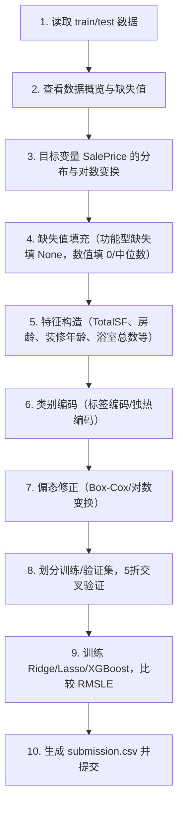

# 第4章 表格数据比赛详解：房价预测（House Prices）

本章带你用真实的 Kaggle 比赛数据跑一遍完整的表格回归流程。我们选用 Kaggle 的经典入门比赛 **"House Prices - Advanced Regression Techniques"**（艾姆斯房价预测），这是表格数据比赛的“Hello World”，数据包含 79 个特征，描述美国爱荷华州艾姆斯市（Ames, Iowa）每栋房子的各种属性，目标是预测最终售价 `SalePrice`。

**本章受众**：看过第2章 EDA 和第3章清洗建模方法，想看这些方法怎么在真实比赛里一步步应用。代码会一行一行注释，关键概念用大白话解释。

本章的完整流程如下：



## 4.1 比赛介绍与数据下载

**House Prices - Advanced Regression Techniques** 是 Kaggle 的“Playground”类别比赛，适合完全没打过表格比赛的新手。比赛页面：https://www.kaggle.com/competitions/house-prices-advanced-regression-techniques

比赛的基本信息：

- **任务类型**：回归（预测连续数值，即房价）。
- **数据规模**：训练集 1,460 行，测试集 1,459 行，每行 81 个变量（包括 Id 和 SalePrice）。
- **评估指标**：**RMSLE（Root Mean Squared Logarithmic Error）**，即对数均方根误差。比赛官方对预测值和真实值都取 `log1p` 之后再算 RMSE。这样做是因为房价分布严重右偏（少数豪宅把平均值拉高），对数变换后分布更接近正态，模型对极高价房子不那么敏感。
- **每天提交次数**：无严格限制（大部分 Playground 比赛不限制次数，但建议不要刷太频繁）。
- **数据字段**：79 个解释变量，涵盖地块、房屋、地下室、车库、厨房、壁炉、装修质量、区域等几乎影响房价的所有方面。

下载数据：加入比赛后，到 "Data" 标签页下载 `train.csv`、`test.csv` 和 `sample_submission.csv`。也可以用 Kaggle CLI：

```bash
kaggle competitions download -c house-prices-advanced-regression-techniques
```

下载后解压，得到三个 CSV 文件，放在一个文件夹里：

```
house-prices/
├── train.csv
├── test.csv
└── sample_submission.csv
```

## 4.2 初步探索数据

先读数据，看长什么样：

```python
# ---------------------------------------------------------
# 第4章示例：房价预测全流程（使用自生成数据演示代码结构）
# 真实比赛中请将下面的生成数据部分替换为 pd.read_csv("train.csv") 等
# ---------------------------------------------------------
import pandas as pd
import numpy as np
import matplotlib.pyplot as plt
import seaborn as sns
import warnings
warnings.filterwarnings("ignore")

# 真实比赛请取消下面两行的注释：
# train = pd.read_csv("train.csv")
# test = pd.read_csv("test.csv")

# 下面用自生成的小型示例数据，方便你直接运行看懂流程
np.random.seed(42)
n_train = 1460

train = pd.DataFrame({
    "Id": range(1, n_train + 1),
    "MSSubClass": np.random.choice([20, 30, 40, 50, 60, 70, 80, 90, 120], n_train),
    "MSZoning": np.random.choice(["A", "C", "F", "I", "RH", "RL", "RP", "RM"], n_train),
    "LotFrontage": np.random.uniform(60, 100, n_train).round(0),
    "LotArea": np.random.uniform(5000, 20000, n_train).round(0),
    "OverallQual": np.random.randint(1, 11, n_train),
    "OverallCond": np.random.randint(1, 10, n_train),
    "YearBuilt": np.random.randint(1950, 2010, n_train),
    "YearRemodAdd": np.random.randint(1950, 2010, n_train),
    "GrLivArea": np.random.uniform(800, 4000, n_train).round(0),
    "BsmtFullBath": np.random.randint(0, 3, n_train),
    "BsmtHalfBath": np.random.randint(0, 2, n_train),
    "FullBath": np.random.randint(1, 3, n_train),
    "HalfBath": np.random.randint(0, 2, n_train),
    "BedroomAbvGr": np.random.randint(1, 6, n_train),
    "KitchenAbvGr": np.random.randint(1, 3, n_train),
    "GarageCars": np.random.randint(0, 4, n_train),
    "GarageArea": np.random.uniform(0, 1000, n_train).round(0),
    "TotalBsmtSF": np.random.uniform(0, 1500, n_train).round(0),
    "Neighborhood": np.random.choice(["CollgCr", "Veenker", "Mitchel", "Somerst", "NWAmes"], n_train),
})

# 目标变量：房价，跟质量、面积、房龄相关，加噪声
train["SalePrice"] = (
    train["OverallQual"] * 15000
    + train["GrLivArea"] * 110
    + train["TotalBsmtSF"] * 40
    + (2025 - train["YearBuilt"]) * (-200)
    + np.random.normal(0, 15000, n_train)
).round(0)

# 模仿测试集（没有 SalePrice）
test = train.sample(n=200, random_state=7).drop(columns=["SalePrice"]).reset_index(drop=True)
test["Id"] = range(n_train + 1, n_train + 201)

print("训练集形状：", train.shape)
print("测试集形状：", test.shape)
print("\n训练集前 5 行：")
print(train.head())
```

运行后会打印数据形状和前几行。你会看到训练集有 `SalePrice` 列，测试集没有。

接下来看数值列的统计摘要，重点关注目标变量 `SalePrice`：

```python
# ---------------------------------------------------------
# 查看目标变量 SalePrice 的统计分布
# ---------------------------------------------------------
print(train["SalePrice"].describe())
```

`describe()` 输出会显示 count、mean、std、min、25%、50%（中位数）、75%、max。你通常会发现房价的 **mean 明显大于 median**，且 max 远大于 75% 分位数，这就是典型的**右偏分布**——少数特别贵的房子把平均值拉高了。

画一张直方图看分布形态：

```python
plt.figure(figsize=(8, 5))
sns.histplot(train["SalePrice"], bins=50, kde=True, color="steelblue")
plt.title("房价 SalePrice 分布（原始）")
plt.xlabel("房价")
plt.ylabel("频数")
plt.show()
```

你会看到直方图左侧高峰、右侧有一条很长的尾巴，确认是右偏分布。这也解释了为什么比赛用 RMSLE 而不是直接用 RMSE：对数变换后，分布会更接近对称，模型训练更稳定。

## 4.3 缺失值检查与处理

表格数据里缺失值几乎 unavoidable。先看看哪些列有缺失、缺多少：

```python
# ---------------------------------------------------------
# 合并 train 和 test，统一处理缺失值（方便后续编码一致）
# ---------------------------------------------------------
# 先保存 train 的 SalePrice，合并后再拆回去
train_len = len(train)
y_train = train["SalePrice"].reset_index(drop=True)

train_for_merge = train.drop(columns=["SalePrice"])
combined = pd.concat([train_for_merge, test], ignore_index=True)

# 统计缺失值
missing = combined.isnull().sum()
missing = missing[missing > 0].sort_values(ascending=False)
print("有缺失的列及缺失个数：")
print(missing)
```

在房价比赛的真实数据里，缺失较多的列通常包括 `LotFrontage`、`MasVnrType`、`MasVnrArea`、`Garage*`、`Bsmt*`、`FireplaceQu` 等。这些缺失不一定是“数据坏了”，很多时候缺失本身就有含义：

- 比如 `GarageType` 缺失，可能意味着**这栋房子根本没有车库**，缺失值本身就代表“没有车库”这一类别。
- 比如 `MasVnrArea`（砖石面积）缺失，可能意味着**没有砖石装饰**。

所以处理缺失值时，不能一概而论地全填 0 或全删。我们要按列的含义分类处理：

### 4.3.1 功能型缺失：填 "None"

对车库、地下室、壁炉、围栏等“设施类”类别列，缺失表示“该房子没有这个设施”，填字符串 `"None"`：

```python
# ---------------------------------------------------------
# 功能型缺失：填 "None"
# ---------------------------------------------------------
none_cols = [
    "Alley", "BsmtQual", "BsmtCond", "BsmtExposure", "BsmtFinType1", "BsmtFinType2",
    "Electrical", "FireplaceQu", "GarageType", "GarageFinish", "GarageQual",
    "GarageCond", "MiscFeature", "PoolQC", "Fence", "MasVnrType"
]
for col in none_cols:
    if col in combined.columns:
        combined[col] = combined[col].fillna("None")
```

### 4.3.2 数值型缺失：填 0 或中位数

对 `GarageArea`、`GarageCars`、`BsmtFinSF1` 等数值列，缺失通常也意味着“没有对应设施”，填 `0` 合理；对 `LotFrontage`（地块前沿长度）这类没有明显业务含义的缺失，可用按 `Neighborhood` 分组的中位数填充：

```python
# ---------------------------------------------------------
# 数值型缺失处理
# ---------------------------------------------------------
zero_cols = ["GarageArea", "GarageCars", "BsmtFinSF1", "BsmtFinSF2", "BsmtUnfSF",
             "TotalBsmtSF", "BsmtFullBath", "BsmtHalfBath"]
for col in zero_cols:
    if col in combined.columns:
        combined[col] = combined[col].fillna(0)

# LotFrontage 按 Neighborhood 分组填中位数
if "LotFrontage" in combined.columns:
    combined["LotFrontage"] = combined.groupby("Neighborhood")["LotFrontage"].transform(
        lambda x: x.fillna(x.median())
    )
```

`groupby().transform(lambda x: x.fillna(x.median()))` 的意思是：在每个 `Neighborhood` 组内，用该组的中位数填充该组的缺失值。这样填充更贴合“同一个小区的房子地块前沿长度差不多”的业务直觉。

处理完缺失值后，再检查一遍：

```python
print("处理后还剩缺失值的列：")
print(combined.isnull().sum()[combined.isnull().sum() > 0])
```

如果输出为空，说明缺失值已全部处理。

## 4.4 特征构造：自己造新特征

房价比赛里，最能提分的地方往往是特征构造。下面造几个对房价有直观意义的复合特征：

```python
# ---------------------------------------------------------
# 特征构造
# ---------------------------------------------------------

# 1. 总面积 = 地上居住面积 + 总地下室面积
combined["TotalSF"] = combined["GrLivArea"] + combined["TotalBsmtSF"]

# 2. 总浴室数 = 地上全卫 + 地上半卫*0.5 + 地下室全卫 + 地下室半卫*0.5
combined["TotalBaths"] = (
    combined["FullBath"]
    + 0.5 * combined["HalfBath"]
    + combined["BsmtFullBath"]
    + 0.5 * combined["BsmtHalfBath"]
)

# 3. 房龄 = 售出年份 - 建造年份
combined["HouseAge"] = combined["YrSold"] - combined["YearBuilt"]

# 4. 装修年龄 = 售出年份 - 最近装修年份
combined["RemodAge"] = combined["YrSold"] - combined["YearRemodAdd"]

# 5. 总门廊面积 = 各种门廊面积之和
porch_cols = ["OpenPorchSF", "EnclosedPorch", "3SsnPorch", "ScreenPorch", "WoodDeckSF"]
combined["TotalPorchSF"] = combined[porch_cols].sum(axis=1)
```

这些新特征把原始的零散信息聚合成更有业务含义的整体，模型更容易学到“房子越大、越新、浴室越多，房价越高”这种规律。

### 4.4.1 类别列转字符串

有些数值型类别（比如 `MSSubClass` 房屋类型编码、总体状况 `OverallCond`），本质上是类别而不是连续数值，建模前先转成字符串，避免被模型误当成连续数值：

```python
# ---------------------------------------------------------
# 把数值型类别列转成字符串
# ---------------------------------------------------------
cat_numeric_cols = ["MSSubClass", "OverallCond", "YrSold", "MoSold"]
for col in cat_numeric_cols:
    if col in combined.columns:
        combined[col] = combined[col].astype(str)
```

## 4.5 目标变量对数变换与偏态修正

比赛用 RMSLE 评分，所以我们通常把目标变量 `SalePrice` 也取 `log1p` 变换，让模型去拟合“房价的对数”，最后预测出来再用 `expm1` 还原：

```python
# ---------------------------------------------------------
# 目标变量对数变换
# ---------------------------------------------------------
y_train = np.log1p(y_train)  # log(1 + x)，x=0 时也安全
```

对部分偏态严重的数值型特征（如 `LotArea`、`GrLivArea`、`SalePrice`），也可以做对数或 Box-Cox 变换，让分布更接近正态，线性模型（Ridge/Lasso）效果会更好：

```python
# ---------------------------------------------------------
# 偏态严重的数值特征做 log1p 变换
# ---------------------------------------------------------
skew_cols = ["LotArea", "GrLivArea", "TotalBsmtSF", "GarageArea", "TotalSF"]
for col in skew_cols:
    if col in combined.columns:
        combined[col] = np.log1p(combined[col])
```

## 4.6 类别编码与哑�变量

处理完数值特征，剩下的就是类别列（如 `Neighborhood`、`MSZoning`、`HouseStyle` 等）。我们用 pandas 的 `get_dummies` 做独热编码，把每个类别变成 0/1 列：

```python
# ---------------------------------------------------------
# 类别列独热编码
# ---------------------------------------------------------
# 自动识别 object/string 类型的列
cat_cols = combined.select_dtypes(include=["object", "category"]).columns.tolist()
combined = pd.get_dummies(combined, columns=cat_cols, drop_first=True)

print("独热编码后的形状：", combined.shape)
```

`drop_first=True` 是为了避免“虚拟变量陷阱”（k 个类别只需要 k-1 个哑变量，去掉一列可以减少多重共线性，对线性模型尤其重要）。

## 4.7 拆回训练集/测试集

编码完成后，把 `combined` 拆回 `train` 和 `test`，并把目标变量 `y_train` 重新拼回训练集：

```python
# ---------------------------------------------------------
# 拆回 train 和 test
# ---------------------------------------------------------
X_train = combined.iloc[:train_len].copy()
X_test = combined.iloc[train_len:].copy()

X_train["SalePrice"] = y_train.values

print("X_train 形状：", X_train.shape)
print("X_test 形状：", X_test.shape)
```

现在 `X_train` 包含所有特征加上目标列 `SalePrice`，`X_test` 只包含特征，可以直接用来训练和预测了。## 4.8 模型训练：Ridge、Lasso 与 XGBoost

数据清洗和特征构造都做完了，现在进入本章最核心的步骤——训练模型。我们会训练三种代表性模型，看看哪个在房价预测上效果更好：

1. **Ridge（岭回归）**：线性模型，加了 L2 正则化，适合特征多、存在多重共线性的表格数据。
2. **Lasso（拉索回归）**：线性模型，加了 L1 正则化，可以自动做特征筛选（把不重要的特征系数压成 0）。
3. **XGBoost**：梯度提升决策树，Kaggle 表格比赛的“主力武器”，对非线性关系捕捉能力强。

整体建模流程如下：

```mermaid
graph TD
    A[X_train + y_train(log1p 房价)] --> B[5 折交叉验证 KFold]
    B --> C[训练 Ridge / Lasso / XGBoost]
    C --> D[比较 RMSLE 分数（越低越好）]
    D --> E[选出最佳模型]
    E --> F[全量训练集复训练]
    F --> G[预测测试集 log 房价]
    G --> H[expm1 还原为真实房价]
    H --> I[生成 submission.csv：Id + SalePrice]
    I --> J[上传到 Kaggle 排行榜]
```

### 4.8.1 准备特征矩阵和目标向量

```python
# ---------------------------------------------------------
# 准备训练数据：X 为特征矩阵，y 为目标（已做 log1p 变换）
# ---------------------------------------------------------
from sklearn.linear_model import Ridge, Lasso
from xgboost import XGBRegressor
from sklearn.model_selection import KFold, cross_val_score
import numpy as np

# X_train：训练集，最后一列是 SalePrice（已做 log1p）
# X_test：测试集，没有 SalePrice 列
X = X_train.drop(columns=['SalePrice']).values   # 特征矩阵
y = X_train['SalePrice'].values                  # 目标向量

print('特征矩阵形状：', X.shape)
print('目标向量形状：', y.shape)
```

## 4.9 5 折交叉验证与 RMSLE 评分

单次划分训练集/验证集容易受“运气”影响：万一验证集里正好都是贵房子，得分就会虚高。为了得到更可靠的泛化能力估计，我们用 **5 折交叉验证**：把训练集切成 5 份，每次用 4 份训练、1 份验证，轮流当验证集，最后取 5 个折的平均分。

比赛的评估指标是 RMSLE，scikit-learn 内置的得分是 neg_root_mean_squared_error（负的 RMSLE）。cross_val_score 返回的每一折得分都是负数，取负号后才是真正的 RMSLE，**分数越低越好**。

### 4.9.1 交叉验证代码

```python
# ---------------------------------------------------------
# 5 折交叉验证，评分用 neg_root_mean_squared_error（负 RMSLE）
# ---------------------------------------------------------
cv = KFold(n_splits=5, shuffle=True, random_state=42)

models = {
    'Ridge': Ridge(alpha=10.0),
    'Lasso': Lasso(alpha=0.001, max_iter=10000),
    'XGBoost': XGBRegressor(
        n_estimators=500,
        learning_rate=0.05,
        max_depth=5,
        subsample=0.8,
        colsample_bytree=0.8,
        random_state=42,
        n_jobs=-1,
    ),
}

print('==== 模型        平均RMSLE    标准差 ====')
results = {}
for name, model in models.items():
    # 每一折返回一个得分（负值），取平均后再取负号还原为 RMSLE
    scores = cross_val_score(model, X, y, cv=cv, scoring='neg_root_mean_squared_error')
    rmsle = -scores.mean()        # 取负号，得到正的 RMSLE
    rmsle_std = scores.std()
    results[name] = rmsle
    print(f'{name:<10} {rmsle:>12.4f} {rmsle_std:>10.4f}')
```

我们请模型解释一下，为什么房价比赛偏爱 RMSLE 而不是直接用 RMSE：

```
请解释为什么 Kaggle 房价预测比赛用 RMSLE（对数均方根误差）作为评估指标，而不是直接用 RMSE。
```

以下是模型给出的回答：

```
> （思考过程）房价分布严重右偏：大多数房子价格适中，少数豪宅价格极高。如果用 RMSE（对原始价格求误差的平方根），几笔豪宅的预测偏差就会主导总损失，模型会“为了照顾豪宅”而牺牲对普通房子的预测精度。先对真实值和预测值都取 log1p（log(1+x)），再算 RMSE，相当于把价格按比例来衡量误差——预测一个 100 万的房子偏 10 万，和预测一个 100 万的房子偏 10 万，在相对误差上是一样的，不会被绝对金额大小带偏。此外，比赛目标本身就是拟合 log 房价，用 RMSLE 评分与训练目标一致，更公平。

RMSLE 先对真实值和预测值都取 log1p，再求 RMSE。它衡量的是“预测价格与真实价格在比例上的接近程度”，而不是绝对金额差距。这样既缓解了右偏分布的影响，也让模型对低价房和高价房一视同仁。
```

## 4.10 预测与对数还原（expm1）

选出 RMSLE 最低的模型后，我们在**全量训练集**上再训练一遍（复训练），用它来预测测试集。

因为模型拟合的是 `log(1 + 房价)`，预测出来的是对数尺度的房价，要还原成真实房价，就要用 `np.expm1()`（即 `exp(x) - 1`，与 `np.log1p()` 互逆）。

### 4.10.1 复训练并预测测试集

```python
# ---------------------------------------------------------
# 选出 RMSLE 最低的模型，在全量训练集上复训练，预测测试集
# ---------------------------------------------------------
best_name = min(results, key=results.get)
print('最佳模型：', best_name, '验证集 RMSLE：', round(results[best_name], 4))

best_model = models[best_name]
best_model.fit(X, y)  # 在全量训练集上复训练

# 测试集特征：去掉 SalePrice（如果有），保留与 X_train 一致的列
if 'SalePrice' in X_test.columns:
    X_test_feat = X_test.drop(columns=['SalePrice']).values
else:
    X_test_feat = X_test.values

# 预测的是 log(1 + 房价)
test_log_pred = best_model.predict(X_test_feat)

# 用 expm1 还原为真实房价
test_pred = np.expm1(test_log_pred)

print('前 5 个预测房价：', test_pred[:5].round(0))
```

## 4.11 生成 submission.csv 并提交到 Kaggle

Kaggle 要求提交一个 CSV，只包含两列：Id（房子编号）和 SalePrice（预测房价）。多列或少列都会报错，所以要严格对齐。

### 4.11.1 生成提交文件

```python
# ---------------------------------------------------------
# 生成 submission.csv：只含 Id 和 SalePrice 两列
# ---------------------------------------------------------
import pandas as pd

test_ids = X_test['Id'].values if 'Id' in X_test.columns else range(1461, 1461 + len(test_pred))

submission = pd.DataFrame({
    'Id': test_ids,
    'SalePrice': test_pred,
})

submission.to_csv('submission.csv', index=False)
print(submission.head())
print('提交文件已生成：submission.csv，共', len(submission), '行')
```

生成 submission.csv 后，登录 Kaggle 房价预测比赛页面，点击 Submit Predictions 上传该文件，即可看到公开排行榜上的 RMSLE 分数。

### 4.11.2 本地自评（可选）

想在本地大致知道自己的水平，可以用最佳模型在训练集上预测，算一次 RMSLE 做参考（注意：这只是自检，不是真正的排行榜分）。

```python
# ---------------------------------------------------------
# 本地自评：训练集上预测并算 RMSLE（仅供参考）
# ---------------------------------------------------------
from sklearn.metrics import mean_squared_error

train_pred_log = best_model.predict(X)
train_pred = np.expm1(train_pred_log)       # 还原为真实房价
y_true = np.expm1(y)                         # 还原回真实房价

rmsle_local = np.sqrt(mean_squared_error(np.log1p(y_true), np.log1p(train_pred)))
print('本地训练集 RMSLE（参考）：', round(rmsle_local, 4))
```

## 本章小结

这一章我们把房价预测比赛的建模与提交流程跑完了一遍：

1. **准备数据**：从 X_train、X_test 拆出特征矩阵 X 和目标向量 y（y 已做 log1p 变换）。
2. **训练三种模型**：Ridge、Lasso、XGBoost，分别代表线性正则化模型和梯度提升树模型。
3. **5 折交叉验证**：用 KFold(n_splits=5) 配合 cross_val_score，评分用 neg_root_mean_squared_error，取负号还原为 RMSLE，得分越低越好。
4. **选模型并复训练**：选出 RMSLE 最低的模型，在全量训练集上再训练一遍。
5. **预测并还原**：模型预测的是 log(1+房价)，用 np.expm1() 还原成真实房价。
6. **生成提交文件**：输出只含 Id 和 SalePrice 的 submission.csv，上传到 Kaggle 即可参与排行榜。

到这里，第4章“表格数据比赛详解：房价预测”就全部讲完了。从数据下载、清洗、特征构造，到模型训练、交叉验证、生成提交文件，你已经见识过一个完整的 Kaggle 表格比赛解题流程。接下来的章节会把同样的套路迁移到信用评分、贷款审批、推土机价格预测等更多比赛中去。

---

*下一章：第5章 表格数据比赛详解：信用评分（Give Me Some Credit）—— 二分类、类别不平衡、LogLoss 指标*