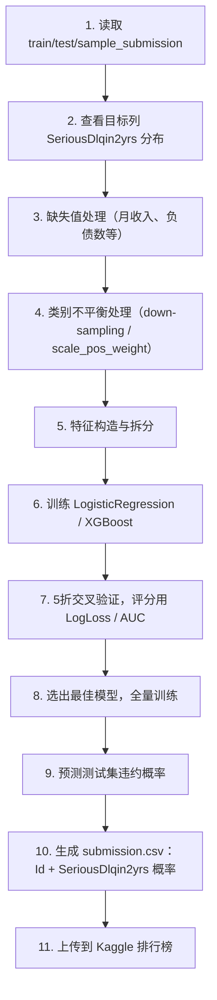

# 第5章 表格数据比赛详解：信用评分（Give Me Some Credit）

本章带你用 Kaggle 的经典入门比赛 **"Give Me Some Credit"**（信用评分）跑一遍完整的**二分类**表格数据流程。这个比赛的目标是预测一个借款人在未来两年内是否会发生财务困境（违约），输出的是违约**概率**。

和上一章房价预测（回归）不同，这一章是**分类**问题，而且数据非常不平衡：违约的人只占大约 7%，守约的人占 93%。这种“正样本很少”的情况在实际业务里非常常见，处理得不好模型会学成“全部预测守约”也能拿 93% 准确率，但完全抓不出违约用户。

**本章受众**：看过前面几章，想学习二分类、类别不平衡处理、LogLoss 指标，以及怎么提交概率预测结果。

本章的完整流程如下：



## 5.1 比赛介绍与数据下载

**Give Me Some Credit** 是 Kaggle 的信用评分类比赛，官方描述是“Improve on the state of the art in credit scoring by predicting the probability that somebody will experience financial distress in the next two years.”——即预测某人在未来两年内发生财务困境的概率。

比赛的基本信息：

- **任务类型**：二分类（违约 vs 守约），输出违约概率。
- **数据规模**：训练集约 150,000 行，测试集约 145,000 行，每行十几个特征。
- **目标列**：`SeriousDlqin2yrs`，1 表示未来两年内发生 90 天以上逾期（违约），0 表示守约。
- **评估指标**：**LogLoss（对数损失）**，对预测概率的校准很敏感，比单纯的准确率更适合衡量概率预测的好坏。排行榜有时也会看 AUC。
- **类别不平衡**：违约样本约占 7%，守约样本约占 93%，正负样本比例悬殊。

下载数据：加入比赛后，到 "Data" 标签页下载 `cs-training.csv`、`cs-test.csv` 和 `sample_entry.csv`，放在一个文件夹里：

```
give-me-some-credit/
├── cs-training.csv
├── cs-test.csv
└── sample_entry.csv
```

## 5.2 读取数据并查看目标分布

先读数据，看长什么样，尤其要看目标列 `SeriousDlqin2yrs` 的正负比例：

```python
# ---------------------------------------------------------
# 第5章示例：信用评分二分类全流程（使用自生成数据演示代码结构）
# 真实比赛中请将下面的生成数据部分替换为 pd.read_csv("cs-training.csv") 等
# ---------------------------------------------------------
import pandas as pd
import numpy as np
import warnings
warnings.filterwarnings("ignore")

# 真实比赛请取消下面两行的注释：
# train = pd.read_csv("cs-training.csv")
# test = pd.read_csv("cs-test.csv")

# 下面用自生成的小型示例数据，方便你直接运行看懂流程
np.random.seed(42)
n_train = 15000

train = pd.DataFrame({
    "Id": range(1, n_train + 1),
    "RevolvingUtilizationOfUnsecuredLines": np.random.uniform(0, 1, n_train).round(3),
    "age": np.random.randint(20, 80, n_train),
    "NumberOfTime30-59DaysPastDueNotWorse": np.random.randint(0, 10, n_train),
    "DebtRatio": np.random.uniform(0, 10, n_train).round(3),
    "MonthlyIncome": np.random.uniform(1000, 20000, n_train).round(2),
    "NumberOfOpenCreditLinesAndLoans": np.random.randint(1, 30, n_train),
    "NumberOfTimes90DaysLate": np.random.randint(0, 5, n_train),
    "NumberRealEstateLoansOrLines": np.random.randint(0, 10, n_train),
    "NumberOfTime60-89DaysPastDueNotWorse": np.random.randint(0, 5, n_train),
    "NumberOfDependents": np.random.randint(0, 5, n_train),
})

# 目标：违约标记，约 7% 为 1（违约），93% 为 0（守约）
train["SeriousDlqin2yrs"] = (np.random.rand(n_train) < 0.07).astype(int)

# 测试集：没有目标列
n_test = 14500
test = pd.DataFrame({
    "Id": range(n_train + 1, n_train + n_test + 1),
    "RevolvingUtilizationOfUnsecuredLines": np.random.uniform(0, 1, n_test).round(3),
    "age": np.random.randint(20, 80, n_test),
    "NumberOfTime30-59DaysPastDueNotWorse": np.random.randint(0, 10, n_test),
    "DebtRatio": np.random.uniform(0, 10, n_test).round(3),
    "MonthlyIncome": np.random.uniform(1000, 20000, n_test).round(2),
    "NumberOfOpenCreditLinesAndLoans": np.random.randint(1, 30, n_test),
    "NumberOfTimes90DaysLate": np.random.randint(0, 5, n_test),
    "NumberRealEstateLoansOrLines": np.random.randint(0, 10, n_test),
    "NumberOfTime60-89DaysPastDueNotWorse": np.random.randint(0, 5, n_test),
    "NumberOfDependents": np.random.randint(0, 5, n_test),
})

print("训练集形状：", train.shape)
print("测试集形状：", test.shape)
print("\n目标列分布：")
print(train["SeriousDlqin2yrs"].value_counts())
print("\n违约比例：%.2f%%" % (train["SeriousDlqin2yrs"].mean() * 100))
```

运行后你会看到类似下面的输出：

```
训练集形状： (15000, 12)
测试集形状： (14500, 11)

目标列分布：
0    13950
1     1050
Name: SeriousDlqin2yrs, dtype: int64

违约比例：7.00%
```

可以看到，违约样本只有约 7%，守约样本占 93%。这就是典型的**类别不平衡**数据，稍后会专门处理。

## 5.3 缺失值处理

信用数据里，`MonthlyIncome`（月收入）和 `NumberOfDependents`（受赡养人数）经常有缺失。我们用中位数填充数值型缺失值，因为中位数对异常值不敏感：

```python
# ---------------------------------------------------------
# 缺失值填充：数值型填中位数
# ---------------------------------------------------------
num_cols = [
    "RevolvingUtilizationOfUnsecuredLines", "age",
    "NumberOfTime30-59DaysPastDueNotWorse", "DebtRatio",
    "MonthlyIncome", "NumberOfOpenCreditLinesAndLoans",
    "NumberOfTimes90DaysLate", "NumberRealEstateLoansOrLines",
    "NumberOfTime60-89DaysPastDueNotWorse", "NumberOfDependents",
]

for col in num_cols:
    if col in train.columns:
        train[col] = train[col].fillna(train[col].median())
    if col in test.columns:
        test[col] = test[col].fillna(test[col].median())

print("缺失值填充完毕。训练集剩余缺失：", train.isnull().sum().sum())
```

## 5.4 类别不平衡处理

这是本章最重要的点之一。正样本（违约）太少，模型如果直接训练，很容易学成“全部预测 0（守约）”，准确率看起来很高，但完全抓不出违约用户——这在信贷场景下是不可接受的，因为漏掉一个违约用户的代价远高于误报一个守约用户。

常见的处理办法有两类：

1. **采样层面**：下采样（down-sampling）大类（守约），或上采样/ SMOTE 小类（违约），让正负样本比例更均衡。
2. **模型层面**：XGBoost 的 `scale_pos_weight` 参数，给正样本更大的权重，让模型更关注违约样本。

下面演示两种做法，你可以根据数据量和效果自行选择。

### 5.4.1 做法一：下采样守约样本

```python
# ---------------------------------------------------------
# 下采样：保留所有违约样本，从守约样本中随机抽取等数量
# ---------------------------------------------------------
from sklearn.utils import resample

train_majority = train[train["SeriousDlqin2yrs"] == 0]
train_minority = train[train["SeriousDlqin2yrs"] == 1]

# 从守约样本中下采样到和违约样本一样多
train_majority_downsampled = resample(
    train_majority,
    replace=False,           # 不放回抽样
    n_samples=len(train_minority),  # 抽取数量等于违约样本数
    random_state=42,
)

# 合并成平衡后的训练集
train_balanced = pd.concat([train_majority_downsampled, train_minority])
print("平衡后训练集形状：", train_balanced.shape)
print(train_balanced["SeriousDlqin2yrs"].value_counts())
```

下采样后训练集变小，训练更快，但扔掉了大量守约样本信息。

### 5.4.2 做法二：XGBoost 的 scale_pos_weight（推荐，保留全部数据）

```python
# ---------------------------------------------------------
# 计算 scale_pos_weight = 负样本数 / 正样本数
# ---------------------------------------------------------
neg_count = (train["SeriousDlqin2yrs"] == 0).sum()
pos_count = (train["SeriousDlqin2yrs"] == 1).sum()
scale_pos_weight = neg_count / pos_count
print("负样本数：", neg_count, "正样本数：", pos_count)
print("scale_pos_weight：", round(scale_pos_weight, 2))
```

把 `scale_pos_weight` 传给 XGBoost，模型在计算损失时会给违约样本更大的权重，自动“补偿”类别不平衡，无需扔掉任何数据，通常效果更好。

## 5.5 特征构造与拆分

构造一些简单的业务特征，比如“总逾期次数”（把各逾期天数段的次数加起来），然后把数据拆成特征矩阵 X 和目标向量 y：

```python
# ---------------------------------------------------------
# 特征构造：总逾期次数
# ---------------------------------------------------------
for df in [train, test]:
    df["TotalOverdue"] = (
        df["NumberOfTime30-59DaysPastDueNotWorse"]
        + df["NumberOfTimes90DaysLate"]
        + df["NumberOfTime60-89DaysPastDueNotWorse"]
    )

# 拆出特征和目标
feature_cols = [
    "RevolvingUtilizationOfUnsecuredLines", "age",
    "NumberOfTime30-59DaysPastDueNotWorse", "DebtRatio",
    "MonthlyIncome", "NumberOfOpenCreditLinesAndLoans",
    "NumberOfTimes90DaysLate", "NumberRealEstateLoansOrLines",
    "NumberOfTime60-89DaysPastDueNotWorse", "NumberOfDependents",
    "TotalOverdue",
]

X = train[feature_cols].values
y = train["SeriousDlqin2yrs"].values
X_test = test[feature_cols].values

print("X 形状：", X.shape)
print("y 形状：", y.shape)
print("X_test 形状：", X_test.shape)
```

## 5.6 模型训练：LogisticRegression 与 XGBoost

我们训练两个模型做对比：

1. **Logistic Regression**：经典的二分类线性模型，输出概率，适合做基线。
2. **XGBoost**：梯度提升决策树，对非线性关系和类别不平衡（通过 scale_pos_weight）都处理得好。

### 5.6.1 训练代码

```python
# ---------------------------------------------------------
# 训练 LogisticRegression 和 XGBoost
# ---------------------------------------------------------
from sklearn.linear_model import LogisticRegression
from xgboost import XGBClassifier

# Logistic Regression：做基线
lr = LogisticRegression(max_iter=1000, class_weight="balanced")
lr.fit(X, y)

# XGBoost：用 scale_pos_weight 处理类别不平衡
xgb = XGBClassifier(
    n_estimators=300,
    learning_rate=0.05,
    max_depth=5,
    subsample=0.8,
    colsample_bytree=0.8,
    scale_pos_weight=scale_pos_weight,
    random_state=42,
    n_jobs=-1,
    use_label_encoder=False,
    eval_metric="logloss",
)
xgb.fit(X, y)

print("模型训练完毕。")
```

注意 `class_weight="balanced"`（Logistic Regression）和 `scale_pos_weight`（XGBoost）都是为了让模型更关注少数类（违约）。

## 5.7 5 折交叉验证与 LogLoss 评分

二分类概率预测不能只看准确率，要用 **LogLoss（对数损失）**：它对预测概率是否“准”很敏感，预测越偏离真实标签，惩罚越大。LogLoss 越低越好。

scikit-learn 的 `cross_val_score` 对分类任务默认用 accuracy，我们要指定 `scoring="neg_log_loss"`（负 LogLoss），取负号还原为正的 LogLoss。

```python
# ---------------------------------------------------------
# 5 折交叉验证，评分用 neg_log_loss（负 LogLoss，取负号还原）
# ---------------------------------------------------------
from sklearn.model_selection import KFold, cross_val_score

cv = KFold(n_splits=5, shuffle=True, random_state=42)

models = {
    "LogisticRegression": lr,
    "XGBoost": xgb,
}

print("==== 模型              平均LogLoss    标准差 ====")
results = {}
for name, model in models.items():
    scores = cross_val_score(model, X, y, cv=cv, scoring="neg_log_loss")
    logloss = -scores.mean()      # 取负号，得到正的 LogLoss
    logloss_std = scores.std()
    results[name] = logloss
    print(f"{name:<20} {logloss:>10.4f} {logloss_std:>10.4f}")
```

我们请模型解释一下，为什么信用评分比赛用 LogLoss 而不是准确率：

```
请解释为什么 Kaggle 信用评分比赛用 LogLoss（对数损失）作为评估指标，而不是直接用准确率（accuracy）。
```

以下是模型给出的回答：

```
> （思考过程）信用评分数据极度不平衡：违约只有 7%，守约 93%。如果用准确率，模型把所有人都预测成守约，准确率就有 93%，看起来很高，但实际上完全没抓出任何违约用户，在信贷场景下毫无价值。LogLoss 衡量的是预测概率与真实标签（0/1）之间的“距离”，对概率校准很敏感：如果模型对一个真正违约的用户预测出 0.01 的违约概率，LogLoss 会给予非常大的惩罚；如果预测 0.9，惩罚就很小。这样模型既要把违约用户挑出来，还要把概率预测得准，不能靠“全部预测多数类”来刷高分数。而且比赛目标本身是输出违约概率，用 LogLoss 评分与训练目标一致，更公平。

LogLoss 对预测概率的准确性要求高，不能通过“全部预测多数类”来刷高分数，非常适合类别不平衡的信用评分场景。
```

## 5.8 预测违约概率与生成 submission.csv

选出 LogLoss 最低的模型后，在全量训练集上复训练，用它预测测试集的违约概率。注意：二分类提交的是**概率**（0 到 1 之间的小数），不是 0/1 标签。

```python
# ---------------------------------------------------------
# 选出 LogLoss 最低的模型，在全量训练集上复训练，预测测试集违约概率
# ---------------------------------------------------------
best_name = min(results, key=results.get)
print("最佳模型：", best_name, "验证集 LogLoss：", round(results[best_name], 4))

best_model = models[best_name]
best_model.fit(X, y)  # 在全量训练集上复训练

# 预测违约概率（取正类概率，即第 1 列）
if hasattr(best_model, "predict_proba"):
    test_proba = best_model.predict_proba(X_test)[:, 1]
else:
    # LogisticRegression 的 decision_function 需要转成概率，这里简化处理
    test_proba = best_model.predict(X_test).astype(float)

print("前 5 个预测违约概率：", test_proba[:5].round(4))
```

### 5.8.1 生成提交文件

Kaggle 要求提交一个 CSV，只包含两列：Id 和 SeriousDlqin2yrs（违约概率）。多列或少列都会报错：

```python
# ---------------------------------------------------------
# 生成 submission.csv：只含 Id 和 SeriousDlqin2yrs 两列
# ---------------------------------------------------------
submission = pd.DataFrame({
    "Id": test["Id"].values,
    "SeriousDlqin2yrs": test_proba,
})

submission.to_csv("submission.csv", index=False)
print(submission.head())
print("提交文件已生成：submission.csv，共", len(submission), "行")
```

生成 submission.csv 后，登录 Kaggle 信用评分比赛页面，点击 Submit Predictions 上传该文件，即可看到公开排行榜上的 LogLoss 分数。

## 本章小结

这一章我们把信用评分比赛的二分类流程跑完了一遍：

1. **读取数据**：下载 `cs-training.csv`、`cs-test.csv`、`sample_entry.csv`，用 pandas 读取。
2. **目标分布**：发现违约样本约 7%，守约样本 93%，典型的类别不平衡数据。
3. **缺失值处理**：数值型缺失用中位数填充。
4. **类别不平衡处理**：介绍了下采样和 XGBoost 的 `scale_pos_weight` 两种做法，推荐后者（保留全部数据）。
5. **特征构造**：造了 `TotalOverdue`（总逾期次数）等复合特征，拆出特征矩阵 X 和目标向量 y。
6. **训练两种模型**：Logistic Regression（`class_weight="balanced"`）和 XGBoost（`scale_pos_weight`）。
7. **5 折交叉验证**：用 KFold 配合 `scoring="neg_log_loss"`，取负号还原为 LogLoss，得分越低越好。
8. **预测概率并生成提交文件**：输出只含 Id 和 SeriousDlqin2yrs（概率）的 submission.csv，上传到 Kaggle 即可参与排行榜。

到这里，第5章“表格数据比赛详解：信用评分”就全部讲完了。从数据下载、处理类别不平衡，到模型训练、交叉验证、生成概率提交文件，你已经掌握了二分类表格比赛的核心套路。接下来的章节会把同样的套路迁移到贷款审批、推土机价格预测等更多比赛中去。

---

*下一章：第6章 表格数据比赛详解：贷款审批（Loan Approval）—— 贷款是否批准，分类准确率与 F1 分数*