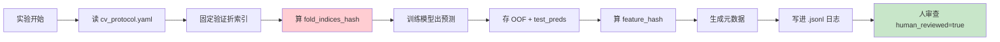
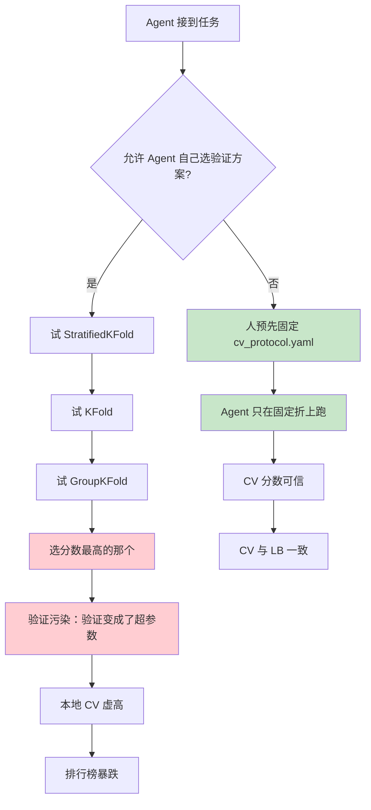
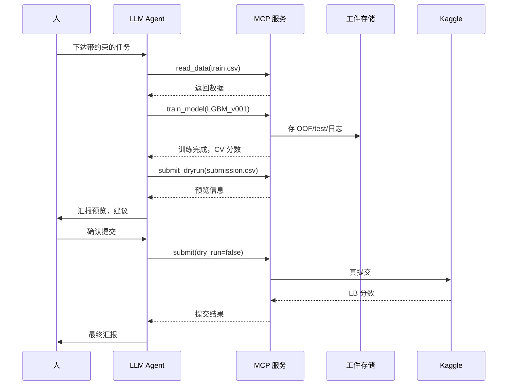

# 第2章 VibeKaggle 的操作系统：工件、验证、Agent、预算

> **本章目标**：把第 1 章搭的“工地”升级成一套**操作系统**。你会拿到四样东西：一份正式的工件规范、一份不可篡改的验证协议、一张 Agent 能干/不能干的边界表、一条带护栏的 MCP 流水线。这一章是全书的地基，后面每一场比赛都跑在这套系统上。

---

## 开篇：第 1 章搭了工地，这一章要盖楼

上一章我们建好了文件夹、跑通了常数基线、写好了提交自检脚本。如果你照着做了，现在电脑里应该有 `artifacts/` 目录和几个 `.npy` 文件。但说实话，那还只是个“能用的工地”，离“操作系统”还差得远。

差在哪？打个比方。第 1 章的工地，相当于你租了个毛坯房，水电通了，能住人。但你要长期住、还要请施工队（Agent）来装修，就得有物业规定：垃圾放哪、几点能施工、装修队只能走哪条通道、每天最多运多少材料。没有这些规定，施工队一进场就乱套。

这一章要定的，就是这套“物业规定”。它分四块，我们一块一块来：

1. **工件规范**——规定每样产出物叫什么名、放哪、带什么信息（这是物理基础）；
2. **验证优先**——规定“怎么切数据、怎么算分”这件事只能人说了算（这是判断纪律）；
3. **Agent 能力边界**——划清楚哪些活能交给 Agent、哪些必须人来做（这是分工原则）；
4. **MCP 流水线**——让 Agent 能持续操作平台，但每一步都有护栏（这是安全边界）。

把这四块拼起来，你就有了 VibeKaggle 的“操作系统”。后面第 3 章开始，每一场比赛都是在这套系统上跑的应用程序。

读完这一章，你可能会有个感受：怎么全是规矩，一条流水线还没跑呢？这个感受是对的，也是故意的。规矩这东西，定的时候觉得啰嗦，用的时候救命。我们不急，慢慢来。

---

## 2.1 工件规范：VibeKaggle 的物理基础

### 先说清楚：为什么“工件规范”值得单独一节？

你可能觉得，不就是文件命名嘛，有什么大不了的。但我要告诉你，这是整本书里**最容易被新手跳过、又最要命**的一节。

设想一个场景。Agent 一晚上跑了 200 个实验，每个实验都产出一个 OOF 文件和一个测试预测文件。第二天早上你想做集成（把多个模型的结果混合），结果发现：文件名乱七八糟，有的叫 `oof1.npy`，有的叫 `model_result_final_v2.npy`，你根本不知道哪个是哪个模型、哪个版本、用的什么验证方案。更糟的是，你想查“Agent 有没有偷偷换验证方式刷分”，翻遍日志也找不到记录。

这个场景不是吓唬你。社区里有个很形象的说法，说很多人到了比赛最后一周，电脑里躺着几十个“book”（实验记录本）、略微不同的特征集、没记下来的随机种子，还有一堆叫 `final_v7_really_final.csv` 的提交文件——乱到根本没法判断哪个模型该进最终集成，更没法诊断某次涨分到底是因为模型变好了、还是因为某个特征泄漏了、还是只是随机波动。

这就是没有工件规范的后果：**工件不可组合、不可追溯、不可审计**。而这三件事，恰恰是 VibeKaggle 的命根子。

所以我们要把工件规范当成“物理协议”来定——不是建议，是强制。定了之后，人和 Agent 都得遵守。

顺便说一句，这套思路不是我们拍脑袋想的，它是从工业界借来的。做机器学习工程的人，通常会用一批叫“实验追踪”的工具来干这件事——比较有名的有 MLflow、DVC、Weights & Biases、Neptune。它们干的活儿，说白了就是替你把“这次实验用了什么数据版本、什么参数、得了多少分、产出了哪些文件”记成一条结构化记录。我们这一章要手搓的这套工件规范，就是这些工具的核心思想的“极简版”——不依赖任何付费服务，用几个文件夹和几个文件就能跑起来。等你以后真需要上规模了，再换正式工具，迁移成本很低，因为“记录什么”这件事我们已经想清楚了。

### 2.1.1 目录结构（全书统一）

先把目录结构定死。你第 1 章已经建了 `artifacts/oof/` 这几个，现在我们把它补全成完整版：

```
<project_root>/
├── artifacts/                    # 所有工件的根目录（建议加进 .gitignore，或用 DVC 管理）
│   ├── oof/                      # 折外预测，形状 (n_train,)
│   │   └── train_oof_[模型]_[版本].npy
│   ├── test_preds/               # 测试集预测，形状 (n_test,)
│   │   └── test_preds_[模型]_[版本].npy
│   ├── logs/                     # 实验日志，JSON Lines，一行一个实验
│   │   └── exp_[模型]_[版本].jsonl
│   ├── configs/                  # 配置快照，YAML，方便人看
│   │   └── cfg_[模型]_[版本].yaml
│   ├── submissions/              # 生成的提交文件备份
│   │   └── submission_[模型]_[版本].csv
│   └── ensembles/                # 集成产出的工件
│       ├── oof_ensemble_[名字]_[版本].npy
│       └── test_ensemble_[名字]_[版本].npy
├── data/                         # 原始数据（只读，别改）
│   ├── train.csv
│   ├── test.csv
│   └── sample_submission.csv
├── src/                          # 可复用源码
│   ├── utils/                    # 工具函数（自检、CV 协议、哈希）
│   ├── baselines/                # 各种基线
│   ├── features/                 # 特征工程
│   ├── models/                   # 模型
│   └── ensembles/                # 集成
├── configs/                      # 项目级配置（不是单次实验的）
│   ├── rules.yaml                # 比赛规则红线
│   ├── cv_protocol.yaml          # 验证协议（人设定，不可变）
│   └── agent_policy.yaml         # Agent 权限策略
├── notebooks/                    # 探索性笔记本（不产出正式工件）
└── scripts/                      # 一次性脚本
```

这里有个小讲究：`artifacts/` 目录建议加进 `.gitignore`（用 Git 管理代码时），因为工件文件可能很大，不适合塞进代码仓库。如果你想让工件也能版本管理，可以用 DVC 这类工具。但这是后话，现在你先把目录建对。

还有一个容易忽略的细节：`data/` 目录我们标了"只读，别改"。这不是洁癖，是防污染。你在探索阶段手滑改了一个原始数据单元格，如果没留记录，那后面所有实验的分数都不可信了——你都不知道分数变化是模型变强还是数据被改了。原始数据要动，正确姿势是**复制一份到别处再改**，并且在配置里注明改了什么。

### 2.1.2 命名约定（强制）

命名这件事，看着小，但它是“可组合”的前提。想象一下，如果每个实验的文件名都带随机后缀，你写脚本批量读取时就得写一堆正则去猜，迟早出错。所以我们要定死命名规则：

| 要素 | 格式 | 例子 | 说明 |
|------|------|------|------|
| 模型标识 | 大写字母+下划线 | `AUTOGLUON`、`LGBM`、`XGB`、`TABPFN`、`NN` | 一眼看出是什么模型 |
| 版本号 | `v` + 三位数字 | `v001`、`v012`、`v100` | 严格递增，排序不乱 |
| 任务后缀 | 可选 | `_cls`、`_reg` | 多任务时区分 |

完整文件名长这样：
- OOF：`train_oof_{模型}_{版本}.npy`
- 测试预测：`test_preds_{模型}_{版本}.npy`
- 日志：`exp_{模型}_{版本}.jsonl`
- 配置：`cfg_{模型}_{版本}.yaml`
- 提交：`submission_{模型}_{版本}.csv`
- 集成 OOF：`oof_ensemble_{名字}_{版本}.npy`

你照着这个填，永远不会乱。

### 2.1.3 每个工件必须附带的最小元数据

光有文件名还不够。每个实验跑完，日志里必须记清楚“这次实验到底是怎么回事”。我们用 Pydantic（一个 Python 数据校验库）定义一个“元数据模板”，强制每次实验都填满这些字段：

```python
# src/utils/artifact_schema.py
"""
工件元数据的"身份证"模板。
每次实验结束，都要生成一份这样的记录，写进 logs/ 目录。
Pydantic 会自动校验字段类型和必填项，缺了就会报错。
"""

from pydantic import BaseModel, Field
from typing import List, Optional, Literal
from datetime import datetime


class ArtifactMetadata(BaseModel):
    # ---- 身份：这是谁家的实验 ----
    model: str                    # 模型标识，如 "AUTOGLUON"
    version: str                  # 版本，如 "v001"
    task_type: Literal["binary", "multiclass", "regression", "ranking"]

    # ---- 验证协议（最关键，防作弊用） ----
    cv_scheme: str                # 验证方案描述，如 "StratifiedKFold_5_42"
    cv_fold_indices_hash: str     # 验证折索引的哈希，确保协议没被偷偷改

    # ---- 性能 ----
    cv_scores: List[float]        # 每一折的分数
    cv_mean: float                # 平均分
    cv_std: float                 # 标准差（衡量稳定性）
    metric: str                   # 指标名，如 "auc"、"rmse"

    # ---- 工件路径 ----
    oof_path: str                 # OOF 文件相对路径
    test_path: str                # 测试预测文件相对路径
    submission_path: Optional[str] = None

    # ---- 数据血统（这批数据是怎么来的） ----
    n_train: int                  # 训练样本数
    n_test: int                   # 测试样本数
    feature_hash: str             # 特征矩阵的哈希
    preprocessing_hash: str       # 预处理管线的哈希

    # ---- 变更描述（这次改了什么，一句话） ----
    change_desc: str              # 如 "增加交互特征 X*Y"

    # ---- 时间与来源 ----
    created_at: datetime = Field(default_factory=datetime.utcnow)
    agent_model: Optional[str] = None   # 哪个 Agent 干的，如 "claude-opus-4.8"
    human_reviewed: bool = False        # 人审过了没

    class Config:
        json_encoders = {datetime: lambda v: v.isoformat()}


def validate_artifact_metadata(meta: ArtifactMetadata) -> bool:
    """校验元数据完整性，缺胳膊少腿就报错。"""
    assert meta.model and meta.version and meta.change_desc, "身份或变更描述不能空"
    assert len(meta.cv_scores) >= 2, "至少要两折分数"
    from pathlib import Path
    assert Path(meta.oof_path).exists(), "OOF 文件不存在"
    assert Path(meta.test_path).exists(), "测试预测文件不存在"
    return True
```

这里面最不显眼但最重要的字段是 `cv_fold_indices_hash`——它是验证折索引的哈希值。有了它，你就能在事后检查“Agent 有没有偷偷换验证方案”。这个机制 2.2 节会详细讲，现在你只需要知道：**它是防作弊的锚点。**

第二个值得单独说说的是 `change_desc`（变更描述）。这一行字看着简单，但它决定了三个月后的你还能不能看懂这次实验干了啥。社区里有个扎心的观察：很多人在比赛最后一周，已经完全想不起来“上周那版为什么分数高”——因为当时只记了分数，没记改动。**分数是结果，`change_desc` 才是原因**，而你复盘时想要的永远是原因。

第三个是 `human_reviewed`。默认 `False`，意思是“这个工件还没被人看过”。人看过、认可了，才改成 `True`。这个字段简单到近乎朴素，但它把“人审”这件事从口头流程变成了数据字段——Agent 读日志的时候，一眼就能分辨哪些工件是“自动产出的”，哪些是“你点头过的”。

用一张图看看一个工件从“实验开始”到“人审通过”的生命周期：



> 记住这句话：**没有工件规范，“人看 OOF 做判断”是空话，“Agent 自动做集成”无从谈起，“验证污染”也无从检查。**

---

## 2.2 验证优先：不可委托的判断纪律

### 2.2.1 什么叫“验证优先”？

一句话：**验证方案怎么设计（切几折、怎么分层、要不要分组、要不要按时间切），必须人来做；Agent 只负责照着执行。**

这话听着像废话，但在 Agent 高吞吐的场景下，特别容易被破坏。我给你描述一个真实会发生的场景：

你让 Agent“帮我把分数刷上去”。Agent 很卖力，它试了 StratifiedKFold 5 折，分数 0.85；又试了普通 KFold，分数 0.86；再试了 GroupKFold，分数 0.87。它一看， GroupKFold 最高，就用了这个，还沾沾自喜地告诉你“我找到了更好的验证方案”。

问题来了：**验证方案本身变成了被优化的对象。** 这就好比考试前你不断换判卷标准，直到找到一套能让你分数最高的判法——你的“高分”毫无意义，因为你已经不是在学知识，而是在钻判卷的空子。这在机器学习里叫**验证污染（validation contamination）**，是 Agent 时代最隐蔽的过拟合。

用图看这个过程有多危险：



所以我们的做法是：**人在项目一开始，就把验证方案写成一份“宪法”文件，之后全程只读不改。** Agent 每次跑实验，都只能照着这份宪法切折。

说到这里，可能有人要问了：那 Agent 到底能不能自己挑验证方式？答案是不能，但原因值得掰开说。

社区里流传一句被反复引用的话：**“一套稳健的验证策略，往往比换一个更复杂的模型更值钱。”** 这话不是鸡汤。你想，模型再复杂，如果分数是假的，你优化的是幻觉；而验证做对了，哪怕模型很朴素，你至少知道自己站在哪。

那怎么判断自己的验证靠不靠谱？有一个很好用的自检工具，叫**对抗验证（adversarial validation）**。做法特别朴素：把训练集和测试集混在一起，训练一个分类器去分辨“这一行来自训练还是测试”。如果这个分类器几乎分不开（ROC-AUC 接近 0.5），说明两边长得差不多，同分布；如果它分得特别开（社区里常用的经验阈值是 AUC 超过 0.60），那就是警报——训练集和测试集存在分布漂移，你的本地 CV 很可能系统性地骗你。这个检查很便宜，几分钟就能跑完，强烈建议你把它写进流水线的第一步。

还有一个特别容易被忽略的细节，是某位 Kaggle Grandmaster 反复强调的：**验证集上不要用早停（early stopping）**。道理很直白——真实测试集根本没给你，你不可能拿它来早停；如果你在验证集上早停，等于偷偷用验证集调了训练轮数，分数就会虚高。这一条对 Agent 尤其重要，因为“加个 early stopping 让分数好看点”正是 Agent 会自作主张干的事。

最后说个更微妙的问题：**到底该信 CV 还是信 LB？** 网上吵这个帖子吵了好几年，其实答案不复杂——**取决于测试集和训练集是不是同分布**。如果同分布，那当然信 CV，因为 CV 用了全部训练数据、样本量大、更稳；如果不同分布，那 CV 就是系统性偏的，这时候公开榜反而可能更接近最终榜。社区里有两个常被引用的例子：一个是 Child Mind Institute 那个睡眠状态检测比赛，数据量大、公开榜分布莫名偏移，最后证明“信 CV”更靠谱；另一个是 UM 那个 MCTS 变体强度预测的比赛，测试集分布明显不同，反而是公开榜更能反映最终榜。所以真正的答案不是“信谁”，而是“**先花时间搞清楚测试集和训练集是不是同一批人**”——搞清楚这一点，信谁的问题就自动解决了。

### 2.2.2 `cv_protocol.yaml`：验证协议的“宪法”

下面这份文件，你要在跑第一个模型之前写好，然后**锁死**。写的时候要像立法一样认真，因为后面所有实验都靠它：

```yaml
# configs/cv_protocol.yaml
# 由人编写，Agent 只读，全程不可变。
# 一旦修改这个文件 = 项目重启（所有历史工件作废）。

protocol_version: "1.0"
created_at: "2026-01-15T10:00:00Z"
author: "human"

# 任务类型决定默认的验证方式
task_type: "binary"      # binary / multiclass / regression / ranking

# 核心验证方案
cv_scheme:
  type: "StratifiedKFold"   # 可选：KFold / StratifiedKFold / GroupKFold / TimeSeriesSplit
  n_splits: 5               # 切 5 折
  random_state: 42          # 随机种子，固定才能复现
  shuffle: true

  # 如果用 GroupKFold，这里填分组列名
  group_column: null        # 如 "customer_id"、"store_id"

  # 如果用 TimeSeriesSplit，这里填时间列名
  time_column: null         # 如 "date"
  gap: 0                    # 训练集和验证集之间隔多久（防泄漏）

# 分层列（分类任务通常是目标列）
stratify_column: "target"

# 明令禁止的验证方案（防止 Agent 乱来）
forbidden_schemes:
  - "KFold"           # 分类任务禁用普通 KFold
  - "ShuffleSplit"    # 禁用随机重采样
  - "LeaveOneOut"     # 计算量太大且容易泄漏

# 指标（Agent 不能自己换）
metric:
  name: "auc"           # auc / logloss / rmse / mape / r2
  direction: "maximize" # maximize / minimize

# 泄漏检查清单（人审查时逐条核对）
leakage_checks:
  - "目标编码是否只用训练折计算"
  - "时间特征是否包含未来信息"
  - "分组列是否跨折泄漏"
  - "预处理拟合是否只在训练折上"
```

这份文件为什么是“宪法”？因为它定义了**所有实验共同的比较基准**。只有验证方案一致，不同实验的分数才能互相比较；一旦有人（包括 Agent）改了它，所有历史分数都失去可比性。

写这份文件的时候，有几个地方值得多花两分钟斟酌。

**第一，`task_type` 要选对。** 二分类、多分类、回归、排序，对应的默认验证方式完全不同。搞错了，后面所有实验的分数都是废的。

**第二，`stratify_column` 默认用目标列，但要注意变体。** 分类任务用它分层是为了让每折的正负比例一致，保持和整体分布接近。回归任务没有天然的“类”，但有个常见变体：**先把目标值分箱（切成一堆区间），再对分箱结果做分层**。这样每折的目标分布也接近整体，比纯 KFold 稳。

**第三，`gap` 这个字段别浪费。** 时序任务里，训练集和验证集之间留一段“空窗”（gap），能防止某些看起来无害的特征间接泄漏未来信息。这是个花小钱办大事的设置。

**第四，`forbidden_schemes` 这一段是给 Agent 看的。** 光说“不许乱改”不够，你得明确列出“这些方案在这个项目里不许用”，Agent 才好照办。人类也一样——明确禁止比模糊叮嘱有效得多。

**第五，`leakage_checks` 这份清单，是本章最有实用价值的部分之一。** 它把“该查什么”具体化了，省得每次凭记忆想。下面我们就来看看，这份清单上为什么是这几条。

### 2.2.3 折索引哈希：用技术手段防篡改

光靠“君子协定”不够，Agent 可能“好心办坏事”，也可能真的想刷分。我们用一个技术手段来兜底：**给验证折索引算一个哈希值，每次实验都记下来，事后一比对就知道有没有被改过。**

```python
# src/utils/cv_protocol.py
"""
验证协议的加载、执行与防篡改校验。
核心：get_splits 按协议切折；compute_fold_indices_hash 算哈希；
     verify_cv_protocol_unchanged 检查历史实验有没有偷偷换协议。
"""

import hashlib
import numpy as np
import pandas as pd
import yaml
from sklearn.model_selection import (
    StratifiedKFold, KFold, GroupKFold, TimeSeriesSplit
)


def load_cv_protocol(config_path: str = "configs/cv_protocol.yaml") -> dict:
    """读取人写的验证协议。"""
    with open(config_path, encoding="utf-8") as f:
        return yaml.safe_load(f)


def get_cv_splitter(protocol: dict, X: pd.DataFrame, y: np.ndarray):
    """按协议生成切折器，返回 splits 列表。"""
    sch = protocol["cv_scheme"]
    cv_type = sch["type"]
    n = sch["n_splits"]
    rs = sch.get("random_state", 42)

    if cv_type == "StratifiedKFold":
        # 分层：保持每折正负样本比例一致
        col = protocol.get("stratify_column", "target")
        strat = X[col] if col in X.columns else y
        cv = StratifiedKFold(n_splits=n, shuffle=sch.get("shuffle", True), random_state=rs)
        splits = list(cv.split(X, strat))
    elif cv_type == "GroupKFold":
        # 分组：同一组（如同一客户）不跨折，防泄漏
        cv = GroupKFold(n_splits=n)
        splits = list(cv.split(X, y, X[sch["group_column"]]))
    elif cv_type == "TimeSeriesSplit":
        # 时序：训练集时间必须早于验证集
        cv = TimeSeriesSplit(n_splits=n, gap=sch.get("gap", 0),
                             max_train_size=sch.get("max_train_size"))
        splits = list(cv.split(X))
    elif cv_type == "KFold":
        cv = KFold(n_splits=n, shuffle=sch.get("shuffle", True), random_state=rs)
        splits = list(cv.split(X, y))
    else:
        raise ValueError(f"不支持的验证类型：{cv_type}")

    return cv, splits


def compute_fold_indices_hash(splits: list, n_samples: int) -> str:
    """
    算折索引哈希：把"每个样本属于第几折"编码成数组，再取 SHA256。
    只要有人改了切折方式（哪怕只挪了一个样本），哈希就会变。
    """
    fold_of = np.full(n_samples, -1, dtype=np.int16)  # -1 表示还没分配
    for k, (_, val_idx) in enumerate(splits):
        fold_of[val_idx] = k
    assert (fold_of >= 0).all(), "有样本没被分到任何验证折"
    return hashlib.sha256(fold_of.tobytes()).hexdigest()[:16]  # 取前16位够用


def verify_cv_protocol_unchanged(protocol: dict, current_hash: str, log_dir) -> bool:
    """扫描历史日志，找出折索引哈希与当前不一致的实验（即偷偷换过协议）。"""
    import json
    from pathlib import Path
    for log_file in Path(log_dir).glob("exp_*.jsonl"):
        with open(log_file, encoding="utf-8") as f:
            for line in f:
                entry = json.loads(line)
                if "cv_fold_indices_hash" in entry:
                    if entry["cv_fold_indices_hash"] != current_hash:
                        print("⚠️ 检测到验证协议不一致！")
                        print(f"  当前：{current_hash}")
                        print(f"  历史（{log_file.name}）：{entry['cv_fold_indices_hash']}")
                        print(f"  历史模型：{entry['model']}_{entry['version']}")
                        return False
    return True


# 使用示例
if __name__ == "__main__":
    protocol = load_cv_protocol()
    train = pd.read_csv("data/train.csv")
    y = train["target"].values
    X = train.drop(columns=["target", "id"], errors="ignore")

    _, splits = get_cv_splitter(protocol, X, y)
    fold_hash = compute_fold_indices_hash(splits, len(train))
    print(f"验证协议哈希：{fold_hash}")

    from pathlib import Path
    if not verify_cv_protocol_unchanged(protocol, fold_hash, Path("artifacts/logs")):
        raise RuntimeError("验证协议被改过了，请检查！")
    print("✅ 验证协议一致性检查通过")
```

这套机制妙在哪？它把“人必须固定验证协议”这条纪律，从“口头约定”变成了“技术强制”。Agent 就算想换 CV 刷分，哈希对不上，一查就露馅。

不过，哈希只能防“换切分方式”，防不了另一类更隐蔽的作弊——**数据泄漏（data leakage）**。所谓泄漏，就是训练时不小心让模型“偷看”到了它本不该知道的答案，于是本地分数虚高、一到线上就崩。社区里有个很准的说法：数据泄漏是“本地 CV 漂亮、公开榜暴跌”的头号元凶。

泄漏有几种经典款，你最好背下来，因为 Agent 特别容易踩：

| 泄漏类型 | 怎么发生的 | 怎么修 |
|----------|-----------|--------|
| **切分前做预处理** | 把整个训练集先标准化/填充缺失，再切折，验证折的均值、方差就漏进了训练 | 所有缩放器、填充器、编码器都放进折内训练，或包进 sklearn 的 `Pipeline` |
| **全局目标编码** | 用全量数据算高基数类别列的目标均值 | 用折内（OOF）目标编码，保证任何一行的目标值不参与它自己的特征计算 |
| **忽略分组结构** | 同一个病人/商店/用户的多行记录被随机分到训练和验证两边 | 识别出分组列，改用 `GroupKFold`；只在测试集评估全新群体时尤其要注意 |
| **训练+测试合并做聚合** | 把 train 和 test 拼起来算 `groupby().mean()` 之类的统计量 | 只从训练数据算统计量，再 `merge` 到测试集 |
| **时间穿越** | 用随机切分处理带时间顺序的数据，模型偷看了未来 | 用 `TimeSeriesSplit` 这类按时间顺序的切分 |
| **滚动窗口没移位** | 算移动平均忘了 `.shift(1)`，或误用了 `center=True`，当前行甚至未来行混进了窗口 | 一律 `.shift(1)`，保证特征只看“真正发生在过去”的值 |
| **过早采样（SMOTE）** | 切分前就对全量数据做 SMOTE，合成样本跨到了验证折 | 重采样只在训练折内做，用 `imblearn.pipeline` 最省心 |

这张表信息量大，你不用一次全记住，但要有印象。**它同时是 Agent 的“必须检查项”和你的“复盘清单”。** 每次分数突然大涨，先别高兴，先对照这七条过一遍——90% 的“天上掉馅饼”都掉在这七条上。

> **人必须固定验证协议。这是不可让渡的判断纪律——Agent 的吞吐量越高，这个护栏越重要。**

---

## 2.3 LLM Agent 的能力边界：执行和枚举，而非判断

### 2.3.1 Agent 擅长什么（可以放心交）

Agent 是个“干活快手”，但“方向感”一般。它擅长的是那些**重复、量大、有明确对错**的活：

| 类别 | 具体任务 | 在 VibeKaggle 里 |
|------|----------|------------------|
| **写代码** | EDA 脚本、baseline、特征函数、训练循环 | 生成 `src/` 下的模块 |
| **批量跑** | 50 种特征变换对比、100 组超参搜索、20 个模型基线 | 循环调用训练函数，产出工件阵列 |
| **汇总结果** | 读所有日志，做排行榜、相关性图、趋势图 | 输出 `reports/` 下的报告 |
| **管工件** | 按规范改名、搬移、校验、算相关性 | 维护 `artifacts/` 整洁 |
| **生成候选** | 集成的候选组合、超参搜索空间 | 生成候选清单供人挑 |

这张表怎么用？一个很简单的判断法：**看这件事有没有客观的对错标准。**

"把这 50 组参数各跑一遍"——有客观标准，跑完就知道每个的分数，Agent 干得又快又不会烦，完美交给它。

"这个特征该不该留"——没有客观标准，取决于你对业务的理解，你来。

"把 train/test 拼起来算聚合特征"——Agent 干得又快又漂亮，而且**它干得越漂亮越危险**，因为结果从外表上看毫无破绽。这种事就得靠上面那张泄漏清单来拦。

顺便说一句，社区上流传的"十条黄金法则"里，有一条跟这块特别契合：**Track Everything**——把每一次提交的本地 CV 分数、超参数、代码版本都记干净。这条听着像废话，但它恰恰是"人判断"能成立的前提：你得有一份可信的账本，才能判断 Agent 这次干的活到底是进步还是原地踏步。账本记得多细算够？社区里的经验值是：一个跑得比较狠的实验周期，光是"模型 × 折数 × 随机种子"这一项就能轻松堆到 150 次拟合（比如 10 个模型 × 5 折 × 3 个种子）。如果这 150 次的配置没一条一条记下来，到了比赛最后一周，你根本说不清哪几个模型该进最终集成——这就是为什么我们第 1 章要费那么大劲定工件规范。

### 2.3.2 Agent 不擅长什么（必须人来做）

但下面这些活，Agent 干不了，或者干了容易坏事：

| 类别 | 具体任务 | 为什么不能交 |
|------|----------|--------------|
| **方向判断** | “该不该做特征选择？”“要不要上神经网络？” | 需要领域直觉和资源权衡 |
| **验证设计** | “5 折还是 10 折？”“要不要分组？” | 验证污染风险，必须人把关 |
| **语义判断** | “这个交互特征有业务意义吗？”“目标编码会泄漏吗？” | 需要理解数据是怎么产生的 |
| **提交决策** | “CV 涨了 0.001，值不值得花一次提交？” | 提交额度是稀缺资源，涉及机会成本 |
| **异常诊断** | “CV 突然掉了 0.01，是数据变了还是代码坏了？” | 需要系统排查，Agent 容易瞎编解释 |

### 2.3.3 怎么给 Agent 下指令：带约束的请求

关键来了。**你给 Agent 的指令，不应该是“帮我建个模型”，而应该是“带着约束的请求”。** 约束从哪来？从我们前面定的 Harness（验证协议、工件规范、预算、工具白名单）来。

对比一下：

**❌ 错误指令**：“帮我建个模型提高分数。”
（Agent 听了会：随便选个 CV、随便存文件、跑完就提交，一片混乱。）

**✅ 正确指令**：

```markdown
## Agent 任务：批量训练 LightGBM 变体

### 硬性约束（必须遵守）
- 验证协议：严格遵循 configs/cv_protocol.yaml，fold_indices_hash 必须一致
- 工件命名：train_oof_LGBM_v{三位版本}.npy、test_preds_LGBM_v{三位版本}.npy
- 日志格式：按 ArtifactMetadata 模板，change_desc 必填
- 禁止：改验证方案、用外部数据、联网下载模型

### 搜索空间（可以发挥）
- 12 组参数：learning_rate [0.01,0.05,0.1] × num_leaves [31,63,127] × min_child_samples [20,50]
- 固定：n_estimators=2000, early_stopping=100, random_state=42

### 验收标准
1. 12 个实验都产出合规工件
2. 无验证协议违规（哈希一致）
3. 生成汇总报告，按 CV 降序，含 OOF 相关性矩阵
4. 标出 CV 前 3 名供人审查

### 交付物
- artifacts/logs/exp_LGBM_v001.jsonl ~ v012.jsonl
- artifacts/oof/train_oof_LGBM_v001.npy ~ v012.npy
- reports/lgbm_sweep_v001.md
```

你看，同样是“训练 LightGBM”，第二种指令把边界、标准、交付物全说清楚了。Agent 照着做，产出整齐；你审查起来，也一目了然。

而且，好的 Agent 收到这种带约束的指令后，会主动把自己的“不确定”暴露给你，而不是闷头乱干。假设你把上面那段任务丢给模型，它可能这样回应：

```
> （思考过程）任务里给了固定 CV 协议、命名规范、12 组搜索空间。
> 我需要确认几件事：1) cv_protocol.yaml 里 task_type 是不是 binary，
> 决定用 predict_proba 还是 predict；2) 数据里目标列是不是叫 target；
> 3) GPU 是否可用。这些如果不确定，应该先问人，而不是假设。

收到。开始前我先确认三点，避免跑错方向：

1. 验证协议 configs/cv_protocol.yaml 里 task_type=binary、metric=auc，
   我会据此用 predict_proba 取正类概率。如果和你的数据不符，请先告诉我。
2. 默认目标列名是 target、ID 列是 id，如果没有这两列我会报错停下，
   不会自作主张改列名。
3. 我会严格复用协议里的 folds，并在每个实验日志里写入
   cv_fold_indices_hash，方便你事后审计。

另外说明一个我不确定、需要你判断的点：min_child_samples=20/50
这档在 16 万行数据上可能偏小，容易过拟合。我先按你给的跑，
如果 12 组里前几名 CV 都不稳定，建议你再补一档 100。要不要现在就加？
```

注意这段回应里最值钱的，是最后那段“我不确定、需要你判断的点”。**Agent 主动划出自己的边界，把超出它判断范围的事交还给你**——这正是 VibeKaggle 想要的协作姿态。

---

## 2.4 AutoML 与表格基础模型：强基线的快速来源

### 2.4.1 为什么每场比赛第一步都是 AutoML？

你可能会问，既然要人判断、Agent 执行，那第一步跑什么？答案是 **AutoML（自动机器学习）**。

AutoML 是个“傻瓜相机”式的工具：你把数据丢给它，它自动帮你选模型、调参、做集成，几分钟到几十分钟就给你一个相当强的基线。在 VibeKaggle 里，它的定位是**“不费力竞争基线”**——先看看“啥也不干、全自动”能做到什么水平，再决定要不要投入更多精力。

它还有两个额外好处：
- **多样性来源**：AutoGluon 内部集成了好多模型家族（梯度提升树、神经网络、随机森林等），它产出的 OOF 天然就多样，适合后面做集成；
- **验证流水线**：AutoML 产出的 OOF 和预测可以直接落盘成标准工件，顺便验证我们的工件流水线通不通。

不过你可能还是犯嘀咕：AutoML 到底能不能打？会不会只是玩具？我给你一个量化参照，你就心里有数了。

有人做过这样的对比：回到 2020 年，AutoGluon 在一个经典表格比赛的排行榜上大致相当于第 23 名的水平；到了 2023 年的 1.0 版本，升到大约第 14 名；再往后到 2026 年 8 月的 1.6 版本，已经能排到大约第 9 名的位置。也就是说，**一个“开箱即用、不调参”的工具有一天能摸到人类高手的后脚跟**——虽然冠军还是人拿的，但它把你从“从零开始”直接托举到了“前十分之一”附近。这就是为什么每场比赛的第一步都值得先跑一趟 AutoML。

当然，AutoML 也不是万能的。它的强项是稳健、省事、基线结实；它的弱项是难以针对特定题目做精巧改造——那种“两个特征相乘一下”的灵光一闪，它给不了你。所以我们的流程是：**先让 AutoML 把地板抬起来，再由人和 Agent 去够天花板。**

### 2.4.2 AutoGluon 基线：产出合规工件

AutoGluon 是目前表格 AutoML 里最强的之一。下面这段代码，把 AutoGluon 的输出包装成我们第 1、2 章定的标准工件。注意它严格按固定 CV 折来产出 OOF：

```python
# baselines/autogluon_baseline.py
"""
AutoGluon 基线：产出合规的 OOF 和测试预测工件。
关键点：用我们人定的固定折来算 OOF（而不是 AutoGluon 内部随便切的折），
      这样 OOF 才能和别的模型公平比较、才能做集成。
"""

import numpy as np
import pandas as pd
import json
import yaml
from pathlib import Path
from datetime import datetime
from autogluon.tabular import TabularPredictor
from sklearn.metrics import roc_auc_score, log_loss, mean_squared_error

# 路径
DATA_DIR = Path("data")
ART = Path("artifacts")
MODEL_NAME, VERSION = "AUTOGLUON", "v001"
TIME_LIMIT = 300          # 每折最多训练 300 秒
PRESETS = "medium_quality"  # 质量档位：medium/good/best


def main():
    # 读数据 + 验证协议
    train = pd.read_csv(DATA_DIR / "train.csv")
    test = pd.read_csv(DATA_DIR / "test.csv")
    sample_sub = pd.read_csv(DATA_DIR / "sample_submission.csv")

    from src.utils.cv_protocol import load_cv_protocol, get_cv_splitter, compute_fold_indices_hash
    protocol = load_cv_protocol()

    target_col, id_col = "target", "id"
    y = train[target_col].values
    X = train.drop(columns=[target_col, id_col], errors="ignore")
    X_test = test.drop(columns=[id_col], errors="ignore")

    # 拿固定折 + 哈希
    _, splits = get_cv_splitter(protocol, X, y)
    fold_hash = compute_fold_indices_hash(splits, len(train))
    print(f"验证协议哈希：{fold_hash}（必须和历史一致）")

    # 逐折训练，拼 OOF
    oof = np.zeros(len(train), dtype=np.float32)
    fold_scores = []
    for fold, (trn_idx, val_idx) in enumerate(splits):
        print(f"  训练第 {fold} 折...")
        fold_train = train.iloc[trn_idx].reset_index(drop=True)
        fold_val = train.iloc[val_idx].reset_index(drop=True)

        fold_predictor = TabularPredictor(
            label=target_col,
            eval_metric=protocol["metric"]["name"],
            path=str(ART / f"_ag_{MODEL_NAME}_{VERSION}_fold{fold}"),
        ).fit(
            train_data=fold_train,
            time_limit=TIME_LIMIT // protocol["cv_scheme"]["n_splits"],
            presets=PRESETS,
            verbosity=0,
        )

        # 预测验证折（分类取正类概率）
        if protocol["task_type"] in ["binary", "multiclass"]:
            fold_pred = fold_predictor.predict_proba(
                fold_val.drop(columns=[target_col, id_col], errors="ignore"))
            if protocol["task_type"] == "binary":
                fold_pred = fold_pred.iloc[:, 1].values
        else:
            fold_pred = fold_predictor.predict(
                fold_val.drop(columns=[target_col, id_col], errors="ignore")).values

        oof[val_idx] = fold_pred.astype(np.float32)

        # 算折分数
        if protocol["metric"]["name"] == "auc":
            score = roc_auc_score(y[val_idx], fold_pred)
        elif protocol["metric"]["name"] == "logloss":
            score = -log_loss(y[val_idx], fold_pred)  # 取负，统一成越大越好
        else:
            score = -mean_squared_error(y[val_idx], fold_pred, squared=False)
        fold_scores.append(score)
        print(f"    第 {fold} 折：{score:.6f}")

    cv_mean, cv_std = float(np.mean(fold_scores)), float(np.std(fold_scores))
    print(f"交叉验证：{cv_mean:.6f} ± {cv_std:.6f}")

    # 全量训练一个模型，预测测试集
    full_predictor = TabularPredictor(
        label=target_col, eval_metric=protocol["metric"]["name"],
        path=str(ART / f"_ag_{MODEL_NAME}_{VERSION}_full"),
    ).fit(train, time_limit=TIME_LIMIT, presets=PRESETS, verbosity=0)

    if protocol["task_type"] in ["binary", "multiclass"]:
        test_pred = full_predictor.predict_proba(X_test)
        if protocol["task_type"] == "binary":
            test_pred = test_pred.iloc[:, 1].values
    else:
        test_pred = full_predictor.predict(X_test).values
    test_pred = test_pred.astype(np.float32)

    # 存工件（复用第 1 章的命名规范）
    for d in ["oof", "test_preds", "logs", "configs", "submissions"]:
        (ART / d).mkdir(parents=True, exist_ok=True)
    oof_path = ART / "oof" / f"train_oof_{MODEL_NAME}_{VERSION}.npy"
    test_path = ART / "test_preds" / f"test_preds_{MODEL_NAME}_{VERSION}.npy"
    np.save(oof_path, oof)
    np.save(test_path, test_pred)

    # 生成提交
    submission = sample_sub.copy()
    submission[target_col] = test_pred
    sub_path = ART / "submissions" / f"submission_{MODEL_NAME}_{VERSION}.csv"
    submission.to_csv(sub_path, index=False)

    # 写日志
    entry = {
        "model": MODEL_NAME, "version": VERSION,
        "task_type": protocol["task_type"],
        "cv_scheme": f"{protocol['cv_scheme']['type']}_{protocol['cv_scheme']['n_splits']}_{protocol['cv_scheme'].get('random_state', 42)}",
        "cv_fold_indices_hash": fold_hash,
        "cv_scores": [float(s) for s in fold_scores],
        "cv_mean": cv_mean, "cv_std": cv_std,
        "metric": protocol["metric"]["name"],
        "oof_path": str(oof_path.relative_to(ART)),
        "test_path": str(test_path.relative_to(ART)),
        "submission_path": str(sub_path.relative_to(ART)),
        "n_train": int(len(train)), "n_test": int(len(test)),
        "change_desc": f"AutoGluon {PRESETS} preset",
        "agent_model": "autogluon", "human_reviewed": False,
        "created_at": datetime.utcnow().isoformat(),
    }
    with open(ART / "logs" / f"exp_{MODEL_NAME}_{VERSION}.jsonl", "w", encoding="utf-8") as f:
        f.write(json.dumps(entry, ensure_ascii=False) + "\n")
    with open(ART / "configs" / f"cfg_{MODEL_NAME}_{VERSION}.yaml", "w", encoding="utf-8") as f:
        yaml.dump(entry, f, allow_unicode=True)

    print(f"✅ AutoGluon 基线完成：CV = {cv_mean:.6f} ± {cv_std:.6f}")


if __name__ == "__main__":
    main()
```

### 2.4.3 TabPFN：零调参的表格基础模型

除了 AutoGluon，还有一种叫 **TabPFN** 的“表格基础模型”。它最神奇的地方是**不用训练、不用调参**——你把训练集丢给它，它直接预测，而且中小规模数据（几千到几万行）上效果拔群。它就像个“读过海量表格的学霸”，看到新题直接秒答。

先解释一下名字，不然你看着一头雾水。TabPFN 里的 PFN 是 **Prior-Data Fitted Network** 的缩写，大意是“在大量先验数据上预拟合好的网络”。翻译成人话：传统机器学习是“拿到题才开始学”，TabPFN 是“作业题都做过一遍了，现在只是把新题塞进去”。

它有多厉害？有个数字值得记一下：2025 年发布的 TabPFN-3.5 版本，在 2015 年那场经典的 Otto 集团商品分类比赛上，**只用了原始数据和默认配置**，在 Private 榜上拿到了 0.375 的多分类对数损失。而那场比赛当年的冠军成绩是 0.382——冠军是两位拿过 Kaggle 世界排名第一的 Grandmaster（Titericz 与 Semenov）组成的队伍，他们手工设计特征、多层叠加了 36 个模型。用一个“不调参”的模型跑赢 36 模型的手工堆叠，这个对比足够震撼。顺带一提，那场比赛有 3,505 支队伍、1 万美元奖金、93 个特征、9 个类别——规模在当年算得上“小数据”，恰恰适合 TabPFN 这种“在小数据上预拟合”的路子。

不过这个故事还有更有意思的后半段。同样是那位参与 AutoGluon 开发的 AI 研究者算过一笔账：在那种量级的比赛里，从第 50 名爬到第 10 名，对数损失从 0.41 降到 0.40，只改善了 0.01；而从第 10 名到冠军的 0.382，还要再啃 0.018。**越往顶尖走，每一个数字的代价越大。** 这也是为什么我们说 AutoML 是“快速来源”而不是“终点”——它把你送到门口，剩下的路得靠你自己走。

在 VibeKaggle 里，TabPFN 的定位是**多样性来源**：它和树模型（AutoGluon）的误差模式不一样，两者的 OOF 拿来一平均，往往比单用任何一个都强。

顺带提醒一句使用前提：TabPFN 属于“预训练基础模型”，它在**规则允许使用预训练模型**的比赛里才没问题。有些比赛对此有明确限制，所以照例——先翻 `Rules` 页。

```python
# baselines/tabpfn_baseline.py
"""
TabPFN 基线：零调参、极快、中小数据极强。
和树模型 OOF 互补，是集成的好材料。
"""
import numpy as np
from tabpfn import TabPFNClassifier, TabPFNRegressor
from sklearn.metrics import roc_auc_score

# 复用第 2 章的 CV 协议和工件保存逻辑（此处省略，实际同 AutoGluon）
# 核心区别：每折直接 TabPFNClassifier().fit(X_trn, y_trn)，无需调参
```

> **关键点**：AutoGluon / TabPFN 产出的是**第一个有 CV 分数的合规工件**。人据此判断“不费力能做到多好”，再决定要不要投入更多 Agent 实验资源。

---

## 2.5 MCP：让 Agent 持续操作平台，安全是内置的

### 2.5.1 MCP 是什么？

MCP（Model Context Protocol，模型上下文协议）你可以理解成**Agent 的“手和脚”**。没有 MCP，Agent 只能跟你聊天、写代码；有了 MCP，Agent 能真正去下载数据、跑训练、存工件、提交比赛——一条流水线全包。

但“全包”是把双刃剑。Agent 能一键提交，也能一键删库。所以 MCP 的核心不是“能做什么”，而是**“安全地能做什么”**。

这句话不是危言耸听。回想一下你在第 1 章学的提交机制：一场比赛你总共只有有限次提交机会，最后还只能挑 2 次算最终名次。如果 Agent 能零摩擦地一键提交，那“有限”这两个字就形同虚设——它一晚上就能把你的侦察兵全部消耗光。所以护栏不是“防坏人”，是“防顺手”。

### 2.5.2 五条护栏

| 护栏 | 怎么实现 | 在哪 |
|------|----------|------|
| **预览-确认双调用** | 所有写操作默认 `dry_run=true`，人确认后再 `false` | MCP 工具定义 |
| **每日提交预算** | `agent_policy.yaml` 设 `daily_submit_limit: 3`，MCP 计数拦截 | MCP 服务状态 |
| **不可逆操作默认关** | `allow_destructive: false`，要人显式开 | Agent 策略 |
| **工具白名单** | Agent 只能调 `train`、`predict`、`submit_dryrun` 等，不能 `rm`、`wget` | MCP 暴露的工具集 |
| **审计日志** | 所有 MCP 调用记到 `mcp_audit.jsonl` | MCP 中间件 |

这五条护栏可以按"防什么"来分成三组，读起来会更有感觉：

- **防不可逆**：预览-确认双调用、不可逆操作默认关。这两条针对的是"一旦做了就没法反悔"的动作——提交、删除。
- **防超支**：每日提交预算。这条针对的是"可以重复做很多次"的动作——每次单看都无害，加起来就致命。
- **防越界**：工具白名单、审计日志。工具白名单是"划圈子"，审计日志是"装监控"。圈划好了，Agent 跑得快；监控装上了，出了事查得到。

顺便说一句，"每日提交预算"这个数字不是随便定的。你们大概还记得第 1 章提到的经验值：很多 Kaggle 比赛，正式赛每个团队每天大约 5 次提交额度，Playground 系列给到 9 次左右，计数器在 GMT 午夜重置。所以 `daily_limit: 3` 这种保守设定是合理的——它保证 Agent 就算全力跑，也吃不掉你一整天的额度，还给你留了人工机动。

### 2.5.3 `agent_policy.yaml`：Agent 权限策略

```yaml
# configs/agent_policy.yaml
policy_version: "1.0"

# 提交预算
submit_budget:
  daily_limit: 3            # 每天最多 3 次真提交
  total_limit: 50           # 整场最多 50 次
  require_human_approval: true

# 允许的工具（MCP 只暴露这些）
allowed_tools:
  - "read_data"           # 读 data/
  - "write_artifact"      # 按规范写 artifacts/
  - "train_model"         # 训练
  - "predict"             # 预测并产出工件
  - "submit_dryrun"       # 提交预演
  - "submit"              # 真提交（需人批准）
  - "list_experiments"    # 列历史实验
  - "compute_oof_corr"    # 算 OOF 相关性
  - "generate_report"     # 生成报告

# 禁止的工具
forbidden_tools:
  - "shell_exec"          # 任意命令执行
  - "pip_install"         # 装包
  - "wget"                # 下载
  - "delete_file"         # 删文件

# 资源限制
resource_limits:
  max_concurrent_trials: 4
  max_runtime_per_trial: "30min"

# 数据访问
data_access:
  allow_external: false   # 禁止外部数据
  forbidden_paths:
    - "~/.kaggle"
    - "~/.ssh"
```

### 2.5.4 MCP 流水线全景



看这张图，你会发现**人始终在环里**：任务是人下的，提交是人批的。Agent 负责中间的“脏活累活”，但关键决策权在人手里。这就是 VibeKaggle 的安全哲学。

---

## 2.6 本章的验收任务

光看不练假把式。这一章结束，你要在同一个表格数据集上（建议 S6E3 客户流失或 S5E1 贴纸销售）完成三件事：

**任务 1：AutoGluon 跑出合规基线工件。**
运行 `baselines/autogluon_baseline.py`，检查产出了 `train_oof_AUTOGLUON_v001.npy`、`test_preds_AUTOGLUON_v001.npy`、日志、配置。打开日志，确认 `cv_fold_indices_hash` 和 `cv_protocol.yaml` 算出来的一致。

**任务 2：让 Agent 生成 EDA 代码并执行，你人工标注。**
把下面这段话丢给 Agent：

```
请生成 EDA 脚本，要求：
1. 读 train.csv，输出缺失值统计、数值列分布、类别列基数、目标分布
2. 画目标分布图、数值列按目标分组箱线图、前 20 特征相关性热力图
3. 检查训练/测试列名一致性、类型一致性、ID 唯一性
4. 图存 artifacts/eda/，统计表写 artifacts/logs/eda_v001.jsonl
5. 代码函数化、带 docstring
```

拿到产出后，**你逐条核对**：哪些结论是数据支持的？哪些是 Agent 编的（比如它说“特征 X 与目标强相关”，你打开箱线图一看，分布重叠得厉害，那就是过度概括）。

这一步的核对，建议你养成一个习惯：**让 Agent 把"证据"和"结论"分开写**。证据是"箱线图长这样、相关系数是 0.85"，结论才是"强相关"。Agent 出错，十有八九不是算错了数，而是从证据跳到结论那一步跳得太远。你把这两栏分开看，一眼就能抓出来。

**任务 3：配置一次 MCP 提交预演。**
启动 MCP 服务（部署见附录 F），让 Agent 调 `submit_dryrun`，你看预览信息，然后决定要不要授权 `submit`。

这三个任务的顺序不能乱。任务 1 是"确认地基能承重"，任务 2 是"确认人机分工跑得通"，任务 3 是"确认护栏真的拦得住"。任何一步跳过，后面都会在某个深夜以"我明明记得跑过了"的形式找你算账。

> **完成标志**：你有一套**可复用的操作系统**——工件规范、验证协议、Agent 策略、MCP 护栏。后面每一章，都是在这套系统上跑。

---

## 2.7 小结

这一章信息量大，我帮你把精华拎出来：

- **工件规范**是物理基础：统一命名、目录、元数据，让工件可组合、可追溯、可审计；
- **验证优先**是判断纪律：验证方案人定、Agent 执行，用折索引哈希防篡改；
- **Agent 能力边界**：执行和枚举交给它，判断和决策留给人；
- **AutoML/基础模型**是强基线的快速来源，产出第一个合规工件；
- **MCP** 让 Agent 持续操作平台，但五条护栏保证安全。

一句话概括这一章：**你在给 Agent 造一套“操作系统”，让它在你划定的圈子里高速运转。** 圈子划得越好，它跑得越快、越稳。

> **下一章预告**：第 3 章我们要把这套系统真正跑起来——在一张表格数据上，完整走一遍“自动基线 → Agent 执行 EDA → 人审查 → 特征构造 → 验证 → 集成”的 Vibe 循环。这个循环模板，后面每一章都会复用。