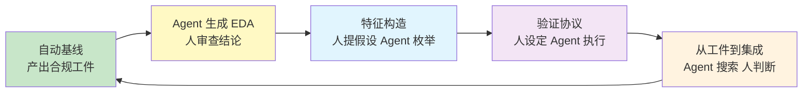
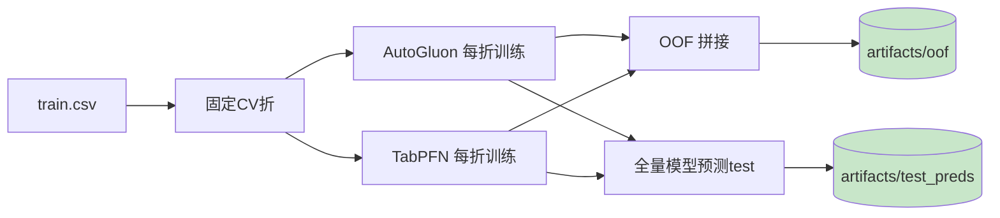
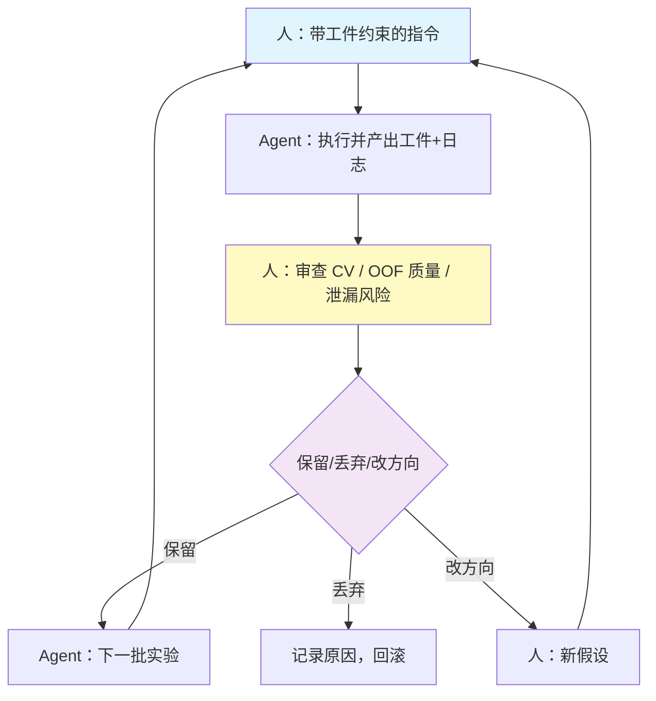

# 第3章 表格数据的 Vibe 工作流：从自动基线到人机迭代

> **本章目标**：在一张表格数据上，把前两章搭的“操作系统”真正跑起来。你会完整走一遍 Vibe 循环：自动基线产出合规工件 → Agent 执行 EDA 和特征变体 → 人设定验证协议并审查工件 → 人决定保留还是丢弃 → Agent 产出下一批。这个五步循环，后面每一章都会反复用。

---

## 开篇：前两章搭好了系统，这一章开始“跑应用”

第 1 章我们建了工地，第 2 章我们盖了操作系统。现在，是时候在这套系统上跑第一个真正的"应用程序"了——一场完整的表格比赛。

但这一章不是教你"怎么调出最高分"。恰恰相反，它教你的是**一套可复用的工作节奏**：什么时候让 Agent 放手干、什么时候人必须亲自看一眼、看到什么程度该喊停。这套节奏，比任何单个技巧都值钱，因为表格比赛占 Kaggle 的大半壁江山，你把它练熟了，后面时序、图像、文本都能套用。

先给你打个预防针：这一章你会看到"跑了一堆实验，一个都没成"这种情节。别慌，这不是失败，这是这套工作流的正常状态。**真正值钱的不是某一次涨分，而是你判断"该不该继续"的那套依据。**

我们先看一眼这一章的路线图：



这五步会转圈——跑完一轮，人决定“保留/丢弃/改方向”，然后 Agent 再跑下一批。这就是 Vibe 循环。我们一步一步拆。

---

## 3.1 第一个动作：自动基线 + 工件落盘

### 3.1.1 验收标准不是分数，是工件

新手跑完 AutoGluon，第一反应是盯着排行榜分数看。分数涨了 0.0003 就高兴半天，跌了就怀疑人生。但 VibeKaggle 的验收标准完全不同：

> 第一个自动基线的验收标准不是"AUC 到多少"，而是**产出了合规的 OOF 和 test prediction 文件**，元数据完整、能被后续流程消费。

为什么这么轴？因为分数会骗人（CV 可能泄漏、LB 可能噪声），但**工件是物理事实**。有了合规工件，你才能：用 OOF 做集成（不用重跑模型）、算 OOF 相关性判断多样性、用日志追溯配置、用哈希校验验证协议。这些后面都要用，现在把工件存规范了，后面省几十个小时。

再换个说法。分数像考试卷上的红笔数字，工件像你写的那本作业本。红笔数字可能老师改错了、可能是隔壁同学抄的，但作业本是你一笔一划写出来的，跑不掉。我们这一章后面所有的判断——保留还是丢弃、集成还是单模型——都要翻这本作业本，而不是看那个红笔数字。

这里还得插一句名词解释，因为 OOF 这个词后面会反复出现，现在不讲清楚，后面就是天书。

**OOF** 是 Out-Of-Fold 的缩写，中文一般翻成"折外预测"或者"袋外预测"。你可以这样理解：把训练集切成 5 份（5 折），每次拿 4 份训练、留 1 份做预测，轮 5 次，每个样本都恰好被"留出来预测"过一次。把这 5 次预测拼起来，就得到一份覆盖全部训练集的预测——而且这份预测里，每个样本的预测值都是"模型没见过它的时候"给出的。所以它像考试里"没复习到的题"，能真实反映模型水平。而 test_preds 是每折模型都预测一遍测试集、再平均，相当于 5 个学生各做一遍同一张卷子取平均，能压掉一部分随机性。

### 3.1.2 AutoGluon 拟合 + 工件保存

下面这段代码，把 AutoGluon 和 TabPFN 两个基线都跑出来，都严格按人定的固定 CV 折产出 OOF。注意它和前两章的 `cv_protocol`、命名规范完全打通：

```python
# src/baselines/auto_baseline.py
"""
表格自动基线：AutoGluon 主基线 + TabPFN 多样性基线。
两个模型都在同一 CV 协议下产出合规工件，供后续集成。
关键点：
1. CV 折索引由人固定的 cv_protocol.yaml 决定，Agent 不得改
2. 每个模型产出 OOF + test_preds + 日志 + 配置四件套
3. 产出后立即做格式自检与协议一致性校验
"""

import json
import hashlib
from pathlib import Path
from datetime import datetime

import numpy as np
import pandas as pd
import yaml
from autogluon.tabular import TabularPredictor
from sklearn.metrics import roc_auc_score
from tabpfn import TabPFNClassifier

# ---------- 路径与常量 ----------
ROOT = Path(__file__).resolve().parents[2]
DATA_DIR = ROOT / "data"
ART = ROOT / "artifacts"
for sub in ["oof", "test_preds", "logs", "configs", "submissions"]:
    (ART / sub).mkdir(parents=True, exist_ok=True)

TARGET = "target"
ID = "id"


def load_protocol() -> dict:
    """读取人设定的验证协议（只读，不得修改）。"""
    with open(ROOT / "configs" / "cv_protocol.yaml", encoding="utf-8") as f:
        return yaml.safe_load(f)


def get_splits(X: pd.DataFrame, y: np.ndarray, protocol: dict):
    """按协议生成固定折索引，并算折索引哈希用于防篡改。"""
    from sklearn.model_selection import StratifiedKFold, KFold, GroupKFold, TimeSeriesSplit

    sch = protocol["cv_scheme"]
    n, rs = sch["n_splits"], sch.get("random_state", 42)

    if sch["type"] == "StratifiedKFold":
        col = protocol.get("stratify_column", TARGET)
        strat = X[col] if col in X.columns else y
        cv = StratifiedKFold(n_splits=n, shuffle=sch.get("shuffle", True), random_state=rs)
        splits = list(cv.split(X, strat))
    elif sch["type"] == "KFold":
        cv = KFold(n_splits=n, shuffle=sch.get("shuffle", True), random_state=rs)
        splits = list(cv.split(X, y))
    elif sch["type"] == "GroupKFold":
        cv = GroupKFold(n_splits=n)
        splits = list(cv.split(X, y, X[sch["group_column"]]))
    elif sch["type"] == "TimeSeriesSplit":
        cv = TimeSeriesSplit(n_splits=n, gap=sch.get("gap", 0),
                             max_train_size=sch.get("max_train_size"))
        splits = list(cv.split(X))
    else:
        raise ValueError(sch["type"])

    # 折索引哈希：把每个样本分到第几折编码成数组再哈希
    fold_of = np.full(len(X), -1, dtype=np.int16)
    for k, (_, va) in enumerate(splits):
        fold_of[va] = k
    h = hashlib.sha256(fold_of.tobytes()).hexdigest()[:16]
    return splits, h


def save_artifact(model, version, oof, test_pred, fold_scores, protocol,
                  fold_hash, change_desc, n_train, n_test, agent_model="autogluon"):
    """把一次实验的四件套写进 artifacts/，符合第2章规范。"""
    oof_p = ART / "oof" / f"train_oof_{model}_{version}.npy"
    tp_p = ART / "test_preds" / f"test_preds_{model}_{version}.npy"
    np.save(oof_p, oof.astype(np.float32))
    np.save(tp_p, test_pred.astype(np.float32))

    entry = {
        "model": model, "version": version,
        "task_type": protocol["task_type"],
        "cv_scheme": f"{protocol['cv_scheme']['type']}_{protocol['cv_scheme']['n_splits']}_{protocol['cv_scheme'].get('random_state', 42)}",
        "cv_fold_indices_hash": fold_hash,
        "cv_scores": [float(s) for s in fold_scores],
        "cv_mean": float(np.mean(fold_scores)),
        "cv_std": float(np.std(fold_scores)),
        "metric": protocol["metric"]["name"],
        "oof_path": str(oof_p.relative_to(ART)),
        "test_path": str(tp_p.relative_to(ART)),
        "n_train": int(n_train), "n_test": int(n_test),
        "change_desc": change_desc,
        "agent_model": agent_model,
        "human_reviewed": False,
        "created_at": datetime.utcnow().isoformat(),
    }
    with open(ART / "logs" / f"exp_{model}_{version}.jsonl", "w", encoding="utf-8") as f:
        f.write(json.dumps(entry, ensure_ascii=False) + "\n")
    with open(ART / "configs" / f"cfg_{model}_{version}.yaml", "w", encoding="utf-8") as f:
        yaml.dump(entry, f, allow_unicode=True)
    return entry


def run_autogluon(train, X, X_test, y, protocol, splits, fold_hash):
    """AutoGluon 主基线：全量训练 + 固定折 OOF。"""
    model, version = "AUTOGLUON", "v001"
    oof = np.zeros(len(train), dtype=np.float32)
    scores = []
    for k, (tr, va) in enumerate(splits):
        p = TabularPredictor(label=TARGET, eval_metric=protocol["metric"]["name"],
                             path=str(ART / f"_ag_{model}_{version}_f{k}"))
        p.fit(train.iloc[tr], time_limit=120, presets="medium_quality", verbosity=0)
        pr = p.predict_proba(train.iloc[va].drop(columns=[TARGET, ID], errors="ignore"))
        pr = pr.iloc[:, 1].values if pr.ndim == 2 else pr
        oof[va] = pr
        scores.append(roc_auc_score(y[va], pr))
    # 全量模型预测测试集
    p_full = TabularPredictor(label=TARGET, eval_metric=protocol["metric"]["name"],
                              path=str(ART / f"_ag_{model}_{version}_full"))
    p_full.fit(train, time_limit=180, presets="medium_quality", verbosity=0)
    tp = p_full.predict_proba(X_test)
    tp = tp.iloc[:, 1].values if tp.ndim == 2 else tp
    return save_artifact(model, version, oof, tp, scores, protocol, fold_hash,
                         "AutoGluon medium_quality 全量+固定折OOF", len(train), len(X_test),
                         agent_model="autogluon")


def run_tabpfn(X, X_test, y, protocol, splits, fold_hash, n_train, n_test):
    """TabPFN 多样性基线：零调参，作为集成多样性来源。"""
    model, version = "TABPFN", "v001"
    oof = np.zeros(n_train, dtype=np.float32)
    scores = []
    for k, (tr, va) in enumerate(splits):
        clf = TabPFNClassifier(device="cuda")
        clf.fit(X.iloc[tr], y[tr])
        pr = clf.predict_proba(X.iloc[va])[:, 1]
        oof[va] = pr
        scores.append(roc_auc_score(y[va], pr))
    clf = TabPFNClassifier(device="cuda")
    clf.fit(X, y)
    tp = clf.predict_proba(X_test)[:, 1]
    return save_artifact(model, version, oof, tp, scores, protocol, fold_hash,
                         "TabPFN 零调参基线", n_train, n_test, agent_model="tabpfn")


def main():
    protocol = load_protocol()
    train = pd.read_csv(DATA_DIR / "train.csv")
    test = pd.read_csv(DATA_DIR / "test.csv")
    y = train[TARGET].values
    X = train.drop(columns=[TARGET, ID], errors="ignore")
    X_test = test.drop(columns=[ID], errors="ignore")

    splits, fold_hash = get_splits(X, y, protocol)
    print(f"CV 折索引哈希：{fold_hash}（必须与历史一致）")

    e1 = run_autogluon(train, X, X_test, y, protocol, splits, fold_hash)
    print(f"AutoGluon CV = {e1['cv_mean']:.5f} ± {e1['cv_std']:.5f}")
    e2 = run_tabpfn(X, X_test, y, protocol, splits, fold_hash, len(train), len(test))
    print(f"TabPFN   CV = {e2['cv_mean']:.5f} ± {e2['cv_std']:.5f}")
    print("✅ 两个合规工件已落盘，可进入集成阶段")


if __name__ == "__main__":
    main()
```

跑完，你有了 `AUTOGLUON_v001` 和 `TABPFN_v001` 两套工件。两个基线是有意为之：AutoGluon 是现在表格竞赛里最常用的"默认第一步"，它会自己尝试几十种模型（梯度提升树、神经网络、线性模型等）并自动做一层简单的内部集成；TabPFN 则完全不同，它专门为小表数据设计，零调参、几秒钟就能训练完，而且和基于树模型的打法犯的错误往往不一样。**两个"犯错方式不同"的模型，是我们后面做集成时多样性的源头**——如果两个模型总是犯同样的错，把它们叠在一起也起不了什么作用，就像两个都怕水的人凑一起也救不了落水者。

用图看它们怎么来的：



---

## 3.2 Agent 执行、人审查的 EDA

### 3.2.1 人机分工：Agent 出代码，人出判断

EDA（探索性数据分析，就是“先摸清楚数据长啥样”）是 Agent 最擅长的活：它能一秒钟生成几十张图、几十个统计量。但 EDA 的**结论不能全信**——Agent 有个毛病，容易把“相关系数 0.85”说成“强相关”，把“分布看起来像”说成“同分布”，这些都是过度概括。

正确姿势是：**Agent 出代码和图表，人出判断。**

我们让 Agent 生成 EDA 脚本。你可以把下面这段话直接丢给它：

> **提示词**：
>
> 请读取 data/train.csv 和 data/test.csv，生成一份 EDA 脚本，要求：
> 1. 输出训练集/测试集的行数、列数、列名差异
> 2. 对数值列：缺失率、均值、标准差、偏度、唯一值数
> 3. 对类别列：基数（unique 数）、top5 频次
> 4. 绘制目标列分布图、数值列按目标分组的箱线图、相关性热力图（前20特征）
> 5. 所有图保存到 artifacts/eda/，统计表写入 artifacts/logs/eda_v001.jsonl
> 6. 代码含 docstring，函数化

这里值得多唠叨一句：上面这段话就是我们说的"带工件约束的指令"。它不仅告诉模型"要做什么"，还规定了输出放哪（`artifacts/eda/`）、统计表叫什么（`eda_v001.jsonl`）、代码怎么写（有 docstring、函数化）。约束越多，模型输出的东西越像能直接使用的工件，而不是漂亮的废话。

人和模型的分工就在这里：**模型擅长把数据横着竖着统计一遍、画几十张图；人擅长判断"哪些统计量可信、哪些图是骗人的、哪个异常值得深挖"**。就像医生看化验单——化验单是机器打印的（模型生成），但最终诊断还得靠医生（人）把化验结果和病人的症状结合起来看。机器不认识病人，它只认识数值。

模型会给你一段代码，节选如下（注意它连"思考过程"都给你了）：

> **AI 输出**
>
> （思考过程）用户需要一份可复用的 EDA 脚本。我先规划函数：
> load_data、profile_numeric、profile_categorical、plot_target_dist、
> plot_box_by_target、plot_corr_heatmap、main。缺失率计算要用
> len(df) 做分母，类别列 top5 用 value_counts().head(5)。绘图用
> matplotlib 避免 seaborn 依赖问题，中文字体需设置。
>
> ```python
> import pandas as pd
> import numpy as np
> import matplotlib.pyplot as plt
> from pathlib import Path
> import json
> ```
>
> ROOT = Path(__file__).resolve().parents[2]
> DATA, ART = ROOT / "data", ROOT / "artifacts"
> (ART / "eda").mkdir(parents=True, exist_ok=True)
>
>
> ```python
> def load_data():
>     """读取训练集与测试集。"""
>     return pd.read_csv(DATA / "train.csv"), pd.read_csv(DATA / "test.csv")
> ```
>
>
> ```python
> def profile_numeric(df):
>     """数值列画像：缺失率、均值、标准差、偏度、唯一值数。"""
>     num = df.select_dtypes(include=[np.number])
>     return pd.DataFrame({
>         "missing": num.isna().mean(),   # 缺失率
>         "mean": num.mean(),
>         "std": num.std(),
>         "skew": num.skew(),             # 偏度：0 对称，>0 右偏长尾
>         "nunique": num.nunique(),
>     })
> ```
>
>
> ```python
> def profile_categorical(df):
>     """类别列画像：基数与 top5 频次。"""
>     cat = df.select_dtypes(include="object")
>     rows = []
>     for c in cat.columns:
>         vc = df[c].value_counts().head(5)   # 最常见的 5 个取值
>         rows.append({"col": c, "cardinality": df[c].nunique(),
>                      "top5": vc.to_dict()})
>     return rows
> ```
>
>
> ```python
> def plot_target_dist(train):
>     """目标列分布。"""
>     fig, ax = plt.subplots(figsize=(6, 4))
>     train["target"].value_counts(normalize=True).sort_index().plot(
>         kind="bar", ax=ax, color=["#4C72B0", "#DD8452"])
>     ax.set_title("Target Distribution")
>     fig.savefig(ART / "eda" / "target_dist.png", dpi=120, bbox_inches="tight")
>     plt.close(fig)
> ```
>
>
> ```python
> def main():
>     train, test = load_data()
>     # ... 省略绘图与 jsonl 写入细节 ...
>     print("✅ EDA 完成")
> ```
>
>
> ```python
> if __name__ == "__main__":
>     main()
> ```

### 3.2.2 人审查：哪些可信，哪些是幻觉

拿到 Agent 的 EDA 输出后，**你必须逐条核对**。给你一张“防忽悠对照表”：

| Agent 可能说 | 你的审查动作 | 判定 |
|--------------|--------------|------|
| “特征 A 与目标相关系数 0.85，强相关” | 打开箱线图，看分布是不是真分开了 | 箱线图重叠严重 → **过度概括，需核实** |
| “训练集与测试集同分布” | 比均值方差、做 KS 检验 | p < 0.05 → **不同分布，要处理** |
| “缺失值随机分布” | 按目标分组看缺失率 | 某类缺失率显著高 → **非随机缺失** |
| “类别列 X 基数 1000，建议丢弃” | 看 X 与目标关系 | 高基数不一定没用 → **人判断** |

这张表怎么用？拿到 Agent 给的 EDA 结论，先别急着信，也别急着扔。对每一条结论问三个问题：

1. **这个数字是怎么来的？** Agent 说"特征 A 和目标相关系数 0.85"，你要能立刻在它生成的统计表里找到这一行。找不到，就说明这句话可能是模型自己脑补的。
2. **这个结论影响我下一步做什么吗？** 如果某个统计量压根不影响你选特征、选模型还是选验证方式，那它可不可信都无所谓，不必纠结。
3. **如果它是错的，我会踩什么坑？** 这才是审查的重点。一个错误结论如果只影响一句 PPT，不值得花时间；但如果它会引导你删掉一个关键特征，那就必须查清楚。

表里那几行术语也解释一下，省得你查：

- **KS 检验**（Kolmogorov–Smirnov 检验）：一种判断"两个分布像不像"的统计检验。做法是把两个分布的累积分布曲线画在一起，看两条线之间最大的缝隙有多大；如果在训练集和测试集上算出来的 p 值小于 0.05，就可以说"这两个分布的差异不太可能是随机波动造成的"，也就是所谓的"训练集和测试集不同分布"。
- **偏度（skew）**：衡量一个分布"歪不歪"。0 表示左右对称，正数表示右边拖一条长尾（绝大多数样本挤在左边，少数极大值拉出长尾），负数则相反。
- **目标偏态**对验证的影响：如果你用 RMSE（均方根误差）做指标，少数极端值会被平方放大、主导整个分数。这会导致什么？模型在"中间那段"预测得再准，也抵不过几个极端值算错。

> **人的 EDA 重点，放在 Agent 容易忽略的地方**：缺失值的语义（为什么缺？缺失本身是不是信息？）、目标偏态对验证空间的影响（长尾目标下 RMSE 会被极值主导）。

举两个具体的例子你就有感觉了。第一个，某个"是否续费"字段有一批空值。Agent 可能会报告"缺失率 8%"，然后就没了。你要追问的是：这些缺失是"用户根本没填"还是"系统压根没有这个字段的数据"？前者可能和用户活跃度相关（不活跃的人懒得填），那缺失本身就是个强特征；后者可能纯粹是技术原因，那缺失就只是缺失，填个常数就行。

第二个，如果目标列是"年度消费金额"，画出来一看 99% 的样本都在 0 到 200 之间，少数几个到了几万。这时候 RMSE 算出来的分数基本由那几十个大客户决定。如果你按总分来调模型，模型会一门心思去讨好那几十个客户，牺牲掉剩下几万个普通客户的预测精度。这不是模型笨，是你的度量衡选错了。

---

## 3.3 特征构造：人类判断力最该介入的地方

### 3.3.1 人提假设，Agent 生成对比工件

AutoGluon 能自动生成交互特征，但**领域驱动的组合特征**仍是人工优势。这句话里有两个词得先掰开。什么叫"交互特征"？就是两个原本独立的列乘在一起、除一下、或者取个差，造出来的新列。为什么要造？因为有些规律不是单个列能表达的，得靠两列的"搭配"才看得出来。举个生活例子：单看"工资"这一列看不出一个人的消费能力，单看"房租"也看不出，但"工资 ÷ 房租"立刻能反映手头宽不宽裕。这种"只有配在一起才有意义"的列，就叫交互。

那"领域驱动"又是什么？就是基于对业务的真实理解去猜该配哪两列，而不是让机器把几百列两两组合全部暴力乘一遍。后一种做法机器确实能做（AutoGluon 某种程度上就在做），但组合数量会爆炸，而且大部分组合毫无业务含义，纯属数值巧合，反而可能过拟合。人在这里的价值，就是**知道该组合哪些列、不该组合哪些列**。

流程是三步：

1. **人提出特征假设**（基于业务理解）；
2. **Agent 在同一 CV 协议下生成对比工件**；
3. **人根据 CV 和工件质量决定是否保留**。

注意第 2 步里的"同一 CV 协议"五个字——这是整套流程能比大小的前提。如果新旧两次实验用的折不一样，分数就没法直接比较，那这次对比就白做了。

举个例子。电信客户流失，你提出一个假设："在网时长 × 月费"可能刻画"高价值但低忠诚"的客户——交着高月费、待得久，但随时可能走。这种客户最值得挽留。这里的"在网时长"（很多数据里叫 tenure）指的是这个客户已经用了这家公司服务多少个月。单看月费，一个月交 100 块的人可能很忠诚、也可能马上跑；单看在网时长，用了 5 年的人也可能因为涨价突然走。但"高月费 × 长时长"这个组合，恰好圈出一批"已经为你贡献了很多钱、但未来也可能损失很多钱"的人。这就是业务假设，是机器自己想不出来的。

我们让 Agent 实现并对比。把下面这段话丢给它：

> **提示词**：请在固定 CV 协议下（configs/cv_protocol.yaml），基于 AUTOGLUON v001 的 OOF，新增特征 tenure_x_monthlycharges = tenure * MonthlyCharges，训练 LightGBM，产出 train_oof_LGBM_FE_v001.npy 与 test_preds_LGBM_FE_v001.npy，change_desc 写明新增特征，日志写入 artifacts/logs/。

模型输出（节选）：

> **AI 输出**
>
> （思考过程）需要复用第2章的 cv_protocol 与 save_artifact。LightGBM
> 用 sklearn API，early_stopping 用验证折。新增特征只需在 X 上加一列。
> 注意 change_desc 必须写清楚，便于人审查。
>
> ```python
> import lightgbm as lgb
> from sklearn.metrics import roc_auc_score
> import numpy as np
> ```
>
> ```python
> def add_feature(df):
>     """新增业务特征：在网时长 × 月费。"""
>     df = df.copy()
>     df["tenure_x_monthlycharges"] = df["tenure"] * df["MonthlyCharges"]
>     return df
> ```
>
> ```python
> # 在每折上：X_tr = add_feature(X.iloc[tr]) ...
> # 训练 LGBM，产出 OOF，调用 save_artifact("LGBM_FE", "v001", ...)
> ```

模型给的代码很短，这恰恰是对的：它没有把训练循环和保存工件的逻辑重新写一遍，而是说"这部分复用第 2 章已经写好的 `save_artifact`"。好的 Agent 应该学会复用你已经建立的基础设施，而不是每次都从零开始造轮子。这也是我们前两章为什么花那么多篇幅去定义工件规范——规范一旦立好，后面每个实验都只是"往同一个模子里填东西"。

当然，模型给的只是骨架，真正落地时你还要自己把每折的训练循环补上。但你看，`add_feature` 这个函数本身是干净的、有 docstring 的、不依赖任何全局状态，这就是好代码的样子。它可以被单元测试、可以被复用、可以在下一轮实验里原样再调一次。

### 3.3.2 人根据 CV 与工件质量决定保留/丢弃

判断清单（四条，缺一不可）：

- **CV 提升了吗？** 提升幅度是否超过噪声（通常 AUC > 0.001 才算信号）？
- **OOF 相关性**：新模型与基线的 OOF 相关性是否 < 0.95？太高说明没多样性，集成价值低。
- **语义合理吗？** `tenure × MonthlyCharges` 有业务含义，还是纯数值巧合？
- **折索引哈希一致吗？** 防止 Agent 偷偷换 CV。

四条缺一不可，但最容易被忽视的其实是第一条和第二条。让我们具体聊聊为什么。

"CV 提升了吗"看起来简单，但这里有个陷阱：分数的波动不全是模型好坏造成的，一部分是运气。比如 5 折交叉验证，你换一套随机种子，同样的模型 CV 分数可能上下波动 0.001 左右，甚至更多。所以"提升了 0.0003"不代表新特征有用，很可能只是这次切分比较有利。行业里的经验规矩是：AUC 提升大于 0.001 才值得当作一个"信号"；更小的提升，应该先保持怀疑，跑更多折或者换个随机种子再试一次，看是否稳定。

"OOF 相关性 < 0.95"是做集成时的多样性检查。如果新模型的 OOF 和旧模型的 OOF 相关性 0.99，说明两个模型几乎对每个样本都给同样的预测值——它们犯的错基本一样。把这样的模型叠在一起，就像两个都怕水的人站在一起，并不能涉水更深。集成要有收益，要求模型"各有偏见，但偏得不一样"。

"语义合理"是人判断力介入的最直接地方。纯数值巧合（比如 `MonthlyCharges × tenure` 刚好巧合地和目标相关，但没有业务解释）往往在测试集上立刻失灵，因为那不是真实的规律，只是训练集上的噪声。有业务含义的特征，换一批数据通常还能保留部分效果。

最后，折索引哈希一致性是保整个流程公平的闸门。这里回顾一下：第 1、2 章里，人固定了一套 CV 折，并且把折索引做了 SHA-256 哈希写进元数据。Agent 跑实验前必须读这个协议，绝不能自己随便切一套折。为什么？如果 Agent 自己换了折，那它和基线的比赛就不公平了——可能它切出了一组"恰好容易"的验证折，分数一涨你就以为特征有效，实际上是验证集变了水。

那如果按这个清单判断，发现新特征既没显著提升 CV、OOF 相关性又太高，又缺乏业务含义，就果断丢弃。这里有一个更深的教训值得记住：**有时候所有实验都失败，不代表你没努力，反而可能说明这个数据在这条路上已经摸到了天花板。** 社区里有参赛者连续尝试了 12 个新思路（加新特征、换元模型、做目标编码、搞归类编码……），每个都没能让 CV 过人家设的 0.0002 门槛；后来他去读前五名的公开笔记，发现大家都卡在同一个分数带附近，而且几个高分笔记的高分其实来自于"公开排行榜后处理"——也就是手工改了几十个测试集 ID 的预测值，不是靠模型打出来的。这个故事告诉我们两点：第一，不要无止境地"再试一个变体"，当一组证据都指向天花板时，该停下来了；第二，高分不等于诚实分，在决定信什么之前，先看看外部证据。

> **原则**：特征工程的深度依然是人能胜过纯自动化的领域，但 Agent 让枚举变体的成本几乎归零。

---

## 3.4 验证协议：人设定，Agent 执行

### 3.4.1 人决定折数与切分方式

不同数据性质，验证方式不同。这张表你存下来：

| 数据性质 | 推荐 CV | 理由 |
|----------|---------|------|
| 普通二分类，样本独立 | StratifiedKFold 5 折 | 保持类别比例，稳定 |
| 类别极不平衡（正类 < 1%） | StratifiedKFold 5-10 折 | 每折正类够多 |
| 有分组结构（客户/商店） | GroupKFold | 同组不跨折，防泄漏 |
| 时间序列 | TimeSeriesSplit | 不能用未来预测过去 |
| 数据量小（< 2000 行） | 重复 5 折取平均 | 降低方差 |

这里每一行都值得你停一下想一想，因为选错验证方式，后面所有分数都是废纸。

先讲两个容易混淆的概念。**StratifiedKFold**（分层 K 折）的意思是：如果训练集里 20% 是正类，每一折里也尽量保持 20% 正类。这样做是为了防止某一折正类太少、算出来的 AUC 上下抖动。**GroupKFold**（分组 K 折）的意思是：同一个组里的样本，要么全在训练折，要么全在验证折，绝不拆开。常见的组是"同一个客户的多条记录"或"同一个商店的多天销售"。为什么要这样做？如果把同一个客户的记录既放进训练折又放进验证折，模型可能"背"了这个客户的习惯，验证分数就会虚高，上线后一塌糊涂。**TimeSeriesSplit**（时间序列划分）的核心原则只有一句：不能用未来的数据去预测过去的数据。时间数据上，验证折必须永远在训练折的时间之后，否则就是预知未来，属于严重泄漏。

再举一个反例你就明白了分层为什么重要。假设你做一个罕见病筛查，正类只有 1%，用普通 KFold 切 5 折，运气不好某一折正类只有 2 个，算出来的 AUC 可能是 0.5 或 1.0，完全由这两个人决定，分数不可信。改用分层 K 折，每一折都保留大概一样比例的正类，分数就稳定多了。

下面是人对 Agent 的基本要求：**验证协议的人设定、Agent 执行，两者不得互换。** Agent 可以建议"我觉得这里用 GroupKFold 更合适"，但最终决定权在人；Agent 负责按协议生成折，人负责抽查折是否真的按协议来。

### 3.4.2 Agent 执行 CV，人检查折索引

Agent 执行 CV 时，**你必须抽查**三件事：每折验证集索引是否与哈希对应、目标编码/标准化是否只在训练折上 fit、有没有特征偷用了验证折的目标值。

```python
# src/utils/leakage_check.py
"""
检测目标编码泄漏：若 OOF 在验证折上 AUC 异常高（> 0.99），
且特征里有目标编码列，高度怀疑泄漏。
"""
from sklearn.metrics import roc_auc_score

def check_target_encoding_leakage(oof, y, splits):
    for k, (_, va) in enumerate(splits):
        s = roc_auc_score(y[va], oof[va])
        if s > 0.99:
            print(f"⚠️ 第 {k} 折 AUC={s:.4f} 异常高，请检查目标编码是否泄漏")
```

这段代码只有十几行，但背景知识值得展开，因为**目标编码泄漏是表格比赛里最常见的翻车方式之一**，很多新手到死都不知道自己输在哪。

先说目标编码（target encoding）是什么。假设你有一个类别列"城市"，取值有北京、上海、广州……直接丢给模型它不认识字符串，于是常见做法是：把每个城市替换成"历史上这个城市的平均目标值"。比如训练集里北京用户的平均流失率是 0.3，那所有北京用户的这一列都填 0.3。这么做很有效，因为城市和目标之间确实有统计关系。

但危险就在这里：**这个平均值必须用训练折的数据算，绝不能用验证折的数据算。** 为什么？因为如果你图省事，先在整个训练集上算好每个城市的平均流失率，再切折，那验证折里那些样本的目标值就"泄露"进了特征值里——模型等于提前偷看了答案。这时候 OOF 的 AUC 会高得离谱（比如 0.999），你一看还以为自己发现了金矿，实际上是验证集被污染了。真正的线上表现会打回原形。

这段 `leakage_check.py` 做的就是最简单的一道防线：如果某一折的 AUC 高到 0.99 以上，就敲一下警钟。它不证明一定有泄漏（有些比赛本身就很容易），但它提醒你"这里不正常，回去查"。更彻底的做法是在每一折内部重新 fit 目标编码，只使用该折的训练部分。

> **验证方案的设计和泄漏检查，是人不可让渡的职责。**

---

## 3.5 从工件到集成：Agent 做搜索，人做判断

### 3.5.1 AutoGluon 已经 stacking 了，人工 stack 图啥？

AutoGluon 内部已经做了多层 stacking，但只在**它自己的模型家族内**。人工 stack 的价值，是**引入 AutoGluon 之外的模型家族**（TabPFN、神经网络、XGBoost），增加多样性。就像 AutoGluon 给你炒了一桌川菜，你人工 stack 是往里加一道粤菜、一道鲁菜——口味越杂，越可能覆盖更多人的偏好。

这个"引入别家的模型"不是我拍脑袋想的，有实打实的比赛案例。2025 年 4 月的一个 Kaggle Playground 比赛（预测用户听播客的时长），冠军选手用 GPU 加速训练，先训了 500 个实验模型，从中挑出 75 个不一样的 Level 1 模型（梯度提升树、神经网络、支持向量回归、最近邻等），再做三层 stacking：Level 2 模型学着怎么把 Level 1 模型的预测组合起来预测目标，Level 3 把 Level 2 的输出取平均。最终交叉验证 RMSE 11.54、私有排行榜 RMSE 11.44，拿下第一名。注意两个数字：75 个 Level 1 模型是从 500 个实验里筛出来的，说明"先量变后质变"是真的管用——不是凭空想出完美 stack，是跑够多、筛够多。顺便说一句这场比赛的 target 有个小玄机：它约等于 0.72 乘以单集时长，而且 88% 的行能拿到单集时长、12% 缺失——所以冠军方案专门设计了四条预测路径（直接回归、用比值、用残差、缺失值单独填充），把"缺 12% 数据"这件事当成一等公民来对待，而不是随便填个均值了事。

再看另一个真实案例。某个比赛的第三名方案（预测最佳肥料），也是靠 stacking 上去的：Level 1 里有 10 个 LightGBM、5 个 XGBoost、4 个 CatBoost、2 个随机森林、1 个极端随机树、4 个直方图梯度提升回归模型，一共 26 个模型；所有模型都用简单的 5 折 KFold，不玩花哨的切分；单模型里表现最好的 LightGBM CV 是 11.79，加上 stacking 以后 CV 从 11.66 提到 11.62，**第一次尝试就提上去了**；最后提交的是"80% stacking + 20% 爬山法加权"的混合。这个方案还透露了一个工程量级：它造了大约 270 个目标编码特征，全部按折存成 Parquet、固定 KFold——这就是为什么前面反复强调"折要固定、哈希要算"，因为目标编码特征一旦换了折，数值就全变了，等于整套特征作废。这个方案也给了一个反面教材：线性模型、神经网络、插值填充、分箱、聚类、标签编码这些方法都试过了，最后都没用上，说明"尝试很多"不等于"全都有用"，人工判断负责把没用的砍掉。

所以人工 stack 的真正工作不是"手搓一个 stacking 类"，而是三件事：第一，引入 AutoGluon 不会训的模型家族；第二，保证所有模型都在同一套固定折上产出 OOF，否则没法比；第三，由人确认哪些模型真的该进入最终集成。

### 3.5.2 用 OOF 工件做 hill climbing 与 meta-model stacking

```python
# src/ensembles/stack_oof.py
"""
基于 OOF 工件的集成：读所有合规 OOF，做加权/Stacking。
Agent 负责生成候选，人负责确认进入最终集成的子集。
"""

import numpy as np
from pathlib import Path
from sklearn.linear_model import LogisticRegression
from sklearn.metrics import roc_auc_score

ART = Path(__file__).resolve().parents[2] / "artifacts"


def load_oof(pattern="train_oof_*.npy"):
    """加载所有 OOF 工件，返回 {模型名: oof数组}。"""
    oofs = {}
    for p in (ART / "oof").glob(pattern):
        name = p.stem.replace("train_oof_", "")
        oofs[name] = np.load(p)
    return oofs


def greedy_hill_climb(oofs, y, metric=roc_auc_score, maximize=True):
    """
    贪心 hill climbing：从空集开始，每次加入让 CV 最优的模型。
    这是"候选生成"，最终子集由人确认。
    """
    names = list(oofs)
    selected, best = [], 0.5 if maximize else 1.0
    while True:
        improved, best_name, best_score = False, None, best
        for n in names:
            if n in selected:
                continue
            cand = selected + [n]
            score = metric(y, np.mean([oofs[m] for m in cand], axis=0))
            if (maximize and score > best_score) or (not maximize and score < best_score):
                best_score, best_name, improved = score, n, True
        if improved:
            selected.append(best_name)
            best = best_score
        else:
            break
    return selected, best


def stack_meta(oofs, y, selected):
    """用选中的 OOF 训练 meta-model（逻辑回归）。"""
    X = np.column_stack([oofs[m] for m in selected])
    meta = LogisticRegression(max_iter=1000)
    meta.fit(X, y)
    return meta
```

这里再解释两个听起来高级、其实很直白的概念。

**贪心爬山法（greedy hill climbing）**：想象你站在一片雾蒙蒙的山上，只能看一步之遥，目标是找到最高点。你每次试着往一个方向走一小步，如果这步让你爬得更高，就留下；否则退回去再试另一个方向。代码里的 `greedy_hill_climb` 就是这样做的：从空集开始，每次试着加一个模型，看加完以后集成的 CV 分数是不是更高；如果是，就保留这个模型，继续下一轮；直到再也没有哪个模型能让分数上去为止。它不一定能找到全山最高点（那是"穷举"，模型太多时不可能），但能很快找到一个不错的局部高点。更重要的是，它是**候选生成**：爬出来的那个子集，只是"值得考虑的名单"，最终要不要用，还是人拍板。

**元模型（meta-model）**：stacking 的第二层。第一层模型（AutoGluon、TabPFN 等等）产出 OOF 预测；第二层模型——这里用逻辑回归——把这些 OOF 预测当成输入特征，学习"怎么把第一层的预测混合得更准"。注意元模型也只能在 OOF 上训练，不能在训练集原始预测上训练，否则就是泄漏。

前面提到的那个肥料比赛第三名方案，Level 2 正是用爬山法和 LightGBM 做的组合，Level 3 用加权平均。它还有一个值得模仿的细节：所有特征（包括目标编码特征）都按折单独保存成 Parquet，并且全赛季强制用完全一样的 KFold 设置，就是为了让 OOF 不会因为"切的折不一样"而失真。这正好印证了第 3.4 节说的：固定折、算哈希、不随意换协议，不是杞人忧天，是拿得出手的方案的基本功。

### 3.5.3 人的判断：哪些模型进入集成

人审查三件事：

- **OOF 相关性结构**：相关性矩阵里有没有两组高度相关（> 0.98）？只留一个。
- **权重是否稳定**：bootstrap 重采样下，hill climbing 选出的子集稳不稳？
- **复杂度值不值**：从 3 个模型到 10 个，CV 提升是否覆盖复杂度代价？

这三件事里，第一条和第三条最能体现"人工判断"的价值。OOF 相关性高于 0.98 的两个模型，就像两个总是一起考错同一道题的学生，把两人的答案平均一下，并不会变得更聪明。集成的收益来自"各有偏见、但偏得不一样"，所以人要看相关性矩阵，把高度重复的模型砍掉，只留互补的。

第三条"复杂度值不值"需要你自己掂量。10 个模型比 3 个模型强不一定多少，但训练时间、推理时间、代码维护成本会翻好几倍。如果从 3 个到 10 个，CV 只提了 0.0001，那这 7 个模型大概率是多余的；如果提了 0.005，那很值得。这里没有标准答案，只有你自己能做的权衡。

除了这三条，还有一个跨整个集成阶段的原则：**不要让排行榜分数（Leaderboard Score）替你做决定。** 社区里总结过不少踩坑教训，浓缩成下面这几条，建议直接背下来：

1. **限制排行榜调参次数**：不要为了上排行榜而反复试几十种权重，试 3～4 种大胆的加权方案就够了；每次改一点点（比如 0.62 改 0.63），看起来像在进步，大概率只是拟合了公开测试集的噪声。
2. **看折级诊断，不只看总分**：一个靠谱的集成应该在大多数折上都提升或至少持平，而不是依赖某一折异常好。
3. **留一个本地 holdout**：数据量允许的话，留一块不参与模型选型和权重调整的验证切片，到最后再用来确认集成效果。
4. **给提交名额留风险梯度**：不要只提交"看 CV 最高的那个集成"。可以准备两份提交：一份是 CV 最稳的集成，另一份是稍微偏向公开排行榜的混合，两者不互相矛盾，这样既有竞争力又有保险。
5. **记录每一次实验**：模型版本、种子、特征、折分数、权重、公开排行榜分数，全部写进日志。没有记录的涨分，等于没有涨分。

可复现性也落在这里。有团队统计过，10 个模型 × 5 折 × 3 个随机种子就已经是 150 次训练，如果每次训练的配置都没记下来，到了比赛最后一周你根本不知道哪 10 个模型该进最终集成。所以每个 OOF 工件都要带完整元数据（模型类型、特征版本、折版本、随机种子、评分、文件路径），这和第 2 章的工件规范是一脉相承的。

> **Agent 做候选生成和初步筛选，进入最终 stack 的模型子集由人确认。**

---

## 3.6 表格 Vibe 循环的操作模板（全书复用）

把上面五步串起来，就是这个循环：



文字版（每章都套）：
1. 人给出**带工件约束的指令**（CV 协议、命名、验收标准）；
2. Agent 执行并产出**工件 + 日志**；
3. 人审查 **CV、OOF 质量、泄漏风险**；
4. 人决定**保留 / 丢弃 / 修改方向**；
5. Agent 执行下一批。

这个循环，就是 VibeKaggle 的"心跳"。你可以把它想象成做菜：人先定菜单（带工件约束的指令，规定用什么食材、多大火、尝起来要什么味道），Agent 去厨房炒一道菜并把做法记录在菜谱上（产出工件 + 日志），人尝一口，决定"这盘菜上桌"、"倒掉重炒"，或者"加点盐再炒"（保留 / 丢弃 / 改方向），然后 Agent 再炒下一道。反复几十次，最后端上桌的那桌菜就是你的最终提交。

后面每一章，不管表格、时序、图像、文本，都是这个心跳的变体。

---

## 3.7 小结

这一章我们把操作系统跑起来了：

- 自动基线的验收标准是**合规工件**，不是分数；
- EDA 由 Agent 生成、人审查结论；
- 特征构造是**人提假设、Agent 枚举变体、人决定保留**；
- 验证协议**人设定、Agent 执行**，折索引哈希防篡改；
- 集成是 **Agent 搜索候选、人确认子集**；
- 五步循环模板，全书复用。

如果你只能带走一句话，我希望是这句：**这套工作流的价值，不在于它总能让你涨分，而在于它让你每一次实验都有迹可循、有据可依、有处可退。** 跑了一堆实验一个都没成，在这套系统里不是失败，是正常状态——你留下了工件、日志、判断依据，下一次可以站在这些信息上继续，而不是从零开始瞎猜。

下一章我们就把这套"心跳"放进一场真实的比赛里，看看它在真实数据上长什么样。

> **下一章预告**：第 4 章用 Playground S6E3 客户流失预测完整演示这套循环，并深入 NVIDIA 冠军方案的“850 → 150”门控规则——看 Agent 的吞吐、工件的可组合、人的验证门控怎么在同一场比赛里全部亮相。