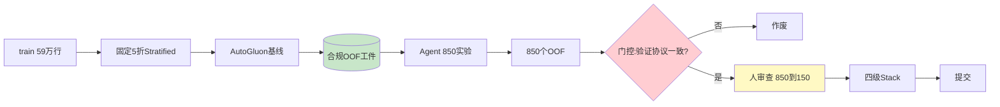

# 第4章 表格比赛详解：Playground S6E3 客户流失预测（2026，NVIDIA LLM Agent 夺冠）

> **本章目标**：用一场真实比赛，把第 3 章的 Vibe 循环完整走一遍，并且看一个“天花板级”的案例——NVIDIA 用三个大模型 Agent 跑了 850 个实验、拼出 150 个模型的四级堆叠拿了冠军。但本章的重点**不是让你复制这个规模**，而是让你看懂那条“门控规则”：Agent 能放手干到什么程度，人又必须在哪几个闸口守着。

---

## 开篇：一场把 VibeKaggle 演到极致的比赛

如果要用一场比赛向你证明“VibeKaggle 这条路走得通”，那大概就是 2026 年 3 月的 Playground S6E3 客户流失预测。

先交代一下背景。这场比赛的题目特别朴素：给你一批电信客户的历史数据，让你猜谁会走。评分用的是 AUC（ROC 曲线下面积，后面会细讲）。就这么一道题，吸引了三千七百多人上榜。

然后 NVIDIA 的 Chris Deotte 出场了。他的头衔是 NVIDIA 高级数据科学家、Kaggle 四冠王（4x Grandmaster）——翻译成人话就是“打比赛打到顶格的那种人”。他做了件在当时看来挺离谱的事：找了三个大模型 Agent（GPT-5.4 Pro、Gemini 3.1 Pro、Claude Opus 4.6），让它们像三个不知疲倦的实习生一样写代码、跑实验。

一晚上过去，这三个 Agent 生成了超过 60 万行代码，跑了 850 个实验。最后，从这 850 个模型里挑出 150 个，拼成一个“四层堆叠”（four-level stack），拿了第一名。

你可能会想：“这也太夸张了，我怎么可能做到？”别急。**这一章不是让你复制 850 这个数字，而是让你理解它背后的纪律。** 因为如果 850 个实验没有纪律约束，它只会变成 850 堆垃圾——谁也不知道哪个模型是啥、用了什么验证方式、能不能用。真正让 850 个实验变成冠军的，是三件事：**固定的验证协议、规范的工件、人的门控**。这三件事，你前两章已经全部学过了。

换句话说，这一章其实是你第一次“实战演习”：我们把前两章的零件箱打开，看看它们拼起来是什么样子。

我们先把这场比赛的路线画出来：



看图的时候别急着记流程，先记住三个颜色：**绿色是“工件”，黄色是“人”，红色是“作废”**。整章讲的就是这三样东西怎么配合。

---

## 4.1 比赛与数据

电信客户流失，二分类问题。指标是 AUC。

AUC 这个词听着抽象，其实一句话就能说明白：**随便抽一个会走的客户和一个不会走的客户，模型把“会走的”排在“不会走的”前面的概率。** 0.5 等于瞎猜，1.0 等于完美。所以 AUC 越接近 1 越好。

数据规模，这里要特别说一句，因为网上很多二手文章写错了。真实的 `train.csv` 是 **594,194 行、21 列**，不是某些博客里说的“25 万行”。三份核心文件长这样：

| 文件 | 行数 | 列 |
|------|------|-----|
| `train.csv` | 594,194 | `id` + 19 个特征 + `Churn`（目标列），共 21 列 |
| `test.csv` | 254,655 | `id` + 同一批 19 个特征（没有目标列），共 20 列 |
| `sample_submission.csv` | 254,655 | `id` + `Churn`（占位，用来告诉你格式） |

这里还有个容易被忽略的细节：这场比赛的数据是**合成**的——官方用一个深度学习模型，在原始的 Telco Customer Churn 数据集（只有 7,043 行）上训练，然后生成了这份五十多万行的“仿制品”。官方还专门鼓励大家把原始数据集也拿来用：一是看看分布差在哪，二是试试把原始数据混进训练集能不能涨分。

为什么要合成？因为原始数据太小了，七千行不够三千多人分着玩。合成之后，行数上去了，规律还在，大家就能在同一条起跑线上比划。

特征大多是类别型的（合同类型、付费方式、有没有网络服务、有没有在线安全……）和少量数值型（月费、在网时长、总消费）。正类（流失）占 **22.5%**，属于轻度不平衡——不算极端，但也别用准确率（accuracy）当指标，不然全预测“不流失”也能拿七成七。

这种“类别特征多、目标二分类”的表格，是 AutoGluon 和梯度提升树最擅长的战场。你可以把它想成做菜：食材（特征）以调料为主，火候（模型）用现成的自动炒菜机（AutoGluon）就够好了，真正决定味道的是你怎么配料。

---

## 4.2 自动基线 + 合规工件

按第 3 章的流程，第一步是跑 AutoGluon 和 TabPFN 基线，产出 `AUTOGLUON_v001` 和 `TABPFN_v001` 两套工件。

这里顺便说一句什么叫“工件”。**工件就是一次实验留下的、别人能捡起来直接用的东西**：折外预测（OOF）、测试集预测、实验日志、配置文件。它们必须按固定名字存好，就像超市货架上的商品，标签朝外、位置固定，别人闭着眼也能摸到。

跑完之后，人要做两件“防忽悠”的检查，这两件事机器不会替你做：

**检查一：概率分布对不对。** OOF 里预测为正类的平均概率，应该接近真实流失率（22.5%）。如果平均值差得远（比如只有 0.05，或者高达 0.9），说明模型的概率校准出了问题，后面做集成会受连累。

**检查二：AUC 的置信区间有多宽。** 光看一个 CV 分数不够，得看它的波动范围。我们用 bootstrap（自助抽样，就是把数据有放回地重抽很多次）来估一个置信区间：

```python
# src/utils/bootstrap_ci.py
"""
用 bootstrap 估 AUC 的置信区间，判断 CV 方差是否可接受。
如果 95% 区间宽度 > 0.01，说明 CV 噪声大，
后面 0.001 级别的"提升"很可能是噪声，别当真。
"""
import numpy as np
from sklearn.metrics import roc_auc_score


def auc_ci(y, p, n_boot=1000, alpha=0.05, seed=42):
    """返回 (均值, 下限, 上限)。"""
    rng = np.random.default_rng(seed)   # 固定随机种子，保证每次结果一样
    vals = []
    n = len(y)
    for _ in range(n_boot):
        idx = rng.integers(0, n, n)          # 有放回抽样：每个样本被抽中的次数服从多项分布
        if len(np.unique(y[idx])) < 2:       # 抽到全是一类就没法算 AUC，跳过
            continue
        vals.append(roc_auc_score(y[idx], p[idx]))
    # 取 2.5% 和 97.5% 分位数，得到 95% 置信区间
    lo, hi = np.percentile(vals, [100 * alpha / 2, 100 * (1 - alpha / 2)])
    return float(np.mean(vals)), float(lo), float(hi)
```

这个小函数后面会被反复用到。它的意义在于：**它告诉你“一个分数到底靠不靠谱”**。CV 涨了 0.001 但置信区间有 0.02 宽，那基本是噪声，不值得为它烧一次提交。

打个比方：两个学生考完试，一个 85 分一个 86 分，看起来 86 分厉害。但如果这次考试本身难度波动就有 5 分，那这 1 分差距说明不了任何事。**置信区间就是帮你量“这次考试难度波动有多大”的那把尺子。**

顺便预告一下：这个“分数靠不靠谱”的问题，在第 5 章会以一种更极端的方式出现——那场比赛的第一名和第二名之间，差距小到小数点后第五位。

---

## 4.3 Agent 批量实验与人的验证门控

### 4.3.1 850 个实验是怎么来的？

NVIDIA 的方案里，三个 Agent 分工干活：一个负责特征工程变体，一个负责模型调参，一个负责集成探索。它们在一个**固定不变的验证协议**下，疯狂地试：

- 不同的特征组合（原始特征、交互特征、目标编码……）；
- 不同的模型家族（XGBoost、LightGBM、CatBoost、神经网络、TabPFN……）；
- 不同的超参数。

每跑一个实验，就产出一份 OOF 和测试预测，按规范命名存好（官方博客里的命名约定是 `train_oof_[模型]_[版本].npy` 和 `test_preds_[模型]_[版本].npy`）。850 个实验 = 850 对 OOF/测试预测工件。这些工件是后面集成的“零件库”。

这里值得停一下，想想“零件库”这个比喻为什么贴切。你去五金店买螺丝，货架上的螺丝都装在标准盒子里、贴着标签，你才能随手配出一台机器。如果 850 个实验的预测散落在 850 个临时目录里、名字全是 `temp1.npy`、`temp2.npy`，那这 850 个实验等于没做。**Agent 真正的贡献不是“跑得多”，而是“跑得整齐”。**

### 4.3.2 关键不是规模，是门控规则

如果你只记住这一章的一句话，请记住这句：**850 个实验的价值，不在数量，而在“固定验证协议下的可组合工件”。**

我们用一张表把“Agent 能自主做什么、人必须守什么”说清楚：

| Agent 可以自主做 | 人必须把关 |
|------------------|------------|
| 在固定 CV 折上枚举各种模型/特征组合 | 改 CV 折数、分层方式、随机种子 |
| 产出任意数量的 OOF/测试工件 | 删除或覆盖别人的工件 |
| 生成候选集成子集 | 直接提交（必须先预演 + 人确认） |
| 记录实验日志 | 修改 `cv_protocol.yaml` |

这张表就是“门控规则”。它规定了 Agent 的自由活动范围，也圈定了人必须亲自到场的几个闸口。

你可以把它想成厨房里贴的那张“谁可以动什么”的规矩：实习生可以自己决定先切哪个菜、切多细，但不能自己改菜谱的盐量，更不能自己把灶台端走。**自由是有的，但自由有边界。**

### 4.3.3 人怎么查“Agent 偷偷换 CV 刷分”？

你可能会担心：Agent 这么能干，会不会偷偷换个验证方式，把一个好看但虚假的分数报给你？

这不是杞人忧天。Agent 的目标是“把分数做好看”，而“换个更容易的验证方式”恰恰是最快让分数变好看的办法——它可能不是故意的，只是“顺手”了。

这正是第 2 章那个“折索引哈希”存在的意义。我们写一个小脚本，扫一遍所有实验日志，凡是验证协议哈希和当前不一致的，全揪出来：

```python
# src/utils/audit_cv.py
"""
审计：扫描所有日志，找出 cv_fold_indices_hash 与协议不一致的实验。
一旦发现，该实验工件作废——因为它的验证方式变了，分数不可比。
"""
import json
from pathlib import Path


def audit_cv_consistency(log_dir, expected_hash):
    bad = []
    # 遍历日志目录下所有 exp_*.jsonl 实验日志
    for p in Path(log_dir).glob("exp_*.jsonl"):
        for line in open(p, encoding="utf-8"):
            e = json.loads(line)
            # 只比对哈希：折索引变了，哈希必然变
            if e.get("cv_fold_indices_hash") != expected_hash:
                bad.append((p.name, e["model"], e["version"], e.get("change_desc")))
    if bad:
        print("⚠️ 发现验证协议不一致的实验：")
        for b in bad:
            print("   ", b)
    else:
        print("✅ 所有实验验证协议一致")
    return bad
```

这个脚本就是人的“第三只眼”。Agent 跑得再快，也逃不过哈希的比对。一旦查出来，那个实验的工件直接作废，不进入集成。

你可以把整个审计过程交给 Agent 做，但**判断要留给自己**。比如这样问它：

```
我担心 Agent 在跑实验时偷偷换了验证方式刷分。
请扫描 artifacts/logs/ 下所有日志，找出 cv_fold_indices_hash
和 configs/cv_protocol.yaml 算出来的不一致的实验，列出来，
但不要自动删除任何工件，只报告，我来决定怎么处理。
```

模型会这样回答：

```
> （思考过程）用户明确要求"只报告不删除"，这是对的——
> 删除是不可逆操作，必须人确认。我需要先读 cv_protocol.yaml
> 算出当前 hash，再遍历所有 exp_*.jsonl 比对，最后按
> 模型/版本/change_desc 列表输出，并给出建议但不动手。

扫描完成，结果如下：

一致：142 个实验（hash 均为 a1b2c3d4e5f6a7b8）
不一致：3 个实验
  - exp_LGBM_v007.jsonl  hash=9f8e7d6c5b4a3210
    change_desc: "改用 10 折提升稳定性"
  - exp_XGB_v003.jsonl   hash=9f8e7d6c5b4a3210
    change_desc: "同上，10 折"
  - exp_NN_v002.jsonl    hash=1122334455667788
    change_desc: "换 GroupKFold 按客户分组"

建议：这 3 个实验的分数不可与其余 142 个直接比较，
      是否作废请你决定。我没有删除任何文件。
```

你看，它不但列出来了，还**明确声明“我没有删除任何文件”**——这就是把不可逆操作的决定权交还给你。

这里再补一句题外话：为什么哈希这么管用？因为哈希有个好性质——**输入变一个 bit，输出就面目全非**。你没法“稍微改一下折”还让哈希不变。所以它天然适合当“防伪标签”。

---

## 4.4 工件审查：从 850 到 150 的选择

850 个模型全塞进集成不行吗？不行。一是算不动，二是高度相关的模型堆在一起不会涨分，反而增加过拟合风险。所以要从 850 里挑出 150 个“既强又互补”的。

这里说的“互补”，值得多解释两句。假设三个模型都看同一批数据，A 和 B 几乎一模一样（同一套特征、同一族算法，只是随机种子不同），那把它们平均，等于把同一个答案抄了三遍——错的地方还是错。真正有用的是：A 在雨天判断失误，B 恰好擅长雨天；B 在高速路段偏保守，C 恰好相反。**ensemble 的收益来自“错误不一样”，不是“模型多”。**

人审查三件事：

1. **OOF 相关性结构**：把 850 个 OOF 两两算相关性，做聚类。同一簇里的模型高度相关（> 0.98），只留 1-2 个代表。
2. **模型多样性**：最终 150 个要覆盖不同家族（GBM、NN、TabPFN、线性模型），而不是同一家族的 150 个超参变体。
3. **集成后的 CV 稳定性**：bootstrap 下，150 个模型 stack 的 CV 稳不稳（置信区间宽度 < 0.005）。

第一个“去冗余”的动作，可以用层次聚类来做：

```python
# src/ensembles/cluster_oof.py
"""
对 OOF 做层次聚类（距离 = 1 - 相关性），每一簇留一个代表。
threshold 越小，簇越多，保留模型越多。
"""
import numpy as np
from scipy.cluster.hierarchy import linkage, fcluster


def cluster_oofs(oofs, threshold=0.02):
    names = list(oofs)                             # 所有模型名
    # 把每个模型的 OOF 向量按列拼成矩阵：行=样本，列=模型
    M = np.column_stack([oofs[n] for n in names])
    corr = np.corrcoef(M, rowvar=False)            # 相关性矩阵（模型×模型）
    dist = 1 - corr                                # 距离 = 1 - 相关，越像距离越近
    # 只取上三角（对角线是 1，重复），做平均链接的层次聚类
    Z = linkage(dist[np.triu_indices(len(names), 1)], method="average")
    labels = fcluster(Z, t=threshold, criterion="distance")  # 按距离阈值切簇
    reps = {}
    for n, l in zip(names, labels):
        reps.setdefault(l, []).append(n)           # 同一簇的模型归到一起
    return reps                                    # {簇编号: [该簇的模型列表]}
```

跑完你会拿到一个字典，键是簇编号，值是这一簇里的模型名。接下来“每簇留谁”，就是人的活儿了——通常留 CV 最好的那个，但如果两个差不多，倾向于留更简单、更能解释的那个。

> **从 850 到 150，是人的“选择判断”，不是自动 hill climbing 一键搞定。** Agent 帮你算好相关性、聚好类、列出候选；但“这一簇留谁”“哪些家族必须保留”，是人拍板。

顺便说一句，社区里那些拿到好名次的方案，做法其实和这条路子一脉相承。有人用 RealMLP（一种表格深度学习模型）单模型就打到 CV 0.91912、榜上 0.91658；有人用 TabM 拿到 CV 0.91898、LB 0.91682；还有人用 Ridge + XGBoost 的 n-gram 交互特征组合，CV 0.91927、LB 0.91684。你看，**单模型已经很强了，但冠军还是选择了“150 个模型堆四层”**——因为最后那千分之几，只能靠“多而互补”去抠。

---

## 4.5 提交纪律

冠军方案最后也要靠“提交”这一步落地，而提交恰恰是最容易出事的环节。前面九个小时的工作，可能因为一行 ID 顺序错位全部报废。

### 4.5.1 概率校准检查

AUC 对概率校准不敏感，但如果比赛用 LogLoss（对概率很敏感），或者需要设阈值，那校准就关键了。检查方法：画可靠性曲线（reliability diagram），看“预测 0.7 的样本里，真实正类比例是不是也接近 0.7”。

什么叫校准？举个例子。天气预报说“明天降水概率 70%”，如果说了 100 次里真下了 70 次雨，这个预报就是校准的；如果只下了 20 次，那它在“吹牛”。模型也一样。

### 4.5.2 生成提交 + 断言检查

```python
# src/submit/make_submission.py
"""
生成提交文件并做断言检查。任何一项不过就拒绝生成。
"""
import numpy as np
import pandas as pd
from pathlib import Path

ROOT = Path(__file__).resolve().parents[2]
ART = ROOT / "artifacts"


def make_submission(test_preds_path, sample_path, out_path, target="target", id_col="id"):
    sample = pd.read_csv(sample_path)                 # 官方样例，决定行数和列顺序
    preds = np.load(test_preds_path)                  # 之前存好的测试集预测
    assert len(preds) == len(sample), "预测长度与 sample 不一致"
    sub = sample.copy()                               # 以 sample 为模板，避免列顺序错
    sub[target] = preds
    assert sub[target].between(0, 1).all(), "概率越界（必须在 0~1）"
    sub.to_csv(out_path, index=False)
    # 二次读回校验：确认写盘过程没把列顺序或 ID 写坏
    chk = pd.read_csv(out_path)
    assert list(chk.columns) == list(sample.columns)
    assert (chk[id_col] == sample[id_col]).all()
    print(f"✅ 提交文件通过断言：{out_path}")
```

为什么要“写下去再读回来”？因为磁盘是会骗人的。列顺序、浮点精度、编码，都可能在写盘那一步出岔子。**读回来再比一遍，是最便宜的保险。**

提交前，人还要过一遍清单：概率在 0~1、ID 顺序对齐、CV 和 LB 方向一致（LB 若大跌就回滚）。

最后补一个真实数字，让你对“抠千分之几”有个概念：这场比赛榜首的分数是 0.91856 左右，而一个排名 286/3718（前 8%）的方案，公开榜分数是 0.91685——**中间隔着的，就是那 0.0017**。在别的比赛里这叫误差，在这场比赛里这叫“几百个名次”。

---

## 4.6 小结

这场比赛把 VibeKaggle 的完整循环演了一遍：

- **Agent 的吞吐**：850 个实验、60 万行代码，人手动不可能做到；
- **工件的可组合性**：850 对 OOF 能被聚类、筛选、堆叠，全靠规范存工件；
- **人的验证门控**：固定协议、哈希审计，挡住了“换 CV 刷分”；
- **人的选择判断**：从 850 到 150 的取舍，是人的活儿。

一句话：**规模是 Agent 给的，可信度是人的纪律给的。** 少了任何一半，850 个实验都会变成 850 堆垃圾。

如果你觉得“850 个实验”离你太远，那我们把镜头拉近一点：下一章那场回归比赛，只有一个人、一台机器、几十个模型，你会看到同样的纪律在小规模下怎么起作用。**规模可以不同，套路必须一样。**

> **下一章预告**：第 5 章换一场回归比赛——Playground S5E10 道路事故风险预测。你会看到 AutoGluon 怎么当“起点”、Agent 怎么把候选池从几个扩到 40 个、人又怎么用 Greedy NNLS 和 LassoCV 从 40 个里挑出最互补的 4-6 个。