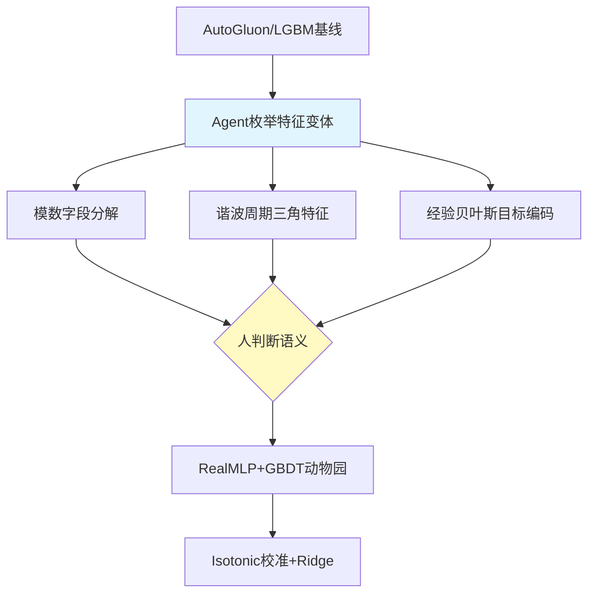

# 第6章 表格比赛详解：Playground S6E1 学生考试成绩预测（2025—2026，特征工程的深度挖掘）

> **本章目标**：看一场“特征工程定胜负”的比赛。1st place 方案里有模数字段分解、谐波周期三角函数、带经验贝叶斯平滑的目标编码、RealMLP + GBDT 模型动物园、中心化 Isotonic 校准 + Ridge 堆叠。Agent 可以把这些变体批量跑出来，但**“模数字段分解是否合理”“谐波周期选 7 还是 30”“平滑强度 α 取多少”，需要人根据数据是怎么生成的来判断。**

---

## 开篇：特征工程的深水区，Agent 帮不上全部

前面几章我们反复说：Agent 擅长枚举和执行，人负责判断。这一章要把它体现得更彻底。

表格比赛的前沿竞争，早就不在“换个更厉害的模型”上了——模型大家都能用，AutoGluon 都帮你训好了。真正的差距在**特征**：你能不能从原始列里拆出隐藏的信息。

举个例子。数据里有一列 `timestamp`，看着就是个时间戳。但它可能藏着“学生什么时候学习”的规律——每天深夜 11 点到凌晨 1 点是学习高峰（用 `hour % 24` 拆），每周日是突击日（`dayofweek`），每学期末是复习期（`month`）。这些信息不拆出来，树模型永远看不到。

你可以把原始特征想成一块没切过的整肉。模型这把刀再快，也只能在整块上下嘴；特征工程是先把肉切成丝、切片、切丁，模型这才有的可选。**同一块肉，刀工不同，做出来的菜完全两个价位。**

Agent 能帮你把 `timestamp` 拆成 24 个小时 × 7 个星期几 × 12 个月共上千种组合，一口气全试完。但**哪个组合真的有业务含义**，Agent 判断不了——它不知道“学生”这个业务场景。

这就是这一章的核心：**特征工程的深度，依然是人可以胜过纯自动化的领域；但 Agent 让枚举变体的成本几乎归零。**



这章的所有内容，都挂在 F 这个黄色菱形上。前面三条蓝色分支是 Agent 的活，后面两条是集成，中间那一下“人判断语义”，才是全章的主角。

---

## 6.1 比赛与数据

连续目标 `exam_score`，指标 RMSE。

学生考试成绩预测：根据学习行为、家庭背景、课程参与等特征预测考试分数。这场比赛 2026 年 1 月 1 日开赛、1 月 31 日截止，官方自己标的难度是“初学者友好”——意思不是你不用动脑，而是它的数据干净、特征有名字、规律相对好找，适合第一次完整打一场。

这里有个小怪癖值得提一句：官方要求每个 `id` 交两次预测。别问为什么，照做就行——这类“格式上的怪规矩”在 Playground 系列里偶尔会出现，读题不仔细就会白丢一次提交。

数据里可能有时间戳、周期性行为字段（如每周学习时长）、高基数类别（如学校编号）。顺便说说它的来历：这份数据也是合成的，官方用一个深度学习模型在“Exam Score Prediction Dataset”上训练后生成。原始数据集很小，就那么几列——学习时长、睡眠时长、出勤率、往期成绩——所以官方鼓励你去下载原始数据，一是看分布差异，二是混进训练集试试能不能涨分。

**第一件人该做的事**：看目标分布。`exam_score` 如果有天花板或地板效应（很多人考 0 分或满分），RMSE 就会被极值主导，这时候可能需要目标变换（比如把分数除以 100 再建模，或者用 `log1p`）。

什么叫“极值主导”？RMSE 是平方后再平均，一个偏到离谱的样本，贡献可能顶得上一百个正常样本。**所以看分布不是走流程，是在找“谁会绑架你的指标”。**

---

## 6.2 自动基线工件

AutoGluon / LightGBM 基线工件，产出 OOF 与测试预测。人检查两件事：

1. **目标分布形状**：偏态？双峰（有没有分成“高分群”和“低分群”）？
2. **特征与目标的关系**：哪些特征和分数明显相关？是线性关系还是 U 型关系？（U 型关系树模型能抓到，线性模型抓不到。）

给你一个量级参照，免得你不知道自己跑得算不算正常：社区里用线性回归做基线，RMSE 大约 9.95、R² 0.72；换成梯度提升，RMSE 能到 8.85 左右、R² 0.78；再上 LightGBM 加 CatBoost 加特征工程，能压到 8.73 上下；而 Kaggle 上当前最好的成绩在 8.53—8.54 附近。

这组数字信息量很大：**从 9.95 到 8.53，中间那 1.4 分不是靠模型换代换来的，绝大部分是特征工程抠出来的。** 你把这条曲线记在心里，就不会再问“要不要换个更牛的模型”这种问题了。

---

## 6.3 Agent 枚举特征变体，人判断语义合理性

### 6.3.1 1st place 的特征清单

| 特征 | 它在做什么 | 人的判断点 |
|------|-----------|-----------|
| 模数字段分解 | 对时间戳取模（周/月/年周期） | 周期长度符合数据生成机制吗？ |
| 谐波周期三角函数 | `sin/cos(2πt/周期)` | 选哪些周期？7 天？30 天？ |
| 经验贝叶斯平滑目标编码 | 类别 → 目标均值，向全局均值收缩 | 平滑强度 α 合理吗？只用训练折了吗？ |
| RealMLP + GBDT 动物园 | 多种模型并行 | 哪些模型互补？ |

这张表最值得看的不是左列，是右列。**左列是“做了什么”，Agent 五分钟就能列全；右列是“凭什么信”，这才是人的活。**

### 6.3.2 模数字段分解：人判断周期

先看 Agent 怎么实现模数字段分解。把这段话丢给它：

```
请实现模数字段分解：对 timestamp 列分别取 mod 7（周）、mod 30（月）、
mod 365（年），并生成对应 sin/cos 谐波特征。产出对比工件 LGBM_FE_v001。
change_desc 写明新增特征。固定 CV 协议不变。
```

模型输出（节选，注意它诚实地标注了自己的假设）：

```
> （思考过程）timestamp 可能是 Unix 秒或日期字符串。先转成 datetime，
> 再取 .dt.dayofweek、.dt.day、.dt.dayofyear。谐波用 2π/period。
> 注意：如果 timestamp 是 ID 而非真实时间，这些特征无意义——
> 这一点需要人确认，我在 change_desc 里标注"假设 timestamp 为真实时间"。

import numpy as np
import pandas as pd


def add_time_features(df, ts_col="timestamp"):
    """模数字段分解 + 谐波周期特征。"""
    df = df.copy()
    ts = pd.to_datetime(df[ts_col])
    df["dow"] = ts.dt.dayofweek        # 周周期 0-6（周一=0）
    df["dom"] = ts.dt.day              # 月周期 1-31
    df["doy"] = ts.dt.dayofyear        # 年周期 1-366
    for col, period in [("dow", 7), ("dom", 30.44), ("doy", 365.25)]:
        ang = 2 * np.pi * df[col] / period   # 把“第几天”换算成“圆周上的角度”
        df[f"{col}_sin"] = np.sin(ang)       # 谐波：把周期位置映射到圆周
        df[f"{col}_cos"] = np.cos(ang)
    return df
```

**这里 Agent 做对了一件事**：它明确说了“假设 timestamp 是真实时间，这一点需要人确认”。这就是好的协作姿态——**把不确定的地方标出来交给人，而不是装作自己知道。**

你的审查动作：打开数据看看 `timestamp` 的取值。是连续的日期时间？还是 1, 2, 3, 4 这样的行号？如果是行号，上面这些特征全是噪声，整批作废。

这一步千万别省。Agent 的自信程度和它的事实正确程度，是两回事。**它能把话说得很圆，但圆不等于对。**

### 6.3.3 为什么用 sin/cos 而不用直接的星期几？

因为星期一到星期日不是线性的：周日（6）和周一（0）挨着，但周日（6）和周六（5）也挨着。用数字直接表示会误导模型。用 `sin/cos` 把周期映射到圆周上，位置关系就对了——这就是“谐波”这个名字的来源。

想象一个时钟。你用数字 0 到 11 表示小时，那 11 点和 0 点在数值上差 11，可实际上它们只差一小时。**sin/cos 就是把这 12 个数字掰弯成一个圈，让“挨着”重新变成“数值上挨着”。**

但用不用得上，还是看业务：**如果考试安排在周末，那“周末”就有意义；如果数据记录的是累计学习时长而不是具体时刻，谐波就纯属装饰。**

### 6.3.4 经验贝叶斯平滑目标编码：防泄漏的关键

目标编码是把高基数类别（比如 500 所学校）变成数字的经典办法：算出每个学校学生的平均分，用这个平均分当特征。听起来很美，但有个致命陷阱——**如果你用全量数据算平均分，验证集样本的“答案”就偷偷参与了它自己的特征值**，这叫泄漏，会让你的 CV 分数虚高得离谱。

这个陷阱为什么这么隐蔽？因为你的代码跑得通、分数还变高了，一切看起来都很美好。**泄漏从不报错，它只是让你在一个假世界里庆祝。**

解决办法是“平滑 + 折外”：

```python
# src/features/target_encoding.py
"""
经验贝叶斯平滑目标编码。
公式：类别编码值 = (该类目标和 + α × 全局均值) / (该类样本数 + α)

α 的作用：样本少的类别向全局均值靠拢（避免"某班只有1人考了90分，
就被编码成90分"这种极端值）。α 越大越平滑。
关键：必须在每折的训练集上 fit，验证/测试集只 transform。
"""
import numpy as np


def smooth_target_encode(train_df, val_df, col, target, alpha=10.0):
    """在 train_df 上计算平滑目标编码，应用到 val_df。"""
    glob = train_df[target].mean()                    # 只用训练折的全局均值
    stats = train_df.groupby(col)[target].agg(["sum", "count"])
    # 分子：本类目标和 + α×全局均值；分母：本类样本数 + α
    smooth = (stats["sum"] + alpha * glob) / (stats["count"] + alpha)
    # 验证集里没见过的类别，用全局均值兜底（不能留空，树模型不接受 NaN）
    return val_df[col].map(smooth).fillna(glob).values, glob
```

**人检查两件事**：
1. **α 合理吗**？经验值：类别平均样本数在几百以上，α 取 5~20；类别很稀疏，α 取 50~100。你得看数据里各类别的分布再定。
2. **有没有用验证折的目标？** 看 OOF AUC 是否异常高（> 0.99）——这是泄漏的典型信号。

关于 α，还可以再问模型一句，让它帮你把“取舍”讲清楚：

```
目标编码的平滑强度 α，我在 5 和 50 之间拿不定主意。
请只讲两件事：α 变大时偏差和方差各自怎么变，
以及我应该看数据的哪个量来决定。不要写代码。
```

模型会这样回答：

```
> （思考过程）用户只要判断依据，不要代码，说明他想自己拍板。
> 那就把偏差-方差的权衡讲清楚，最后落到一个可观测的量上：
> 各类别的样本数分布。不要堆公式。

α 变大，等于更信任全局均值：
  - 偏差变大：每个类别的真实差异被抹平，编码值都往中间靠；
  - 方差变小：小类别不再因为一两个样本就跳到极端值。

α 变小则相反：类别差异保留得多，但小类别的编码值会乱跳。

所以该看的量是：目标列按类别分组后的 count 分布。
如果中位数有几百，5 就够；如果大量类别只有个位数样本，
就往 50 甚至更大走。另外，无论取多少，都必须只用训练折算。
```

你看，它没有替你做决定，而是把“该看哪个数”指给你。**这就是我们要的：Agent 收窄问题，人做最后那一刀。**

---

## 6.4 验证纪律与过拟合门控

人设定固定的 5 折 CV；Agent 在固定折上迭代特征和模型。

**过拟合门控清单**（每次新特征加进来都过一遍）：

- [ ] 新增特征后，CV 提升 > 0.001 RMSE 吗？（小于这个数，多半是噪声）
- [ ] 新模型与基线的 OOF 相关性 < 0.95 吗？（太高说明没带来新信息）
- [ ] 特征在训练/验证上的分布稳定吗？（用 PSI 群体稳定性指数衡量）
- [ ] 折索引哈希还一致吗？

这四条里，第一条最容易被违反，也最容易被原谅。因为“涨了 0.0008 也是涨啊”——可第 5 章我们已经见过那种在小数点后第五位上定胜负的比赛，0.0008 在那种场合是天大的差距；而这一章的量级下，0.0008 基本就是噪声在跟你打招呼。**同一个数字，换个比赛就是两种含义，所以门槛必须按比赛定，不能照搬。**

PSI（Population Stability Index）衡量的是“某个特征在两个数据集上的分布有没有漂移”。下面是它的实现：

```python
# src/utils/psi.py
"""
群体稳定性指数（PSI）：衡量特征在训练集/验证集上的分布漂移。
PSI > 0.2 说明漂移明显，要警惕；PSI < 0.1 基本稳定。
"""
import numpy as np


def psi(expected, actual, bins=10):
    e, _ = np.histogram(expected, bins=bins)   # 期望分布（通常是训练集）的计数
    a, _ = np.histogram(actual, bins=bins)     # 实际分布（通常是验证集）的计数
    e = e / max(e.sum(), 1)                    # 归一化成比例，避免样本数不同没法比
    a = a / max(a.sum(), 1)
    # 每个桶累加 (实际-期望) × log(实际/期望)；加 1e-8 防止 log(0)
    return float(np.sum((a - e) * np.log((a + 1e-8) / (e + 1e-8))))
```

PSI 的直觉很简单：把两个分布切成同样多的桶，逐桶比“比例差多少”，再把差异加起来。**差得越多，PSI 越大。** 它不像 KL 散度那样要求两边都处处为正，所以对“验证集里出现了训练集没有的桶”这种情况更宽容，工程上更好用。

---

## 6.5 集成与提交

1st place 用了 **Centered Isotonic Regression 校准 + Ridge stacking**。

**Isotonic 校准**是干什么的？模型输出的概率不一定准——可能它说 0.9 的时候，真实比例只有 0.7。Isotonic 回归（非保序回归，名字有点吓人）就是用一个单调函数把“预测概率”映射到“真实频率”，让概率变得可信。如果比赛用 LogLoss 指标，这个校准能实打实地涨分。

“保序”两个字其实是关键：它要求这个映射函数是单调不减的——预测 0.8 的，校准后不能比预测 0.7 的还小。**这个约束看着简单，正是它不容易过拟合的原因。**

```python
# src/ensembles/calibrated_stack.py
"""中心化 Isotonic 校准 + Ridge stacking。"""
import numpy as np
from sklearn.isotonic import IsotonicRegression
from sklearn.linear_model import Ridge


def centered_isotonic(y_true, y_pred):
    """中心化 isotonic：先对预测做等距回归校准。"""
    # out_of_bounds="clip"：超出训练范围的预测，一律取边界值，不外推
    iso = IsotonicRegression(out_of_bounds="clip")
    iso.fit(y_pred, y_true)          # 学“预测值 → 真实频率”的单调映射
    return iso.predict(y_pred)


def ridge_stack(oofs, y, selected, alpha=1.0):
    """Ridge 堆叠：简单、稳定。"""
    M = np.column_stack([oofs[m] for m in selected])   # 只取选中的几列 OOF
    return Ridge(alpha=alpha).fit(M, y)
```

提交前用第 4 章的 `make_submission` 做断言检查。

最后讲个真实的故事，给这一章收个尾。中文社区里流传过一篇帖子，标题大意是“一个不懂技术的人，用 Claude 拿下两场 Kaggle 比赛 Top5”，其中一场就是 S6E1。文章里对这道题的评价很实在：标准的表格回归题，CSV 格式，目标列 `exam_score`，指标 RMSE，“没有什么花哨的地方，特征也是具名的，你能看懂每一列是什么意思”。

这句话恰恰是本课的题眼。**题目不花哨，不代表它不考验人。** 它不考你知不知道某个冷门模型，它考你会不会老老实实地看分布、查泄漏、验假设——也就是这一章从头到尾在做的那几件事。

---

## 6.6 小结

**特征工程的深度依然是人可以胜过纯自动化的领域，但 Agent 让枚举变体的成本几乎归零。**

- 模数字段分解、谐波周期——**周期选择是领域判断**；
- 经验贝叶斯目标编码——**平滑强度与防泄漏是人的职责**；
- RealMLP + GBDT 动物园——Agent 枚举，人挑互补；
- Isotonic 校准 + Ridge——复杂度由人权衡。

这一章最值得记住的一句话是那句注释里的：**“如果 timestamp 是 ID 而非真实时间，这些特征无意义——这一点需要人确认。”** Agent 负责把可能性穷举出来并标好假设，人负责验证假设是否成立。这就是人机协作在特征工程上的标准形态。

如果只让你带走一个数字，那就带走 9.95 到 8.53 这段距离——**它几乎全是特征工程的功劳**。模型是公共的，特征是你自己的。

> **下一章预告**：第 7 章进入科学表格数据——NeurIPS Open Polymer Prediction 2025。在物理世界里，除了“分数对不对”，还得问一句“预测值在物理上可能吗”。这一章会引入 VibeKaggle 的第二道守门：**领域合理性检查**。