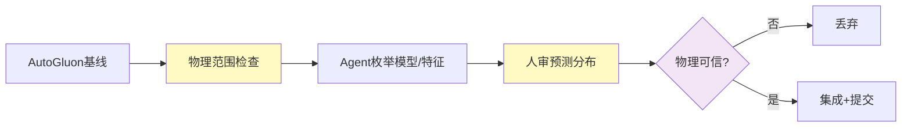

# 第7章 表格比赛详解：NeurIPS Open Polymer Prediction 2025（2025，科学表格数据的验证特殊性）

> **本章目标**：进入科学表格数据。这一章你会遇到一个全新的问题：**分数好，不等于结果对。** 一个模型 CV 分数漂亮，但预测出"玻璃化转变温度低于绝对零度"，那它就是废品。科学竞赛里，人的判断不只是验证纪律，还包括**领域合理性的守门**——这是 Agent 完全帮不上忙的地方。

---

## 开篇：当“分数”和“物理”打架

前面几章，我们判断一个模型好坏，主要看 CV 分数。这在商业比赛里基本够用——分数高，说明模型确实学到了东西，提交上去大概率也不会太差。

但科学竞赛不一样。这一章我们要讲的比赛，是 2025 年 NeurIPS 的 Open Polymer Prediction（开放聚合物预测挑战赛）。先给你交个底，让你知道这比赛是什么量级：据赛后的复盘文章统计，它吸引了 **2,240 支以上的队伍**参加。这不是小打小闹的练习赛，而是全球研究者和 Kaggle 老手混在一起的真刀真枪。

好，背景交代完，我们回到正题。

设想你在预测某种聚合物的玻璃化转变温度（Tg，说白了就是材料从硬变软的那个温度）。模型的 CV 分数很低，看着很美。可你低头一看预测值，发现有 3% 的样本预测出了 -250°C——比绝对零度（-273°C）只高一点点，物理上根本不可能，聚合物的 Tg 不可能这么低。

这就是典型的"分数好，但物理上不可信"。

先别急着说"才 3%，无所谓"。我们把这笔账算清楚。CV 告诉你的是"预测值和真实值的平均差距小"。注意"平均"这个词——平均是个很温柔的词，它会被大多数表现正常的样本稀释掉。那 3% 的离谱预测，只要落在样本数很少的角落，对平均值的贡献就几乎可以忽略，于是分数照样漂亮。可那 3% 在物理世界里是实打实的 3% 废品，是"模型在这个区域完全失控"的 3%。

**在科学竞赛里，一个违反物理常识的预测，哪怕数值上很准，也是不可接受的**——因为它意味着模型在某个区域彻底乱来，只是碰巧那个区域样本少，没把平均分拉下来。

打个比方。这就像你去医院体检，报告单上 95 项指标全部正常，唯独"体温"那一栏写着 -250℃。医生要是说"没关系，平均分很健康"，你肯定想换一家医院。分数是平均分，物理是每一栏。平均分再好看，也救不了那一栏荒唐的数字。

所以这一章，我们要在"验证纪律"之外，再加一道"领域合理性"的守门。这道门，Agent 守不了——它不懂物理。你把 "-250℃" 丢给 Agent，它顶多告诉你"这个值偏离训练集分布"，它并不知道"低于绝对零度"意味着什么。它没见过绝对零度，它只见过数据。



这张图就是本章的骨架。请注意两个涂成黄色的框——它们站的是"人"的位置。Agent 负责跑腿，人负责拍板。后面每一节，我们都会回到这张图上，指给你看"现在轮到谁上场了"。

---

## 7.1 比赛与数据

先把这场比赛到底在预测什么，讲清楚。

NeurIPS 2025 的聚合物性质预测，奖金 $50,000，是一个回归 / 多任务的表格任务。你拿到的是聚合物的分子描述符和实验条件，要预测多个目标性质。官方最终选定了五个性质：玻璃化转变温度（Tg）、导热系数（Tc）、密度（Density）、分数自由体积（FFV）、回转半径（Rg）。

这里插一句大白话：这五个名字你完全不需要记住，你只要知道它们是"五种不同的材料参数"，而且量纲差得离谱——温度是几百，密度是 1 左右，FFV 是个 0 到 1 之间的小数。**多任务**的意思就是"一次要同时预测好几个目标"，而这几个目标的数值范围差好几倍甚至好几十倍。所以不能一锅炖，必须分别标准化，不然数值大的那个目标会主导整个损失函数，小的那个直接被忽略。

数据规模也值得说一句，因为它直接决定了后面所有策略。根据赛后报告，官方一共整理了 **11,475 个不重复的聚合物**，其中 **9,625 个至少带一个性质的标签**。听起来还行？别急，真正扎心的是"标签分布"：有研究论文统计过官方放出的 7,973 条训练记录，发现 FFV 这个性质有 7,030 条标签（约占 88%），而 Tg 只有 511 条（约 6.4%），密度 613 条（约 7.7%），导热系数 737 条（约 9.2%），回转半径 614 条（约 7.7%）。

看出问题了吗？**样本最多和最少的目标，差了将近 14 倍。** 更麻烦的是，没有任何一条记录同时拥有全部五个标签——大多数记录只有一个标签。这就叫"标签缺失严重"。

有意思的是，连比赛官方都意识到这事有多棘手。他们最后用的评价指标不是普通的 MAE，而是**加权 MAE（wMAE）**：每个性质前面乘一个权重，权重里同时考虑了两件事——一是这个性质的数值范围（范围大的，除以范围，免得它一家独大），二是这个性质的标签数量（标签少的，给更高的权重， via 除以根号 n 的方式补偿）。说白了，官方在指标层面就替"样本少的目标"打了抱不平。

这件事对你的启示是：**当你面对一个多任务、标签又极度不均衡的数据集时，先去看官方指标是怎么加权的。** 指标怎么加权，你的模型就该往哪儿使劲。这比闷头调参有用得多。

数据本身的特点，可以总结成三句话：

- **特征**：分子描述符（分子量、链长、官能团计数等）加上实验条件（温度、压力等）。这些描述符是把一个分子"翻译"成一串数字，好让模型能算。
- **目标**：多个性质，每个都有自己的物理范围。ρ 不可能是负数，Tg 不可能低于绝对零度。
- **陷阱**：某些目标在训练集里样本极少，模型一旦跑到训练集没覆盖的区域（我们叫它"外推区域"），就开始胡言乱语。

关于最后这个陷阱，学术界有一句很冷静的提醒，我觉得值得原样转述给你：**随机切分得到的高分，主要衡量的是"在采样分布内部做插值"的能力，不能当作"化学空间上广泛泛化"的证据。** 换句话说，随机切分考的是"你在这张考卷覆盖的题型里能考多好"，而不是"你换个题型还行不行"。

这句话，其实就是我们整章要讲的东西的学术版。

---

## 7.2 自动基线工件与领域约束

先用 AutoGluon 跑一个基线工件出来。这一步和前面几章一样，没什么新鲜的：让自动机器学习工具先跑一遍，产出一份 OOF（折外预测，说白了就是"每个样本的预测值，都来自没见过它的那次训练"）和测试集预测，落盘存好。

新鲜的是下一步：**人要去检查这些预测值，是不是落在物理合理的范围内。**

科学数据的验证不能只看 CV——**领域约束是人的判断**。我们先得把每个目标的物理范围写下来。注意，这张表得人来填，Agent 不知道，它也没法知道：

```python
# src/utils/physical_constraints.py
"""
物理约束断言：预测值必须满足领域常识范围。
违反约束的模型，即使 CV 高也应丢弃。
这份表由人根据领域知识填写，Agent 只读。
"""

# 各目标的合理范围（这张表是人填的，Agent 不许改）
CONSTRAINTS = {
    # 玻璃化转变温度，单位摄氏度。不可能低于绝对零度，也不可能高到几千度
    "Tg":      {"min": 0.0,   "max": 500.0},
    # 密度，单位 g/cm³。必须是正数，常见聚合物大致在 0.5 到 2.5 之间
    "density": {"min": 0.5,   "max": 2.5},
    # 另一个写法不同的 Tg 目标，范围放宽一点，留点余地
    "Tg_v2":   {"min": -50.0, "max": 300.0},
}


def check_physical(oof_dict: dict) -> dict:
    """
    检查每个目标 OOF 的预测范围是否满足物理约束。

    参数
    ----
    oof_dict : dict
        {目标名: 该目标的折外预测数组}

    返回
    ----
    dict
        {目标名: 是否通过}。True 表示整列预测都落在允许范围内。
    """
    report = {}
    for target, preds in oof_dict.items():
        c = CONSTRAINTS.get(target)
        if c is None:
            # 这张表里没登记的目标，我们默认放行，但会在最后提醒人补表
            report[target] = True
            continue
        # 取这一列预测的最小值和最大值，只要有一个越界就算不通过
        ok = (preds.min() >= c["min"]) and (preds.max() <= c["max"])
        report[target] = bool(ok)
        if not ok:
            # 越界时把实际范围和允许范围都打出来，方便人判断"错得有多离谱"
            print(f"⚠️ {target} 预测越界：[{preds.min():.2f}, {preds.max():.2f}] "
                  f"允许范围 [{c['min']}, {c['max']}]")
    return report
```

跑完基线，先过一遍这个检查。如果有目标越界，哪怕 CV 好看，也要先弄清楚为什么——是模型的问题，还是你那张物理范围表填得太死。

这里多说一句"为什么这张表必须人填"。因为物理范围不是从数据里能推出来的。你看训练集里 Tg 的最小值是 50°C，就以为下限是 50°C？不一定，可能只是采样没采到更低的。但"不可能低于绝对零度"这件事，不需要看数据，它是物理定律。**数据告诉你"我见过什么"，领域知识告诉你"什么不可能"。** 这两件事必须同时在场。

---

## 7.3 Agent 批量实验，人审核物理合理性

现在到了本章最精彩的部分。

Agent 枚举模型和特征变体，跑出一堆工件；人审查工件里的预测分布和异常值，判断有没有"分数好但物理上不可信"的模型。

**我们来看一个真实会发生的场景。**

Agent 跑了 20 个模型，其中 XGBoost 的 CV RMSE 最低。你正准备用它，先做个物理检查——结果发现它 3% 的预测 Tg 小于 -200°C。你去查，发现这些样本的特征值在训练集里从没出现过（也就是说，它们掉进了外推区域），模型在那里完全乱来。

这时候你要做决定。CV 分数好看，是因为那 3% 样本太少，没把平均误差拉高。但**外推不可靠**这件事是实打实的。怎么办？果断丢弃。

先别走，我们把这事再想深一层：为什么模型一到外推区域就发疯？

因为树模型（XGBoost、LightGBM 这类）本质上是在训练集里"切格子"。训练集里没出现过的格子，它没有任何依据，只能把最近见过的那个格子的答案抄过来。这个"抄"的动作，在插值区域是合理的（附近确实差不多），在外推区域就是瞎猜。你可以想象一个只见过 1 到 10 度的温度计，你把它扔进 100 度的水里，它不会爆炸，它会指到 10 度——看起来"很稳"，其实完全错了。

那怎么系统地检测这种"外推失控"？看预测值偏离训练目标分布的程度：

```python
# src/utils/out_of_distribution.py
"""检测 OOF 中超出训练范围的预测（外推风险）。"""
import numpy as np


def extrapolation_ratio(oof, y_train, z=3):
    """
    OOF 中偏离训练目标均值 > z 倍标准差的比例。

    参数
    ----
    oof : array-like
        折外预测值。
    y_train : array-like
        训练集的真实目标值，用来算"正常范围"的均值和标准差。
    z : float, default 3
        几倍标准差算"偏离"。3 倍是个常用的经验值，
        正态分布下大约 99.7% 的数据落在均值 ±3σ 内。

    返回
    ----
    float
        越界样本占全部样本的比例。这个比例高，
        说明模型在"训练集没覆盖的区域"乱预测。
    """
    mu, sd = y_train.mean(), y_train.std()
    # 用训练集自己的均值和标准差当尺子，量预测值跑得有多远
    return float(np.mean(np.abs(oof - mu) > z * sd))
```

人的审查问题清单，就三条：

1. 预测分布的形状，和训练目标分布像吗？（画个直方图叠一起看，别靠脑补）
2. 有没有大量样本落在训练集从未出现的区域？
3. 多任务之间预测物理一致吗？（比如密度和体积的关系对不对）

> **Agent 不会主动做这些检查**——它只会报 CV 分数。物理合理性这道门，只能人守。

不过，你可以让 Agent 帮你**执行**检查，但**判断**留给自己。比如这样问：

```
我跑了 20 个模型，担心有"CV 好看但物理上不可能"的。
请对每个模型的 OOF 做两件事：
1. 按 src/utils/physical_constraints.py 里的范围检查越界比例
2. 算 extrapolation_ratio（偏离训练均值 3 倍标准差的比例）
把结果按"越界比例"降序列出来，不要自动丢弃任何模型。
```

模型会返回一张表：

```
> （思考过程）用户要的是"体检报告"，不是"自动清理"。
> 我按越界比例排序，把两个指标都列出来，并给出我的观察，
> 但明确说明"是否丢弃由你决定"——这是他的领域判断，
> 我不该替他做。

模型          越界比例   外推比例   CV RMSE   我的观察
XGB_v001      3.2%       11.5%     0.0421    越界集中在 Tg < -200°C
LGBM_v001     0.0%       2.1%      0.0435    全部在物理范围内
CAT_v001      0.4%       4.8%      0.0428    轻微越界（Tg 略低于 0）
NN_v001       0.0%       1.2%      0.0451    稳定但分数一般
...
我的观察：XGB_v001 的 CV 最好，但 3.2% 的预测物理上不可能，
且外推比例 11.5% 远高于其他模型，说明它在训练集未覆盖的区域
失控。是否丢弃请你判断——如果比赛指标对极端值不敏感，
你可能想保留它但做截断；如果指标敏感，建议丢弃。
我没有删除任何工件。
```

它把"事实"（越界比例、外推比例）和"我的观察"（可能失控）都给你了，但**没有替你做"丢不丢"的决定**。这就是我们要的协作姿势。

顺便说一句，这种"Agent 出体检报告、人做诊断"的分工，在真实比赛里是有先例的。这次比赛的获胜方案（据复盘文章介绍）走的是"每个性质单独建模 + 多模型集成"的路线，用了 ModernBERT、AutoGluon 和 Uni-Mol-2 三套东西，五折交叉验证，最后还专门针对 Tg 做了一步后处理——因为作者发现训练集和排行榜数据之间存在明显的分布漂移，于是给 Tg 的预测值加上了"预测标准差乘以一个系数"的修正。你注意这个动作的性质：**它不是算法，它是人对数据的人工干预。** 机器跑完，人看了一眼分布，觉得"不对，整体偏低了"，然后手动掰回来。这种事，Agent 不会主动做。

那如果 Agent 在"随机切分"这件事上给你出坏主意呢？这在分子数据上尤其常见，因为分子数据看起来就是一张普通表格。你可以这样问它：

```
我的分子数据有 8000 行，每行一个 SMILES 加五个性质标签。
我想用普通 KFold 做五折交叉验证，可以吗？请说明风险，
不要直接改我的代码。
```

模型大概会这样回答：

```
> （思考过程）用户问的是"能不能用 KFold"，这是个有陷阱的问题。
> 分子数据长得像普通表格，但样本之间相似度很高——
> 随机切分会把"几乎一样的分子"同时放进训练和验证。
> 我要说清"高分不等于泛化"，但不能替用户下结论说
> "你必须换切分"，那是他的领域判断。

可以用，但你要清楚它衡量的是什么。

【KFold 在这里会发生什么】
你的数据里有很多结构高度相似的分子（比如只差一个甲基）。
随机切分之后，1 号分子和它的"近亲"可能一个进了训练集、
一个进了验证集。模型在训练集里见过"近亲"，
验证时自然答得准——但这是"认脸"，不是"懂化学"。

【分数会怎么骗你】
随机切分主要衡量"在采样分布内部做插值"的能力。
它不能证明模型在"没见过的化学区域"也行。
如果你后续要外推（比如预测训练集里没有的新型聚合物），
随机切分的分数会系统性偏乐观。

【一个我没把握的点】
你这五个性质的标签数量差很多（有的几百，有的几千）。
KFold 是随机分，不保证每折里小样本性质的标签分布一致。
要不要我先统计一下每个性质在每折里的标签数，
看看有没有某折特别空？
```

这段回答好在哪儿？它没有简单说"不行"，而是告诉你"行，但它衡量的是另一件事"，还顺手指出一个你没问的隐患（小样本性质在折间分布不均）。**好的模型输出，是帮你把问题的边界画清楚，而不是给你一个非黑即白的答案。**

---

## 7.4 集成与提交

模型选完了，该提交了。但科学竞赛的提交，要比商业比赛多一道闸。

```python
# src/submit/physical_submit.py
"""
提交前做物理约束断言，违反则拒绝生成提交。
这是最后一道闸：宁可交不上去，也不交一个物理上荒谬的结果。
"""
import numpy as np
import pandas as pd
from src.utils.physical_constraints import CONSTRAINTS


def make_physical_submission(pred_dict, sample_path, out_path, id_col="id"):
    """
    生成提交文件，但在写盘之前先过一遍物理约束。

    参数
    ----
    pred_dict : dict
        {目标名: 测试集预测数组}
    sample_path : str
        官方 sample_submission.csv 的路径，用来对齐行顺序和列名。
    out_path : str
        输出路径。
    id_col : str, default "id"
        提交文件里的编号列名。

    抛错
    ----
    ValueError
        只要有一个目标越界，就拒绝写文件。
    """
    sample = pd.read_csv(sample_path)
    sub = sample.copy()
    for target, preds in pred_dict.items():
        c = CONSTRAINTS.get(target)
        # 关键：先检查，再赋值。检查不过直接抛错，文件根本不会生成
        if c and ((preds.min() < c["min"]) or (preds.max() > c["max"])):
            raise ValueError(f"{target} 预测违反物理约束，拒绝提交")
        sub[target] = preds
    sub.to_csv(out_path, index=False)
    print(f"✅ 物理约束通过，提交已生成：{out_path}")
```

注意这里的设计哲学：**宁可交不上去，也不交一个荒谬的结果。**

为什么这么决绝？因为在科学竞赛里，一个物理上不可能的答案，比一个分数稍低的合理答案更糟——前者说明你根本没理解问题，后者只是说明你还没做到最好。这两件事的性质完全不同。

再打个比方。你交上去一份"预测某种材料密度是 -3 g/cm³"的结果，评委不会觉得"哎呀你差一点"，他会觉得"这人不靠谱，后面都不用看了"。而如果你交上去一份"密度预测得还行，但 Tg 差了几个点"，评委至少知道你是认真做过的人。

最后说一句题外话，但其实是题内话：**这道闸真正的价值，不在于它拦住了多少错误提交，而在于它逼你在提交前再看一眼自己的预测。** 很多时候，人就是在这一眼里，发现了那个"分数很好看但哪里不对劲"的模型。

---

## 7.5 小结

**科学表格竞赛中，人的判断不仅是验证纪律，还包括领域合理性的守门。**

- CV 高 ≠ 可信，物理越界直接否决；
- 外推风险检测（`extrapolation_ratio`）是 Agent 不会自动做的；
- 多任务物理一致性需要领域知识；
- 提交前的物理断言，是最后一道闸。

这一章给你的启发可以推广到所有"有领域约束"的问题：医疗（预测值不能是负的剂量）、金融（预测收益率不能离谱）、气象（预测温度不能超出物理极限）。**凡是现实有约束的地方，验证就不能只看数字。**

说到底，这一章讲的是一件很朴素的事：**模型不知道什么是"不可能"，只有你知道。** 你脑子里那些"这 obviously 不对"的直觉，不是玄学，是你在这个领域里泡久了长出来的东西。Agent 再聪明，也没有这层东西。所以别把它当工具用，把它当一个跑腿很利索、但完全不懂业务的实习生——它出报告，你签字。

> **下一章预告**：第二部分（表格）结束，第三部分进入时序数据。第 8 章建立时序 Vibe 工作流，核心只有一句话：**时间纪律不可委托。** 你会在那里看到，为什么"随机划分"在时序问题里是头号大敌。