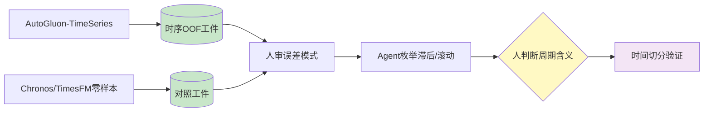

# 第8章 时序数据的 Vibe 工作流：自动化枚举与人工时间纪律

> **本章目标**：进入第二部分——时序数据。这一章只讲一件事，但这件事是时序竞赛的命根子：**时间纪律不可委托。** Agent 可以帮你批量枚举几百个滞后和滚动特征，但"哪些阶数有周期含义""时间该怎么切"，必须你来定。本章建立时序 Vibe 循环模板，后面三章（S5E1、S5E10、Jane Street）都复用它。

---

## 开篇：时序问题里，最大的敌人是“偷看未来”

先说一个让人后背发凉的事实：时序竞赛里，最常见的错误不是模型不够好，而是**模型偷看了未来**。

什么叫偷看未来？假设你要预测某家店明天的贴纸销量。如果你随机地把数据切成训练集和验证集，那很可能出现这种情况：训练集里有 1 月 5 日的数据，验证集里有 1 月 3 日的数据——模型在"未来"训练，却去预测"过去"。

这在现实中根本不可能。你不可能用明天的数据训练一个预测昨天的模型。可在随机切分下，它就这么发生了，而且发生得悄无声息——代码不报错，分数还挺高。

结果就是：你的 CV 分数高得离谱，一提交，LB 暴跌。因为你训练时偷看了未来，线上却只能看到过去。

这个落差有多夸张？我给你看一个真实发生过的例子。有人在 Stack Overflow 上贴过一组对照实验：同一份数据、同一个模型，用 `train_test_split` 随机切，验证集分数是 **10.66**，测试集分数是 **136.65**——差了十几倍，直接崩盘。换成 `TimeSeriesSplit` 之后，验证集 **12.66**，测试集 **18.77**，虽然也差，但同一个量级，属于"正常的、可解释的"差距。

你看，问题的本质不是"模型变差了"，而是"第一种切法根本在骗你"。

再讲个更狠的。有人拿 Kaggle 的 Playground 时序题做过实验：同一套 25 个特征、同一个 LightGBM，只换切分方式——

| 切分方式 | 分数（RMSLE） | 真相 |
|---|---|---|
| KFold（随机打乱） | 0.1248 | "看起来"好得吓人 |
| TimeSeriesSplit（时序） | 1.1246 | 真实的"预测未来"水平 |

**相差约 9 倍。** 随机切分之所以那么好看，是因为它把 2010 年 10 月的数据拿去训练、2010 年 5 月的数据当验证——模型"从未来学知识去猜过去"，当然猜得准。可真实比赛里你要猜的是明年的未来，跨年预测难度陡增。这就是那句老话的由来：**分数可以骗人，验证方式不能骗人。**

所以时序问题的第一纪律是：**永远用过去预测未来，切分必须严格按时间顺序。**

这条纪律，Agent 最容易违反。它看到"交叉验证"四个字，条件反射就是 `KFold`，完全不管数据有没有时间性。为什么？因为它的训练数据里，99% 的表格题都是随机切分的，它"见多识广"，见的全是错的示范。

这一章，我们就把这条纪律，用制度和代码焊死。



看图里那两个绿色的"工件"框。整个时序流程的产出物不是模型，是**工件**——落盘的预测文件、折索引、指标报告。为什么强调这个？因为时序问题里，人需要反复回头检查"我到底喂了什么给模型"。工件在，你就能查；工件丢了，你只能靠记忆，而记忆在时序问题里是最不可靠的东西。

---

## 8.1 时序自动基线 + 工件落盘

先用 AutoGluon-TimeSeries 快速跑一个基线；同时把基础模型（Chronos / TimesFM）的零样本预测也跑出来，作为对照工件。

先解释两个新词，别被名字唬住：

- **AutoGluon-TimeSeries**：AutoGluon 的时序版本，专门做"预测未来一段时间"的任务。你可以把它理解成一个"自动调参的流水线工人"，你给它数据，它自己选模型、自己调参。
- **零样本（zero-shot）预测**：像 Chronos 这种"时序基础模型"，在无数条时间序列上预训练过，你直接把新数据丢给它，不用训练就能预测。它就像一个见过无数股票曲线、销售曲线、气温曲线的"老分析师"，看一眼新曲线就能大致外推。

为什么要专门跑一个零样本基线？因为它给你一个**不依赖你自己调参的参照系**。你后面辛辛苦苦做了半天特征工程，结果还不如人家零样本，那说明你走错路了。这个参照系很便宜，但很值钱。

```python
# src/baselines/timeseries_baseline.py
"""
时序自动基线：AutoGluon-TimeSeries + Chronos 零样本。
产出与表格一致的 OOF/test 工件规范，便于集成。
"""
import numpy as np
import pandas as pd
from pathlib import Path
from autogluon.timeseries import TimeSeriesPredictor

ROOT = Path(__file__).resolve().parents[2]
# 时序数据通常长这样：item_id（序列编号）、timestamp（时间）、target（值）
train = pd.read_csv(ROOT / "data" / "train.csv")

# AutoGluon-TimeSeries 要求长格式：item_id, timestamp, target
predictor = TimeSeriesPredictor(
    prediction_length=28,          # 预测未来 28 天
    target="target",               # 目标列名
    eval_metric="MAPE",            # 平均绝对百分比误差，越接近 0 越好
    path=str(ROOT / "artifacts" / "_ag_ts"),   # 工件落盘目录
).fit(train, time_limit=300, verbosity=0)      # 只跑 300 秒，先要个基线

# 产出预测工件（示意；严格 OOF 见后文时间切分）
print("AutoGluon-TimeSeries 基线完成")
```

跑完之后，先别急着看总分。**人要做的是检查不同序列的误差模式**：哪些 item 的 MAPE 远高于平均？是新品（历史数据少）、促销期（波动大）还是数据稀疏？

我举个例子你就明白了。假设总体 MAPE 是 0.15，看着还行。但你把 90 条序列拆开一看，发现其中 5 条序列的 MAPE 是 0.8，剩下 85 条是 0.05。这时候"总体 0.15"这个数字，其实是个彻头彻尾的谎言——它把一个"模型完全不会做"的群体，和一群"模型做得很好"的群体，平均在了一起。

这就像班里平均分 75 分，听起来及格了，但其实是 5 个学生考 30 分、45 个学生考 80 分。**平均数最会骗人，它把所有问题都藏起来了。** 你要做的，是把那 5 个 30 分的学生找出来。

这些问题的答案，决定了你后面该往哪个方向使劲：如果差的是新品，那你要想办法做"冷启动"；如果差的是促销期，那你要加促销特征；如果是数据稀疏，那可能任何模型都救不了，你得接受它。

---

## 8.2 Agent 执行、人审查的特征工程

日期拆分这种体力活，交给 Agent。滞后阶数和滚动窗口的**候选枚举**也交给 Agent。但**哪些阶数有周期含义**，必须人根据 EDA（探索性数据分析，说白了就是"先把数据画出来看看长什么样"）来判断。

先解释两个核心特征，它们是时序特征工程的两块砖：

- **滞后特征（lag）**：把过去第 k 天的值拿过来当特征。比如"昨天的销量"对预测今天很有用——这符合直觉，今天和昨天总是有点像。
- **滚动窗口（rolling）**：把过去 w 天的统计量（均值、标准差、最大最小值）当特征。比如"过去 7 天平均销量"刻画短期趋势，能回答"最近这周整体是热还是冷"。

把这段话丢给 Agent：

```
请为时序数据生成滞后与滚动特征：
- 滞后：1, 7, 14, 28 天
- 滚动窗口：7, 14, 28 天，统计量 mean/std/min/max
产出对比工件 LGBM_TS_v001。固定时间切分协议不变。
```

模型输出（节选，注意那个 `shift(1)`）：

```
> （思考过程）滞后特征用 groupby(item_id)[target].shift(k)。
> 滚动用 groupby(item_id)[target].rolling(w).mean() 等。
> 注意：滚动统计必须 shift(1) 避免用当天值（泄漏）——
> 如果直接 rolling 会把当天数据算进去，等于偷看答案。
> 这一点必须写在注释里，因为用户是从我这里复制代码的，
> 注释是他唯一能看到的提醒。

def add_lag_roll(df, item_col, ts_col, target):
    """滞后 + 滚动特征，严格避免当天泄漏。"""
    # 先按"序列 + 时间"排序，否则 shift 会串行——这是最容易翻车的一步
    df = df.sort_values([item_col, ts_col]).copy()
    g = df.groupby(item_col)[target]
    for k in [1, 7, 14, 28]:
        df[f"lag_{k}"] = g.shift(k)               # 滞后 k 天：把 k 天前的值搬过来
    for w in [7, 14, 28]:
        r = g.shift(1).rolling(w)                 # shift(1) 防泄漏！
        df[f"roll_mean_{w}"] = r.mean()           # 过去 w 天的均值（不含今天）
        df[f"roll_std_{w}"] = r.std()             # 过去 w 天的标准差（不含今天）
    df["dow"] = pd.to_datetime(df[ts_col]).dt.dayofweek   # 星期几，0=周一
    df["is_weekend"] = (df["dow"] >= 5).astype(int)       # 是否周末
    return df
```

那个 `shift(1)` 是时序特征工程的命门。我们把它单独拎出来讲。

如果不写 `shift(1)`，滚动窗口会把当天（也就是你要预测的那天）的值算进均值里。这意味着什么？意味着你在用"今天的答案"去预测"今天"。这等于考试时偷看了答案——CV 会虚高，线上必崩。

这个坑有多常见？社区里有专门的文章把它列为"最隐蔽的泄漏之一"，并且特别提醒：用 pandas 算滚动统计时，忘了 shift，或者设了 `center=True`，当前行甚至未来行都会渗进你的移动平均里。

我打个比方。这就像你统计"过去 7 天的平均气温"，结果把今天中午的温度也算进去了——可你要预测的正是今天中午。你不是在预测，你是在抄。

那 Agent 会不会主动提醒你？有时候会，有时候不会。所以更稳妥的做法是，你直接去问它，把话挑明：

```
我在做时序的滚动特征，用 df.groupby('item')['target'].rolling(7).mean()。
这样写有没有泄漏？如果有，请说明泄漏发生在哪一行，
并给出修正后的代码。不要改我其他的代码。
```

模型会这样回答：

```
> （思考过程）用户问得很具体："有没有泄漏、泄漏在哪一行"。
> 我要指出 rolling 默认包含当前行，这就是泄漏点。
> 修正方式是先 shift(1) 再 rolling。
> 另外要提醒 center=True 也不行。回答要短，别绕。

有泄漏，泄漏就在 rolling 本身。

【泄漏在哪一行】
rolling(7) 默认窗口是"当前行 + 前 6 行"。
所以第 t 行的 roll_mean_7 里，包含了第 t 行的 target——
而第 t 行的 target 正是你要预测的东西。

【为什么这很致命】
模型会直接学到"roll_mean_7 ≈ 今天的真实值"，
于是 CV 分数虚高，线上却拿不到今天的真实值，必崩。

【修正】
r = g.shift(1).rolling(7)   # 先整体下移一天，窗口变成"前 7 天"
另外别用 center=True，那会把未来行也拉进来。

【一个附带提醒】
如果你的数据里有缺失日期（比如某天没有记录），
shift(1) 移动的是"行"不是"天"，此时 lag_1 可能实际是"前两天"。
要不要我先检查一下每个 item 的日期是否连续？
```

最后那句"要不要我先检查一下日期是否连续"，又是它主动帮你发现的隐患。注意这个模式：**好的模型输出，回答完你的问题之后，还会顺手指出你问题背后的假设可能不成立。**

**人的判断**（这是 Agent 干不了的）：零售数据有周周期（周末销量高）、月度效应（月初月末不同）。滞后 7、14、28 天有业务含义；滞后 3、5 天可能只是噪声。滚动窗口 28 天覆盖一个完整月周期，合理。

**这些"哪个阶数有意义"的判断，Agent 给不了，它只会把所有阶数都试一遍。** 它不知道你卖的是贴纸还是空调，不知道你的业务周末真的会爆单。它只知道"7 和 14 和 28 是常见的数字"。

这里还有个反面教材值得说。有人做时序题时，觉得"月份/季节特征网上都说必加"，于是加了 month 和 season，结果分数反而变差了。为什么？因为训练数据只覆盖一年多，**每个月份只出现过一次**。模型看到"month=10"，等于被告知"这是那一年第 10 个月的数据"，于是把某一年 10 月的偶发情况当成了季节规律。这是另一种形式的时间泄漏——不是偷看未来，而是把"一次偶然"误当成"周期"。无独有偶，同一场比赛里还有人觉得"低苯值"那 230 行是脏数据、删掉更干净，结果删完分数也变差了——因为那 230 行恰恰是某个真实存在的低值群体，删掉等于让模型在真实场景里再也没见过这种低值，预测时反而抓瞎。**时序数据里的"异常值"往往不是脏，而是你还没理解的真实模式，删之前先想清楚。**

**要加季节特征，至少得有两三年的数据循环可学。** 这句话你记住，能省你很多时间。

---

## 8.3 时间验证：不可委托的纪律

现在到本章的核心。

人设定时间切分方案，Agent 执行；**Agent 的任何"随机划分"建议应被默认拒绝。**

验证协议（时序版）长这样：

```yaml
# configs/cv_protocol.yaml（时序版）
task_type: "regression"
cv_scheme:
  type: "TimeSeriesSplit"   # 时序切分：训练集时间永远早于验证集
  n_splits: 5
  gap: 28                   # 训练与验证间隔 = 预测跨度，防自相关泄漏
  time_column: "timestamp"
forbidden_schemes:
  - "KFold"            # 时序禁用随机 KFold！
  - "ShuffleSplit"
  - "StratifiedKFold"
```

这份 yaml 我管它叫"时序竞赛的小宪法"。它只做一件事：把"不许随机切"这条纪律，从"我记住了"变成"文件里写着"。人脑会忘，文件不会。

那个 `gap: 28` 也值得解释。如果你预测未来 28 天，那训练集和验证集之间最好隔 28 天以上——否则训练集末尾的数据和验证集开头的数据高度相关（相邻日期的销量本来就相似），模型又会"偷看"。

再打个比方。这就像你准备考试，老师给你划范围说"考第 1 到 10 章"。你复习的时候，如果第 10 章和第 11 章的知识点是连着的（比如都是同一个公式的延伸），那你看第 10 章的时候，其实已经"顺带"看到了第 11 章的开头。gap 就是那道墙，把"复习范围"和"考试范围"隔开，不让你顺带看到。

**人检查工件中的验证折索引是否符合时间顺序**：

```python
# src/utils/time_order_check.py
"""
验证折索引必须严格按时间顺序：
折 k 的验证集时间，必须晚于折 k 的训练集时间。
只要有一个样本"时间倒流"，就报错。
"""
import numpy as np


def check_time_order(splits, timestamps):
    """
    检查每一折是否满足"训练时间 < 验证时间"。

    参数
    ----
    splits : list[tuple[array, array]]
        每一折的 (训练索引, 验证索引)。
    timestamps : array-like
        每个样本对应的时间戳。

    返回
    ----
    bool
        全部通过返回 True，否则打印第一处问题并返回 False。
    """
    ts = np.asarray(timestamps)
    for k, (tr, va) in enumerate(splits):
        # 训练集里最晚的时间，必须早于验证集里最早的时间
        if ts[tr].max() >= ts[va].min():
            print(f"⚠️ 第 {k} 折时间顺序错误：训练集最大时间 >= 验证集最小时间")
            return False
    print("✅ 所有折时间顺序正确")
    return True
```

这个函数只有几行，但它是你最后一道防线。跑一遍，一秒钟的事，能救你一整场比赛。

> Agent 的任何"随机划分"建议应被默认拒绝——这是时序竞赛的第一红线。它如果说"用 10 折交叉验证更稳"，你要立刻警觉：时序数据不能用随机 KFold。

那 Agent 到底会给出什么建议？你试一次就知道了：

```
我的时序数据想做交叉验证。用哪种切分方式？请说明理由，
不要直接改我的 cv_protocol.yaml。
```

模型会这样答：

```
> （思考过程）用户要的是"方案 + 理由"。关键判断：
> 这份数据有 item_id（多条序列）和 timestamp，
> 既有分组结构又有时间性。我要说明为什么普通 KFold 错、
> 为什么 TimeSeriesSplit 对，以及 gap 该设多少。
> 最后一句要留个口子：序列长度差异这个隐患我没数据，
> 不能瞎猜，得先问。

推荐：TimeSeriesSplit（时间前向切分），不要用 KFold。

【为什么 KFold 在这里会出事】
你的数据是"多天连续记录"。随机 KFold 会把 3 月 10 日
放进训练集、3 月 5 日放进验证集——模型就用"未来"训练，
去预测"过去"。这在真实上线时不可能发生，所以 CV 分数会虚高，
一上线就崩。

【TimeSeriesSplit 怎么工作】
把时间轴顺序排好，第 1 折用最早的一段训练、紧接着的一段验证；
第 2 折把验证数据也并入训练，再往后取一段验证。
每一折的训练时间都严格早于验证时间。

【gap 该设多大】
gap = 你的预测跨度。也就是你要预测未来 28 天，
那训练集和验证集之间至少隔 28 天（gap=28）。
原因是：训练集末尾的数据和验证集开头的数据如果挨得太近，
相邻日期本来就相似，模型会"顺手"猜对——这也是一种偷看。
如果你预测跨度不是 28 天，gap 要跟着改。

【一个我没把握的点】
你的多条序列（item_id）之间长度可能不同。TimeSeriesSplit
是按"行"切的，不是按"序列"切的，如果各序列长度差异大，
切出来的折可能会让某些序列在训练集里完全缺席。
要不要我先统计一下各序列的长度分布，看看有没有这个问题？
```

它把"错在哪""对的是什么""gap 为什么重要"讲清楚了，还主动提出一个**你没问但确实存在的隐患**（序列长度差异导致切分不均）。这就是好的协作——它不只回答问题，还帮你发现下一个问题。

不过，TimeSeriesSplit 也不是完美的，你心里得有数。它有个公认的毛病：**每一折的训练集大小是不一样的，而且越来越大。** 第一折可能只有全部数据的 20% 拿来训练，第五折就有 5 倍那么多。这意味着各折的分数不完全可比，第一折的分数天然会更差（因为见的数据少）。所以看时序 CV 分数，别只盯着某一折，要看整体趋势，最好用"均值 + 标准差"这种带惩罚的口径（有的 Kaggle 高手就习惯用 `mean + std` 当总分，专门惩罚那些"忽好忽坏"的模型）。

---

## 8.4 基础模型与树模型的工件级融合

基础模型工件和树模型工件并列摆着；人来判断融合方式（简单加权、残差建模、把基础模型预测作为特征送入树模型）。

三种融合方式，各有适用场景：

```python
# src/ensembles/ts_fusion.py
"""三种融合方式：加权、残差、基础模型预测作特征。"""
import numpy as np


def weighted_fusion(p_tree, p_base, w=0.5):
    """
    简单加权：最终预测 = w * 树模型 + (1-w) * 基础模型。
    w 由人根据 CV 决定，没有万能的默认值。
    """
    return w * p_tree + (1 - w) * p_base


def residual_fusion(y_true, p_base, tree_model, X):
    """
    残差建模：让树模型专门去学"基础模型没预测对的那部分"。

    直觉：基础模型已经把大趋势抓得不错了，
    剩下的残差（真实值 - 基础模型预测）里藏着它抓不到的东西，
    让树模型去啃这块硬骨头。
    """
    residual = y_true - p_base          # 残差 = 真实值 - 基础模型预测
    tree_model.fit(X, residual)         # 树模型只学残差
    return p_base + tree_model.predict(X)   # 基础模型 + 树模型补的部分
```

**人判断**：

- 如果基础模型（Chronos）在稳定期表现好、树模型在促销期好 → 用残差融合，让树模型专门补基础模型的短板；
- 如果两者误差模式互补 → 用加权；
- 如果基础模型的预测本身就是强信号 → 把它当特征喂给树模型。

这些判断，都建立在你对"两个模型各自擅长什么"的理解上。Agent 不知道 Chronos 擅长什么、树模型擅长什么，它只会把三个公式都跑一遍，然后告诉你"三个分数分别是多少"。

这里我想多说一句，因为它很容易被忽略：**融合的本质不是"拼分数"，是"拼视角"。** 两个模型如果错在同一批样本上，那融合毫无意义——你只是把同一个错误平均了两次。真正有价值的融合，是找到"一个怕热、一个怕冷"的组合。而"谁怕热、谁怕冷"这件事，只有看过误差分布的人才知道。

---

## 8.5 小结

- 时序自动基线产出合规工件，人审误差模式；
- 滞后/滚动特征 Agent 枚举，**周期含义人判断**；
- 时间验证纪律**不可委托**，随机划分默认拒绝，`shift(1)` 防泄漏；
- 基础模型与树模型融合方式由人决定。

这一章反复出现一个主题：**时序问题里，Agent 的"聪明"反而是危险的。** 它见多识广，会给你提各种"优化"建议，但其中很多在时序场景下是错的（比如随机 CV、用未来数据、把偶然当周期）。你的职责，就是把这些建议挡在门外。

说得再直白点：Agent 像一个知识渊博但没上过班的顾问。它读过一万份报告，知道"交叉验证" generally 是好的，但它不知道你这份数据的时间戳意味着什么。它给出的每一个建议，你都要过一遍"这在现实里说得通吗"这一关。

> **下一章预告**：第 9 章贴纸销售预测，把这套循环落到入门级时序比赛。你会看到 Top 15% 的方案都在用 Group K-Fold——**时间/分组纪律，从入门级比赛就是核心**，不是高级技巧。