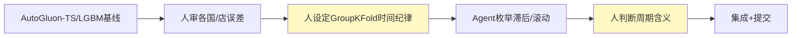

# 第9章 时序比赛详解：Playground S5E1 贴纸销售预测（2025，时间纪律的入门标准）

> **本章目标**：把第 8 章的时序循环，落到一场入门级比赛上。你会看到 Top 15% 的公开方案用的是 Group K-Fold 验证——**时间/分组纪律不是高级技巧，而是入门级比赛的核心。** 这一章教你"为什么不能随机切，要按组切"，以及"怎么用一句话戳破自己的自我欺骗"。

---

## 开篇：同一家店的销量，随机切开会“泄漏”

第 8 章我们说了，时序不能随机切分，要按时间顺序。但 S5E1 贴纸销售有个额外陷阱：**同一个商店（或同一家店卖的同款贴纸）的数据，在时间上是连续的**。

想象你要预测某家贴纸店的日销量。随机 KFold 切分时，可能出现：1 月 10 日在训练集、1 月 11 日在验证集。但这两天的销量高度相关（同一店、连续两天）。模型在"未来"（1 月 10 日）训练，去预测"过去"（1 月 11 日）——又是偷看未来。

更隐蔽的是**同店泄漏**：同一商店的所有日期被随机撒到各折里，模型能"记住"某家店的特征，跨折作弊。

打个比方。你要参加一场"根据以往记录预测下个月销量"的考试，结果考卷发下来，你发现隔壁同学的答题卡上写着答案，而那个"隔壁同学"就是你自己的店——只不过日期被调换了。这不叫能力，这叫抄自己的卷子。

解法就是这一章的主角：**Group K-Fold**——按"商店 + 时间段"分组，同组不跨折。



看这张图，注意黄色框的位置：**纪律是人定的，枚举是 Agent 干的。** 这个分工从头到尾没变过。

---

## 9.1 比赛与数据

这是 Kaggle 2025 年的 Playground Series 赛季 5 第 1 场，名字叫 "Forecasting Sticker Sales"——预测贴纸销量。指标是 MAPE（平均绝对百分比误差）。

先说数据规模，这样你对后面的数字才有感觉：

- `train.csv`：**230,130 行**，6 列（`id`、`date`、`country`、`store`、`product`、`num_sold`）；
- `test.csv`：**98,550 行**，5 列（没有目标列）；
- `sample_submission.csv`：98,550 行 × 2 列。

这数据看着挺大，但有个反直觉的事实：它其实是 **90 条时间序列**。6 个国家 × 3 家虚拟商店 × 5 种贴纸产品，正好 90 条。你要做的事情，说白了是"同时预测 90 条曲线的未来"。

再算一下时间跨度：230,130 ÷ 90 = 2,557 天，差不多是 2010 年 1 月 1 日起的七年；而测试集 98,550 ÷ 90 = 1,095 天，正好三年。

**这个"三年"很重要。** 后面你会看到，它是这一章验证协议的关键依据。

顺便提一个细节：目标列 `num_sold` 里有 **8,871 个缺失值**。为什么缺失？因为这个数据是合成的——现实中有的组合就是没有销量记录。这是入门级比赛的经典设计：**先给你一点脏东西**，看你会不会处理。

目标列的结构也很清楚：**强季节性**。周末高、月初月末不同、有节假日效应。这一点后面判断滞后阶数时全靠它。

MAPE 是什么？它衡量"预测偏差占真实值的百分比"的平均。

$$
\text{MAPE} = \frac{1}{n}\sum_{i=1}^{n}\left|\frac{y_i - \hat{y}_i}{y_i}\right|
$$

比如真实销量 100，你预测 110，偏差 10%，那这条就贡献 10%。

MAPE 的好处是"对量级不敏感"——卖 100 张的店和卖 10000 张的店，都用百分比衡量误差，不会让大店主导整个分数。坏处嘛，当然也很直白：**当真实值接近 0 时，分母趋近 0，误差会被放大到无穷大。** 这一章后面会讲，这次比赛里有一个国家就吃了这个亏。

---

## 9.2 自动基线工件

AutoGluon-TimeSeries / LightGBM 基线工件；人检查不同国家/商店的误差模式。

```python
# src/baselines/s5e1_baseline.py
"""S5E1 基线：LightGBM + 日期特征，按国家/商店分组报告 MAPE。"""
import numpy as np
import pandas as pd
import lightgbm as lgb
from pathlib import Path

ROOT = Path(__file__).resolve().parents[2]
train = pd.read_csv(ROOT / "data" / "train.csv")
test = pd.read_csv(ROOT / "data" / "test.csv")


def add_date(df):
    """
    把日期列拆成一组数字特征。

    为什么树模型需要这些？因为树模型不认"日期"这种连续的东西，
    它只认切得开的数字。星期几、月份、第几周，都是在告诉模型
    "这一行属于哪一类"。
    """
    df = df.copy()                      # 复制一份，避免改到原始数据
    d = pd.to_datetime(df["date"])      # 字符串转成真正的日期类型
    df["year"] = d.dt.year              # 年
    df["month"] = d.dt.month            # 月
    df["day"] = d.dt.day                # 日
    df["dow"] = d.dt.dayofweek          # 星期几（0=周一）
    df["woy"] = d.dt.isocalendar().week.astype(int)   # 一年第几周
    df["is_weekend"] = (df["dow"] >= 5).astype(int)   # 是否周末
    return df
```

跑完基线，人分组看 MAPE：

```python
def mape_by_group(oof, y, group_values):
    """
    按某列分组报告 MAPE，找出误差异常的组。

    参数
    ----
    oof : pd.Series
        折外预测值（每个样本一个预测）。
    y : pd.Series
        对应的真实值。
    group_values : pd.Series
        每个样本所属的分组标签，比如 country 那一列的值。
        注意传的是"值"，不是列名——列名没法用来分组。

    返回
    ----
    pd.Series
        每个组的平均 MAPE，按从大到小排。
        排在前面的，就是你最该去查的。
    """
    # 绝对百分比误差。clip 是保护措施：真实值可能是 0，
    # 直接除会得到 inf，把整个平均分数炸掉，所以把分母兜个底。
    errs = np.abs(oof - y) / np.clip(y, 1e-8, None)
    # 把误差和分组标签拼成一张表，然后按组求均值
    tmp = pd.DataFrame({"group": group_values.values, "err": errs.values})
    return tmp.groupby("group")["err"].mean().sort_values(ascending=False)
```

人审查：某国 MAPE 远高于其他 → 该国数据可能稀疏或节假日特殊，需单独处理。**这就是"人审查误差模式"的具体动作**——不是一眼看总数，而是拆开看每个组。

说到这儿，我想讲一个这次比赛里非常精彩的实战技巧，因为它完美示范了"人怎么审误差模式"。

拿到第 3 名的选手用了一个巧妙的方法，单独把每个国家的误差拆出来看。他交了两次分：第一次是正常预测；第二次把**除了选定国家以外的所有预测值都改成 0**。因为"预测 0"的 MAPE 恰好等于 1（因为 $\frac{|0 - y|}{y} = 1$），所以两个提交的总分能联立成两个方程，解出两个未知数：这个国家单独的分数，以及其余国家的平均分数。

就这么一个提交技巧，把"哪个国家最难预测"这个问题给量化出来了。他的结论是：**肯尼亚（Kenya）最难。**

顺便补一句这个技巧的出处：它是这次比赛季军 Konstantin Dmitriev 的复盘里写的，思路是"把非目标国家的预测全置 0，利用置 0 的 MAPE 恰好等于 1 这个性质，联立方程拆出单国误差"。这种"用提交次数换信息"的玩法，本身就是人审误差模式的极致示范——模型不会主动告诉你"该拆哪个国家"，是你设计了这个实验。

为什么？他说肯尼亚有两重问题：一是目标值特别小，二是存在缺失值。小目标值加上取整误差，就产生了大量采样噪声；缺失值又让这个国家的模型只能靠"猜"。社区里其他人也补充说，肯尼亚的销量和人均 GDP 的比例关系跟其他国家合不上——因为 GDP 很低的时候，"比例约等于"这个近似就不成立了。

你看，这就是人审误差模式的价值。模型只给你一个总分 **0.07**，它不会告诉你"是肯尼亚把你的分数拖下来的"。而知道这一点，你就知道该往哪儿使劲：给肯尼亚单独加处理、单独调参、或者至少在最后融合时给别的国家更大的权重。

---

## 9.3 人设定 Group K-Fold 时间纪律

按商店和产品分组做时间切分，Agent 执行；**人检查工件中的折索引是否严格按时间顺序**。

先说清楚为什么 S5E1 需要"分组 + 时间"两重纪律，而不是只要一个。

看这个对照表。这是社区里一个拿了 Top 15% 成绩的公开方案自己记录的数据，同一个 LightGBM、同一套特征，只换验证方式：

| 验证方式 | 验证分数（MAPE，越小越好） |
|---|---|
| 随机 train-test split（基线参数） | 0.05349 |
| 随机 train-test split（调优参数） | **0.00793** ← 看起来好得离谱 |
| TimeSeriesSplit（时序切分） | 0.01253 |
| Group K-Fold（分组切分） | 0.01237 |
| Group K-Fold（调优参数） | 0.01096 |

然后是他的真实测试成绩：**0.07416**（约 7.4%），五折的测试分数分别是 0.08837、0.07416、0.08559。

把这两个数字放在一起看——

**随机切分告诉他 0.00793（不到 1%），现实告诉他 0.07416（7.4%）。差了将近 9 倍。**

这就是"自我欺骗"最直白的形态：你的本地分数漂亮得可以拿去吹牛，实际交上去差了 9 倍。你不仅被骗了，你还因为这个假分数，放弃了那些真正有效的工作（比如老老实实做时序切分）。

再说一遍那个类比：随机切分相当于你提前拿到了答案，然后在家里做模拟考，分数当然 98 分。可正式考试换的是新题，你的 98 分什么也不是。

所以验证方案，必须人定。简化版的"分组 + 时间"双重切分，代码这样写：

```python
# src/cv/group_time_cv.py
"""
Group + 时间双重纪律：
先按 (store, product) 分组确保同组不跨折，
再在时间上切分确保验证时间晚于训练时间。
"""
import numpy as np
import pandas as pd


def group_time_splits(df, time_col, n_splits=5):
    """
    全局时间分块 + 前向切分。

    把时间轴切成 n_splits+1 块，第 k 折用前 k+1 块训练、第 k+2 块验证。
    这样每折的训练时间都严格早于验证时间。

    参数
    ----
    df : pd.DataFrame
        训练数据，必须已经按时间排好（或至少时间列可信）。
    time_col : str
        时间列名。
    n_splits : int, default 5
        折数。默认 5 折是社区里的常规做法。

    返回
    ----
    list[tuple[np.ndarray, np.ndarray]]
        每一折的 (训练行索引, 验证行索引)。
    """
    splits = []
    times = np.sort(df[time_col].unique())      # 把所有不同的日期排好序
    blocks = np.array_split(times, n_splits + 1) # 切成 n_splits+1 个连续时间块
    for k in range(n_splits):
        tr_times = np.concatenate(blocks[: k + 1])   # 训练：前 k+1 块
        va_times = blocks[k + 1]                     # 验证：紧接的下一块
        tr = df.index[df[time_col].isin(tr_times)].values
        va = df.index[df[time_col].isin(va_times)].values
        splits.append((tr, va))
    return splits
```

> Top 15% 的公开方案使用 Group K-Fold 验证，说明时间/分组纪律从入门级比赛就是核心。这不是"锦上添花"，而是"不这么做就必输"。

再补一个有意思的参照：这场比赛的亚军是 NVIDIA 的 Chris Deotte，他公开了两个 starter 的分数——用 WaveNet 做 starter 的公开榜是 0.08207，用 Transformer 做 starter 的是 0.05260，都相当能打。但你要注意，社区里绝大多数人用的还是梯度提升树（GBDT），而且也有人栽在神经网络上：有个方案 CV 0.811 看着不错，一提交 LB 直接 4.4644，过拟合得妈都不认。**入门时序比赛里，"用对切分"永远比"上更高级的模型"重要。**

还有一个细节非常值得强调，它直接来自这次比赛的数据结构：**验证窗口的跨度，应该和测试集的时间跨度对齐。**

这次测试集是三年。有一份最终报告在选验证方案时明确写了理由：选择三年的交叉验证窗口，是**刻意为之**，因为测试集也横跨三年，用同样的预测跨度来做模型选择，才能得到对"长期预测"这个任务真正有意义的估计。

这一句话能帮很多人跳出误区。很多人验证时只用最后一个月做 holdout，然后拿这个结果去预测三年后的东西——这就像只复习了一晚上，就去考三年的内容。当然考不好。**你的验证集要模拟你要面对的考试。**

如果你不确定该用哪种切分，可以直接问模型，但**最后拍板的是你**：

> **提示词**：我的数据有 country / store / product / date 四列，要预测某店某天贴纸销售额。我该用 KFold、GroupKFold 还是TimeSeriesSplit？请说明每种的风险，不要直接替我改代码。

模型会这样分析：

> **AI 输出**
>
> （思考过程）用户要的是"方案对比 + 风险"，不是"帮我改代码"。
> 我需要指出：这数据同时有分组结构（store/product）和时间性，
> 所以单一方案都有缺陷。KFold 会同时踩两个坑；GroupKFold
> 防同店泄漏但不防时间倒流；TimeSeriesSplit 防时间倒流但
> 不防同店跨折。最稳的是"分组 + 时间"双重切分。
>
> 三种方案的风险：
>
> 1. KFold（随机）
>    ✗ 同店数据同时进训练和验证 → 模型"记住"这家店
>    ✗ 未来日期进训练、过去日期进验证 → 偷看未来
>    结论：最危险，不要用。
>
> 2. GroupKFold（按 store 分组）
>    ✓ 同店不跨折，防"记住店铺"
>    ✗ 但同一店内仍可能时间倒流
>    结论：比 KFold 好，但时间维度没管住。
>
> 3. TimeSeriesSplit（按时间前向）
>    ✓ 训练时间永远早于验证，防偷看未来
>    ✗ 但同店数据可能跨折
>    结论：时间对了，分组没管。
>
> 我的建议：用"分组 + 时间"双重切分（先按 store/product 分块，
> 再在时间上前向切）。要不要我把这个切分函数写出来给你看？
> （只写代码，不改你的 cv_protocol.yaml）

注意它最后一句"只写代码，不改你的 cv_protocol.yaml"——**它主动确认自己不会去动那份"宪法"**。这就是第 2 章立的规矩在起作用。

**人检查**：把折索引算出来，过一遍 `check_time_order`（第 8 章那个函数），确认每折验证时间都晚于训练时间。

---

## 9.4 Agent 枚举滞后与滚动特征，人判断周期含义

Agent 批量生成滞后 1/7/14/28 天和滚动窗口的工件；人根据零售数据的周周期和月度效应判断哪些窗口有业务含义。

```python
# src/features/s5e1_features.py
"""S5E1 特征：滞后 + 滚动 + 日期 + 节假日。"""
import numpy as np
import pandas as pd


def make_features(df, group_cols=["country", "store", "product"]):
    """
    按 (country,store,product) 分组做滞后/滚动。

    关键：groupby 之后 shift 才是"这条序列自己的 k 天前"，
    如果不分组直接 shift，隔壁国家的销量会串进来。
    """
    df = df.sort_values(group_cols + ["date"]).copy()   # 先排序，shift 才靠谱
    g = df.groupby(group_cols)["sales"]                 # 按序列分组
    for k in [1, 7, 14, 28]:
        df[f"lag_{k}"] = g.shift(k)                     # 滞后 k 天
    for w in [7, 14, 28]:
        r = g.shift(1).rolling(w, min_periods=1)        # shift(1) 防泄漏
        df[f"roll_mean_{w}"] = r.mean()                 # 过去 w 天均值（不含今天）
        df[f"roll_std_{w}"] = r.std()                   # 过去 w 天标准差（不含今天）
    return df
```

**人判断**（这是 Agent 干不了的）：

- 滞后 7 天：周周期，零售核心信号；
- 滞后 28 天：月周期，月度补货效应；
- 滚动 7 天均值：短期趋势；
- 滞后 3 天：无明显业务含义，可作噪声对照。

判断依据是"零售数据是怎么生成的"——你知道周末促销、月末盘点这些业务规律，Agent 不知道。

这里再补一条和第 8 章呼应的经验：**季节特征不是越多越好。** 如果你的数据只有一个年头的循环，month 特征学到的不是季节性，而是"去年这个时候碰巧发生了什么"。要加季节，至少得有两三年数据。

另外，前面说的肯尼亚问题也提醒我们一件事：**特征工程的判断，永远要和误差分析连在一起。** 你加了 20 个特征，如果肯尼亚的 MAPE 纹丝不动，那说明这 20 个特征对那个国家没用——因为它的瓶颈根本不在特征，而在数据本身太稀疏太小。

---

## 9.5 集成与提交

```python
# src/submit/s5e1_submit.py
"""多工件融合 + 提交核对。MAPE 指标，注意预测非负。"""
import numpy as np
import pandas as pd
from pathlib import Path

ROOT = Path(__file__).resolve().parents[2]


def fuse_and_submit(paths, sample_path, out_path, target="sales", id_col="id"):
    """
    把多个工件按简单平均融合，再核对非负。

    参数
    ----
    paths : list[str]
        各个工件的预测文件路径（.npy）。
    sample_path : str
        官方 sample_submission.csv，用来对齐行数和列名。
    out_path : str
        提交文件输出路径。
    """
    preds = [np.load(p) for p in paths]      # 把每个工件的预测读进来
    final = np.mean(preds, axis=0)           # 简单平均融合
    final = np.clip(final, 0, None)          # 销售额不能为负！
    sample = pd.read_csv(sample_path)
    sub = sample.copy()
    sub[target] = final
    sub.to_csv(out_path, index=False)
    assert (sub[target] >= 0).all()          # 最后再断言一次，双保险
    print(f"✅ 提交通过：{out_path}")
```

那个 `np.clip(..., 0, None)` 别省。回归模型很容易预测出负数，但销售额不可能是负数。提交一个负数，MAPE 会算出荒谬的值——因为 $|0 - 100| / 100$ 还好，但如果真实值是 0 而预测是 -50，那就直接爆炸。

**提交前断言非负，是时序回归的标配动作。** 这条规则和第 7 章的物理约束是同一个道理：现实世界有约束，提交之前检查一遍，比提交完再被现实打脸划算得多。

---

## 9.6 小结

**入门级时序比赛的首要教学点不是模型复杂度，而是时间验证纪律。**

- Group K-Fold 防同组泄漏 + 时间切分防未来泄漏；
- 验证窗口的跨度要对齐测试集的时间跨度（这次是三年）；
- 滞后/滚动窗口的业务含义由人判断；
- `shift(1)` 防当天泄漏；
- 提交前非负约束断言。

这一章最有价值的认知是：**时序入门的第一道坎，不是"用什么模型"，而是"怎么切数据"。** 很多人卡在分数上，其实是在切分方式上埋了雷。

回头看那个最刺眼的数字吧：随机切分给你 0.00793，现实给你 0.07416。**模型换得再贵、特征加得再多、调参调得再狠，都填不上这个 9 倍的坑。** 因为那不是模型的问题，是你的镜子被人换成了哈哈镜。

而修复它的成本，往往只是换一个切分函数。

顺便说一句也别太灰心。这次比赛有位参赛者用线性回归跑出 429.81% 的 MAPE，随机森林做到 5.12%，最后排在 1800 人里的 1500 名左右。他在自己的复盘里写得很实在：这个成绩"远不具竞争力"，但"还是很激励人"，因为这是他认真打完的第一场比赛。**入门比赛的意义本来就不在于名次，而在于让你亲手撞一次墙，然后知道墙在哪。** 你现在知道了。

> **下一章预告**：第 10 章回到表格与时间交叉的 S5E10（时序视角），看 Agent 怎么在时间切分下管理实验、人怎么挑互补子集；第 11 章则是时序的极限——Jane Street 高频金融数据，连"验证本身"都要怀疑。