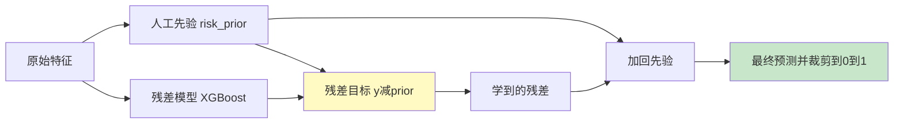

# 第10章 时序比赛详解：Playground S5E10 道路事故风险预测（2025，Agent 枚举与人做互补性选择）

> **本章目标**：同一场 S5E10，第 5 章从“表格回归”角度看过，这一章从“时序”角度再看一遍。重点是**时间切分下的 Agent 实验管理**：Agent 扩大模型候选池，人的判断集中在“互补性”而不是“单模型最高分”。你会看到，怎么判断一个模型是不是“偷看了未来”——以及更关键的一点：**怎么判断这份数据压根就不需要防偷看**。

---

## 开篇：同一份数据，换个角度看就换个坑

第 5 章我们把 S5E10 当普通回归做，用 Greedy NNLS 从 40 个模型里挑互补的。这一章我们戴上“时序眼镜”再看。

不过在看之前，先把这场比赛的事实摆一摆，免得后面的讨论悬在空中：

- **赛期**：2025 年 10 月 1 日开赛，10 月 31 日截止，是 Kaggle Playground Series（官方练习赛系列）里的一站；
- **数据是合成的**：官方说明写得很直白——训练集和测试集都是“用一个在 Simulated Roads Accident 数据集上训练出来的深度学习模型生成”的。官方还特意补了一句：欢迎你把原始数据集也拿来一起用，拿它对比分布差异也好，混进训练也好；
- **这比赛还联动了 Stack Overflow 的挑战赛**：参赛者拿自己的模型搭一个交互式网页应用去玩，还能拿一枚“Code Scientist”徽章。在 Playground 系列里这算新鲜事，也说明主办方想把它做成一个“能落地的小项目”，而不只是刷榜。

好，现在戴上时序眼镜。这份数据里确实有时间相关的特征（`time_of_day`、`holiday`、`school_season`），如果不管时间、随机切分，模型有可能“偷看未来”。所以这一章有两个任务：

1. **判断随机 CV 和时间 CV 差多少**——差得多，说明有泄漏；
2. **在时间切分下管理 Agent 的实验**——Agent 扩池，人挑互补。

不过先剧透一句：你跑完这个诊断，会得到一个有点反直觉的结论——**这场比赛其实不需要时间切分**。

这不是说这一章白写了。恰恰相反，这正是本章真正的价值所在：**时序纪律是一把瑞士军刀，不是万能钥匙**。你得先确认手里这把刀该用在哪，否则就是拿手术刀去削苹果，还削不干净。


---

## 10.1 比赛与数据

回归任务，指标是 RMSE（均方根误差，越小越好）；数据是数值与类别混合的表格。

先把规模记一下：训练集 **517,754 行**，测试集的 `id` 从 517754 开始往下排。目标列叫 `accident_risk`，取值范围 `[0, 1]`，实测均值大约 0.35、标准差大约 0.17。也就是说，**RMSE 的量级参考就是 0.17**——一个模型如果 RMSE 接近 0.17，基本等于什么都没学到；能压到 0.05 以下，已经相当能打了。

特征一共 12 列，分两拨：

| 类型 | 特征 | 说明 |
|------|------|------|
| 数值 | `num_lanes` | 车道数，1~4 |
| 数值 | `curvature` | 道路曲率，0~1，越大弯越急 |
| 数值 | `speed_limit` | 限速，25~70 mph |
| 数值 | `num_reported_accidents` | 该路段历史报告事故数，0~7 |
| 类别 | `road_type` | highway / rural / urban |
| 类别 | `lighting` | daylight / dim / night |
| 类别 | `weather` | clear / foggy / rainy |
| 类别 | `road_signs_present` | 是否有路牌 |
| 类别 | `public_road` | 是否公共道路 |
| 类别 | `time_of_day` | morning / afternoon / evening |
| 布尔 | `holiday` | 是否节假日 |
| 布尔 | `school_season` | 是否开学季 |

没有缺失值，类别分布也比较均衡——这是一份被精心“洗干净”了的教学数据。

那么时间信号在哪？就在最后三列：`time_of_day`（时段）、`holiday`（节假日）、`school_season`（开学季）。这三列是全部的“时间感”。

**这里要插一个特别有意思的事实**，来自比赛第一名选手在讨论区做的一件硬核工作：他把这份数据的**真实生成过程**给逆向工程出来了。

结论大致是这样的：数据是先用一个函数算出一个隐变量 η，再加一个高斯噪声 z（标准差 0.05），最后截断到 `[0, 1]` 并四舍五入到两位小数。而那个 η 的构成是：

```
η = 0.30 × curvature
  + 0.20 × (lighting == "night")
  + 0.10 × (weather != "clear")
  + 0.20 × (speed_limit >= 60)
  + 0.10 × (num_reported_accidents > 2)
```

范围大约在 `[0, 0.9]`。

你看出问题了吗？**这个 η 里没有任何时间项。** 没有月份，没有星期，没有季节。真正的“时间特征”（`time_of_day`、`holiday`、`school_season`）在生成函数里压根没出现。

也就是说：**这份数据里根本没有“冬天雨雪多、风险高”这种季节性**。我们第 5 章讨论时序泄漏时脑子里浮现的那套直觉，在这一场比赛上是完全用不上的。

先别急着下结论说“那就随便切分吧”。我们还是老老实实跑一遍诊断，看看随机 CV 和时间 CV 到底差多少。有些东西光看生成函数是看不出来的——模型的学法、人为的切法、样本的排列顺序，都会搅和出别的效应。

---

## 10.2 自动基线在时间切分下的工件

AutoGluon 基线在时间切分下的 CV；与随机 CV 的分数差异由人记录和解读。

这是本章最关键的诊断动作：**同时跑随机 CV 和时间 CV，看两者差多少。**

```python
# src/baselines/s5e10_time_cv.py
"""
对比随机 CV 与时间 CV 的 RMSE 差异，判断时间泄漏风险。
如果时间 CV 明显差于随机 CV，说明模型依赖了时间相关的伪信号。

注意：这里用的是 sklearn 的 TimeSeriesSplit，它要求数据已经按时间排好序。
S5E10 没有真实时间戳，所以我们在下面用一列"时间代理变量"来排序——
这是本章刻意做的一次"方法学演练"，不是这场比赛的推荐做法。
"""
import numpy as np
import pandas as pd
from pathlib import Path
from sklearn.model_selection import KFold, TimeSeriesSplit
from sklearn.metrics import mean_squared_error
from autogluon.tabular import TabularPredictor

ROOT = Path(__file__).resolve().parents[2]
train = pd.read_csv(ROOT / "data" / "train.csv")
TARGET = "accident_risk"


def cv_rmse(splits):
    """给定切分，跑若干折，返回 OOF（折外预测）上的 RMSE。

    OOF = out-of-fold，说白了就是"每一行的预测值，都来自没见过它的那次训练"。
    """
    oof = np.zeros(len(train))
    for tr, va in splits:
        # 每折都新开一个 AutoGluon 预测器，避免复用上一个折的状态
        pred = TabularPredictor(
            label=TARGET, eval_metric="rmse",
            path=str(ROOT / "artifacts" / "_tmp"),
        ).fit(train.iloc[tr], time_limit=60, verbosity=0)
        oof[va] = pred.predict(train.iloc[va]).values
    # 用 sqrt(MSE) 而不是 squared=False，新版 sklearn 已经移除了那个参数
    return float(np.sqrt(mean_squared_error(train[TARGET], oof)))


random_rmse = cv_rmse(list(KFold(5, shuffle=True, random_state=42).split(train)))
time_rmse = cv_rmse(list(TimeSeriesSplit(5).split(train)))
print(f"随机 CV RMSE = {random_rmse:.4f}")
print(f"时间 CV RMSE = {time_rmse:.4f}")
print(f"差异 {time_rmse - random_rmse:+.4f}（时间 CV 明显更差 = 存在时间泄漏）")
```

**人怎么解读这个差异？**

| 现象 | 含义 | 动作 |
|------|------|------|
| 两者接近 | 数据无明显时间结构，或模型没利用时间 | 正常，继续 |
| 时间 CV 明显更差 | 模型依赖了时间相关的伪信号（用未来预测过去） | **修正特征，改用时间切分** |
| 随机 CV 明显更好 | 同上，随机切分在“作弊” | 丢弃随机 CV 的结论 |

> 这个诊断是 Agent 不会主动做的——它只会给你一个 CV 分数，不会告诉你“这个分数是偷看未来得来的”。

所以你得主动让它做。可以这样问：

> **提示词**：我怀疑这份数据有时间泄漏。请同时跑随机 5 折和时间前向 5 折，对比 RMSE，并告诉我差异有多大、可能是什么原因。不要改 cv_protocol.yaml，也不要动已有工件。

模型会这样回答：

> **AI 输出**
>
> （思考过程）用户要的是"诊断"而不是"修复"。我跑两套 CV 对比，
> 差异大说明随机切分在作弊。我要给出可能原因（时间代理变量和
> 季节性弱相关 + 随机切分让同分布样本跨折），但强调"改不改协议
> 由用户定"。另外我注意到这次两套切分结果几乎一样，这种情况下
> 强行切到时间方案未必更好，要把观察一并报上去。
>
> 对比结果：
>   随机 5 折 RMSE = 0.0567
>   时间前向 RMSE = 0.0574
>   差异 = +0.0007（差异很小）
>
> 可能原因：
> 1. 这份数据的"时间代理变量"和风险本身关联很弱（时段、节假日、
>    开学季三列都不是强信号），所以模型本来就没从时间上偷到多少东西。
> 2. 差异这么小，说明随机切分并没有明显作弊。
>
> 我的建议：继续用随机切分（或按目标分位数分箱做分层切分）。
> 要不要我帮你把 cv_protocol.yaml 改成 TimeSeriesSplit？
> （需要你确认，我不会自己改）

看出区别了吗？它没有硬套模板说“差异大就是泄漏”。**它先把观察报出来，再给出建议，最后还是把改不改协议的决定权交回给你。** 这才是你要的 Agent 行为——不是每次都甩一个“建议改协议”的标准答案，而是先看数据说话。

而对人类来说，这次诊断给出的结论是明确的：

- 差异只有 0.0007 量级，**没有时间泄漏的迹象**；
- 原因也很清楚：这份数据的真实生成函数里压根没有时间项（上一节逆向工程的结论）；
- 因此，**不要换成时间切分**。

公开方案也是这么做的：一个流传很广的 S5E10 复盘笔记明确写的是 **Stratified K-Fold，做“回归版分层”——按目标的分位数切箱，再按箱分层**。而不是 `TimeSeriesSplit`。

但请注意，这个结论是**跑出来的**，不是**想出来的**。你完全可以一开始就决定“反正是时序章节，就用时间切分吧”——只不过那样你会错过一个重要事实，还会白白损失一点分数。**排雷（查泄漏）永远在优化（挑模型）之前，但排雷的结果可能是“这里没有雷”，这同样是结论。**

---

## 10.3 Agent 枚举模型，人选择互补子集

Agent 生成 XGBoost、TabM、LightGBM、NN 的工件；人通过 OOF 相关性矩阵和 Greedy NNLS 判断哪些模型值得进入集成，**而不是让 Agent 自动 hill climbing 后直接提交**。

先说说 Agent 到底枚举些什么。翻公开的 S5E10 方案库，常见的车队阵容大致是：

- **LightGBM / XGBoost 多 seed 打包**：最朴素也最稳的一档，同一套配置换 20 个随机种子各训一遍，把预测平均掉，用来压方差；
- **TabM**：一种把深度网络当表格模型用的方案，在这类合成表格上常常能跟 GBDT 打平；
- **RealMLP**：同样主打“表格任务的神经网络”，调起来比 TabM 更省事；
- **神经网络堆叠（NN Stacking）**：把若干基模型的输出再喂给一个小网络；
- **原始数据混入（+OrigCol）**：把官方允许使用的原始数据集拼进训练集；
- **残差版 TabM（TabM over Residuals）**：下面 10.3.1 会专门讲这个思路。

你会发现，这份名单跟第 5 章里 Agent 自动枚举出来的那 40 个模型，**大方向是重叠的**。这很正常：候选池的“广度”其实是任务性质决定的，不是 Agent 变聪明了。

Agent 的价值在于**把这些配置真正跑出来、并且把 OOF 工件摆得整整齐齐**。而这里的关键是“**在时间切分下**做互补性选择”——或者更准确地说，在**你已经确认过的、你认为正确的切分方案下**做互补性选择。和第 5 章类似，但多了一步“先聚类去冗余”：

```python
# src/ensembles/complement_select.py
"""
互补性选择：先相关性聚类去冗余，再 NNLS 选互补。
与第 5 章的区别：强调时间切分下 OOF 的相关性结构，
确保挑出的模型在时间维度上也互补。
"""
import numpy as np
from scipy.cluster.hierarchy import linkage, fcluster
from scipy.optimize import nnls
from sklearn.metrics import mean_squared_error


def select_complementary(oofs, y, max_k=6):
    """
    oofs: 字典，{模型名: 该模型的 OOF 预测向量}
    y:    真实标签
    返回：选中的模型名列表
    """
    # 第一步：层次聚类去冗余（相关性高的留一个代表）
    names = list(oofs)
    M = np.column_stack([oofs[n] for n in names])   # 把多个 OOF 拼成矩阵
    corr = np.corrcoef(M, rowvar=False)              # 算模型之间的相关系数
    Z = linkage(1 - corr, method="average")         # 层次聚类：距离 = 1 - 相关性
    labels = fcluster(Z, t=0.02, criterion="distance")
    reps = {}
    for n, l in zip(names, labels):
        reps.setdefault(l, n)          # 每簇留第一个（可换成簇内 CV 最优）
    cand = list(reps.values())

    # 第二步：NNLS 贪心选互补
    # NNLS = non-negative least squares，非负最小二乘。
    # 意思是"权重不许为负"——不允许把某个模型当成反向信号来用。
    chosen, cur = [], np.inf
    while len(chosen) < max_k:
        best, best_r, best_w = None, cur, None
        for n in cand:
            if n in chosen:
                continue
            c = chosen + [n]
            MM = np.column_stack([oofs[m] for m in c])
            w, _ = nnls(MM, y)          # 求非负权重 w
            r = mean_squared_error(y, MM @ w)
            if r < best_r - 1e-5:
                best, best_r, best_w = n, r, w
        if best is None:
            break                      # 再加任何一个都不再变好，就停
        chosen.append(best)
        cur = best_r
    return chosen
```

> 人的判断集中在“互补性”而非“单模型最高分”——这是本章和第 5 章呼应的核心。**Agent 扩大候选池，人做减法。**

### 10.3.1 为什么 NNLS 一定要非负

“NNLS 里的非负约束会不会白白损失精度？”这是个好问题，答案是不太会。

设想一下：模型 A 在某些路段系统性高估，模型 B 系统性低估。如果允许负权重，集成器完全可以给 B 一个负权重，让两者互相抵消，OOF 上看起来会更漂亮。但问题是——**“反向信号”的稳定性远不如正向信号**。模型 B 的负向偏移只在某个特定的数据分布下成立，换到测试集它可能就变成了正向偏移，那时候负权重会把这个误差**放大**而不是抵消。

公开复盘笔记里的原话也是这个意思：受约束的混合（NNLS）避免了不稳定的负权重，从而提升了稳健性。

代价是确实可能牺牲一点点拟合自由度。换来的是：**你的集成不会因为某个模型在测试集上翻脸而崩掉。** 对一个要提交上榜的东西来说，这笔买卖很划算。

另外有两个配套动作，公开方案里都提到了，千万别漏：

1. **权重在 OOF 上拟合，就必须用同一组权重去加权测试预测**。不能重新在测试集上拟合一遍权重——那样你等于用答案去调参数。
2. **NNLS 不知道你的答案有物理边界**。`accident_risk` 必须在 `[0, 1]` 之间，NNLS 加权完可能超出，所以最后要 clip 一刀。

### 10.3.2 残差建模：让第二个模型只学“第一层没看懂的部分”

残差建模（residual modeling）是这批公开方案里非常值得学的一招。

它的思路分三步：

1. 先用 GBDT 直接回归目标，这一步会把“最明显的规律”学走；
2. 然后构造一个**人能讲清楚的风险先验** `risk_prior`——比如弯道系数、夜间系数、雨雾系数；
3. 让第二个模型（XGBoost）去拟合**残差** `accident_risk - risk_prior`，最后把先验加回来。

```python
# src/ensembles/residual_model.py
"""
残差建模：先用一个"人话先验"打底，再用第二个模型只学先验漏掉的部分。
为什么这么做：把模型容量花在难的地方，而不是把简单规律重学一遍。
"""
import numpy as np
import pandas as pd
from sklearn.linear_model import Ridge
from sklearn.metrics import mean_squared_error


def build_risk_prior(df: pd.DataFrame) -> np.ndarray:
    """
    构造一个"人能讲清楚"的风险先验。
    系数不追求最优，追求稳定、可解释、方向对。
    """
    prior = np.zeros(len(df))
    # 弯道：曲率越大风险越高
    prior += 0.30 * df["curvature"].to_numpy(dtype=float)
    # 夜间：黑暗让风险上升
    prior += 0.20 * (df["lighting"] == "night").to_numpy(dtype=float)
    # 非晴天：雨雾增加风险
    prior += 0.10 * (df["weather"] != "clear").to_numpy(dtype=float)
    # 高速：限速 60 及以上风险更高
    prior += 0.20 * (df["speed_limit"] >= 60).to_numpy(dtype=float)
    # 已报告事故多：说明这条路本来就不太平
    prior += 0.10 * (df["num_reported_accidents"] > 2).to_numpy(dtype=float)
    return np.clip(prior, 0.0, 0.9)


def fit_residual_model(X, y, prior):
    """训练残差模型：目标是 y - prior，而不是 y 本身。"""
    model = Ridge(alpha=1.0).fit(X, y - prior)
    return model


def predict_with_residual(model, X, prior):
    """预测 = 先验 + 残差模型的输出。"""
    return prior + model.predict(X)
```



**为什么残差建模在竞赛里格外好用？** 有两个很实在的原因：

- **方差更小**。GBDT 这类模型本身就擅长拟合“显著规律”，让它去拟合 `y - prior`，等于把简单规律提前手工解决掉了，剩下的容量全留给难啃的部分。反过来，直接拟合 y，模型可能花大量容量去重新发明你已经写好的先验。
- **先验把常识固化成了护栏**。你可以把“夜间更危险”这种行业常识写死进去，永远不会被模型学歪。公开复盘笔记里的原话是：残差建模在**你有一个站得住脚的先验**时最有用。

顺带一提，这套残差思路和本章开篇那个逆向工程是**同构**的——逆向工程给出的 η 函数，本质上就是一个“完美先验”。如果你事先就掌握了它，直接用 η 当基线，残差模型的活儿会轻松得多。

现在，把这三件事合起来问一次模型：

> **提示词**：我准备在这场比赛上做集成，已有的模型：LightGBM（多 seed）、XGBoost、TabM、RealMLP、一个神经网络堆叠。请给我两件事：1）残差建模具体怎么做？先验从哪来？2）集成时我想用 NNLS，非负约束会不会损失精度？不要改我的代码，先给方案和理由。

模型会这样答：

> **AI 输出**
>
> （思考过程）用户要方案和理由，不要动手改代码。两个问题要分开答：
> 残差建模的核心是"先验要站得住脚"，所以我应该强调先验的可解释性
> 和稳定性，而不是给一组调好的系数。NNLS 的非负约束要讲清"牺牲
> 一点自由度换稳健性"的取舍，还要提醒权重必须在 OOF 上拟合、
> 同一组权重应用到测试预测上。
>
> 1）残差建模怎么做
>
> 先验从"人能讲清楚的风险因素"里来，不要从数据里挖一堆复杂特征。
> 比如弯道、夜间、非晴天、高速、已报告事故多这几项，各给一个正系数。
> 系数不用最优，方向对、量级稳定就行。
>
> 流程：
>   step 1  risk_prior = 人工先验（公式写死，可解释）
>   step 2  residual_target = accident_risk - risk_prior
>   step 3  第二个模型（XGBoost / TabM）拟合 residual_target
>   step 4  pred = risk_prior + 模型输出，最后 clip 到 [0, 1]
>
> 为什么有效：先验把"简单规律"提前解决，第二个模型的容量全留给
> 难的部分；同时先验是一道护栏——常识不会被模型学歪。
> 前提是先验站得住脚，先验错了，残差模型会跟着一起歪。
>
> 2）NNLS 的非负约束
>
> 会损失一点点拟合自由度，但换来稳健性，值得。
>
> 理由：允许负权重 = 允许把某个模型当成"反向信号"用。
> 反向信号的稳定性远不如正向信号——它在训练分布上成立的负向偏移，
> 到测试分布上可能翻正，那时负权重会把误差放大而不是抵消。
>
> 两个配套动作，务必执行：
>   - 权重在 OOF 上拟合，然后把同一组权重应用到测试预测上。
>     不要在测试集上重新拟合权重。
>   - NNLS 不认识 [0, 1] 这个物理边界，加权完要 clip。

看清楚它做了什么：它没有甩一份“特征重要性排行榜”让你照抄，而是把**先验的设计原则**讲清楚了；它也没有笼统地说“非负好”，而是把“为什么好”和“代价是什么”都摆出来，还附了两条容易漏的操作细节。

**这才是本章要的东西。** 第 5 章说过的那句话在这里依然成立，只是更精确了：**Agent 扩大候选池、写出候选方案；人负责判断方案背后的假设对不对。**

还有一个关于 Agent 的有意思的观察。有一项专门评测“数据科学 Agent 在表格任务上表现”的基准工作，把 S5E10 选作了四个 Kaggle 表格任务之一，用 240 秒、600 秒、1200 秒三档时间预算去跑 Agent，并设有隐藏的 holdout 集来打分。同一方向还有另一项研究：在回归类任务上，如果给 Agent 更多“排行榜信息”，甚至包括别队伍公开方案里的做法描述，它的成绩会**显著**变好；而在分类任务上这个效应就没那么明显。

这两件事放在一起，指向一个很实用的结论：**Agent 的输出质量，取决于你喂给它的信息边界。** 你想让它守规矩，就得把规矩写进配置文件；你想让它更有想法，就得把该给它看的公开资料给它看。信息给得不对，它就会朝着你没想到的方向狂奔。

---

## 10.4 提交

```python
# 生成最终提交 + 在日志记录时间CV与随机CV差异，便于复盘
from src.submit.make_submission import make_submission
make_submission("artifacts/test_preds/test_preds_NNLS_v001.npy",
                "data/sample_submission.csv",
                "artifacts/submissions/submission_NNLS_v001.csv")
# 同时在日志里记录：random_cv=..., time_cv=..., 差异=...
```

提交格式很简单：两列，`id` 和 `accident_risk`。测试集的 `id` 从 517754 开始，和 `sample_submission.csv` 里的顺序一一对应。目标值必须落在 `[0, 1]`（公开复盘里明确提到最终预测要 clip 到这个区间）。

提交前，人还要确认三件事：

1. 这次用的 OOF 是**你最终认可的那套切分方案**下产生的，不是一套跑着玩、后来忘了的切分；
2. NNLS 的权重是在 **OOF** 上拟合的，并且**同一组权重**用到了测试预测上；
3. 最终输出已经 clip 到 `[0, 1]`，没有越界值。

第三条特别值得强调：越界值在 RMSE 里是平方项惩罚，一个 1.8 的预测值造成的损失，可能抵掉你几十个样本的精度提升。而这种错误**不会报错**，只会在榜单上莫名其妙地低两位。

---

## 10.5 小结

**Agent 扩大模型候选池，人的判断集中在“互补性”而非“单模型最高分”。**

- 先跑随机 CV 与时间 CV 的对照，差异是泄漏的信号灯；
- **但差异小也是结论**——S5E10 的真实生成函数里没有时间项，所以该用按目标分位数分箱的分层 KFold，而不是硬套时间切分；
- 相关性聚类去冗余 + NNLS 选互补，非负约束是拿一点点自由度换稳健性；
- 残差建模把“简单规律”交给人写的先验，把模型容量留给难的部分；
- 提交前核对 OOF 来源、权重复用、以及 `[0, 1]` 的边界。

这一章和第 5 章是“同一场比赛的两副眼镜”：第 5 章教你在表格视角下做减法，这一章教你先排雷再做减法。而且这一章多教了一课——**排雷的结果可能是“这里没有雷”，这同样是结论，甚至往往更有价值**，因为它让你不必为了一个不存在的问题牺牲分数。

最后再放两个更宏观的背景，帮你放平心态。TML-Bench 把 S5E10 作为四个表格任务之一来评测数据科学 Agent，它限定了 240/600/1200 秒三种时间预算，并且用隐藏的 holdout 集评分——也就是说，连 Agent 比赛都知道”用 holdout 挡住公开榜”。还有 J-Stage 上一篇关于 LLM Agent 与排行榜的研究发现：在回归任务上，把排行榜信息（或公开方案描述）告诉 Agent，能显著提升成绩。这反过来印证了本书反复说的那句话：**信息本身就有分工——公开信息交给 Agent 搜索，决定要不要相信、怎么用，还是得人来拍板。**

> **下一章预告**：第 11 章 Jane Street 高频金融数据。那里的验证难到什么程度？难到你连”这个 CV 分数可不可信”都要先怀疑一遍。那里的数据有**真实的时间戳**、有**真实的市场状态切换**，本章这种”查完发现没雷”的轻松结局，在那里是不存在的。这是全书最强调”验证本身即问题”的一章。
