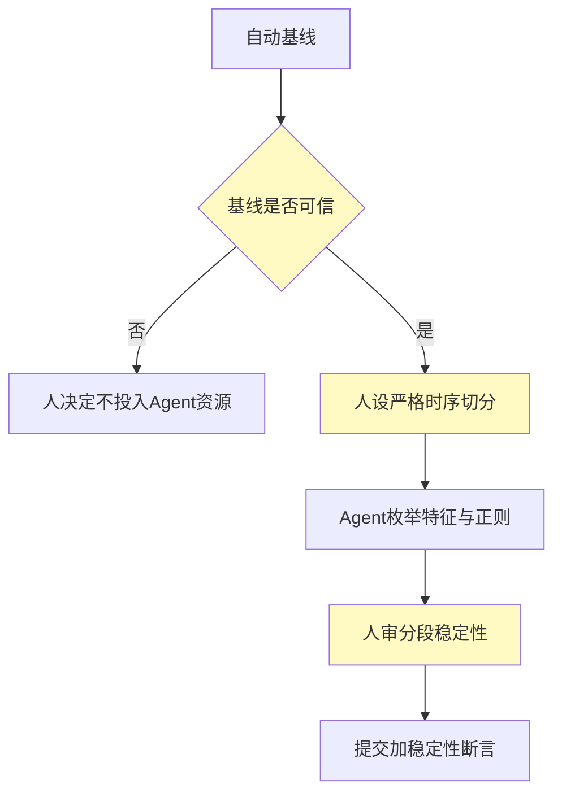
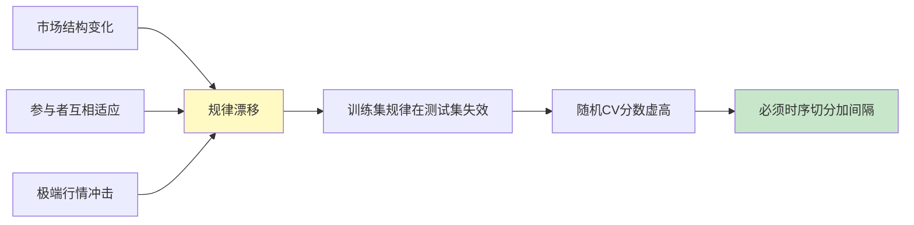
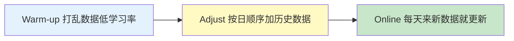

# 第11章 时序比赛详解：Jane Street Real-Time Market Data Forecasting（2024—2025，非平稳时序的验证极限）

> **本章目标**：当验证本身都变得极其困难时，人的判断不再是“选一个分数”，而是“判断这个分数到底信不信得过”。Jane Street 高频金融数据，肥尾、非平稳、突变，让标准的 CV 假设几乎全部失效。这是全书最强调“Agent 不应自主选择验证方案”的一章——因为在金融时序里，验证方案选错的代价，比模型选错还大。

---

## 开篇：金融数据，是个“会变心”的对象

前面几章的时序数据（贴纸销量、道路事故），虽然有时间结构，但底层的“规律”相对稳定：周末销量高、冬天事故多，这些规律几年不变。

金融数据完全不同。它是个“会变心”的对象：

- **肥尾**：极端行情（暴涨暴跌）出现的频率，远比正态分布预测的高。一两天的极端波动，能把整个 RMSE 拉爆；
- **非平稳**：市场的“玩法”会变。去年管用的信号，今年可能反向；
- **突变**：政策出台、黑天鹅事件，一夜之间参数跳变。

这三点加起来，导致一个可怕的结论：**你训练集上学到的规律，在测试集上可能根本不成立。** 更糟的是，你甚至无法用 CV 可靠地检验“规律还成不成立”——因为如果 CV 假设（样本独立同分布）本身就是错的，CV 分数就不可信。

打一个不太严谨但很好懂的比方。平稳的时序像开了二十年的老司机开车：路况天天变，但“红灯停、绿灯行”这条规律几十年不变，你昨天学到的经验今天照样能用。非平稳的时序更像跟一个每局都换打法的对手打牌：你上一局辛苦记下的牌路，这一局可能整个反过来，甚至你越“有经验”反而输得越惨。

所以这一章反复讲一件事：**在金融时序里，先怀疑验证，再谈优化。**



先把“非平稳”这个词的破坏力看清楚。它不是一个抽象概念，它有一条很具体的传导链：



三个源头，说穿了都不神秘：

1. **市场结构会变**。交易规则、费率、参与者名单、标的本身，隔一段时间就换一茬。你在旧结构上学到的“套利关系”，新结构里可能压根不存在。
2. **参与者会互相适应**。这是金融市场最特别的一点——你的对手也是会学习的。一个信号被越多人用，它的超额收益就越薄，直到消失。这在别的领域很少见：考试作弊的老师不会因为你作弊就改卷子，但市场会。
3. **极端行情会整体拉走统计量**。肥尾的意思是，那种“几十年一遇”的日子，出现的频率比正态假设高得多。而 RMSE、R² 这类指标对极端值极其敏感，几天的极端行情就能把你在另外几百天里辛苦攒下的分数全部抹掉。

这三条叠在一起，就有了本章的核心命题：**你估的不是“模型有多好”，你估的是“模型在未来那段你看不见的时间里有多好”。而后者，只能靠一套尽量贴近真实上线场景的验证来近似。**

---

## 11.1 比赛与数据

金融高频数据，指标是加权零均值 R²（R2 for `responder_6`），2024 年 10 月—2025 年 7 月。

先把规模摆出来，你才能感受到这不是一份“随便读进内存”的数据：

- 官方页面上记录的参赛队伍数是 **3,757 支**；
- 训练集 `train.parquet` 被切成 **10 个分区**，加起来大约 **4,700 万行**，覆盖大约 **1,700 个交易日**；
- 整个数据集一共 26 个文件、约 **12.3 GB**；有人在自己的机器上处理时的体感是“20GB+ 的解压体量，内存里放不下，得用 Polars 这类能跑在内存外面的工具，并且全程用 float32”；
- 特征 `f_1` 到 `f_79`：**79 个匿名特征**，可能是各种技术指标、市场微观结构信号；
- 响应变量 `responder_0` 到 `responder_8`：**9 个匿名标签**，取值在 -5 到 +5 之间，你要预测的是 `responder_6`；
- `date_id` 和 `time_id`：时间步编号，前者是“第几天”，后者是“当天第几个时刻”；
- `symbol_id`：标的编号；
- `weight`：样本权重，参与最终评分；
- 加权零均值 R²：一个对“预测信号相关性”敏感、对绝对偏差不敏感的指标。

数据的肥尾、非平稳和突变特征，使标准 CV 假设几乎全部失效。

**这里还有一个特别容易被忽略、但会直接决定你切分方式的事实**：这些响应变量不是原始收益，而是**被加工过的移动平均**。

社区里有人把这件事挖得很透：画出自相关函数后发现，`responder_6` 的自相关在某个滞后阶数上被“一刀切断”——具体是滞后 20；`responder_7` 在滞后 120 处截断；`responder_8` 在滞后 4 处截断。再对照官方给的 `responders.csv` 里的 tag 标签，就对上了：`tag_1` 是窗口 4 的简单移动平均，`tag_2` 是窗口 20，`tag_3` 是窗口 120。

翻译成白话：**`responder_6` 是某个底层变量的 20 日移动平均值。** 而移动平均天然就有很强的自相关——今天的值和前面 20 天的值高度相关。

这一句话，就把“为什么金融时序必须用时间切分”从“行业经验”变成了“数学事实”：**相邻两天的标签共享 19 天的重叠窗口，随机切分等于把答案的碎片直接递到模型手里。**

---

## 11.2 自动基线的局限

AutoGluon-TimeSeries / 树模型基线在非平稳金融数据上的表现往往不稳定；人必须**先判断自动基线是否可信**，再决定是否投入 Agent 实验资源。

这一步很反常识：**别人都是先跑一堆模型再说，这里却要“先判断值不值得跑”。** 为什么？因为金融数据里，如果信号本身极弱（模型根本学不到规律），你让 Agent 跑 1000 个实验也是白费电。所以先跑一个稳健的线性基线看看。

为什么用线性而不是树模型？因为树模型在肥尾非平稳数据上特别容易过拟合——它会把训练集里的“偶然规律”当真理记住。线性模型（带强正则）更老实。

```python
# src/baselines/jane_street_baseline.py
"""
Jane Street 基线：线性模型 + 稳健标准化。
树模型在肥尾非平稳数据上易过拟合，线性基线更稳、更可信。
"""
import numpy as np
import pandas as pd
from pathlib import Path
from sklearn.linear_model import Ridge
from sklearn.preprocessing import RobustScaler
from sklearn.metrics import r2_score

ROOT = Path(__file__).resolve().parents[2]
train = pd.read_parquet(ROOT / "data" / "train.parquet")
# 特征列 f_1..f_79，目标 responder_6
feats = [c for c in train.columns if c.startswith("f_")]
X, y = train[feats].values, train["responder_6"].values

# 稳健标准化：用中位数和四分位距来缩放，而不是均值和标准差。
# 为什么？因为肥尾数据里几个极端值就能把 mean/std 带偏，
# 而中位数和四分位距几乎不受极端值影响。
scaler = RobustScaler().fit(X)

# 强正则（alpha=10）的岭回归：故意把系数往 0 压，换稳定性。
m = Ridge(alpha=10.0).fit(scaler.transform(X), y)

# 注意：这里打印的是训练集 R²，不是验证 R²。
# 这一步的目的不是"看模型多好"，而是"看信号到底存不存在"。
print("训练 R²：", r2_score(y, m.predict(scaler.transform(X))))
```

**人判断基线是否可信**：

- 若训练 R² 很低（< 0.01），说明信号弱，Agent 实验也难有作为——不如省点算力；
- 若训练 R² 高但分段 R² 波动大，说明非平稳严重——需要分段验证，不能只看全局。

“训练 R² 低于 0.01 就别投入了”这条判断，不是拍脑袋。看看公开成绩的坐标系你就明白了：

- 一个用 LightGBM 加特征工程的公开方案，在按日期留出的验证集上，加权 R² 大约 **0.014**，方向准确率大约 **54%**；
- 社区里有人的公开方案最佳能做到大约 **0.0090**（这是公开榜上能摸到的水平）；
- 一个用 lag 数据训练的树模型集成（LightGBM + XGBoost + CatBoost），R² 大约 **0.0064**；
- 一位早期分享 baseline 的博主，线下验证集分数在 **0.007** 左右，他自己都吐槽“公榜分数感人，估计最后过拟合会很多”；
- 而私榜第 8 名的最终方案，LB 分数是 **0.0112**。

把这些数字排在一起，你会发现一个很反直觉的事实：**在这个赛场上，0.01 已经是世界级水平，0.5 才是随机猜测。** 信噪比低到这种程度，意味着“模型还有没有提升空间”这件事，本身就是一个需要严肃判断的问题，而不是一个默认答案为“有”的假设。

这也是为什么本章要把“先判断基线可不可信”放在“跑模型”之前。**在一个信号微弱的场景里，最贵的浪费不是算错，而是把算力投给一个根本没有信号的方向。**

---

## 11.3 时间验证的极端纪律

官方评估 API 强制模型不能“向前看”。人设定严格的时序切分；Agent 的任何交叉验证建议都必须经过人审核。

```yaml
# configs/cv_protocol.yaml（Jane Street 版）
task_type: "regression"
cv_scheme:
  type: "TimeSeriesSplit"
  n_splits: 5
  gap: 5              # 间隔至少 5 个时间步，防自相关泄漏
  time_column: "date_id"
forbidden_schemes:
  - "KFold"
  - "StratifiedKFold"
  - "ShuffleSplit"
  - "GroupKFold"      # 金融时序不能随机分组
```

> **这是全书最强调“Agent 不应自主选择验证方案”的一章。**

Agent 可能建议“用 10 折交叉验证更稳”——**默认拒绝**，因为金融时序的 IID（独立同分布）假设不成立。它可能建议“用 GroupKFold 按天分组”——**也拒绝**，因为相邻日期的数据高度相关（Overlapping returns），按天分组仍会泄漏。

如果你把这类建议丢给模型，它会怎么回应？我们试一次：

> **提示词**：Jane Street 比赛，我跑了 5 折 TimeSeriesSplit。有个 Agent 建议我改成 10 折普通 KFold，说"折多更稳"。我该听它的吗？请分析利弊，不要直接改我的代码。

模型会这样答：

> **AI 输出**
>
> （思考过程）这是个"该不该采纳建议"的问题。我要指出
> 10 折 KFold 在金融时序里是错的：KFold 会随机打乱，
> 未来数据进训练集。折数多≠更稳，反而放大泄漏。
> 但我要说明"折数"和"切分方式"是两个问题，别混为一谈。
>
> 不建议采纳。原因：
>
> 1. 问题不在"5 折还是 10 折"，而在"KFold 还是 TimeSeriesSplit"。
>    KFold 会随机打乱时间顺序，未来数据进训练集 = 偷看未来。
>    折数从 5 加到 10，只会让泄漏更严重，不是更稳。
>
> 2. 金融数据相邻时段收益高度重叠（比如预测 20 天收益，
>    相邻两天的 20 天窗口重叠 19 天）。普通 KFold 挡不住这种泄漏。
>    这次的目标 responder_6 本身就是 20 日移动平均，
>    相邻样本共享 19 天的窗口，随机切分等于把答案碎片递过去。
>
> 3. 真正"更稳"的做法是：保持 TimeSeriesSplit，增加折数
>    （5→10），并且设置 gap（间隔）≥ 预测跨度。这样既多折又
>    不泄漏。
>
> 如果你愿意，我可以给你看"TimeSeriesSplit + gap"的正确写法，
> 但不会动你的 cv_protocol.yaml。

你看，它没有简单说“不行”，而是**把“折数”和“切分方式”这两个被混在一起的问题拆开**，然后给出真正可行的替代方案。这种“拆解混淆概念”的能力，正是你该向 Agent 索取的。

这里有个特别反直觉的点，值得展开：**GroupKFold 在普通时序里是好的，但在金融里反而是坏的。** 因为金融里相邻时间段的收益高度重叠（比如你预测 20 天收益，相邻两天的 20 天窗口重叠 19 天），按“天”分组也挡不住泄漏。解决办法是“时间顺序切分 + 间隔（embargo）”。这就是为什么 `gap: 5` 这么重要。

**但请注意，上面这份 `cv_protocol.yaml` 只是一个起点，不是标准答案。** 真实的高分方案在“折数”和“验证集长度”上，跟这份配置很不一样，而且他们的选择更有说服力：

私榜第 8 名的方案用的是**两折**，验证集大小设成 **200 个交易日**——理由是“和公榜测试集的规模一致”。作者说这套本地 CV 和公榜分数相关性很好。更狠的是，他还额外做了一个压力测试：用第 0 折训练出的模型，**跳过 200 天**，再去预测最后 200 天，以此模拟私榜“训练数据和测试数据之间存在时间鸿沟”的真实场景。

为什么不按常规来 5 折？因为这两件事的目标函数不一样：

- **常规 KFold / 多折 CV 的目标**是“让每折的验证集尽量大、尽量平均”，好让分数稳定；
- **金融时序验证的目标**是“让验证场景尽量像真实上线”——真实上线就是“用某个时间点之前的所有数据，往后看一段”，而不是“把历史切成小块轮流当验证”。

所以“折数”在这里不是越多越好。**验证集的长度，应该等于你上线时要面对的“视野长度”。** 公榜测试集是 200 天，那你的验证集就该是 200 天；私榜和训练数据之间隔了 200 天，那你的压力测试就该跳过 200 天。

这也是为什么这一章反复强调“Agent 不应自主选择验证方案”——因为**验证方案不是一个可以靠搜索求解的超参数，它是一个关于“你要估计什么”的判断。** Agent 可以帮你跑，但它不知道你上线时要面对多长的视野。

---

## 11.4 Agent 枚举特征与模型，人审核非平稳性

Agent 可以批量尝试不同特征组合和正则化强度；人审查工件在不同时间段上的稳定性，而不是只看全局 CV。

“分段稳定性”是这一章的核心审查方法。把 OOF 按时间切成几段，看每段的 R² 稳不稳：

```python
# src/utils/segment_stability.py
"""
分段稳定性：把 OOF 按时间分段，看每段 R² 是否稳定。
全局 R² 高但分段忽高忽低 = 不可信（模型只在某些时段管用）。
"""
import numpy as np
from sklearn.metrics import r2_score


def segment_r2(oof, y, dates, n_seg=5):
    """按时间分 n 段，返回每段 R²。"""
    # 先按日期排序，保证切出来的每一段都是"连续的一段时间"
    order = np.argsort(dates)
    # 把排序后的下标平均切成 n_seg 份
    chunks = np.array_split(order, n_seg)
    # 每一段单独算 R²
    return [r2_score(y[c], oof[c]) for c in chunks]
```

**人审查问题清单**：

1. 分段 R² 是不是全为正？若某段为负，说明那段行情下模型方向都反了；
2. 正则化强度 α 变化，对分段稳定性影响多大？（越稳越好）
3. 特征在不同时段的符号有没有翻转？（翻转说明非平稳）

一个具体的例子：如果某模型全局 R² = 0.05（看着还行），但分段是 `[0.10, 0.08, -0.15, 0.12, 0.09]`——第三段是负的，说明在某个行情阶段模型完全失效。这种模型再好看也不能信。

**Agent 在这时候能干什么？** 它能帮你把“特征候选”批量跑出来。看看公开方案里真正有效的特征都是什么，你就知道该让它枚举哪一类：

- **市场平均值**：按 `date_id` 和 `time_id` 聚合出来的均值，用来刻画“此刻整个市场是什么状态”；
- **滚动统计量**：每个标的在过去 1000 个 `time_id` 上的滚动均值和标准差；
- **把 `time_id` 本身当特征**：让模型知道“现在是一天中的哪个时刻”；
- **时间交互特征**：有公开方案发现 `feature_06 × time_id` 是单特征里最重要的预测量；
- **多项式与统计聚合**：关键特征的平方、立方，以及逐行的均值/标准差/极差；
- **周期编码**：`sin/cos` 变换后的时间特征。

这些特征加上去，8 分名方案的 CV 提升了大约 **+0.002**；另一个方案的特征工程让验证 R² 比基线提升了大约 **29%**。

但要小心，这里面有一个**极isc 容易踩的坑**：滚动统计和聚合特征，必须用“只到当前时刻为止”的窗口来算。一旦你的滚动窗口不小心包含了未来的数据，这个特征就变成了一个伪装得很好的答案泄漏。官方 API 会拦一部分，但拦不住所有写法。**这就是为什么这类特征必须由人逐个确认时间对齐，而不是让 Agent 批量生成完就直接上。**

再说模型。这一章标题里点了“LSTMs 的局限”，这不是随口一提，而是有真实证据支撑的：

- 一个公开的项目记录写得很坦白：他们用 Keras 搭了 LSTM，在按窗口切好的历史成交序列上训练，结果**模型泛化困难**，作者自己的总结是“循环结构在低信噪比环境下可能表现不佳”；后来换成带加权 Huber 损失的前馈网络、加上 `sin/cos` 时间编码，训练在本地跑了 20 多个小时还没完，只能提前终止。最终的提交“优先简单性和推理速度，而不是边际上的精度提升”。
- 私榜第 8 名的作者也试了序列模型。她的做法很有代表性：**以“一天”为一个序列长度**，用 GRU。她试过的其它结构——MLP、时序 Transformer、跨品种注意力、embedding——**全都没效果**。而她的 GRU 之所以有效，收益主要来自**在线学习**（后面会讲），而不是序列结构本身。
- 一支 Top 1% 的队伍在公开笔记里说得更直接：序列模型“遭遇了严重的过拟合问题”，因为他们在截止日前三周才加入比赛，时间不够调，最后保留了优化好的非序列模型。

所以结论不是“LSTM 没用”，而是：**在低信噪比、强非平稳的数据上，复杂结构很难兑现它的理论上限。** 你花两周调一个 Transformer，收益可能还不如花两天把训练流程和验证做扎实。**这不是说序列模型永远不行，而是说在这个信噪比水平下，它的优先级应该排在后面。**

那什么东西的收益是确定的？**在线学习。** 这是本章唯一一个“几乎所有人都说有用”的东西：

- 官方 API 每来一个新的 `date_id`，你就可以更新一次模型。私榜第 8 名的做法是：每来一天数据，做一次前向传播，用学习率 0.0003 更新权重。就这一招，CV **+0.008**——注意，这个增量是她所有技巧里最大的一个，比换骨干、比加辅助目标都大。
- 她的原话是：“每次只做一天的更新、持续将近一年，模型依然表现良好，这很神奇。”
- 另一支队伍的三阶段训练法也是同一个思路，他们把过程拆成三段：



三段各自解决一个问题：

- **Warm-up（热身）**：用打乱的数据、大 batch、低学习率先训 5~6 个 epoch。他们的观察是，这个阶段收敛很快，再往后 R² 几乎不动。它的真正作用是**给后面的顺序训练打一个稳的地基**——没有这个热身，模型在顺序数据上会很快过拟合到最近的行情。
- **Adjust（调整）**：按 `date_id` 顺序喂数据，同时掺一部分打乱的历史数据。这是在**模拟线上条件**。
- **Online（在线）**：比赛当天的真实推理阶段，每来一个新 `date_id` 就更新一次。这一阶段要**降低学习率、并混入历史数据**，防止“灾难性遗忘”——也就是新行情把旧规律冲掉。

在线学习也有它的脾气，值得记下来：

- **只有神经网络能舒服地做在线更新**。社区里的原话是：每步只有 1 分钟时间，很难想象在 60 秒里训练任何基于树的模型；而 GBDT 的树结构没法像神经网络那样按 mini-batch 更新权重。
- **“结构好”和“能被在线更新”是两回事**。私榜第 8 名的作者观察到一个反例：MLP 在**不开**在线学习时分数比 GRU 高，但**开了**在线学习后反而更低。
- **灾难性遗忘是真的**。对策是降低学习率、混入历史数据（类似强化学习里的“经验回放”）。

那么，怎么把这些判断交给 Agent 去执行、又守住自己的方向盘？可以这样问：

> **提示词**：Jane Street 比赛，我打算做在线学习。请帮我列一份"上线前必须确认"的检查清单，重点是我这套逐日更新的流程里，哪些地方最容易悄悄泄漏未来信息。只给清单和原因，不要改我的代码。

模型会给出这样的回答：

> **AI 输出**
>
> （思考过程）用户要"泄漏风险清单"，不要改代码。我要按"数据、
> 特征、更新、评估"四层来组织，每条都说清"为什么这里会泄漏"。
> 最后要提醒：这份清单是通用经验，具体还得对着官方 API 的行为核对。
>
> 一、数据层
>   滚动窗口必须只含当前及之前的时间步。
>     原因：窗口里混进未来 = 直接泄漏，且分数会虚高得很好看。
>   训练/验证切分必须有 gap，且 gap ≥ 预测跨度。
>     原因：responder_6 是 20 日移动平均，相邻样本共享 19 天窗口。
>   按 date_id 排序后再切，不要依赖文件里的物理行序。
>     原因：分区文件的行序不保证时间序。
>
> 二、特征层
>   任何"全数据集统计量"（均值、标准差、分位数）都要用训练段统计。
>     原因：用全量统计 = 把验证集分布信息提前告诉了模型。
>   标准化器的 fit 只能在训练段上做。
>     原因：同上，这是最常见的隐形泄漏。
>   时间特征用 sin/cos 编码时，确认周期长度没有用到未来信息。
>
> 三、更新层
>   在线更新的 batch 必须对应"一天"，不要跨天混批。
>     原因：跨天混批会让模型提前看到未来那天的样本。
>   更新用的标签必须是"已经公布"的标签。
>     原因：官方每天给一次标签，拿到之前的那段不该参与更新。
>   学习率要衰减，并混入历史数据。
>     原因：防止灾难性遗忘，也防止模型被最近一天带跑。
>
> 四、评估层
>   本地评估要模拟官方 API 的调用形状（一次一个 date_id）。
>     原因：本地一次性喂全量、线上一次喂一天，两者行为可能不同。
>   分段看 R²，不要只看全局。
>     原因：全局好、某段差 = 模型只在特定行情下有效。
>
> 重要提醒：以上是通用清单。官方 API 的具体行为（比如 lags 的
> 对齐方式、每步的时间限制）会随版本变化，最终要对着实际返回的
> 数据形状逐条核对，我给的清单不能替代实测。

这份清单的价值不在于它有多全，而在于它**把“泄漏”从一个抽象名词拆成了四个可以逐条核对的层次**。你拿着它去对代码，比你自己盯着屏幕想“我有没有泄漏”要有效得多。

而最后那句“我给的清单不能替代实测”，就是 Agent 在**主动承认自己的边界**——这正是你该向它索取的诚实。

---

## 11.5 提交

```python
# src/submit/make_stable_submission.py
"""
提交前断言：所有分段 R² 都 > 阈值。
宁可少交一次，也不交一个"在某段行情完全失效"的模型。
"""
import numpy as np
import pandas as pd
from src.utils.segment_stability import segment_r2


def make_stable_submission(oof, y, dates, test_pred, sample_path, out_path,
                           target="responder_6", id_col="row_id", min_seg_r2=0.0):
    # 先算分段 R²
    segs = segment_r2(oof, y, dates)
    # 任何一段不达标，直接抛异常，不生成提交文件
    assert all(s > min_seg_r2 for s in segs), f"分段不稳定：{segs}"
    sample = pd.read_csv(sample_path)
    sub = sample.copy()
    sub[target] = test_pred
    sub.to_csv(out_path, index=False)
    print(f"✅ 稳定性断言通过，提交：{out_path}，分段 R²={[round(s, 4) for s in segs]}")
```

这份代码里最值得学的是那个 `assert`：**它把“人的判断”固化成了一道自动闸门。** 你不需要每次提交前都记得去看分段 R²，程序会替你拦住。

但光有分段断言还不够，金融时序的提交还有几个别的坑：

- **推理速度是硬约束**。官方 API 每步大约给 1 分钟（第一批数据更宽松，约 15 分钟），而整个测试期有大约 10 万个 batch。私榜第 8 名的最终方案，每个推理步只花 **0.06 秒**——她是花了大量时间优化数据读取和滚动特征计算的。
- **最常见的提交失败原因，是把重活放错了位置**。社区里的原话很直白：很多人在 `predict` 函数里每个 batch 都重新加载模型、重新建变量，结果每批都超时。正确做法是把模型加载放到 `predict` 外面、推理服务器启动之前；如果确实有需要耗时超过 15 分钟的操作，就只在**第一个 batch**（时间限制更宽松）里做一次。
- **树模型做在线更新很别扭**。前面说过，GBDT 没法按 mini-batch 更新权重。如果你打定主意要在线学习，就别在树模型上耗。

---

## 11.6 小结

**当验证本身极其困难时，人的判断不是“选一个分数”，而是“判断这个分数是否可信”。**

- 基线可信度由人判断，决定是否投入资源——在这个赛场上，0.01 已经是世界级，0.5 才是随机猜测；
- 时序切分极端严格，Agent 的 CV 建议默认拒绝；
- GroupKFold 在金融里也会泄漏，需要 embargo（间隔）；
- 验证集的长度应该等于上线时的“视野长度”，而不是越平均越好——私榜第 8 名用 200 天验证集 + 200 天间隔的压力测试，比机械的 5 折更有说服力；
- `responder_6` 是 20 日移动平均这件事，把“必须时序切分”从经验变成了数学事实；
- 分段稳定性是核心审查维度，并且最好固化成提交前的一道自动闸门；
- 复杂结构（LSTM、Transformer）的优先级要往后放，**在线学习才是这个赛场上收益最确定的东西**。

这一章给所有时序问题一个通用警示：**CV 分数不是护身符。** 只有当数据的 IID 假设成立时，CV 才可信。金融数据、非平稳系统、突变环境，IID 都不成立，这时候你必须自己设计更贴近“真实上线”的验证方式。

说得再直白一点：在别的比赛里，验证是为了**挑模型**；在这场比赛里，验证本身就是**这道题的一部分**。你把验证做对了，分数自然会来；你把验证做错了，模型选得再漂亮也只是在自欺欺人。

> **下一章预告**：第二部分（时序）结束，第三部分进入图像数据。第 12 章建立图像 Vibe 工作流——在那个时代，预训练骨干微调是主路径，但数据清洗、增强策略、提交前的通道/归一化检查，仍是人的战场。你会看到，图像竞赛里“人眼能看出、机器看不出”的那部分，恰恰是分数差距最大的地方。