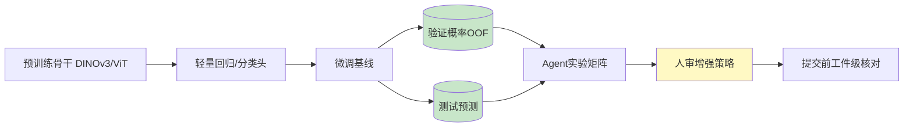
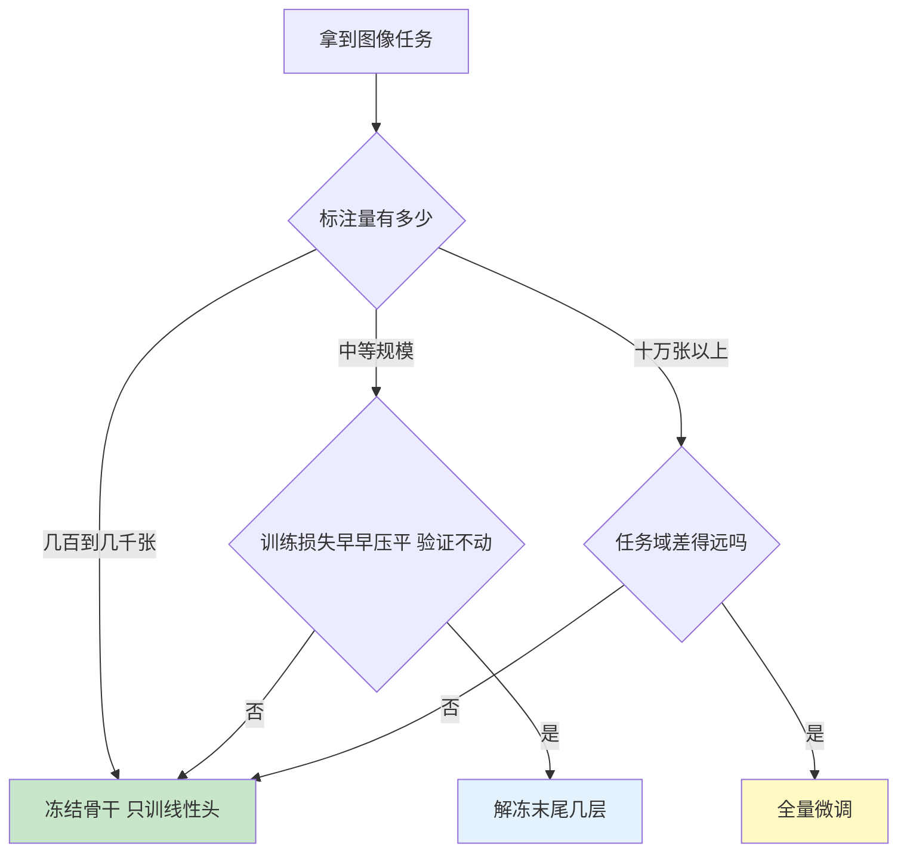

# 第12章 图像数据的 Vibe 工作流

> **本章目标**：进入第四部分——图像数据。那个时代，预训练骨干（DINOv3、ViT）微调是主路径，Agent 能帮你管一大堆实验矩阵。但有三件事 Agent 干不了：**判断增强策略会不会改变病变特征、处理类别不平衡的临床含义、提交前逐项核对通道/归一化/ID**。本章建立图像 Vibe 循环，后面三章（CSIRO、RSNA Knee、Image Matching）都复用它。

---

## 开篇：图像竞赛里，Agent 是“实验管理员”，不是“主刀医生”

图像竞赛和表格竞赛最大的不同，是**算力和时间**。表格模型几分钟跑完，图像微调一次可能几小时。所以图像竞赛里，Agent 的价值不是“跑得快”，而是“管得齐”——帮你把几十个骨干 × 分辨率 × 增强组合的实验管得井井有条，产出整齐的工件。

但图像有个表格没有的特点：**人眼能看出机器看不出的事**。一块纸板背景、一个方向不对的翻转、一个被增强抹掉的病灶——这些 Agent 看像素看不出来，人一眼就知道。所以图像竞赛的人机分工，更像“主刀医生（人）+ 实验管理员（Agent）”，而不是“指挥官 + 施工队”。



上面这张图是本章的骨架，但第一次读的人可能会问：**“基础模型时代”，到底谁干什么？** 这句话值得单独说清楚，因为它决定了你后面每一章该把精力花在哪。

所谓“基础模型时代”，指的是：现在有一个在海量图上预训练好的通用骨干（比如 DINOv3），你不需要从零训练一个会看图的网络，只需要在它后面接一个很小的“头”，用你自己的几百到几千张图把这个头训出来。这个变化把“训练一个模型”这件重活，变成了“调一个头 + 管一堆实验”的轻活。

重活变轻了，人的角色反而更清楚了。可以这样分：

| 环节 | Agent 擅长 | 人必须做 |
|------|-----------|---------|
| 跑实验 | 批量改配置、跑矩阵、收工件、汇总分数 | 决定“跑哪些、不跑哪些” |
| 看分数 | 算 CV、算 LB、做相关性对比 | 判断“这个 CV 能不能信” |
| 改增强 | 生成增强流水线、批量试强度 | 判断“这个增强会不会把病灶抹掉” |
| 处理不平衡 | 算权重、采样、加权损失 | 判断“漏诊和误诊哪个更贵” |
| 提交 | 生成文件、跑断言 | 核对通道顺序、归一化、ID 映射 |

看出规律了吗？**Agent 负责“把路走完”，人负责“确认路是对的”。** 图像竞赛里最贵的错误，从来不是“模型不够大”，而是“你把一张颜色错乱的图喂给了模型，然后花两周怀疑模型不行”。

---

## 12.1 默认起点：预训练骨干 + 微调，工件先行

DINOv3、ViT 等预训练骨干的微调是主路径；第一个微调基线必须产出验证集概率（OOF）和测试集预测工件。

先解释几个词：
- **骨干（backbone）**：图像模型里负责“把图像变成特征”的那部分，通常是在海量图上预训练好的。DINOv3 是 Meta 在 2025 年推出的自监督视觉基础模型，用 ViT 架构，预训练数据是 LVD-1689M 的 **16.89 亿张图**（外加一个 49.3 亿像素块的卫星数据集 SAT-493M），模型族有 **ViT-B（8600 万参数）、ViT-L（约 3 亿参数）、ViT-7B（67 亿参数）**，冻结不用微调就能用；在 ImageNet-1k 上，冻结骨干只训线性头，线性探针顶-1 准确率可达 **85.1%**——说明冻结特征本身就已经很强。
- **微调（fine-tune）**：在预训练骨干后面接一个小的“头”（分类/回归层），用你的数据训练这个头（或连同骨干一起小幅调整）；
- **冻结（freeze）**：把骨干参数锁住不更新，只训头部。数据少时冻结能防过拟合。

这里有个很值得记住的事实：**DINOv3 的作者自己就把“冻结骨干”写进了设计目标。** 官方仓库的原话是，微调“虽然能带来一些收益，但建议把它当作最后手段”，因为冻结的特征“开箱即用就能有不错表现”；而微调会**让特征带上偏向性**——它会朝着你给的标签那一边偏，数据少的时候偏得尤其厉害。

这不是说微调没用，而是说**默认起点应该是冻结**。什么时候该解冻，后面会讲。

```python
# src/baselines/image_baseline.py
"""
图像微调基线：DINOv3 骨干 + 轻量头，产出 OOF 概率与测试预测。
用 timm 加载预训练骨干，冻结前 50% 层加速收敛、防过拟合。
"""
import numpy as np
import torch
import torch.nn as nn
import timm

ROOT = "data"


class DinoRegressor(nn.Module):
    """DINOv3 骨干 + 回归头。"""

    def __init__(self, backbone="vit_huge_plus_patch16_dinov3.lvd1689m", out_dim=1):
        super().__init__()
        # num_classes=0 表示只要骨干的特征，不要它自带的分类头。
        # 这个模型名不是随手写的：CSIRO 那场比赛的 8 分名方案，
        # 最终就是靠把骨干从 base 一路换到 huge_plus 提上去的。
        self.backbone = timm.create_model(backbone, pretrained=True, num_classes=0)
        # 头就是一个线性层：把骨干输出的特征向量映射成 1 个数。
        self.head = nn.Linear(self.backbone.num_features, out_dim)

    def forward(self, x):
        f = self.backbone(x)          # 图像 -> 特征向量
        return self.head(f).squeeze(-1)


def freeze_first_half(model, ratio=0.5):
    """冻结前 ratio 比例的 transformer 层，降低过拟合与显存占用。"""
    blocks = model.backbone.blocks
    n_freeze = int(len(blocks) * ratio)
    for blk in blocks[:n_freeze]:
        for p in blk.parameters():
            p.requires_grad = False   # 锁住，不更新
    print(f"冻结前 {n_freeze}/{len(blocks)} 层")


def extract_features(model, loader, device):
    """提取特征，用于后续线性探测或工件。"""
    model.eval()
    feats = []
    with torch.no_grad():
        for x, _ in loader:
            feats.append(model.backbone(x.to(device)).cpu())
    return torch.cat(feats).numpy()
```

`ratio=0.5` 只是一个起点，不是标准答案。真实方案里这个比例差别很大：CSIRO 那场的 7 分名方案冻结了**前 80%** 的参数；8 分名方案则更讲究，分成两段——先只训头 15 个 epoch（学习率 3e-4）把权重稳住，再解冻整个骨干训 35 个 epoch（权重衰减 0.2，前面留 3 个 epoch 的 warmup）。

为什么要分两段？因为**大模型 + 小数据**这个组合，一上来就全量更新，很容易把预训练学到的通用特征冲掉。先只训头，等于让随机初始化的头先“追上”骨干的特征分布，之后解冻才不会把骨干带跑。

那到底什么时候冻结、什么时候解冻、什么时候全量微调？社区里有一份很实用的判断标准，我把它画成图：



四种情况可以冻结：标注只有几百到几千张、任务和预训练数据不算太远、算力有限、只需要一个可用基线。三种信号出现就该解冻末尾几层：训练损失早早压平而验证指标不再动、任务域差得远（医学、遥感、低对比度图像）、想把精度再抠几个点又不想动全部权重。而全量微调的门槛是：**十万张以上、任务域明显不同、并且确实要冲上限**——三个条件缺一个都别轻易上，因为小数据上全量微调会“灾难性遗忘”，把预训练学到的通用特征练坏，最后反而不如解冻几层。

为什么解冻只解末尾几层？因为梯度要从损失一路回传到解冻的层，前面那些层如果还冻着，梯度过不去，白折腾。而 DINOv3 Large 有 24 层、Base 有 12 层，解冻一层会多出多少可训练参数，用总参数一除层数就知道了——得掂量掂量自己训不训得动。

冻结到底有多省？看一个工业缺陷检测的例子：冻结 DINOv3 全部权重，只在 768 维的 CLS 特征上训一个线性分类器，5 分类任务只需要训 **768×5 = 3,840 个参数**，CPU 上几分钟就能收敛，每类 50 到 200 张样本就够。这个数字很能说明问题：**冻结之后，你要训的东西少到可以忽略，瓶颈完全在“数据够不够、干净不干净”上。**

人检查：各类别/目标的预测概率分布、混淆矩阵。如果某类概率全挤在 0.5 附近，说明模型没学到东西。

那么，把“该冻结还是该解冻”这个问题丢给 Agent，它会怎么答？我们试一次：

```
我要做一个显微图像的分类任务，标注大概 2000 张，
任务类型和预训练数据差得比较远。我打算用 DINOv3。
请告诉我：该冻结全部骨干，还是解冻末尾几层，
还是全量微调？给出判断和理由，不要改我的代码。
```

模型会这样答：

```
> （思考过程）用户给了两个关键信息：标注 2000 张（少）、
> 任务域差得远（远）。这两条指向不同方向：样本量少说
> "别动骨干"，域差异大说"冻结特征可能不够"。我要把这对
> 矛盾点出来，给一个折中方案，并说明怎么验证。

结论：先冻结全部骨干、只训线性头，把它当基线；
如果验证指标早早压平，再解冻末尾 2~4 层。

理由：

1. 2000 张对全量微调来说太少了。全量微调在小数据上最容易
   出现灾难性遗忘——预训练学到的通用特征被这几千张图的
   标签带偏，最后连"看图"这件基本的事都退化了。

2. 但你的任务域和预训练数据差得远，冻结特征不一定够用。
   所以"冻结"是起点，不是终点。

3. 解冻末尾 2~4 层是折中：既让梯度能回传、把特征往你的
   任务上重塑一点，又不会把底层通用特征冲掉。注意别解冻
   前面的层——梯度过不去，等于白解冻。

怎么判断该不该往下走：
  - 训练损失早早压平、验证指标不再动 → 该解冻了；
  - 解冻后验证涨了就停手，别贪；
  - 解冻后反而掉了 → 退回冻结，说明数据撑不住。

一句话：先用冻结拿一个能信的数，再决定要不要花算力解冻。
```

这段回答里最值得注意的，是它**没有给你一个确定答案**，而是给了一条“先跑基线、再看信号、再决定”的路径。这正是图像任务里最需要的东西——因为“该不该解冻”这件事，不看数据是没法回答的，而 Agent 恰恰看不到你的数据。

---

## 12.2 Agent 管理实验矩阵，人审查增强策略

Agent 批量运行不同骨干、分辨率、增强组合的微调实验，汇总工件和验证分数；**增强策略必须与验证方案一起评估**，更激进的增强是否匹配数据特性由人判断。

Agent 可以这样管矩阵：

```python
# src/experiments/image_matrix.py
"""
实验矩阵：骨干 × 分辨率 × 增强强度。
Agent 生成配置、产出工件；人审查增强是否合理。
"""
EXPERIMENT_MATRIX = [
    {"backbone": "vit_base_patch16_dinov3", "img_size": 224, "aug": "mild"},
    {"backbone": "vit_base_patch16_dinov3", "img_size": 384, "aug": "mild"},
    {"backbone": "vit_huge_plus_patch16_dinov3", "img_size": 224, "aug": "strong"},
]


def train_one(cfg):
    """训练单个配置，返回 OOF 与测试预测（示意）。"""
    # 数据加载、增强、训练循环...
    return oof, test_pred
```

这个矩阵里“骨干 × 分辨率 × 增强”三个维度，是有真实依据的。CSIRO 那场 8 分名方案的作者把换骨干的效果一条条列了出来：

- `convnext_tiny` → `vit_base_patch16_dinov3`：0.61 → 0.67
- `vit_base` → `vit_large`：0.69 → 0.72
- `vit_large` → `vit_huge_plus`：0.72 → 0.74

他的原话是：**“增大模型比增大分辨率更有效。”** 这背后是一个很实在的算力约束——A100 显存有限，把图从 768 调到 1024 的代价，远大于换一个更大的骨干。所以在显存不够的时候，优先级应该是“先换大骨干，再考虑加分辨率”。

同一场比赛的 7 分名方案则提供了一个反面参考：他用 DINOv3-Large，输入分辨率拉到 **1024×2048**，单模型 5 折、不做 TTA 和 TTT，就能到公榜 0.76、私榜 0.65。他还老老实实列了“什么没用”：SigLIP-2 之外的架构、Mixup 和 Cutmix 及其各种变体、辅助任务和辅助损失、DINO embedding 接机器学习模型、外部数据集——**全都没用**。

这份“没用清单”比“有用清单”更值钱。因为它告诉你：**在这个任务上，你能想到的大部分“技巧”，其实都已经被人试过了，而且没用。** 你少走一天弯路，就多一天用来检查数据。

**人审查增强策略**（这是 Agent 干不了的）：
- 医学图像：强增强（大角度旋转、翻转）可能改变病变特征 → 需谨慎；
- 自然图像：强增强通常有益；
- 卫星图像：旋转增强合理（无绝对方向），但翻转可能不符物理。

参考真实案例：医学脑肿瘤分类里，增强必须“戴着镣铐跳舞”——旋转限制在 ±10°、平移 ≤0.1、缩放 ≤10%、亮度 0.8~1.2，禁止 ±90° 大旋转和 >15% 激进缩放，因为那会把肿瘤形态扭曲掉。这些红线，Agent 不会主动遵守，得你写进配置。

这个案例的背景值得说一句：在医学 X 线影像这类强模态偏移的领域，学术界有个比较稳的共识——**监督式 ImageNet 预训练比自监督更适合做骨干**。原因很简单：医学图像里病灶、骨骼、组织边界这些“看得见”的结构，ImageNet 有标签的监督预训练反而更能学到；纯自监督的 DINO 这类，在自然图像上强，但迁到医学影像后边际收益更小。举个具体数字：Kvasir-SEG 胃肠镜图像分割上，冻结 DINOv3 骨干只训头 Dice 约 0.9042，解冻末尾 4 层后能到 0.919~0.921——提升有限，而且全量微调在小数据上反而更容易“灾难性遗忘”通用特征。所以医学图像里，选骨干和解冻策略，比死磕增强更重要。

顺着这个思路，你可以让 Agent 帮你把“增强是否安全”列成清单，但**判断**是你的：

```
我要做膝关节 MRI 多标签分类。请列出常见的图像增强，
并标注哪些在医学影像上"可能改变病变特征"、风险高/中/低。
只给清单和分析，不要改我的训练代码。
```

模型会给出这样的表：

```
> （思考过程）用户要"风险清单"，不要改代码。我按风险
> 高中低分类，并说明原因（解剖方向、信号物理意义）。
> 最后提醒：最终取舍需要临床/领域知识，我只能给通用判断。

高风险（可能改变病变特征，慎用/禁用）：
  水平翻转     左右膝解剖不同，会制造不存在的镜像病例
  大角度旋转   MRI 有固定扫描方向，>30° 不符合临床
  强高斯噪声   可能抹掉细微病变对比
  弹性形变     会扭曲病灶形态

中风险（可小幅使用）：
  小角度旋转   ≤15° 一般可接受
  亮度/对比度  轻度（±10%）通常安全
  高斯模糊     轻度可能模拟不同设备，但别过度

低风险（通常安全）：
  轻度缩放     ±10% 以内
  颜色抖动     灰度图影响小
  Cutout       小面积遮挡，注意别盖住病灶

重要提醒：以上是通用经验。具体哪些增强安全，
取决于你的病灶类型和成像协议——这需要领域知识判断，
我给的清单不能替代临床确认。
```

最后那句“我给的清单不能替代临床确认”，就是 Agent 在**主动承认自己的边界**。你要的正是这种诚实。

再问一个更“像老板”的问题，看看它怎么划分职责：

```
我要参加一个图像分类比赛，数据 3 万张，算力只有一张 24G 卡。
我会用 DINOv3。请把接下来两周的工作分成"Agent 可以自动做的"
和"必须我亲自看的"两类，每类给 5 条，并说明理由。
不要写代码。
```

模型会这样答：

```
> （思考过程）用户要的是"分工清单"，不是技术方案。我要按
> "能不能被规则描述"来划线：能被配置和代码穷举的归 Agent，
> 需要看图、需要领域知识、需要拍板的归人。最后提醒一句：
> 这张卡跑 huge 会紧张，骨干选型本身就得人来定。

Agent 可以自动做的：
  1. 跑实验矩阵（骨干 × 分辨率 × 增强），产出 OOF 和测试预测。
     理由：这是纯穷举，配置写清楚就能批量跑。
  2. 汇总每个配置的 CV 分数、训练时长、显存峰值，排成表。
     理由：机械统计，不需要判断。
  3. 做提交前的格式断言（列名、ID 顺序、取值范围）。
     理由：规则明确，错了就是错了。
  4. 生成增强流水线并批量试强度。
     理由：可以参数化扫描。
  5. 对同一配置的多个 seed 求平均，压方差。
     理由：标准操作，无需人介入。

必须你亲自看的：
  1. 看一批训练集和验证集的图像，确认增强没有把目标特征改掉。
     理由：Agent 看像素看不出"这个翻转在解剖学上不成立"。
  2. 确认验证集和测试集的分布是否接近。
     理由：分布不一致时，CV 再高也没用，这需要人判断要不要
     接受 CV 与 LB 的偏差。
  3. 定骨干规格（base / large / huge_plus）。
     理由：24G 显存能不能跑、跑多久，得你拿实际数据试。
  4. 定类别不平衡的处理策略。
     理由：漏诊和误诊哪个更贵，是业务问题不是技术问题。
  5. 决定是否用 TTA、用几种、怎么加权。
     理由：TTA 会成倍增加推理时间，这个取舍要人拍板。

一条提醒：以上是通用分工。你的 24G 卡跑 vit_huge_plus 可能
会 OOM，建议先用 base 跑通全流程，再逐步换大。我给的建议
不能替代你实测的显存占用。
```

这张清单的用法不是“照做”，而是**拿它当一面镜子**：你每做一件事之前，先问一句“这件事是能被规则描述的，还是需要我看图？”如果是前者，就该交给 Agent；如果是后者，就别偷懒。

---

## 12.3 类别不平衡与指标特殊性

医学图像中，Agent 的自动类别加权可能忽视临床意义上的差异；人根据指标判断加权策略。

比如一个皮肤病数据集，正类（恶性）只有 343 个，负类 40 万个，比例 1165:1。Agent 默认用 “balanced” 权重，但临床上漏诊（把恶性判成良性）的代价远高于误诊。这时候人要把阳性类权重调更高。

```python
# src/utils/class_weight.py
"""
类别加权：Agent 默认用 balanced 权重，但医学场景需人调整。
例如：漏诊代价远高于误诊，应提高阳性类权重。
"""
import numpy as np


def clinical_class_weight(y, pos_weight=3.0):
    """按临床代价加权，而非简单 balanced。"""
    w = np.where(y == 1, pos_weight, 1.0)   # 正类加权 pos_weight 倍
    return w / w.mean()                      # 归一化，保持总权重不变
```

这段代码里最值得注意的其实是最后那行归一化。为什么要除以均值？因为如果不归一化，你把正类权重调成 3 倍，等于把学习率也放大了 3 倍——**你本来只想改“谁更重要”，结果顺手改了“步子多大”**，两件事搅在一起，实验结论就没法比了。归一化之后，总权重不变，只有分配比例变了，这才是干净的对照。

处理不平衡的常用武器还有：
- **Weighted Random Sampler**：每个 epoch 强制正负样本各占一半；
- **Downsampling**：负类下采样到正类的 10 倍；
- **Class weights**：在损失函数里给少数类加权。

选哪个，取决于数据规模和临床代价——这是人的判断。数据够多就下采样（简单、还省显存），数据不够就加权（不丢信息），两边都紧张就用 Sampler（每个 epoch 重新洗牌，相当于反复利用少数类）。

还要多说一句“指标”这件事。图像分类比赛常用 Accuracy，但在 1165:1 的数据上，一个“全部预测为负”的模型准确率是 99.9%——**准确率在这里是骗人的**。所以这类比赛往往改用 AUC、Average Precision 或者 F1。指标一换，模型该怎么选就跟着换：AUC 只关心“排序对不对”，F1 关心“阈值定在哪”。这些都不是 Agent 会主动提醒你的事。

---

## 12.4 提交前的工件级检查（人执行）

图像提交的错误代价高：通道顺序、归一化方式、ID 映射、TTA 后的概率校准。人对照工件和 `sample_submission` 逐项核对。

```python
# src/submit/image_submit_check.py
"""
图像提交前检查清单（人执行）：
1. 通道顺序：RGB 还是 BGR（cv2 读出来是 BGR，PIL 是 RGB，搞混就全错）
2. 归一化：ImageNet 的 mean/std 是否和训练时一致
3. ID 映射：文件名 → sample_submission 顺序
4. TTA（测试时增强）后的概率校准
"""
import numpy as np
import pandas as pd


def check_image_submission(sub_path, sample_path, id_col="id", target="target"):
    sub = pd.read_csv(sub_path)
    sample = pd.read_csv(sample_path)
    assert list(sub.columns) == list(sample.columns), "列名不一致"
    assert (sub[id_col] == sample[id_col]).all(), "ID 顺序不一致"
    assert sub[target].between(0, 1).all(), "概率越界"
    print("✅ 图像提交检查通过")
```

那个“通道顺序”的坑，值得多说一句。`cv2.imread` 读出来是 BGR（蓝绿红），`PIL.Image.open` 是 RGB（红绿蓝）。如果你用 cv2 读图、却按 RGB 的 mean/std 归一化，模型看到的就是“颜色错乱”的图，预测全废。**这种错误不会报错，只会让分数莫名其妙地低。** 提交前必须核对。

除了这四条，用 DINOv3 这类骨干还有两个专属的坑：

- **输入尺寸必须是 16 的倍数**。DINOv3 的 patch 大小是 16，如果你喂进去的尺寸不是 16 的倍数，模型会**自动裁剪**到最接近的较小倍数——它不报错，只是悄悄把你的图切掉一圈。对需要保留细节的任务（比如小病灶），这个自动裁剪可能正好把关键区域裁走了。稳妥做法是在预处理时自己 padding，而不是让模型替你决定。
- **权重是“门控”的**。DINOv3 的官方权重需要先在 Hugging Face 上同意 Meta 的许可协议才能下载。这本身不是技术问题，但如果你在别人的 notebook 里跑，或者换了一台机器，很容易卡在“下载失败”这一步。把模型名和版本记在配置里，别硬编码 token。

还有一个更隐蔽的坑：**TTA 之后的概率需要重新校准**。TTA（测试时增强）是把一张测试图做若干次增强、分别预测再平均。平均之后，概率分布会变“尖”或者变“平”，如果你在验证集上算阈值时用的是没做 TTA 的概率，提交时却用了 TTA 之后的概率，阈值就错位了。**验证和提交必须用同一种概率**，这是很多人栽过的地方。

---

## 12.5 小结

- 预训练骨干微调是主路径，工件先行；
- **默认从“冻结骨干 + 线性头”开始**，这是 DINOv3 官方推荐的姿势，也是数据少时最稳的选择；
- 解冻末尾几层是折中，全量微调要满足“十万张以上 + 域差异大 + 要冲上限”三个条件；
- Agent 管实验矩阵，人审增强策略（医学增强有红线）；
- 类别不平衡需临床判断（漏诊代价 vs 误诊代价），加权时记得归一化，别把学习率一起改了；
- 提交前逐项核对通道/归一化/ID/TTA，外加 DINOv3 的“16 倍数”和“门控权重”两个专属坑。

图像竞赛的人机分工，可以浓缩成一句：**Agent 帮你把实验管整齐，人帮你把“看图”这件事做对。** 机器看像素，人看语义。

说得再具体一点：这一章里 Agent 干的活，几乎都能被写成配置和断言；而人干的活，几乎都需要“看一眼真实的东西”或者“拍一个板”。**你没法把“看图”这件事外包出去，就像你没法把“这个增强会不会抹掉病灶”外包给一个不看图的程序。** 这既是图像竞赛的麻烦，也是它最迷人的地方。

> **下一章预告**：第 13 章 CSIRO Image2Biomass，看一个真实案例——4th place 方案靠“人工识别并裁剪纸板背景噪声”涨了 0.01 LB。这种数据质量问题，Agent 永远不会自动发现，只有人眼能看出来。