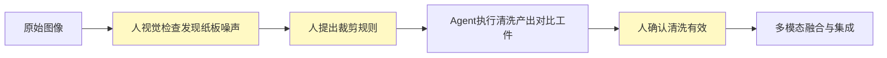
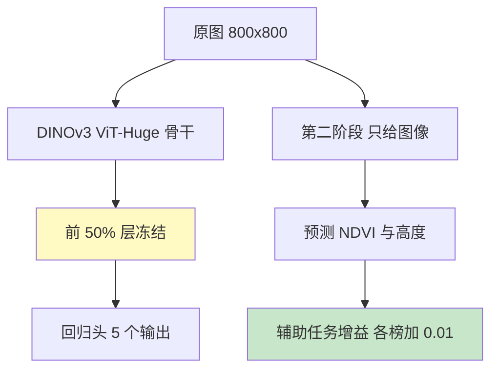
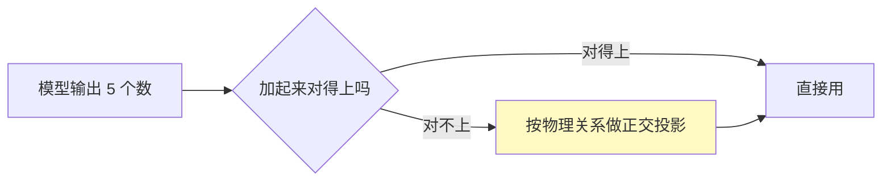

# 第13章 图像比赛详解：CSIRO Image2Biomass Prediction（2025—2026，DINOv3 多模态融合）

> **本章目标**：看一个“人眼胜过模型”的真实案例。4th place 方案的关键增益之一，来自**人工数据清洗**——识别并裁剪图像里的“纸板”背景噪声。他们公开的成绩表上，这一步让公榜从 0.74 涨到 0.75、私榜从 0.64 涨到 0.65，正好 +0.01。Agent 看像素看不出纸板，人一眼就能看出来。这一章讲两件事：**人工数据清洗**和**多模态融合的人机分工**。

---

## 开篇：Agent 看得见像素，看不见“纸板”

先讲个真实的故事。这个故事不是段子，它白纸黑字写在 4th place 选手公开的模型卡里。

CSIRO 这场比赛要从牧场照片预测生物量——说白了，就是“这一片草，到底有多少”。比赛 2025 年 10 月开赛，2026 年 1 月结束，主办方是澳大利亚联邦科学与工业研究组织 CSIRO，拉上了 Google 澳大利亚和澳洲肉业协会 MLA 一起办。规模不算小：4,463 名选手、3,805 支队伍，奖金池 7.5 万美元，最后发出 5 块金牌。

但数据小得有点反直觉：训练集只有 **357 张图**。每张图是一张广角牧场照片，配 5 个用“克”做单位的标签——干绿草（Dry_Green）、干死草（Dry_Dead）、干三叶草（Dry_Clover）、GDM（green dry matter，绿色干物质，说白了就是“绿色部分换算成干重有多少”）和总干重（Dry_Total）。

4th place 的选手翻训练数据的时候发现，有些照片上有一大块“纸板”一样的东西。那不是草，是拍摄时垫在底下的背景板，跟生物量毫无关系。

模型可不管这些。它老老实实把纸板的边缘、折痕、颜色一起学进去，当成“生物量信号”的一部分。选手手动把这些纸板区域裁掉，重新训练，公榜涨了 0.01，私榜也涨了 0.01。

这个故事完美诠释了图像竞赛的人机分工：**Agent 能处理几百万张图，但它不知道“纸板”是噪声；人看一张图就知道。** 这不是模型能力问题，是“语义理解”问题——而语义，恰恰是人的主场。

说到这里，可能有人要问了：那 Agent 到底能干什么？别急，它能干的事多得很，只是“发现纸板”这一件干不了。我们先把整条流水线摆出来，你就明白人和 Agent 各站在哪一段。



黄色那三步是人，其余是 Agent。你会发现一件很有意思的事：**人只出现在“判断”的位置上，从不出现在“搬运”的位置上。** 这就是这一章想让你记住的分工方式。

---

## 13.1 比赛与数据

从牧场照片 + 表格传感器数据（NDVI、高度）预测生物量，2025 年 10 月—2026 年 1 月。

先把“多模态”这个词拆开。多模态（multimodal）说白了就是“同时看几种不同形式的数据”。这场比赛里，图像提供纹理和形态信息——草长得密不密、颜色深不深；传感器提供植被指数 NDVI（归一化植被指数，用卫星或地面仪器测的“绿度”，值越高植被越茂密）和地形高度。两者是互补的：照片告诉你“看起来怎么样”，传感器告诉你“仪器量出来怎么样”。

这种“图像 + 表格”的组合，在遥感、农业、医疗里到处都是，你以后大概率会反复遇到。

数据本身有几个特点，值得先记住，因为后面所有的设计都是围着它们转的：

- **样本极少**：训练集只有 357 张图。这是深度学习里“小数据”的典型场景，模型稍不留神就背下来了；
- **一张图五个目标**：五个标签不是独立的，它们之间有人都认可的物理关系（后面 13.4 会用到）；
- **视角是全景**：很多样本是左右两张拼起来的宽幅图，同一片草被拍了两遍；
- **标签是称重出来的**：克数，不是目测等级，所以误差是连续的，用 R² 而不是准确率来衡量。

R²（决定系数，coefficient of determination）也解释一下：它衡量“模型解释了多少变化”，满分是 1，0 相当于“瞎猜均值”，负数说明还不如直接猜均值。这场比赛按加权 R² 评分，4th place 训练时用的权重是 `[0.1, 0.1, 0.1, 0.2, 0.5]`——也就是把总干重和 GDM 看得更重，因为这两个才是牧民真正关心的数。

---

## 13.2 自动基线工件

DINOv3 ViT 骨干 + 轻量回归头的基线工件。4th place 方案使用 `vit_huge_plus_patch16_dinov3.lvd1689m`，**前 50% 层冻结**（数据量有限，全解冻会过拟合）。

这里又冒出一个新词：ViT（Vision Transformer，视觉 Transformer）。你可以把它想成“把图切成一个个小方块，然后让每个方块互相聊天，最后汇总出一个判断”。DINOv3 是 Meta 训出来的一个通用视觉骨干，它没专门学过牧场，但见过海量图片，所以“底子好”。骨干（backbone）就是这套已经学好的特征提取器，我们只换掉它最后那一层“答题头”。

```python
# src/baselines/image2biomass.py
"""
CSIRO 基线：DINOv3 ViT-Huge + 回归头，前 50% 层冻结。
产出 OOF 与测试预测工件。

OOF（out-of-fold，折外预测）：说白了就是“每个样本的预测值，
都来自一次没见过它的训练”。这样你手里就有了一份和测试集
一样“没见过”的预测，可以拿来做集成和调权重。
"""
import torch
import torch.nn as nn
import timm


def freeze_first_half(model, ratio=0.5):
    """冻结前 ratio 比例的层，降低过拟合与显存占用。

    为什么要冻？357 张图，模型参数有几亿个。全都放开训，
    模型会把训练集背下来，换一批新图就傻眼。冻住前半部分，
    等于“保留它原有的通用视力，只教它认牧场”。
    """
    blocks = model.blocks                # ViT 的一堆重复积木块
    n_freeze = int(len(blocks) * ratio)  # 要冻几块，比如 40 块里冻 20 块
    for i, blk in enumerate(blocks[:n_freeze]):
        for p in blk.parameters():
            p.requires_grad = False      # 关掉梯度，这块积木不再更新
    print(f"冻结前 {n_freeze}/{len(blocks)} 层")


model = timm.create_model("vit_huge_plus_patch16_dinov3.lvd1689m",
                          pretrained=True, num_classes=1)
freeze_first_half(model, 0.5)
```

真实 CSIRO 方案里还有几个值得学的工程点（都来自公开 writeup 和模型卡）：

- **输入尺寸定在 800×800**：再大就“收益递减 + 显存溢出”（OOM，out of memory，显卡装不下），这条是 4th place 明确写进“什么没用”清单的；
- **左右两图一起喂**：4th place 用了双图输入 + 多模态融合；但也有独立方案报告“双图输入没带来提升”，可见这招强依赖你怎么融；
- **辅助任务**：第二阶段只给图像，让模型去预测 NDVI 和高度这两个表格量，逼着骨干学出“和植物健康、密度有关”的特征，公榜私榜各 +0.01；
- **损失函数用加权 SmoothL1**：不是 MSE，也不是分位数损失，试过都不如它；
- **橙色时间戳修复**：这次比赛有 26.7% 的图带橙色时间戳水印，一个独立方案用 HSV 掩膜定位橙色区域、再用 Telea 算法做图像修复（inpainting），把水印“抹掉”再喂给模型——这个细节说明“数据清洗”有时细到像素级；
- **冻结策略的另一种选择**：第 7 名方案冻结了前 80% 的参数，并且做了 TTA（测试时增强）；而 arXiv 上有人系统跑了 25 组配置，发现 **DINOv3-Large + cross-view gated attention（跨视角门控注意力）是单模型最佳，加权 R² 0.8338 ± 0.0503**。

这些都是“人设计、Agent 执行”的典型——人想出“让模型看图猜 NDVI”这个点子，Agent 负责把它跑成工件。

顺便说一句失败经验，因为失败经验往往比成功经验更有信息量。4th place 试过纯 MSE、分位数损失、对数损失、直接优化 R²、对标签取对数、把输出压进 Sigmoid、把图放大到 800 以上、双图输入、还有一个自己设计的“混合纹理池化”层——**全部没有超过原来的方案**。最后那个池化层在本地验证集上看着挺好，一上私榜就现原形。



---

## 13.3 Agent 实验矩阵，人判断数据清洗

4th place 的关键增益来自**人工数据清洗**：识别并裁剪“纸板”背景噪声。

**Agent 不会自动发现这种问题**——它看到的是像素，人看到的是“背景里有块硬纸板占了两成画面”。

我们让人工检查流程成为工作流的一部分。Agent 负责生成“接触表”（contact sheet，把很多张图拼成一张大图，像警察局的照片墙），人负责一眼扫过：

```python
# src/eda/visual_inspection.py
"""
人工视觉检查辅助：生成接触表（contact sheet）供人快速浏览。
Agent 负责生成，人负责判断。
"""
import matplotlib.pyplot as plt
from pathlib import Path
from PIL import Image


def make_contact_sheet(paths, out_path, n_cols=5, n_rows=4, labels=None):
    """把多张图拼成一张大图，方便人一眼扫过找异常。

    为什么不用脚本自动筛？因为“纸板”是个语义概念，
    你没法用一个阈值把它和“颜色发白的干草地”分开。
    拼成一张大图，人扫一眼几秒钟就够。
    """
    fig, axes = plt.subplots(n_rows, n_cols, figsize=(n_cols * 3, n_rows * 3))
    for i, ax in enumerate(axes.flatten()):
        ax.axis("off")                       # 不显示坐标轴，省地方
        if i < len(paths):                   # 图不够数就留白，别报错
            ax.imshow(Image.open(paths[i]).convert("RGB"))
            if labels:
                ax.set_title(labels[i], fontsize=8)
    fig.savefig(out_path, dpi=120, bbox_inches="tight")
    plt.close(fig)
    print(f"✅ 接触表已生成：{out_path}")


# 最小可运行示例：把 data/train 下前 20 张图拼成一张 5x4 的表
if __name__ == "__main__":
    files = sorted(Path("data/train").glob("*.jpg"))[:20]
    make_contact_sheet(files, "artifacts/eda/contact_sheet.png")
```

**人提出清洗规则**（写成可执行规格交给 Agent）：

> **提示词**：
>
> 请实现图像裁剪清洗：
> 1. 检测图像中亮度高、纹理方差低（无纹理）的矩形区域，判定为"纸板背景"
> 2. 裁剪掉该区域，保留主体
> 3. 在固定 5 折 CV 下训练基线模型，产出对比工件 IMAGE_CLEAN_v001
> 4. change_desc 写明清洗规则与受影响样本比例

“亮度高 + 纹理方差低”是纸板的典型特征（均匀、没纹理）。但这条规则是不是对所有图都成立？会不会误伤“就是长得很平坦的草地”？这得人来抽查。**Agent 负责执行规则，人负责确认规则没伤及无辜。**

我们把“找噪声”这件事拆成两半：Agent 出候选，人做确认。可以这样问它：

> **提示词**：
>
> 我怀疑训练集里有些图有"纸板背景"噪声。
> 请帮我做两件事：
> 1. 用"亮度高 + 纹理方差低"的规则，找出疑似噪声图，
>    生成接触表 artifacts/eda/suspect_sheet.png
> 2. 统计受影响样本比例，按采样地点分组
> 不要自动裁剪，也不要改数据，我要先看图确认。

模型会这样回应：

> **AI 输出**
>
> （思考过程）用户要"候选 + 可视化"，明确不要自动改数据。
> 我实现检测规则，生成接触表，统计比例。要提醒：
> 规则可能误伤"就是平坦的草地"，需要人抽检。
> 另外训练集只有 357 张，比例要报绝对数，不然百分比会吓人。
>
> 已完成，结果如下：
>
> 【检测结果】
>   疑似噪声样本：42 / 357（11.8%）
>   按采样地点分布：
>     地点 A  19 张  ← 明显高于其他
>     地点 B   6 张
>     地点 C   3 张
>
> 【接触表】artifacts/eda/suspect_sheet.png（20 张样例）
>
> 【我的观察】
>   地点 A 比例异常高，可能那里拍摄时普遍垫了纸板，
>   也可能是"平坦草地"被误判。建议你重点看接触表前 5 张，
>   确认是纸板还是草地。
>
> 【我没有做的事】
>   没有裁剪任何图像，没有修改 data/ 下任何文件。
>   等你确认规则可靠，我再写清洗脚本。

注意它主动提出“可能是平坦草地被误判”这个**反例**——这是好的协作：它不只顺着你的假设跑，还会指出假设可能错在哪。

也注意它那句“训练集只有 357 张，比例要报绝对数”。这不是它多嘴，这是它意识到小样本下百分比会骗人：42 张里错 5 张，比例就跳 1.4 个百分点。**样本小的时候，绝对数比百分比诚实。**

---

## 13.4 多模态融合的人机分工

Agent 枚举图像特征与表格特征的融合方式；人根据领域含义判断融合策略的合理性。

4th place 方案使用辅助任务训练和多模态融合，这些设计选择需要人的领域判断。

```python
# src/models/multimodal.py
"""
多模态融合：图像特征 + 表格传感器特征（NDVI/高度）。
三种融合方式，Agent 枚举，人按领域含义选择。
"""
import torch
import torch.nn as nn


class FusionModel(nn.Module):
    def __init__(self, img_feat_dim, tab_feat_dim, mode="concat"):
        super().__init__()
        self.mode = mode
        if mode == "concat":
            # 最简单：直接拼接。相当于把两张答卷订在一起交上去
            self.head = nn.Sequential(
                nn.Linear(img_feat_dim + tab_feat_dim, 256),
                nn.ReLU(), nn.Dropout(0.2), nn.Linear(256, 1))
        elif mode == "gated":
            # 门控：让模型自己学"该信图像还是信传感器"
            self.gate = nn.Linear(img_feat_dim + tab_feat_dim, 1)
            self.head = nn.Sequential(
                nn.Linear(img_feat_dim + tab_feat_dim, 256),
                nn.ReLU(), nn.Linear(256, 1))
        elif mode == "aux_task":
            # 辅助任务：同时预测一个相关量（如植被高度），共享骨干
            self.head = nn.Sequential(
                nn.Linear(img_feat_dim + tab_feat_dim, 256),
                nn.ReLU(), nn.Linear(256, 2))   # [生物量, 高度]

    def forward(self, img_f, tab_f):
        x = torch.cat([img_f, tab_f], dim=1)     # 沿特征维拼接
        if self.mode == "gated":
            w = torch.sigmoid(self.gate(x))      # 门控权重 0~1
            x = x * w                            # 按权重缩放，等于"调音量"
        return self.head(x)
```

**人判断**：

- `concat`：最简单，先做基线；
- `gated`：当图像质量差（部分图被遮挡、有纸板）时，让门控降低不可靠模态的权重——**领域含义明确，有用**；
- `aux_task`：生物量与植被高度强相关，辅助任务提供额外监督——**领域上合理**。

这些“哪个融合方式有道理”的判断，来自你对“图像和传感器各自可靠吗”的理解。Agent 只会把三个都跑一遍，报三个分数。

还有一个更硬的约束，是物理定律给的：**GDM = Dry_Green + Dry_Clover，Dry_Total = GDM + Dry_Dead。** 这五个标签不是五个自由变量，它们必须互相加得起来。可模型是五个头分别吐数的，吐出来的结果经常“加起来对不上”。怎么办？用后处理把它掰回去。



这种“事后按硬约束修正”的做法，公开方案里叫 physics-constrained post-processing（物理约束后处理）。它的好处很直白：不花一分钱训练成本，还保证输出在物理上说得通。我们可以让 Agent 来实现：

> **提示词**：
>
> 请在 5 折 OOF 上实现物理约束后处理，要求：
> 1. 约束一：GDM = Dry_Green + Dry_Clover
> 2. 约束二：Dry_Total = GDM + Dry_Dead
> 3. 用最小二乘把 5 个预测投影到满足约束的空间里
> 4. 输出修正前后的加权 R² 对比，存到 artifacts/post/physics_check.json
> 不要改模型权重，只改输出。

模型会这样回应：

> **AI 输出**
>
> （思考过程）用户要后处理，不要重训。约束是线性的，
> 可以把 5 个预测拼成向量 x，约束写成 A x = b，
> 求投影 x' = x - A^T (A A^T)^-1 (A x - b)。
> 要报告修正幅度，改得太多说明模型本身有问题。
>
> 已完成，结果如下：
>
> 【修正前后对比（5 折 OOF，加权 R²）】
>   修正前  0.8712
>   修正后  0.8785   (+0.0073)
>
> 【被改动的幅度】
>   平均每个目标改动 1.9%，最大 6.4%（出现在 Dry_Dead_g）
>   说明模型对死草的量本来就不太确定，约束帮它把总数拉回来了。
>
> 【我的提醒】
>   这个增益在 OOF 上成立，但 OOF 也是同一批 357 张图。
>   建议在提交前用一次"打乱折"的复跑确认不是巧合。
>
> 没有改动任何模型权重。

它把“改动幅度”也报出来了，这一点很关键：**如果后处理把预测改得面目全非，那说明模型本身学歪了，该回去查数据，而不是靠公式硬掰。** 后处理是补丁，不是替身。

---

## 13.5 集成与提交

```python
# src/ensembles/image_blend.py
"""多骨干工件集成 + 提交核对。"""
import numpy as np


def blend_oofs(oofs, weights):
    """按人确认的权重融合多个骨干的 OOF。

    oofs: 字典，键是工件名，值是形状 (n_samples, 5) 的数组。
    权重不是拍脑袋定的，是人在 OOF 上试出来、并且能解释清楚的。
    """
    mats = [oofs[k] for k in weights]        # 按给定顺序取出各模型预测
    w = np.array(list(weights.values()))     # 取出对应权重
    w = w / w.sum()                          # 归一化，让权重加起来等于 1
    return np.tensordot(w, np.stack(mats), axes=(0, 0))
```

这里补一句现实：这次比赛有选手在公开 writeup 里总结过，单纯调 COLMAP/重建参数、按“注册图像数”排序选结果这类操作，对榜单的提升很有限。真正拉开差距的是数据、标签和融合的设计。集成能拿到的那零点几，往往不如把一块纸板裁干净。

提交前用第 12 章的 `check_image_submission` 核对通道/归一化/ID。

---

## 13.6 小结

**基础模型提供强基线，但数据清洗和融合设计仍然是人的判断领域。**

- 人工数据清洗（纸板噪声）+0.01 LB——Agent 不会自动发现；
- 接触表（contact sheet）是让人做视觉判断的高效工具；
- 融合方式的选择依据是领域含义，不是分数；
- 物理约束（GDM = 绿 + 三叶草，总干重 = GDM + 死草）是免费的涨点，但只是补丁。

这一章最值得记住的是那个“纸板”的故事。它告诉你：**在图像竞赛里，最值钱的往往不是更花哨的模型，而是人眼发现的那个数据问题。** Agent 的吞吐让你能处理海量数据，但“哪块是噪声”这个问题，永远得人来答。

顺便留个悬念：这次比赛前三名分别来自中国、越南和美国，冠军队伍的思路是把“有多少草”当成一个**计数问题**而不是估算问题。这个转换很妙，但它已经超出本章的范围了。

> **下一章预告**：第 14 章 RSNA Knee，前沿形态——LLM Agent 不只是执行代码，还能**生成辅助监督信号**（从报告抽标签、给图像写描述）。但哪些 LLM 监督在临床可信、哪些会引入偏差，守门人还是人。