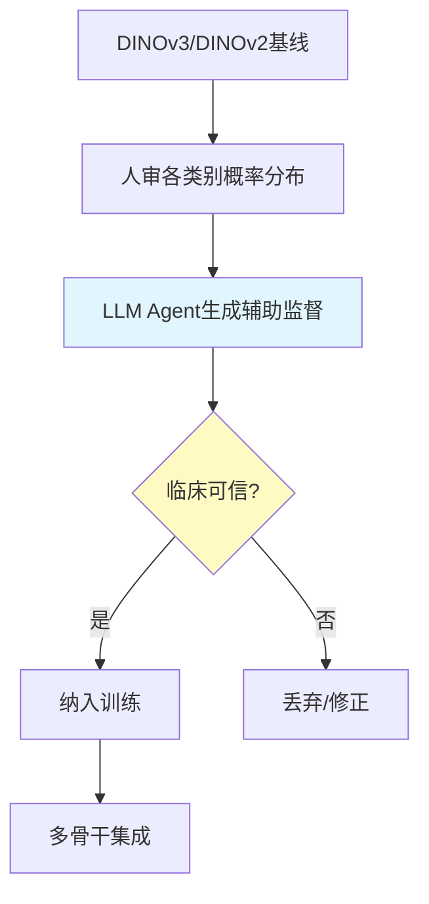

# 第14章 图像比赛详解：RSNA Knee Abnormality Detection（2026，医学影像 + LLM Agent 监督）

> **本章目标**：看 VibeKaggle 的一个前沿形态。2026 年 RSNA Knee 的 1st place 方案，用 **frontier LLM agents 来获取训练集的不同类型监督信号**——Agent 不只是执行代码，还能**生成辅助监督**（从报告抽标签、给图像写描述）。但哪些 LLM 监督在临床可信、哪些会引入系统性偏差，守门人仍然是人。这一章教你“怎么审计 LLM 生成的标签”。

---

## 开篇：当 Agent 开始“造标签”

前面所有章节，Agent 的角色都是“执行者”：你让它写代码、跑实验、管工件。这一章，Agent 多了一个新角色——**“监督信号生成者”**。

什么意思？传统监督学习，你需要人工标注的标签（金标准，gold standard，说白了就是“专家定下来的标准答案”），贵、慢、量小。但 2026 年 RSNA Knee 的冠军方案换了个思路：让 LLM 去读放射科报告、读图像描述，自动生成额外的“弱标签”和“注意力提示”。比如 LLM 读一份报告，抽出“半月板撕裂：有；韧带损伤：无；积液：有”，这就成了额外的监督。

这很诱人，但也很危险。**LLM 会幻觉**——它可能描述一个根本不存在的病灶，或者系统性地忽略罕见病。所以这一章的核心不是“怎么用 LLM 造标签”，而是“**怎么判断 LLM 造的标签可不可信**”。

先给你一组真实的数字，这组数字就是整章的背景板：这场比赛有 **4,407 个训练检查**，但其中只有 **58 个**配了专家标注，剩下的 4,349 个只有一份报告文本。换句话说，**98.7% 的训练数据没有标准答案**。



看这张图，C 和 D 是关键：Agent 在 C 里生产，人在 D 里守门。**这一章要练的就是 D 这个动作。**

---

## 14.1 比赛与数据

膝关节 MRI 多标签异常检测，12 类临床异常，2026 年 RSNA 挑战赛。

先把两个词说清楚。

**MRI**（磁共振成像）：你可以理解成“用磁场给身体拍照片”，它不用 X 光，所以没有辐射，但对软组织的对比度特别好——看韧带、半月板、软骨这类“软软的东西”很在行。

**DICOM**：医学影像的通用文件格式。一张 DICOM 文件里不只有像素，还有一大堆元数据（扫描参数、体位、左右标记……）。更麻烦的是，一次膝关节检查不是一个文件，而是**几百张横断面切片**叠起来的一摞，像把一条面包切成几百片。所以“一张图”在医学影像里往往指“一摞图”。

**多标签**（multi-label）：每个病例可能同时有几种异常（半月板撕裂 + 韧带损伤 + 积液），不是“二选一”。指标通常是列平均 AUC（每个标签单独算 AUC，再平均，英文叫 macro AUC）。

AUC 也解释一下：它衡量“模型把正例排在负例前面的能力”，0.5 等于瞎猜，1.0 是完美。列平均 AUC 就是 12 个标签各算一个，然后取平均——**它天然会掩盖“某一类特别差”**，这一点后面 14.3 会咬人。

数据特点：

- 膝关节 MRI 有固定扫描方向（不能大角度旋转）；
- 左右膝解剖不同（不能水平翻转）；
- 类别不平衡（某些异常很少见）；
- 有放射科报告文本（这是 LLM 能利用的金矿），报告来自全球多家医院，用九种语言写成；
- **报告只在训练集里有，测试时只给图像**——所以文本永远不能当输入特征，只能当“造标签的原料”。

最后这条特别重要，很多人第一次看会误解。它的意思是：LLM 只在“出题”阶段帮忙，考试的时候它不在场。

---

## 14.2 自动基线工件

DINOv3 / DINOv2 骨干微调基线；人检查各类别的预测概率分布和混淆矩阵。

```python
# src/baselines/rsna_baseline.py
"""
RSNA 多标签基线：DINOv3 骨干 + 12 头输出。
指标为列平均 AUC，各类别独立评估。
"""
import torch
import torch.nn as nn
import timm
import numpy as np
from sklearn.metrics import roc_auc_score

NUM_LABELS = 12


class MultiLabelModel(nn.Module):
    def __init__(self, backbone="vit_base_patch16_dinov3"):
        super().__init__()
        # num_classes=0 表示"只要骨干，不要它自带的分类头"
        self.backbone = timm.create_model(backbone, pretrained=True, num_classes=0)
        # 12 个独立输出，每个输出一个 logit（未归一化的分数）
        self.head = nn.Linear(self.backbone.num_features, NUM_LABELS)

    def forward(self, x):
        return self.head(self.backbone(x))    # 输出 12 个 logit


def col_mean_auc(y_true, y_prob):
    """列平均 AUC：每个标签算 AUC 再平均。"""
    aucs = [roc_auc_score(y_true[:, i], y_prob[:, i])
            for i in range(y_true.shape[1])]
    return float(np.mean(aucs)), aucs       # 第二个返回值单独列出每类，别只看平均
```

注意最后那行注释里的“第二个返回值单独列出每类”。这不是顺手写的，是本章最实用的一条经验：**只看平均 AUC，你会永远发现不了那一类塌方。**

人审查：哪些类别 AUC 低？混淆矩阵（confusion matrix，说白了就是一张“真实类别 × 预测类别”的对照表，对角线对了、非对角线错了）显示哪些类别互相误判（半月板撕裂 vs 韧带损伤）？

真实比赛里，这份“逐类体检”救过很多人的命。有公开复盘写到，他们发现 12 个标签里，积液（Effusion）和滑膜炎（Synovitis）用某类骨干单独训反而更好，其他 10 类用 DINOv2 更好——**一个平均分会把这个信息彻底抹平**。

---

## 14.3 LLM Agent 作为监督来源（本章的核心新内容）

2026 年 RSNA Knee 的 1st place 方案，用 **frontier LLM agents 来获取训练集的不同类型监督信号**。

**什么是“LLM 生成辅助监督”？** 三种典型：

- LLM 读放射科报告文本，抽结构化异常标签 → 弱标签（weak label，说白了就是“不是专家定的、但看起来有点道理的标签”）；
- LLM 对图像生成“病变区域描述” → 注意力监督；
- LLM 生成“鉴别诊断候选” → 辅助任务。

我们让 Agent 从报告抽标签。把这段话丢给它：

```
请读取 train.csv 中的影像报告文本列 report，用 LLM 抽取结构化异常标签：
1. 对 12 类异常，每类输出 0/1（存在/不存在/不确定）
2. 输出置信度 0-1
3. 结果写入 artifacts/weak_labels/llm_labels_v001.npy，形状 (n_train, 12)
4. 同时记录抽取失败的样本索引到 artifacts/logs/llm_extract_fail.json
```

模型输出（节选）：

```
> （思考过程）需要调用 LLM API 批量处理报告文本。设计 prompt 要求
> 严格 JSON 输出：{"label_1": {"present": 0/1, "confidence": 0.0-1.0}, ...}。
> 对"不确定"的样本标 confidence < 0.5，训练时降权。
> 注意：LLM 可能幻觉，需人抽样复核。
> 另外报告有九种语言，非英语的要先翻译，翻译错了标签就全错。

import json
import numpy as np
import pandas as pd
from pathlib import Path


def extract_labels_with_llm(reports, labels, api_client):
    """用 LLM 从报告抽取结构化标签。"""
    out = np.zeros((len(reports), len(labels)), dtype=np.float32)
    conf = np.zeros_like(out)                # 置信度矩阵，后面训练时当权重用
    fails = []
    for i, text in enumerate(reports):
        prompt = f"从以下放射科报告抽取异常标签，严格JSON输出：{labels}\n报告：{text}"
        try:
            r = json.loads(api_client.chat(prompt))
            for j, lb in enumerate(labels):
                out[i, j] = r[lb]["present"]
                conf[i, j] = r[lb]["confidence"]
        except Exception:
            fails.append(i)                  # 解析失败就记下来，别静默填 0
    return out, conf, fails
```

这里有个容易忽略的细节：`fails` 一定要记。如果解析失败就默默填 0，你等于往训练集里灌了一批“假阴性”，模型会学得很开心，然后在线下掉分。

### 人的判断：哪些 LLM 监督信号临床可信？

这是本章的核心。**人必须逐类审查**：

| LLM 监督类型 | 可信度风险 | 人的审查动作 |
|--------------|-----------|--------------|
| 从报告抽取的结构化标签 | 报告本身可能有错/不完整 | 抽样 50 例人工核对 |
| 图像区域描述 | LLM 视觉幻觉（描述不存在的病灶） | 对照影像确认 |
| 鉴别诊断候选 | 引入先验偏差（LLM 偏好常见病） | 检查是否系统性忽略罕见病 |
| 软标签置信度 | LLM 过度自信 | 校准检查（confidence 与真实准确率的相关性） |

这张表值得盯一会儿。它说的其实是一件事：**LLM 造标签的风险，不是“它会犯错”，而是“它会稳定地犯同一类错”。** 随机的错，训练时会被平均掉；系统性的错，会被模型当成真理学进去。

真实数据把这件事演示得淋漓尽致。有团队统计过：膝关节报告里，前交叉韧带（ACL）是否撕裂几乎每份都会写，只有 **8%** 的报告压根没提；但滑膜炎（Synovitis）只有 **14%** 的报告会提到——因为它不打造影剂很难判断，医生干脆不写。你现在明白问题在哪了吧：**LLM 从报告里读到的“滑膜炎：无”，很可能只是“医生没写”，不是“病人没有”。** 你把这个当负样本喂进去，就是在教模型“滑膜炎很罕见”。

更狠的是评分标准。有公开复盘指出，官方标签的判定不是“报告里提没提”，而是“**这个异常是否严重到明确无疑**”。所以一份写着“少量关节积液”“轻度软骨病变”的报告，标签就是 0——**这不是噪声，这是标准**。你如果让 LLM 按“提了就标 1”去抽，抽出来的标签和官方标准从根上就是错位的。

怎么系统地审计？用 Cohen's Kappa（一致性系数）在抽样上比对 LLM 标签和金标准：

```python
# src/utils/weak_label_audit.py
"""
弱标签审计：人抽样核对 LLM 标签与金标准的一致性。
Cohen's Kappa：衡量两个标注者的一致性，1 完全一致，0 等于瞎猜。
Kappa < 0.4 说明 LLM 标签不可信。
"""
import numpy as np
from sklearn.metrics import cohen_kappa_score


def audit_weak_labels(llm_labels, gold_labels, sample_idx):
    """在抽样样本上计算每个标签的 Kappa。

    为什么必须逐类算？因为 Kappa 也会被平均骗。
    12 类平均 0.6 看着还行，但可能 10 类 0.7、2 类 0.05，
    而那 2 类恰好是最需要谨慎的罕见病。
    """
    kappas = []
    for j in range(llm_labels.shape[1]):
        k = cohen_kappa_score(gold_labels[sample_idx, j],
                              llm_labels[sample_idx, j])
        kappas.append(k)
        flag = "⚠️ 低可信" if k < 0.4 else "✅"
        print(f"  标签 {j}: Kappa={k:.3f} {flag}")
    return kappas
```

光算 Kappa 还不够，得知道“错在哪个方向”。我们可以让 Agent 做一份更细的体检：

```
在这 58 个有专家标注的病例上，比对 LLM 标签和专家标签：
1. 逐标签算 Cohen's Kappa
2. 对每个标签，分别统计"LLM 说 1、专家说 0"和"LLM 说 0、专家说 1"的例数
3. 找出 LLM 系统性偏向某一类的标签
不要修改任何标签文件，只输出报告。
```

模型会这样回应：

```
> （思考过程）58 例太少，Kappa 的置信区间会很宽，要提醒。
> 方向性统计比 Kappa 更能说明问题：如果全是"LLM 说 1、专家说 0"，
> 那就是 LLM 过度诊断，不是随机噪声。

已完成，报告在 artifacts/audit/label_audit.md：

【Kappa 概览（58 例）】
  标签 3（内侧半月板）  Kappa 0.71  ✅
  标签 7（积液）        Kappa 0.38  ⚠️ 低可信
  标签 8（滑膜炎）      Kappa 0.12  ⚠️ 低可信

【方向性统计】
  标签 7 积液：LLM 说 1 专家说 0 共 11 例；反向 2 例
  标签 8 滑膜炎：LLM 说 0 专家说 1 共 9 例；反向 1 例

【我的判断】
  积液是 LLM 过度诊断（把"少量"也当成 1），
  滑膜炎是 LLM 漏诊（报告没写就当成 0）。
  这两个都不是随机错误，是系统性的，直接混进训练会带偏。

【提醒】
  58 例的 Kappa 置信区间很宽（约 ±0.2），
  这个结论方向可信，具体数值别当定论。
```

这段话里最值得学的，是最后那条“提醒”。它没有把 0.12 说得斩钉截铁，而是告诉你 58 个样本撑不起多精确的结论。**好的 Agent 会知道自己的结论有多脆。**

> **人的判断在于：哪些 LLM 生成的监督信号在临床上是可信的，哪些可能引入系统性偏差。** 这不是“跑个分数”能解决的，得靠临床知识抽样核对。

顺便说个反直觉的真实发现：有团队做了对照实验，结论是“**更好的标签，不一定教出更好的学生**”。他们把报告标签换成更贴近专家口径的版本，同一个学生模型在私榜上反而没涨。原因不复杂——**瓶颈不在标签，在视觉能力**。同一批 58 例上，读报告的文本标注器能拿 0.791，而第一个视觉模型只有 0.674。模型连图像都还没看明白，你把标签擦得再亮也没用。

---

## 14.4 Agent 枚举骨干与增强，人审核临床合理性

Agent 批量运行 DINOv3、DINOv2 等骨干的微调工件；人根据医学图像的语义判断增强策略是否可能改变病变特征。

**医学图像增强的红线**（比第 12 章更严格）：

- 旋转：膝关节 MRI 有固定扫描方向，大角度旋转不符合临床 → 限制在 ±15°；
- 翻转：左右膝关节解剖不同，水平翻转会制造“不存在的镜像病例” → 禁止或谨慎；
- 强度扰动：MRI 信号强度有物理意义，过度扰动可能抹掉病变对比 → 轻度。

```python
# src/augment/medical_aug.py
"""
医学图像安全增强：限制在临床上合理的变换。
"""
import torchvision.transforms as T


def medical_safe_aug(img_size=224):
    """临床上合理的增强：轻度旋转、亮度/对比度微扰、无翻转。"""
    return T.Compose([
        T.Resize((img_size, img_size)),
        T.RandomRotation(degrees=15),                    # 限制角度，别把解剖结构转歪
        T.ColorJitter(brightness=0.1, contrast=0.1),     # 轻度扰动，别抹掉对比
        T.ToTensor(),
        T.Normalize(mean=[0.485, 0.456, 0.406],
                    std=[0.229, 0.224, 0.225]),
    ])
```

Agent 可能建议“加个水平翻转增强，数据集能翻倍”——**默认拒绝**，因为左右膝解剖不同，翻转会制造错误样本。

这里插一句真实的花絮，因为它很能说明“文献做法”和“临床合理”的冲突：有公开复盘统计过，20 个公开 notebook 里有 19 个都做了“把左膝翻成右膝”的处理。也就是说，**大多数人在跟着做一件解剖学上说不通的事**。而 4th place 的方案里写得更直白：除了一个模型，其他所有模型看到的膝盖都被当成左膝。这不是他们懒，是“统一方向”在特征层面确实能省事——但它省的事，和“制造不存在的病例”是同一件事的两面。**你可以用，但你得知道自己在用什么。**

还有一个更隐蔽的坑，是验证集本身。有参赛者老老实实做了“元数据泄漏探测”：只用 DICOM 头里的信息、一个像素都不看，在随机折上能拿到 0.6515 的 macro-AUC；把折按扫描仪分组之后，掉到 0.5981。结论很扎心：**随机 K 折会高估约 0.053，高出来的部分全是“记住这是哪家医院”**。他们统计出 265 个不同的扫描仪指纹。

所以这一章顺便教你一个习惯：**在医学影像里，随机切折是默认作弊。** 要么按病人分组，要么按中心分组，要么两个都做。

---

## 14.5 集成与提交

```python
# src/ensembles/multilabel_blend.py
"""多骨干集成 + 提交核对（列平均 AUC）。"""
import numpy as np


def blend_multilabel(oofs, weights):
    """按权重融合多骨干的 OOF（形状 n×12）。

    注意：这里融合的是"每一类各自擅长的模型"，
    不是把 12 类一锅端。哪类用哪个模型，来自 14.2 的逐类体检。
    """
    w = np.array(list(weights.values()))
    w = w / w.sum()
    return np.tensordot(w, np.stack(list(oofs.values())), axes=(0, 0))
```

提交前用第 12 章的 `check_image_submission` 核对。

再补一句真实世界的注脚：这场比赛有 6,299 支队伍，金牌线在私榜 0.954 附近，前三名的私榜成绩在 0.959 到 0.960 之间。前三名有个共同点——**都让 LLM 同时读了报告和 MRI 图像**，而不是只读报告。这个差别，恰好就是本章开头那个“守门”动作能不能做好的分水岭：只读文本，你拿到的永远是“医生写了什么”；读了图像，你才有机会核对“图像里到底有没有”。

---

## 14.6 小结

**医学影像中 Agent 可以参与监督生成，但临床合理性的守门人仍然是人。**

- LLM 生成辅助监督是前沿形态（从报告抽标签、写描述）；
- 弱标签必须用 Kappa 抽样审计，而且要逐类看、看方向；
- 增强策略受临床解剖约束（禁翻转、限旋转）；
- 随机折在医学影像里会高估，按中心或病人分组才是老实做法。

这一章把 VibeKaggle 的边界又推了一步：**Agent 不再只是“执行”，它开始“创造”训练信号。** 但创造出来的东西可不可信，仍然得人来判。这就像你请了个很有想法的实习生，它能给你提一百个点子，但哪个点子靠谱，得你拍板。

而且这一章还留了个更扎心的结论：当 98.7% 的数据没有标准答案时，**你最大的风险不是模型不够好，而是你根本不知道自己在往错的方向上使劲**。文本标注器 0.791、视觉模型 0.674，这两个数摆在一起，就把“标签派”和“模型派”的争论一锤定音了。

> **下一章预告**：第 15 章 Image Matching Challenge 2025。几何视觉里，数值指标经常“看不出问题”，但人眼一看匹配可视化就知道哪里错了。这一章讲“为什么人的视觉审查不可替代”。