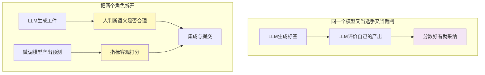
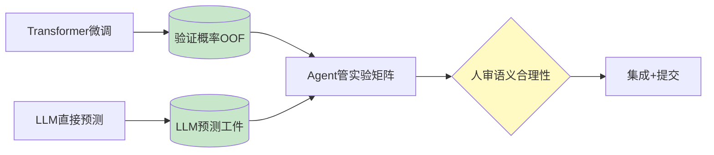
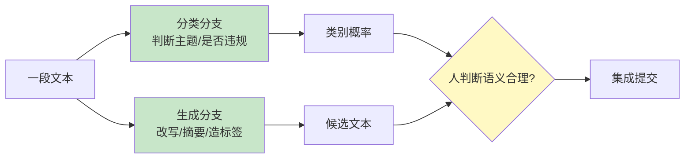
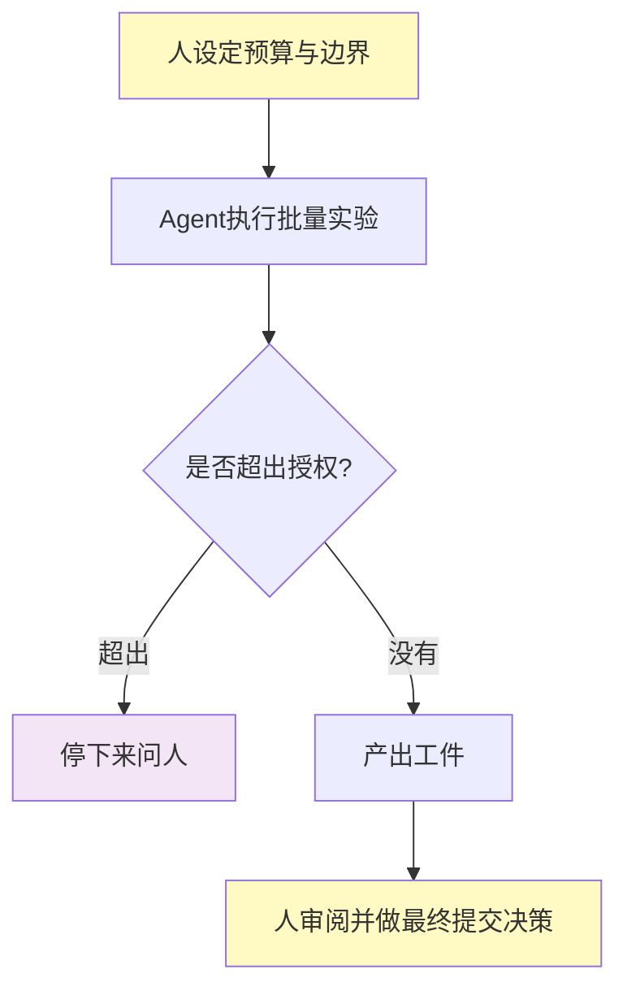

# 第16章 文本数据的 Vibe 工作流

> **本章目标**：进入第五部分——文本数据。这是 LLM 的主场，Agent 在这里有双重身份：既是"执行者"（帮你写训练代码、跑实验），又是"模型本身"（它的输出就是预测）。这种双重角色让文本竞赛的人机分工更微妙。本章建立文本 Vibe 循环，后面三章（Jigsaw、Prompt Recovery、Make Data Count）都复用它。

---

## 开篇：文本竞赛里，Agent 既是"工人"也是"材料"

前面几部分，Agent 的角色很单纯：它是工人，帮你搬砖（写代码、跑实验）。你负责拍板，它负责干活，分工清清楚楚。

但到了文本竞赛，Agent 多了一重身份——它本身可能就是"材料"。

为什么？因为文本任务的核心是"理解语言"，而 LLM 恰恰是最懂语言的那个东西。所以你可以：

- 让 Agent 当工人：写微调代码、跑 DeBERTa 实验、管工件；
- 让 Agent 当材料：直接让 LLM 预测标签、生成弱监督、做数据增强。

这带来一个新问题：**当 Agent 既当裁判又当运动员时，你怎么保证它不"既吹哨又进球"？**

打个比方你就明白了。如果让你自己出一份考卷、自己批改、自己给自己打分，你大概率会给自己打高分——不是因为你撒谎，而是因为你根本没有一个"外部标准"来纠正你。LLM 也一样。让它生成训练标签，再让它评估这些标签训练出来的模型，它会天然地偏好"自己生成的标签"，因为它认得出自己的风格。

所以文本竞赛的人机分工，核心是**把"生成"和"评判"分开**：Agent 生成，人评判。

这句话说起来简单，做起来全是细节：

- 生成标签时用的 prompt，和检查标签时用的 prompt，必须不是同一段；
- 评判时能看的材料，不能只有"Agent 自己说它对"；
- 指标能算的部分（概率、AUC），交给指标；指标算不了的部分（语义通不通、语气对不对），交给人。

说白了，Agent 既是选手又是裁判这个局面，就像让一只狗给自己看门。它可能真的很警觉，但它叫两声你就开门了——因为它分不清"真的有坏人"和"自己闻到了熟悉的味道"。

下面这张图，是本章的核心结构。上面是危险的混法，下面是我们推荐的分法：



上面那条链路的问题不在于"用了 LLM"，而在于**没有第二只眼睛**。下面那条链路把 LLM 放回了它该待的位置：生成端它最强，评判端人来把关。

而真实的文本 Vibe 循环，就是下面这张图：



---

## 16.1 现代起点：Transformer 微调 + 工件落盘

DeBERTa / RoBERTa / 开源 LLM 微调是默认强基线；RAG（检索增强生成）在需要外部知识的任务中成为常见组件。第一个微调基线必须产出验证集概率和测试预测工件。

先解释几个词，免得后面看着晕：

- **Transformer**：现在几乎所有文本模型的底层架构，你可以理解成一套"注意力机制 + 多层加工"的流水线，擅长捕捉长距离的语义关联；
- **DeBERTa / RoBERTa**：两个常用的预训练语言模型，在海量文本上预训练过，微调之后就能拿来干各种具体任务；
- **微调（fine-tune）**：在预训练模型后面接一个分类头（一个很小的"打分零件"，把模型的输出压成你要的类别或概率），然后用你自己的数据训练它；
- **RAG**：检索增强生成，先从外部知识库里检索相关内容，再让模型基于检索到的东西回答。

这几个词看起来吓人，其实你可以这么记：**预训练是"读完整个图书馆"，微调是"练一套专门的手艺"**。Kaggle 上做文本任务，你几乎总是在"练手艺"这一步。

为什么第一个基线这么重要？因为它是后面一切的地基。你后面要加特征、加数据、做集成、挑模型，全都建立在"有一个稳定的基线 + 一份可复现的工件"之上。没有工件，你后面所有的"我好像变好了"都无从谈起。

```python
# src/baselines/text_baseline.py
"""
文本微调基线：DeBERTa + 分类头，产出 OOF 概率与测试预测。
用 HuggingFace Transformers 加载预训练模型。

这个文件是整个文本 Vibe 循环的起点。它只做三件事：
1) 把文本切成模型认识的 token；
2) 搭一个"Transformer + 分类头"的最小模型；
3) 在训练循环里同时产出验证集概率（OOF）和测试集预测。
后两者会被反复用到：验证概率用于调阈值、算 AUC、做集成；
测试预测是最终提交文件的原料。
"""
import numpy as np
import torch
from transformers import AutoModelForSequenceClassification, AutoTokenizer

MODEL_NAME = "microsoft/deberta-v3-base"


def build_model(num_labels):
    """加载预训练 DeBERTa + 分类头。

    num_labels 是类别数。二分类填 2，多分类填类别总数。
    from_pretrained 会把预训练权重下载到本地缓存，
    只多接一个很小的分类头，主体参数不动。
    """
    return AutoModelForSequenceClassification.from_pretrained(
        MODEL_NAME, num_labels=num_labels)


def tokenize(tokenizer, texts, max_len=256):
    """分词：把文本转成模型能读的 token id。

    tokenizer 做的事相当于"把一句话切成积木"：
    "这段评论违反了规则" -> [1024, 883, 2901, ...]
    truncation=True  表示超长的截断，避免超出模型的位置编码上限；
    padding="max_length" 表示短的补齐到 max_len，
                      这样一批样本能拼成一个规整的矩阵，一次送进 GPU；
    return_tensors="pt" 表示直接返回 PyTorch 的张量，免去手工转换。
    """
    return tokenizer(texts, truncation=True, padding="max_length",
                     max_length=max_len, return_tensors="pt")
```

人检查：各类别概率分布、混淆矩阵。文本任务特别要看"模型是不是只记住了关键词而没理解语义"——比如它把"不"字忽略，导致"不好"和"好"预测一样。

这一步为什么重要？因为表格任务里，特征和标签的关系一目了然；文本任务里，模型可能学了一个"看起来很聪明"的捷径。检查的方法很土但有效：专门找一批含否定、转折、反讽的样本，单独看它们的预测对不对。如果模型在这批样本上的正确率明显低于整体，那说明它抓的是关键词，不是语义。

顺便说一句，从 16.1 到 16.3，其实暗含了一条线：**越是"有唯一答案"的部分，越交给指标；越是"要理解意思"的部分，越要留给人。** 这条线后面还会反复出现。

---

## 16.2 Agent 做清洗，人定义"保留什么"

否定词、转折词、反讽标记是否需要特殊保留，由人根据任务语义判断；Agent 不应在未授权的情况下删除这些信号。

文本清洗比表格/图像更微妙。表格里删一列、图像里裁一块，通常没事。但文本里删一个"不"字，意思就反了。Agent 做清洗时，可能"好心"地把"无意义"的词都删了，结果把"不""没""除非"这些关键信号也删了。

你可能会想：这模型怎么会犯这种低级错？原因在于，模型眼里的"无意义"是按**统计频率**判断的——高频虚词删掉通常能涨点。而否定词、转折词在语料里也不算特别高频，模型没有理由知道它们对你这个任务意味着什么。

换句话说：**模型知道什么是"通常可以删的"，但只有你知道什么是"这次绝对不能删的"。**

```python
# src/features/text_clean.py
"""
文本清洗：默认保守，只去明显噪声，保留语义关键信号。
人可根据任务调整保留策略。
"""
import re


def conservative_clean(text, keep_negation=True):
    """
    保守清洗：只去多余空白、HTML 标签、URL。
    默认保留否定词、转折词、标点（它们承载语义）。

    keep_negation 这个参数是留给人的开关：
    某些任务（比如纯主题分类）确实可以忽略否定，
    但你得自己决定，不能让模型替你决定。
    """
    text = re.sub(r"<[^>]+>", "", text)          # 去 HTML 标签：<br> <p> 之类，纯噪声
    text = re.sub(r"http\S+", "", text)          # 去 URL：链接本身通常不代表语义
    text = re.sub(r"\s+", " ", text).strip()     # 去多余空白：换行、连续空格
    # 注意：没有删标点、没有删"不/没/除非"——这些是语义关键
    return text
```

**人定义"保留什么"**：做情感分类，"不"必须保留；做主题分类，标点可以删；做法律文本，条款编号必须保留。这些判断，Agent 给不了。

那怎么让 Agent 处理文本，又不让它把关键信号删掉？你得**明确告诉它边界**：

> **提示词**：请写一个文本清洗函数，用于社区规则分类（Reddit 评论）。要求：去 HTML 标签、去 URL、多余空白、重复标点。注意：不要删除否定词（not / no / never / without）、不要删除转折词（but / however）、不要删除标点，因为这些在本任务里承载语义。

模型会这样回应：

> **AI 输出**
>
> （思考过程）用户明确列了"不能动"的东西。我按"只删噪声、
> 不删语义"的原则实现，并在 docstring 里写清保留项，
> 避免以后有人误改。
>
> ```python
> import re
> ```
>
> ```python
> # 这些词在本任务里承载语义，明确列入"禁止删除"清单
> KEEP_TOKENS = {"not", "no", "never", "without", "but", "however"}
> ```
>
> ```python
> def clean_comment(text: str) -> str:
>     """
>     社区规则分类专用的保守清洗。
>     只删除纯噪声；否定词、转折词、标点一律保留。
>     """
>     text = re.sub(r"<[^>]+>", "", text)          # HTML 标签
>     text = re.sub(r"http\S+|www\.\S+", "", text)  # 链接
>     text = re.sub(r"\s+", " ", text).strip()      # 多余空白
>     text = re.sub(r"!{2,}", "!", text)            # 重复标点压缩到1个
>     # 不做小写化、不删标点、不删 KEEP_TOKENS 里的词
>     return text
> ```
>
> 【我的说明】
>   我没有做小写化——虽然很多 NLP 流程会做，但你的模型是
>   DeBERTa（自带大小写敏感的分词），小写化反而可能损失信号。
>   如果你想试小写化的收益，可以作为一组对比实验。

看见了吗？**它不仅照做了，还主动指出"我没有做小写化，并解释了为什么"**。这种"把每一个'没做的事'也说明白"的习惯，能帮你审查时少漏很多坑。

说白了，这段交互的价值不在于"少写了几行正则"，而在于**你把判断权留下了**。你告诉它边界，它在边界内自由发挥，并且告诉你它没做什么。评审一个 Agent 干得好不好，问的往往不是"它做对了几件事"，而是"它有没有在我没授权的地方自作主张"。

---

## 16.3 特征工程的 Vibe 分化

Transformer 嵌入作为主信号；人工设计的相似度/规则特征作为多样性来源。Agent 批量生成变体，人判断语义合理性。

文本特征工程有两条路：

- **主信号**：Transformer 的嵌入向量（把文本变成几百维向量），这是最强的；
- **多样性来源**：人工设计的特征（文本长度、关键词频次、标点密度、相似度），这些和嵌入互补，集成时能涨分。

为什么要"两条路"？因为嵌入向量很强，但它有个特点：**它对所有句子都长得很像**。它擅长回答"这段话在说什么"，不擅长回答"这段话有多长、有几个感叹号、有没有藏链接"。后面这些"笨特征"，单独看很弱，但它们和嵌入的**相关性低**，集成起来就是白捡的收益。

这其实是个通用的道理：一个模型的强项越集中，弱项就越值得补。

```python
# src/features/text_meta.py
"""
人工设计的文本元特征：作为 Transformer 嵌入的多样性补充。
这些特征单独不强，但与嵌入向量相关性低，集成时能带来额外收益。
"""
import numpy as np


def text_meta_features(texts):
    """文本长度、词数、标点密度、大写比例等。

    返回一个 (样本数, 特征数) 的 numpy 矩阵，
    每一列就是一个手工特征，和 OOF 概率一起拼起来做集成。
    """
    feats = []
    for t in texts:
        feats.append([
            len(t),                              # 字符数：太长的评论往往是灌水
            len(t.split()),                      # 词数
            t.count("!") + t.count("?"),         # 感叹/疑问密度：情绪强度
            sum(c.isupper() for c in t) / max(len(t), 1),  # 大写比例：喊话式发言
            t.count("不") + t.count("没"),        # 否定词数（语义关键）
        ])
    return np.array(feats)
```

顺便插一句真实做法：在 Jigsaw 那类社区规则分类赛里，有队伍专门写了一套"语义化 URL 解析"的规则——把 `http://soccerstreams.com/man-u-vs-chelsea` 这种链接拆成 `soccer streams man u chelsea` 塞进上下文，因为评论里贴个球赛直播链接，本身就是一条关于"哪条规则"的信息。这类东西模型很难自动想到，但它恰恰是人一眼就能看出来的"笨特征"。

而另一种"多样性来源"是**检索**：把训练集全部嵌进向量库，来一条新评论就检索出最相似的 K 条历史样本，用它们的标签投票。Kaggle 上有队伍把这套做法做成了 RAG 分支，效果相当不错。

说到分类和生成的分工，这里有个特别值得一说的真实案例。2026 年 DSN Bootcamp Hackathon 的 LLM/Agent 赛道，要求同时做两件事：把文章分到七个主题之一（分类），再给它生成一句标题（生成）。评分是 **0.5 × Macro-F1（分类）+ 0.5 × GenScore（标题，用 ROUGE-L + BERTScore）**，训练集约 6000 条、覆盖四种尼日利亚语言。参赛者一开始想得很美：用**一个** mT5-small 模型，靠"任务前缀"来区分两种任务。结果模型直接崩了——分类部分塌成"永远猜最多的那个类别"，生成部分输出的全是 `<extra_id_0>` 这种占位符，一句话也没写出来。

原因是小模型小数据扛不住多任务：两个任务在抢同一份容量，分类又"被迫"用生成的方式来做，两个都没学好。

最后他们是这么拆的：**分类用一个专门的编码器（只挂序列分类头），生成用另一个专门的编码器-解码器（只按生成目标微调）**。拆完之后，分类这边把 xlm-roberta-base 换成专门在 11 种非洲语言上预训练的 afriberta_large（只有 1.26 亿参数），Macro-F1 从 0.81 跳到 0.88；生成那边也终于写出了像样的标题。

同一场比赛的另一个 63 名队伍也做了同样的事：XLM-RoBERTa 管主题分类，Qwen2.5-3B 管标题生成。他的总结很朴素——**"任务专门化，胜过一条提示词走天下。"**

这两件事串起来看就很有意思了：**"分类"和"生成"是两种不同性质的能力，混在一起互相拖累；分开之后各自都能更强。** 这跟前面说的"把生成和评判分开"是同一个道理的两面：不是模型越强越好，而是**角色越分明越好**。



---

## 16.4 LLM 作为竞赛模型的使用纪律

人设定 API 预算和推理成本约束；Agent 不应在未授权的情况下消耗大量额度。

如果你直接用 LLM API 做预测（而不是微调），要特别小心成本。一次 API 调用可能几分钱，跑 10 万条测试数据就是几百块。所以：

- 人设定预算上限；
- Agent 不得自行扩大调用量；
- 优先用"缓存"（相同输入不重复调用）。

这三个字面规则背后，藏着一条更重要的原则：**在文本赛里，LLM 从来不是"随便调调就能用"的现成答案**。真实的情况更像是这样：

- 几乎所有能拿牌的队伍，最后都收敛到了同一批 7B 级别的模型上（Mistral 7B、Gemma 7B 之类），再往上堆参数，收益很快就见顶了；
- 决定名次的往往不是模型大小，而是**你把它放在流程的哪个位置**：是让它直接出答案，还是让它出候选、由别的模型来挑，还是让它只做一个分类器；
- 更现实的是，你手上的显卡往往很小。有人的本地环境只有一张 4GB 显存的笔记本卡，最后的做法是：4 比特量化加载 4B 模型、batch size 压到 1、串行跑评估，而且只在最值得跑的那一两成数据上调用 LLM，剩下的靠正则兜底。

这些数字放在一起说明什么？说明**在文本赛里，LLM 的使用量是要"精打细算"的资源，而不是可以随便撒的糖**。你让 Agent 自由发挥，它会很自然地写出"给每条测试样本调用三次 API 做一致性投票"这种听起来很聪明的方案——然后你的账就炸了。

```python
# src/utils/api_budget.py
"""
API 预算控制：记录调用次数和花费，超预算就停。
"""
class APIBudget:
    """一个简单的预算闸门。

    max_calls     —— 最多允许调用多少次
    cost_per_call —— 单次调用大概多少钱（单位自己定义，比如元）
    """

    def __init__(self, max_calls=10000, cost_per_call=0.001):
        self.max_calls = max_calls       # 预算上限：人设定的硬约束
        self.cost_per_call = cost_per_call
        self.calls = 0                   # 已用次数
        self.spent = 0.0                 # 已花金额

    def can_call(self):
        """还能不能继续调？预算没超就返回 True。"""
        return self.calls < self.max_calls

    def record(self):
        """记一次调用，并累计花费。"""
        self.calls += 1
        self.spent += self.cost_per_call
        if self.calls >= self.max_calls:
            print(f"⚠️ API 预算耗尽（{self.calls} 次，约 {self.spent:.2f}），停止调用")
        return self.calls
```

预算之外，还有一道更重要的闸门：**最终提交决策不外包。**

有一份专门讲"如何给 AI Agent 派活"的 Kaggle 实践清单，把任务分成两类：特征工程、模型训练、集成构造、调试失败的 Notebook——这些放心交给 Agent，因为它们可验证、试错成本低；而"最终提交决策"，明确标成**不委派**，理由只有五个字：风险与收益由人判断。

这话听起来保守，但你把场景换到文本赛就懂了。你手上有一份"分数看起来很好但我不确定为什么好"的提交，Agent 会说"提交吧，分数更高"；但它不知道这条提交是不是恰好拟合了 Public LB 的那 15% 样本、是不是踩到了某个只有测试集才有的分布、是不是会在 Private LB 上翻车。这些判断，只能你来做。

那 Agent 到底适合接哪些活？这里有一张可以直接抄的分工表：

| 任务 | 交给 Agent？ | 原因 |
|------|-------------|------|
| 下载数据 / 检查文件 | 否 | 机械活，自己做更快 |
| 特征工程 | 是 | 变换空间大，Agent 能批量试 |
| 模型训练与调参 | 是 | 可自动验证，迭代快 |
| 集成方案构造 | 是 | 组合多，让它穷举 |
| 调试报错的 Notebook | 是 | 它能读日志定位问题 |
| 最终提交决策 | 否 | 风险与收益是人的判断 |

顺带说一句，给 Agent 派活时提示词的结构也有讲究。一个比较稳的模板是六段式：**背景（什么比赛、什么任务）、数据（文件在哪、长什么样）、目标（要它产出什么）、约束（GPU、时间、能不能联网）、成功标准（怎么算做到了）、禁止事项（不许做什么）**。

最后一段"禁止事项"最容易被忽略，但它恰恰是防止"既当选手又当裁判"的关键。你得明确写上：不要用测试标签当兜底、不要假设测试集和训练集同分布、不要在没有交叉验证的情况下汇报准确率。



---

## 16.5 小结

- Transformer 微调是默认强基线，工件先行；
- Agent 做清洗，但"保留什么"由人定（否定词/转折词不能删）；
- 特征工程分化：嵌入为主、人工特征为辅；
- LLM 当模型用时，预算和成本由人控制；
- 分类和生成是两种能力，分开建模各自更强；生成与评判也必须分开。

文本竞赛的人机分工，可以浓缩成一句：**Agent 既帮你干活、又可能亲自上场，但"它说得对不对"得你判。**

生成和评判必须分开，这是文本场景的特殊纪律。Agent 可以是又快又好的工人，可以在某些环节比微调模型更合适，但它不能是唯一裁判——因为它既是选手，就一定会偏心。

> **下一章预告**：第 17 章 Jigsaw 社区规则分类。1st place 方案做了一个大胆判断——**直接信任 Public LB 当验证**，理由是 LB 切分随机、测试量大。这个"用 LB 还是用 CV"的选择，本身就是人判断的问题。
