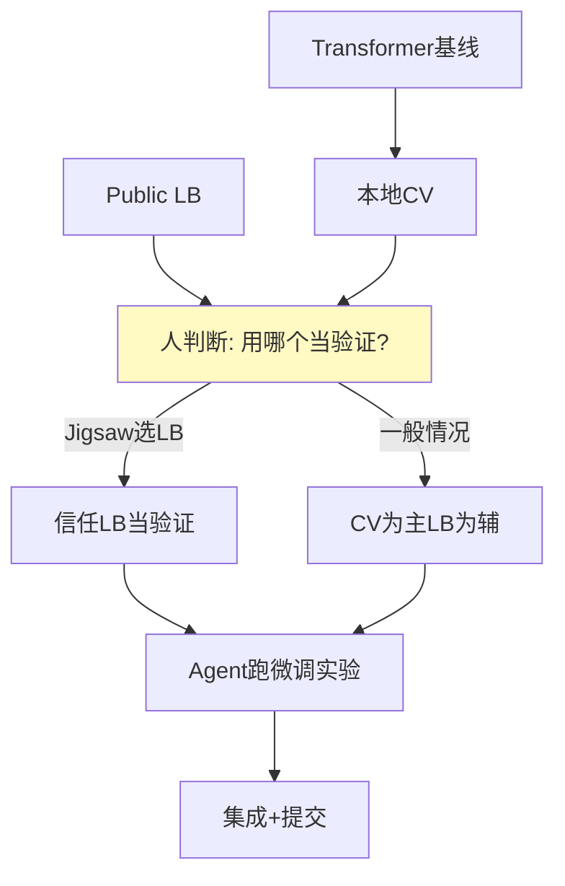
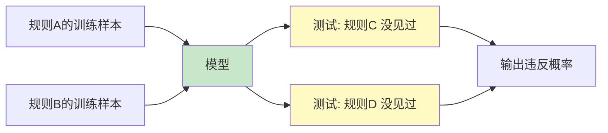
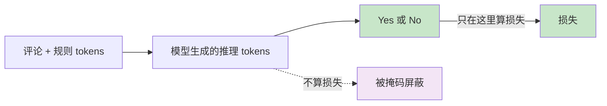

# 第17章 文本比赛详解：Jigsaw — Agile Community Rules Classification（2025，LLM 微调与验证策略的判断）

> **本章目标**：这一章讲一个特别反常识的判断。Jigsaw 的 1st place 方案，做了一个大胆的决定——**直接信任 Public LB 当验证**，理由是"LB 切分随机、测试数据量大以降低方差"。这个"用 LB 还是用 CV"的选择，本身就是**人**做出的验证方案决策。本章核心：**当验证策略本身成为判断对象时，人的角色是"选择用什么标准来判断"，而不是"让 Agent 选一个分数最高的标准"。**

---

## 开篇：这一次，"不信 CV 信 LB"反而是对的

我们前面反复讲"本地 CV 是主裁判，Public LB 是参考"。讲了很多遍，讲到你自己都快背下来了。

但 Jigsaw 这一章要给你一个例外。而且不是那种"理论上存在"的例外，是**拿了第一名的队伍公开写明白的例外**。

Jigsaw 的任务是判断 Reddit 评论是否违反某个社区规则，二分类，指标是列平均 AUC（多个规则分别算 AUC 再平均）。

1st place 方案做了个反常的决定：**不主要看本地 CV，而是直接信 Public LB。** 理由是：

- LB 的切分是随机的，没有泄漏；
- 测试数据量足够大，采样噪声小；
- 文本训练/测试分布往往不完全一致，本地 CV 可能反而不准。

这不是我编的。同一场比赛里，7 名的队伍说得更直白——他们把自己的 CV 直接扔了，理由写得很短：**测试集太大，盲信就行**。更有甚者，这支 7 名队伍在复盘里明确写了"**CV 捨てた（丢弃 CV）**"，干脆不算本地验证，完全信任 Public LB。5 名的队伍也写了四个字：**"信任 Public LB"**。

先别急，我知道你现在想说什么："这不是鼓励大家刷 LB 吗？"

不是。这里有个关键区别，值得掰开讲：**"刷 LB"是拿 LB 当调参目标，"信 LB"是拿 LB 当验证集。** 前者是作弊式的自欺，后者是在承认"我本地那套切分不能代表真实测试"之后，换一个更可信的尺子。而且用 LB 当验证是要花提交次数的——Kaggle 每天能提交的次数有限，你把它当验证集，就等于把预算烧掉了。所以这仍然是一个**需要人批准**的决定。

这就引出了本章真正的主角：**验证策略本身，也是一个需要判断的对象。**

Agent 永远不会做这种判断，因为它只会默认按"CV 最高"来优化。而如果 CV 和真实测试分布不一致，Agent 就会把你带进沟里——它不会提醒你，它只会兴高采烈地给你一个 CV 0.93、Private LB 0.88 的方案。



图里那个黄色的菱形，是整章的核心。它不是流程中的一个步骤，而是一个**岔路口**：走哪边，Agent 说了不算。

---

## 17.1 比赛与数据

Reddit 评论是否违反特定社区规则，二分类，列平均 AUC，2025 年 Jigsaw 竞赛。

先给这场比赛交个底，让你知道量级：据公开复盘，共有 **2,445 支队伍**参赛，银牌线大约是第 **42 名**，最终 AUC **0.92909**。银牌方案（mayin0902）的思路很有代表性：Qwen3-4B 用 QLoRA 微调，配合 GTE 三元组学习分支和 DeBERTa-v3 做 `rule [SEP] comment` 判别（URL 语义、attention pooling、FGM 对抗训练、EMA），最后混合为 **0.5×rank(DeBERTa) + 0.3×rank(GTE) + 0.7×rank(Qwen)**。你看，即便是拿银牌的方案，也是好几个模型按排名加权出来的——单模型很难封神。

再看数据结构。每一行是这样几样东西：

- `body`：评论正文；
- `rule`：这条评论要对照的规则原文；
- `subreddit`：评论来自哪个版块；
- `positive_example_1` / `positive_example_2`：这条规则下"违规"的示例；
- `negative_example_1` / `negative_example_2`：这条规则下"不违规"的示例；
- `rule_violation`：目标列，1 表示违规，0 表示不违规。

数据结构本身不复杂，复杂的是它藏着的那个坑：

- 文本内容是自然语言，"理解语义"比"抓关键词"重要；
- 训练/测试可能分布不一致（不同时期、不同社区）；
- 存在"反讽、否定、隐喻"等语义难点；
- **训练集里只有两条规则，测试集里出现了训练时没见过的规则。**

最后一条是这场比赛的灵魂。官方在数据说明里写得很清楚：训练集只包含两条规则，测试集包含额外的、模型必须能泛化的规则（具体几条官方没说，社区里有人数出来是六条）。

这也意味着"数据少"不是借口。社区里有铜牌方案只用了约 **2,000 条训练样本**，自己从 Reddit 的 24 个版块爬了 **6 万多条评论**做数据增强，再用 Llama 3.2 3B（Unsloth）+ QLoRA 微调——靠的是更好的数据，而不是更大的模型。

这意味着什么？意味着你**不能**把任务当成"两条规则的二分类"，然后指望背下这两条规则的表面特征就能赢。你必须让模型学会"给定任意一条规则 + 一段评论，判断它违不违反这条规则"——也就是所谓的**规则条件化审核**（rule-conditioned moderation）。



这张图解释了为什么"规则条件化"这么重要：模型在训练时只见过 A、B 两条规则，测试时却要面对 C、D。它必须学会的是"读规则、读评论、做比对"这个动作本身，而不是记住"A 规则长什么样"。

也正因为这样，很多队伍的第一个动作都是**改造输入格式**：把规则和评论拼在一起喂给模型，中间用一个分隔符隔开，比如 `rule [SEP] comment`。有的队伍更进一步，把规则、评论、以及正负示例一起塞进提示词，让模型"看着例子判断"。

说到数据量，这里有个很能说明问题的对比。官方给的训练数据非常少——有队伍统计过，大约只有两千条。两千条是什么概念？在深度学习里，这是"刚够跑通、远远不够学"的量级。所以那年几乎所有能拿牌的方案，都在做同一件事：**造数据**。

- 有队伍去 Reddit 上按六个规则类别、二十四个版块定向爬评论，先攒了九千多条，后来又扩到六万五千条以上；
- 有队伍用大模型生成合成数据，再拿它去微调；
- 还有队伍把测试集里给出的正负示例直接当成训练样本来用（这不是作弊，官方就是这么设计的，示例本来就是给你参考的）。

你看，数据不够的时候，人的判断力体现在**"往哪个方向造"**：造得跟真实分布不像，造得再多也是噪声；造得方向对，几千条就能顶用。

---

## 17.2 Transformer 基线工件

Qwen / Llama / Phi 小模型微调基线；Agent 管理多模型工件。

```python
# src/baselines/jigsaw_baseline.py
"""
Jigsaw 基线：DeBERTa / Qwen 小模型微调，多规则二分类。
每规则独立预测概率，列平均 AUC。
"""
import torch
import torch.nn as nn
from transformers import AutoModelForSequenceClassification
from sklearn.metrics import roc_auc_score
import numpy as np


def train_one_rule(train_texts, labels, model_name="microsoft/deberta-v3-base"):
    """单个规则的微调（示意）。

    注意：这里"单规则"只是最朴素的写法。
    实际比赛里更常见的做法是把"规则 + 评论"拼成一条输入，
    让同一个模型学会对任意规则做判断，这样才能泛化到没见过的规则。
    """
    model = AutoModelForSequenceClassification.from_pretrained(model_name, num_labels=2)
    # ... 训练循环 ...
    return model


def col_mean_auc(y_true, y_prob):
    """列平均 AUC。

    y_true: (样本数, 规则数) 的 0/1 矩阵
    y_prob: (样本数, 规则数) 的预测概率

    为什么叫"列平均"？因为每一列是一条规则，
    每条规则单独算一个 AUC，最后再把这些 AUC 平均起来。
    这样做的好处是：规则多的时候，不会因为某条规则样本特别多
    就把整体分数带偏——每条规则的话语权是平等的。
    """
    aucs = [roc_auc_score(y_true[:, i], y_prob[:, i]) for i in range(y_true.shape[1])]
    return float(np.mean(aucs)), aucs
```

Agent 可以同时管多个模型（DeBERTa、Qwen、Llama），每个都产出工件，人审查哪些值得进集成。

这里插一句真实观察。那一年榜单前列的队伍，模型清单长得几乎一模一样：Qwen3-14B、Qwen3-8B、Phi-4、Gemma-2-9B、ShieldGemma-9B、Llama-3.1-8B、DeBERTa-v3、ModernBERT、E5/BGE/GTE 这些嵌入模型。**大家用的东西高度重合，名次却差很多。**

这说明什么？说明在文本赛里，**决定名次的不是"你用了什么模型"，而是"你怎么用、怎么组、怎么验"**。7 名队伍的原话是三条经验：大模型一定强、谁能用好合成和外部数据谁赢、以及"总之就是堆模型"。听起来像废话，但第三条背后其实有讲究——他们堆的不是同类模型，而是**性质不同的模型**：生成式的因果语言模型、判别式编码器、语义检索，三路人马各来一路。

15 名队伍的七模型集成也是同一个思路：把七个模型的预测先转成**排名**再加权平均，而不是直接平均概率。原因很实在——不同模型输出的概率分布差异很大，直接平均等于让"概率标得最松"的那个模型说了算；转成排名，大家就都在同一把尺子上了。

---

## 17.3 验证策略的不可委托性（本章核心）

1st place 方案明确选择**信任 Public LB 作为验证**，理由包括 LB 切分随机、测试数据量足够大以降低方差。

**这个判断是人做出的验证方案选择**——Agent 不应自主决定"用 LB 还是 CV"。

为什么这事必须人来做？因为"用 LB 还是 CV"是个**战略性**判断，涉及：

- 本地 CV 的代表性（切分方式是否贴合真实测试）；
- 测试集大小（小测试集 LB 噪声大，不能信）；
- 提交预算（用 LB 当验证意味着要消耗很多提交，得人批准）。

把这三条摊开看，你会发现它们没有一条是"算出来的"，全是"判断出来的"。

第一条最微妙。本地 CV 好不好，取决于你怎么切。这场比赛里，2 名的队伍用的是分层 K 折、老老实实信本地 CV；1 名和 5 名、7 名则直接不信。两拨人都进了前列。**所以不存在"标准答案"，只存在"这次这个比赛，哪种尺子更准"。**

第二条是纯经验。测试集大，LB 的采样噪声就小，一条 0.001 的差异才值得当真；测试集小，LB 上跳 0.01 可能纯属运气。这场比赛测试集有九千多条（公开的那部分占一成半左右），所以"信 LB"才成立。换个只有几百条测试集的比赛，同样的做法就是灾难。

第三条最容易被忽略：**信 LB 是要花钱的。** 提交次数有限，你把它当验证集，就等于每天要烧掉好几次提交。这笔钱谁批？只能人批。

```python
# src/utils/validation_strategy.py
"""
验证策略的辅助决策：帮人算"CV 和 LB 的一致性"。
这不是替人做决定，是给决定提供数据。
"""
import numpy as np


def cv_lb_consistency(cv_scores, lb_scores):
    """
    比较历次提交的 CV 和 LB 分数，算它们的相关性。
    如果高度相关（> 0.8），说明 CV 可信，可以主要用 CV；
    如果相关性低，说明 CV 不可信，要考虑用 LB（但消耗预算）。

    注意这个函数的定位：它只输出一个数字和一句提示，
    真正的决定（要不要改用 LB、要不要多花提交次数）由人来做。
    """
    if len(cv_scores) < 3:
        # 少于三次提交，样本太少，算出来的相关性没有意义
        print("提交次数太少，无法评估一致性")
        return None
    corr = np.corrcoef(cv_scores, lb_scores)[0, 1]
    print(f"CV 与 LB 相关性：{corr:.3f}")
    if corr > 0.8:
        print("→ CV 可信，主用 CV")
    else:
        print("→ CV 不可信，考虑用 LB（需人批准预算）")
    return corr
```

这个函数值得多说两句，因为它体现了一种很健康的分工：**Agent 负责把"事实"算出来，人负责把"决定"下下去。**

相关性 0.85 意味着什么？意味着你本地 CV 涨 0.005，LB 大概也涨 0.005，那你可以放心用 CV 调参。相关性 0.2 意味着什么？意味着你本地调得再精细，LB 上可能毫无反应，甚至反向——这时候继续"优化 CV"就是在自我催眠。

顺带说一个真实的小技巧。有队伍在造合成数据时，用的判断标准就是相关性：先算"生成数据训出来的模型"和"mean prompt 基线"在 CV 与 LB 上的相关性，如果超过 0.8 就采用这批数据，否则丢掉。他们实测的相关系数大约是 0.86，刚好过线。**你看，连"这批合成数据能不能用"这种问题，最后也是靠"相关性"这把尺子来量，而不是靠"我觉得像"。**

> **在文本竞赛中，训练/测试分布往往不完全一致，验证策略的选择本身就是一个需要人判断的问题。** Agent 只会默认选 CV，你得判断这次 CV 到底靠不靠谱。

---

## 17.4 Agent 执行微调实验，人审核损失掩码与数据增强

1st place 方案在微调时**手动排除 "Yes"/"No" 之外的 token 的损失**，并利用 test.csv 中的正负例进行上采样。这些操作由人设计，Agent 批量执行不同配置的工件。

**损失掩码**是什么？训练语言模型时，通常对每个 token 都算损失。但如果你的任务是"让模型回答 Yes/No"，那你只关心它回答对没对，不关心它中间的推理过程。损失掩码就是"只在 Yes/No 这两个 token 上算损失，其他地方不算"。

为什么要这么干？因为如果你对每个 token 都算损失，模型会花大量精力去学"怎么把推理过程写得漂亮"，而不是"怎么答对"。掩码一上，模型的注意力就被强行掰回来了。



```python
# src/train/loss_mask.py
"""
损失掩码：只对答案 token（Yes/No）算损失，忽略其他 token。
人设计掩码规则，Agent 批量执行。
"""
import torch
import torch.nn.functional as F


def masked_loss(logits, labels, answer_token_mask):
    """
    logits: 模型输出 (B, T, V)
    labels: 真实 token (B, T)
    answer_token_mask: 布尔张量 (B, T)，True 表示这个位置是答案 token

    这里有个容易忽略的细节：语言模型预测的是"下一个 token"，
    所以要把 logits 和 labels 错开一位（shift），
    否则你就是在用"答案本身"预测"答案本身"，等于作弊。
    """
    # 错开一位：用第 t 个位置的输出，去预测第 t+1 个位置的 token
    shift_logits = logits[..., :-1, :].contiguous()
    shift_labels = labels[..., 1:].contiguous()
    mask = answer_token_mask[..., 1:].contiguous()   # 掩码也要跟着错开
    # 逐 token 交叉熵，reduction="none" 表示先不求和，保留每个位置的损失
    loss = F.cross_entropy(
        shift_logits.view(-1, shift_logits.size(-1)),
        shift_labels.view(-1), reduction="none")
    loss = loss * mask.view(-1)                      # 非答案位置乘 0，等于不算
    # 只除以答案 token 的个数，避免"答案越少损失越小"的假象
    return loss.sum() / mask.sum().clamp(min=1)
```

**人为啥要设计这个**？"只在答案 token 算损失"是一个经验判断——它让模型聚焦于"答对"，而不是"把推理过程写得漂亮"。这个设计来自对任务的理解决定，Agent 不会主动想到。

其实"只在关键位置算损失"这个想法，在那一年的榜单上不止一个人用。4 名的队伍走得更远：他们用的是广义交叉熵（Tsallis 那一族），并且把重复、矛盾的标注合并成一个**软标签**（比如"这条评论有七成概率违规"），而不是非 0 即 1 的硬标签。理由很实在——官方数据里本身就有重复和互相矛盾的行，硬要当成绝对真理，模型反而学歪。

如果 Agent 没想到，你可以把设计意图告诉它，但让它来实现细节：

> **提示词**：我要做的是"评论是否违反社区规则"的二分类，用 LLM 微调。我想只让模型在最终输出的 Yes/No 两个 token 上算损失，中间的推理 token 不算损失，这样模型更专注于答对。请实现这个损失掩码，并说明怎么定位答案 token。

模型会这样回应：

> **AI 输出**
>
> （思考过程）用户已有明确设计意图，我要做的是实现细节。
> 关键点是"怎么找到答案 token 的位置"：因为模型输出序列
> 里只有最后一个非 padding 位置是答案，所以我用 attention_mask
> 找出每行最后一个有效 token，再检查该位置的 token id
> 是否属于 Yes/No 词表。
>
> ```python
> def build_answer_mask(input_ids, attention_mask, yes_id, no_id):
>     """
>     构造答案位置掩码：只标记每行最后一个有效 token，
>     且该 token 属于 Yes/No 词表时才标记为 1。
>     """
>     seq_len = input_ids.size(1)
>     # 每行最后一个有效位置（attention_mask 从右往左第一个 1）
>     last_idx = attention_mask.size(1) - 1 - attention_mask.flip(1).argmax(1)
>     mask = torch.zeros_like(input_ids, dtype=torch.bool)
>     rows = torch.arange(input_ids.size(0))
>     tok = input_ids[rows, last_idx]
>     mask[rows, last_idx] = (tok == yes_id) | (tok == no_id)
>     return mask
> ```
>
> 【设计要点说明】
> 1. 为什么用"最后一个有效 token"而不是搜 Yes/No：
>    推理文本里也可能出现 "yes"（比如"yes, it is rude"），
>    全文搜索会标错位置。
> 2. 如果末尾 token 不是 Yes/No（比如模型输出的是"Sure."），
>    该行掩码全 0，这行就不参与损失。我会打印这类样本比例，
>    太高说明提示词或解码策略要调。

它不仅实现了，还**解释了关键设计取舍**（为什么不用全文搜索、异常情况怎么处理）。这种"解释为什么"比"解释怎么做"更有价值——因为后者你能自己看代码，前者才是它真正的思考。

再说数据增强这一半。1 名队伍把 `test.csv` 里的正负示例直接拿来当训练样本，这是一个很聪明的动作：官方既然在测试集里给了每条规则的示例，说明这些示例本身就是"这条规则长什么样"的最佳说明。把它们加进训练集，等于让模型提前"预习"了测试集的规则分布。

但这里有个陷阱，值得你警惕：**上采样不是越多越好。** 你把示例复制一百遍，模型就会死记这几条示例的表面特征，遇到真正的测试评论反而不会判断了。所以人要做的是定"上采样几倍、哪些规则多采、哪些不采"，而 Agent 负责把这个配置批量跑成工件。

下面这段对话，演示的就是"人定方向、Agent 出对比"的分工：

> **提示词**：我要做数据增强：把 test.csv 里每条规则的 positive_example_1/2和 negative_example_1/2 加进训练集，并对这些样本上采样。请帮我跑三组配置：A 组不上采样；B 组统一 3 倍；C 组按规则样本数反向加权。每组都跑 5 折 CV，报告列平均 AUC，以及每组里"只在示例上过拟合"的迹象（比如训练集上 AUC 接近 1 但验证集明显低）。不要替我选，我要看三组数字的对比。

模型会这样回应：

> **AI 输出**
>
> （思考过程）用户要的是三组对比，不是让我拍板。我除了报 CV，
> 还要报"训练集 AUC 与验证集 AUC 的差距"——因为这个差距
> 是判断"是不是在背示例"的直接证据，比单看验证分数更有信息量。
> 另外要提醒：示例样本在训练集里占比很小，
> 上采样倍数一大，模型可能把示例当成模板，这个风险要写清楚。
>
> 【三组配置结果（示意）】
>   组别            列平均AUC   训练AUC   差距
>   A 不上采样        0.9124     0.9681   0.056
>   B 统一 3 倍       0.9187     0.9924   0.074
>   C 反向加权        0.9203     0.9871   0.067
>
> 【我的观察】
> 1. C 组验证分数最高，但训练-验证差距也变大了，
>    说明它在往"记住示例"的方向偏。
> 2. A 组差距最小，说明模型没有过度依赖示例。
> 3. 光看这三个数我不能替你决定，因为还缺一个信息：
>    测试集里的规则，和训练集里的两条规则重合度有多高？
>    如果测试规则几乎都是新的，那"记住示例"的危害就小，
>    因为示例本来就是唯一的规则线索；如果重合度高，
>    那 A 组可能更稳。
>    要不要我先统计一下 test.csv 里的规则分布？

这段回应里最值得学的，不是那三个数字（数字是示意），而是它**主动指出"我还缺一个信息，所以我不替你决定"**。

这就是"不可委托性"的具体样子：Agent 可以把三组实验跑完、把差距算出来、把风险讲清楚，但"重合度多少算高""我这次要稳还是要冲"这两个判断，它交回给你了。

---

## 17.5 集成与提交

```python
# src/ensembles/weighted_blend.py
"""多模型工件加权集成 + 提交核对。"""
import numpy as np
import pandas as pd


def weighted_blend(oofs, weights):
    """按权重融合多个模型的 OOF 概率。

    oofs: 字典，键是模型名，值是 (样本数,) 的概率数组
    weights: 字典，键是模型名，值是权重

    这里用的是最朴素的加权平均。比赛里更常见的做法是
    先把每个模型的概率转成"排名"（rank），再加权平均——
    因为不同模型的概率刻度不一样，直接平均会让刻度最松的模型主导。
    """
    w = np.array(list(weights.values()))
    w = w / w.sum()                      # 归一化，让权重加起来等于 1
    return np.tensordot(w, np.stack(list(oofs.values())), axes=(0, 0))


def rank_blend(oofs):
    """把每个模型的概率转成排名后平均（更适合 AUC 类指标）。

    转排名的意思是：把 1000 个样本按预测值从小到大排队，
    第 3 名的样本记 3/1001，第 500 名记 500/1001。
    这样不管原模型的概率是挤在 0.4~0.6 还是散在 0~1，
    融合时大家都在同一把尺子上。
    """
    ranks = []
    for name, p in oofs.items():
        r = pd.Series(p).rank(method="average").to_numpy()
        ranks.append(r / (len(r) + 1))   # 归一化到 0~1，避免样本数影响
    return np.mean(ranks, axis=0)
```

提交前用第 4 章的 `make_submission` 核对。

顺便提醒一句，上面那个 `rank_blend` 里用到了 `pd`，记得在文件开头 `import pandas as pd`——这种小疏漏在赶时间的时候特别常见，跑一遍就报错，改一行就好，但会打断你的思路。所以养成"写完先跑一遍最小样例"的习惯，比事后 debug 便宜得多。

---

## 17.6 小结

**当验证策略本身成为判断对象时，人的角色是"选择用什么标准来判断"，而不是"让 Agent 选一个分数最高的标准"。**

- 信任 LB 当验证，是一个需要人拍板的战略判断；
- 损失掩码、数据上采样，由人设计、Agent 执行；
- CV 与 LB 一致性算出来给人看，决定由人下；
- 数据不够时，"往哪个方向造数据"是人的判断；
- 集成的关键不是堆同类模型，而是堆性质不同的模型，并用排名统一刻度。

这一章最反直觉也最重要：**有时候，"用 CV 验证"这个我们一直强调的原则，反而要被人推翻。** 为什么？因为 CV 的有效性依赖于"本地切分能代表真实测试"——如果这个前提不成立，CV 就不可信。**验证方案本身，永远是需要人判断的对象。**

说得再直白一点：CV 不是圣经，它只是一把尺子。尺子准不准，得你自己拿真实的东西去比一比才知道。而"拿什么去比"，就是人的活儿。

> **下一章预告**：第 18 章 LLM Prompt Recovery，进入生成式任务。生成式的评估指标往往抓不住"语义质量"，人得靠人工抽检来判断 Agent 优化的方向有没有偏。