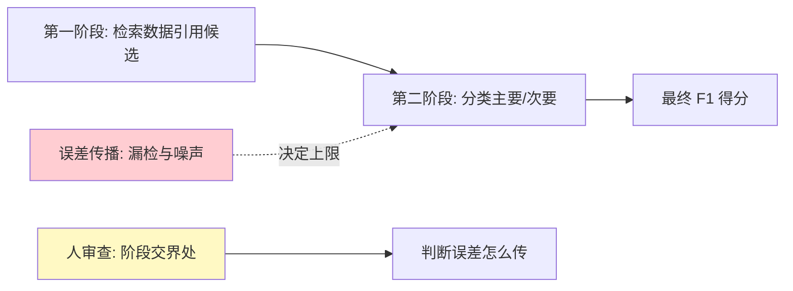

# 第19章 文本比赛详解：Make Data Count — Finding Data References（2025，检索 + 分类的混合流程）

> **本章目标**：看一个"两阶段混合"的文本任务。Make Data Count 要从科学论文全文里识别数据引用，并分类为主要/次要引用。1st place 用 CatBoost 训练，4th place 用 Qwen2.5 预训练。关键不是"单个阶段得分高"，而是**"阶段之间的误差怎么传播"**——人审查的重点在阶段交界处，而不是单阶段的分数。

---

## 开篇：两阶段任务里，最致命的不是"第一阶段错了"，而是"错传给了第二阶段"

先说个题外话。你平时在表格比赛里看到一个分数掉了，通常还有救——改改特征、调调参数，分数就回来了。但文本任务里有一种错，是**回不来的**。这一章我们要讲的，就是这种错。

Make Data Count（下面简称 MDC）是 2025 年 6 月 11 日到 9 月 9 日举办的一场比赛，主办方是一个叫 Make Data Count 的国际倡议组织。这个组织干的事听起来有点抽象：他们想给"科学数据被引用了几次"这件事建立一套公开的计量标准。他们做过一个统计，说目前大约 86% 的研究数据在现有的引用体系里根本没被引用过——数据明明被人用了，但没人写下来"我用了这份数据"。比赛要做的，就是把这种"用了但没写清楚"的关系，用模型自动补出来。

比赛规模不小：最终有 1282 支队伍参加，奖金池 10 万美元。评价指标是 F1 分数（精确率和召回率的调和平均，简单说就是"找得准"和"找得全"两头都不能偏科）。

任务本身可以拆成两句话：

- 第一阶段（检索）：在科学论文全文里找出"哪里可能提到了数据集"；
- 第二阶段（分类）：把找到的候选分成"主要引用"或"次要引用"。

这里插一句名词解释，后面会反复用到：

- **主要引用（Primary）**：这份数据是这篇论文自己研究产生出来的，为这项研究量身定做；
- **次要引用（Secondary）**：这份数据是别人早就发布过的，这篇论文只是拿来用或者二次加工。

为什么要分这两类？因为对科学计量来说，"我自己产的数据"和"我借的数据"价值完全不一样。前者说明这篇论文有数据贡献，后者说明它在做数据复用。混在一起算，就没意义了。

好，现在回到刚才那句话：这类任务有一个表格/图像任务里没有的问题——**误差会传递**。

如果第一阶段检索漏了某个引用，第二阶段再怎么强，也只能对"找到的"东西分类，漏掉的永远回不来了。反过来，如果第一阶段把大量无关段落也当成候选塞进来，第二阶段的分类精度又会被稀释——它得在一堆垃圾里挑金子，挑花眼了，准确率自然掉。

打个生活里的比方。这就像机场安检：如果第一道门（金属探测门）漏检了，后面开箱检查再仔细也没用，因为那个人已经过去了；可如果第一道门把每个乘客都拦下来开箱，后面安检员再厉害，也会被箱子淹没，真正该抓的人反而混过去了。**第一道门的松紧，决定了整个系统的上限。**

所以这一章真正想教你的是：**人审查的重点在阶段交界处，而不是单阶段的分数。**



看这张图的时候，注意那条虚线。它不是装饰，它是这一章的主角。阶段一的输出，就是阶段二的输入；阶段一的错误，不会停在原地，它会一路传到底。

---

## 19.1 比赛与数据

先把数据长什么样说清楚，不然后面的代码你看着会一头雾水。

比赛给的是科学论文的全文，两种格式混着来：一部分是 PDF，一部分是 XML（一种带结构的文本格式，学术论文常用它排版）。根据公开的复盘文章，训练数据规模其实不大，大约 500 篇 PDF，加上差不多数量的 XML。主办方在赛后放出了一份更大的、带上下文标注的数据集，大约 9000 条数据引用——这也是他们宣传的"目前最大的带上下文的数据引用标注集"。

每条标注的核心字段是三个东西拼起来的元组：

```
(article_id, dataset_id, type)
```

翻译成人话就是：**哪篇文章、引用了哪个数据集、算主要还是次要。**

这里有个容易踩的坑：如果一篇文章里同一个数据集被引用了好几次，你只需要预测一次。而**完全没有数据引用的文章，不能出现在提交文件里**——你硬塞进去，就算假正例，要扣分。

数据集的标识符主要有两大类，长得完全不一样：

- **DOI（数字对象标识符）**： basically 就是数据集的"身份证号"，格式统一，长这样 `https://doi.org/10.5061/dryad.6m3n9`。所有论文都有 DOI，部分数据集也有。
- **Accession ID（访问号）**：这个是各个数据库自己编的号，格式五花八门。比如 `GSE12345`（基因表达综合数据库 GEO）、`PDB 1Y2T`（蛋白质结构数据库）、`E-MEXP-568`（ArrayExpress 数据库）。

为什么要专门提这个？因为**两类标识符的检索方式、分布、甚至"主要/次要"的比例都不一样**。公开复盘里提到，DOI 那一类里主要和次要差不多一半一半，而 Accession ID 那一类里绝大多数都是次要引用。这个差异后面会变成一个很重要的判断依据。

数据还有几个特点，我们提前打个预防针：

- **长文本、信息稀疏**：一篇论文几万字，真正提到数据集的可能就一两句话；
- **类别不平衡**：次要引用在某些子集里特别少；
- **标注本身有噪声**：这一点特别关键。社区里有人发现，官方训练数据里有一批"Missing"标记的稀疏标注文章，如果你不特殊处理，本地验证会莫名其妙地多出很多假正例——你以为模型错了，其实是标注本身缺了。

最后这条，是这一章后面"人怎么判断"的一个伏笔：**当你的本地分数和榜单对不上时，先别急着怀疑模型，先怀疑标签。**

---

## 19.2 自动基线：检索 + 分类两阶段工件

现在看真实的高手是怎么做的。公开方案里有一个非常一致的模式，几乎所有人都在用：

**第一阶段不训练模型，而是"查数据库"。**

具体说，DOI 的候选主要来自 MDC 自己维护的 Data Citation Corpus（数据引用语料库，简称 DCC），Accession ID 的候选主要来自 Europe PMC 的 TextMinedTerms 语料。做法是把文章 ID 和这些库做连接，取出候选，然后再回到论文原文里核对一遍——**这个 ID 是不是真的在正文里出现过**。没出现过的，扔掉。

这一步为什么这么关键？因为一旦你用对了数据源，第一阶段的召回率可以接近满分。有复盘文章直接说，前 10 名里有 9 个都用了这套"数据库连接 + 原文核对"的做法。换句话说，**这场比赛的检索环节，很大程度上不是算法问题，而是"你知不知道有这两个库"的信息问题。**

当然，光连接还不够，还得过滤。社区里反复提到的过滤对象包括 figshare、GCA_、GO、HGNC 这些来源——它们在训练数据里被标成了 Missing 或者大量误报，留着就是给自己添乱。

第二阶段才是真正拉开差距的地方，各家路数不同：

- **第 1 名**：用论文和数据集的元数据训练 CatBoost（一种基于决策树的梯度提升库，对表格类特征很在行）；
- **第 3 名**：训练 DeBERTa-v3 large，配 EMA（指数滑动平均，一种让模型权重更稳的技巧）和梯度裁剪，做了 6 折集成；
- **第 4 名（NVIDIA 团队）**：搞了个"工具调用 Agent"，让它去 Europe PMC 的开放论文里自动找证据、生成合成标签，用这批合成数据先给 Qwen2.5 系列"热身"，再用比赛数据微调；推理时用级联策略，先让 14B 模型跑一遍，不确定的（50% 的 DOI 样本 + 20% 的 Accession 样本）交给 32B，最难的 10% 再交给 72B；
- **第 12 名**：直接用 Qwen2.5-72B-Instruct-AWQ 做零样本，输入约 3000 字符的上下文，强制模型在 A（主要）/ B（次要）里二选一，取 logit 更大的那个；他们还报告了一个数字：加上元数据特征后，只用 DOI 的公开榜分数从 0.333 涨到了 0.345；
- **第 2 名**：在复盘里说，**纯规则也能拿金牌**。

最后这条特别值得停下来想一想。一场看起来"必须上大模型"的比赛，第二名告诉你规则就够了。这说明什么？说明**在这类任务里，"选对工具"比"用最强工具"重要得多**。你要是没发现 DCC 和 Europe PMC 这两个库，把 Qwen2.5-72B 供起来也没用；反过来，你老老实实查库加规则，可能比硬训一个模型跑得还远。

顺便给个参照：比赛期间公开笔记本的最高分在 0.53 上下，有人用单个大模型魔改公开笔记本做到了 0.58 多。这些数字不是让你去追，而是让你对"这场比赛的分数量级"有个概念。

```python
# src/pipelines/two_stage.py
"""
Make Data Count 两阶段流水线。

设计要点：
  阶段一（检索）负责"别漏"，阶段二（分类）负责"别分错"。
  这两件事的目标函数不一样，所以不能用一个模型端到端硬做。
  人审查的位置在交界处：阶段一漏了什么、阶段二在什么样的候选上被评估。
"""
import numpy as np


def stage1_retrieve(texts, candidate_ids, text_id_map):
    """
    阶段一：检索可能提到数据集的候选。

    参数
    ----
    texts : list[str]
        论文全文列表。
    candidate_ids : list[str]
        从 DCC / Europe PMC 等外部库连接出来的候选标识符。
    text_id_map : dict[str, str]
        文章 id -> 全文 的映射，用来做"原文核对"。

    返回
    ----
    list[tuple[str, str]]
        通过核对的 (article_id, dataset_id) 候选对。

    为什么要有"原文核对"这一步？
    因为外部语料库覆盖面比论文正文广，里面有一堆这篇论文根本没提的 ID。
    不核对，阶段二就要在大量噪声上做分类，精度会被稀释。
    """
    kept = []
    for article_id, text in text_id_map.items():
        lowered = text.lower()  # 统一小写，避免大小写差异导致漏匹配
        for ds_id in candidate_ids:
            # 关键：候选必须真的在正文里出现过，否则直接丢弃
            if ds_id.lower() in lowered:
                kept.append((article_id, ds_id))
    return kept


def stage2_classify(candidates, context_window, model):
    """
    阶段二：对候选做主要/次要引用分类，返回概率。

    参数
    ----
    candidates : list[tuple[str, str]]
        阶段一留下的候选对。
    context_window : int
        喂给模型的上下文字符数。公开方案里常见取值在 3000 字符左右，
        太长会爆显存，太短会丢上下文。
    model : callable
        分类器。可以是 CatBoost，也可以是 LLM 的封装。

    返回
    ----
    dict[tuple[str, str], float]
        候选对 -> "主要"的概率。
    """
    scores = {}
    for article_id, ds_id in candidates:
        # 示意：真实实现里这里会拼上下文（ mentioning 的句子 + 摘要 + 元数据 ）
        ctx = f"{article_id} || {ds_id}"[:context_window]
        prob = model(ctx)  # 约定返回"主要"的概率
        scores[(article_id, ds_id)] = float(prob)
    return scores


def filter_by_source(candidates, blacklist=("figshare", "gca", "go", "hgnc")):
    """
    按来源过滤已知噪声。

    这些来源在训练数据里大量被标成 Missing 或误报，
    留着它们等于主动给自己制造假正例。
    """
    out = []
    for article_id, ds_id in candidates:
        low = ds_id.lower()
        if any(b in low for b in blacklist):
            continue  # 命中黑名单，跳过
        out.append((article_id, ds_id))
    return out
```

人检查的时候，盯住三个问题：

1. 阶段一漏掉了什么？（拿训练集当"标准答案"，看漏了多少条）
2. 把什么误报为候选了？（看候选里有多少是无关段落）
3. 阶段二的精度，是在"干净候选"上算的，还是在"噪声候选"上算的？

第三问最容易被忽略。同一个分类器，喂给它 100 条干净候选和 100 条里混了 50 条垃圾，算出来的准确率能差出一大截。**你报分数的时候，得说清楚是在哪种候选上算的。**

---

## 19.3 Agent 管理两阶段实验，人判断稀有类别的处理

Agent 在这一章能干什么？它能批量尝试不同的检索策略和分类器组合：换关键词、换上下文字符数、换模型、换阈值，跑一晚上，第二天早上给你一张表。

但有两件事，Agent 替不了你：

**第一件：检索阶段的假阴性（漏检），一次漏掉，第二阶段永远救不回来。** 这是最严重的错误类型，因为它不可逆。

**第二件：稀有类别（次要引用）的处理。** 样本少，模型容易偷懒，全预测成"主要引用"。你得看每一类的召回率，而不是整体准确率——整体准确率在类别不平衡的时候是个骗子。

你可以让 Agent 帮你把这两件事算清楚，但**严重程度的判断**留给自己。下面这段对话就是这么个场景。

我们先把问题抛给模型：

> **提示词**：
>
> 请分析我这个两阶段流程（检索 → 分类）：
> 1. 阶段一在验证集上的召回率是多少？
> 2. 如果阶段二完美，最终分数的上限是多少？
> 3. 每个类别的召回率分别是多少？哪个最差？
> 不要改代码，只给诊断。

模型会给出这样的诊断：

> **AI 输出**
>
> （思考过程）用户要"诊断"不要"修复"，所以我不动代码。
> 核心是算清楚误差传播的上限：阶段一的召回率就是最终天花板。
> 我要明确指出瓶颈在哪一段，并且给出"改哪一段收益更大"的量化对比。
>
> 【阶段一：检索】
>   召回率 = 0.862   ← 漏掉了 13.8% 的真实数据引用
>   误报率 = 0.21    ← 候选里 21% 是无关段落
>
> 【误差传播上限】
>   即使阶段二达到 F1=1.0，最终 F1 也不可能超过 0.862。
>   当前实际 F1 = 0.701。
>
> 【各阶段贡献拆解】
>   若阶段一召回率提到 0.95（其余不变），最终 F1 预计升到 ~0.76
>   若阶段二 F1 从 0.81 提到 0.90（阶段一不变），最终 F1 预计升到 ~0.73
>   → 提升阶段一召回率的收益更大
>
> 【各类别召回率】
>   主要引用: 0.91
>   次要引用: 0.43   ← 最差，正是稀有类别
>   无关段落: 0.12   ← 误报主要来源
>
> 【我的建议】
> 1. 优先提升阶段一召回率（放宽阈值或加召回型检索器）
> 2. 次要引用召回率低，建议上采样或改损失权重
>
> 以上是诊断，我没有改动任何代码。要不要我针对第 1 点
> 做一组阈值对比实验？

注意最后那句"**以上是诊断，我没有改动任何代码**"——它清楚地区分了"给建议"和"替你动手"。而它给出的"提升阶段一比提升阶段二收益更大"这个量化判断，正是你需要的信息。

再往下问一层，我们还可以让模型帮我们把"阈值该往哪边调"这个权衡摊开。这里的关键是：**放宽阈值能救回漏检，但会放进更多噪声**，两边拉扯，得有人拍板。

> **提示词**：接上文。如果我把阶段一的阈值放宽，召回率会涨，但候选会变多。请只做一件事：把"阈值—候选数量—预计阶段二负担"列成一张对照表，并告诉我拐点大概在哪。不要替我选阈值。

模型这样回：

> **AI 输出**
>
> （思考过程）用户要的是对照表和拐点，不是结论。
> 阈值放宽的代价是候选线性增长，而阶段二的算力/延迟也线性增长。
> 拐点应该在"召回率增速开始明显放缓"的位置。
> 我要提醒他：这个表是示意，真实拐点得用他的验证集跑。
>
> 【阈值—候选量—负担 对照（示意）】
>   阈值 0.30 → 候选约 1.0 万 → 阶段二需处理 1.0 万条
>   阈值 0.50 → 候选约 6200  → 阶段二需处理 6200 条
>   阈值 0.70 → 候选约 3100  → 阶段二需处理 3100 条
>   阈值 0.90 → 候选约 900   → 阶段二需处理 900 条
>
> 【拐点判断】
>   从 0.50 放宽到 0.30，候选几乎翻倍，但召回率通常只涨几个点；
>   从 0.70 收紧到 0.90，候选掉七成，召回率却可能掉十几个点。
>   → 拐点大概在 0.50 附近，往两边走都不划算。
>
> 【必须说明】
>   以上数字是示意，不是你的数据跑出来的。
>   真实拐点请用你自己的验证集，把候选量和召回率一起记下来再画。
>
> 要不要我把这段"阈值扫描"写成一个可复用的函数？

这段回答里最值得学的，不是那张表，而是最后那句"以上数字是示意，不是你的数据跑出来的"。**一个靠谱的助手，会主动区分"我算的"和"你该去测的"。** 这也是为什么这一章反复强调：Agent 可以搜，但判断得你来。

```python
# src/utils/error_propagation.py
"""
误差传播分析：估算阶段一假阴性对最终分数的上限影响。

核心结论只有一句：
  阶段一的召回率，就是最终成绩的天花板。
  阶段二再强，也只能在这个天花板底下做事。
"""
import numpy as np


def leakage_upper_bound(recall_stage1):
    """
    阶段一召回率越低，最终 F1 的上限越低。

    即使阶段二完美（F1 = 1.0），最终也不可能超过 recall_stage1。
    因为漏掉的那部分样本，压根没进入阶段二。
    """
    return recall_stage1


def stage_metrics(stage1_correct, stage1_total, stage2_correct, stage2_total):
    """
    分别算两段的召回率，并给出最终理论上限。

    这里刻意把两段分开算，就是为了让"瓶颈在哪一段"一眼可见。
    """
    # 分母加 max(..., 1) 是防止除零，样本数为 0 时不至于崩掉
    r1 = stage1_correct / max(stage1_total, 1)
    r2 = stage2_correct / max(stage2_total, 1)
    print(f"阶段一召回率：{r1:.3f}（这是最终上限）")
    print(f"阶段二召回率：{r2:.3f}")
    # 最终上限取两者的较小值：木桶最短板
    print(f"最终理论上限 ≈ {min(r1, r2):.3f}")


def per_class_recall(y_true, y_pred):
    """
    逐类别算召回率。

    为什么必须逐类看？
    因为整体准确率在类别不平衡时会骗人：
    次要引用只占 5% 时，全预测成"主要"也能拿 95% 准确率。
    """
    labels = sorted(set(y_true))
    report = {}
    for lab in labels:
        total = sum(1 for t in y_true if t == lab)
        hit = sum(1 for t, p in zip(y_true, y_pred) if t == lab and p == lab)
        report[lab] = hit / max(total, 1)
    return report


def threshold_sweep(thresholds, candidates_at, recall_at):
    """
    阈值扫描小工具：把"阈值—候选量—召回率"放在一张表里。

    用法：传入你实测的三组数据，函数帮你算拐点附近的边际变化。
    注意：这里不做任何"自动选阈值"的事，选哪个是人拍板。
    """
    rows = []
    for i, th in enumerate(thresholds):
        d_cand = candidates_at[i] - candidates_at[i - 1] if i > 0 else 0
        d_rec = recall_at[i] - recall_at[i - 1] if i > 0 else 0
        # 每多处理 1000 条候选，能换回多少召回率
        efficiency = (d_rec / d_cand * 1000) if d_cand != 0 else float("nan")
        rows.append((th, candidates_at[i], recall_at[i], efficiency))
    return rows
```

---

## 19.4 提交

两阶段跑完，把结果合并成提交文件。这一步看着简单，其实最容易翻车——行数不对、ID 没对齐、把"无引用"的文章也塞进去了，都会让分数白掉。

顺便提一句提交纪律：这场比赛每天允许提交 5 次，次数有限。次数一有限，你就没法拿公开榜当验证集穷举，只能老老实实靠本地。这其实是好事。

```python
# 两阶段结果合并 + 提交核对
import pandas as pd


def make_submission(final_predictions, sample_path, out_path,
                    id_col="id", target_col="label"):
    """
    生成提交文件，并做几项基本核对。

    参数
    ----
    final_predictions : list
        每条样本的最终预测（已经过阶段一筛选 + 阶段二分类）。
    sample_path : str
        官方样例提交文件路径，用来对齐格式和行数。
    out_path : str
        输出路径。
    """
    sample = pd.read_csv(sample_path)
    sub = sample.copy()  # 以样例为模板，避免列名/顺序写错

    # 长度必须严格一致，否则说明中间某一步把样本弄丢了或多加了
    assert len(sub) == len(final_predictions), "预测数量与样例行数不一致"

    sub[target_col] = final_predictions
    sub.to_csv(out_path, index=False)

    # 二次核对：行数一致 + 没有空值
    assert len(sub) == len(sample), "行数不一致"
    assert sub[target_col].notna().all(), "存在未预测的样本"

    print(f"✅ 两阶段提交已生成：{out_path}")
    return sub
```

提交前，人再看一眼这三件事就够了：行数对不对、ID 有没有错位、"无引用"的文章有没有被误加进去。

---

## 19.5 小结

**多阶段文本流程中，人的判断集中在"阶段之间的误差传播"上，而不是单个阶段的分数。**

- 第一阶段漏检（假阴性）不可逆，上限就是阶段一的召回率；
- 次要引用等稀有类别，要看每类召回率而非整体准确率；
- Agent 批量搜策略，人盯"误差怎么传"。

这一章给所有"流水线"任务（检索+分类、OCR+NLP、视频处理等）一个通用提醒：**最弱的一环决定天花板，人得盯着交界处，而不是只看终点的分数。**

说得再直白一点：单阶段的分数是给工程师看的，交界处的误差是给决策者看的。你作为"指挥系统的人"，要盯的是后者。

> **第五部分（文本）结束。** 第 20 章开始进入"进阶与迁移"——验证与评估，Vibe 时代更不可让渡的判断；调优与集成；策略与心态；从竞赛到实际项目。