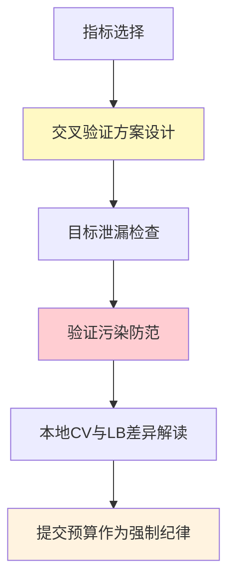
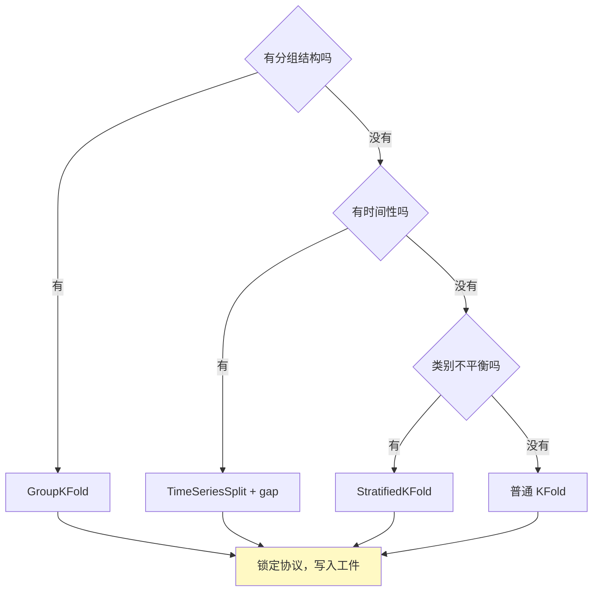

# 第20章 验证与评估：Vibe 时代更不可让渡的判断

> **本章目标**：把验证和评估这个贯穿全书的话题，集中起来系统性地讲一遍。验证污染、目标泄漏、指标选择、本地 CV 与 LB 差异、提交预算作为强制纪律——这些都不是"技术细节"，而是 Vibe 时代人必须守住的判断纪律。

---

## 开篇：验证，是 Agent 时代最后的防线

我们写了 19 章，反复出现一个词：**验证**。它不是某一章的附录，而是 VibeKaggle 的灵魂。

为什么？因为 Agent 能做的事越来越多（写代码、跑实验、管工件、甚至生成监督信号），但**"这个验证方案对不对""这个分数可不可信"**，Agent 判断不了。这不是因为模型不够强，而是因为验证涉及**目标本身**——你究竟要衡量什么，这个问题没有标准答案，只能人来定。

打个比方。验证就像考试。Agent 是那种能一分钟做完一套卷子的学生，速度快得吓人。但**"这次考试该考什么""及格线划在哪""判卷时该不该给步骤分"**，这些不是学生能定的，是出题人和判卷人定的。你要是把出题权也交给学生，他当然会出一套自己最拿手的题——分数会很好看，但那分数一文不值。

再换个更扎心的比方：**偷看答案**。Agent 跑得快，如果没人管，它会用各种办法"提前看到答案"——用未来信息做特征、用全量数据做标准化、拿公开榜当验证集反复刷。它偷看的时候不会告诉你，它只会给你一个虚高的分数。而验证，就是那扇你亲手锁上的门。

所以这一章的核心主张只有一句：**Agent 可以替你跑实验，但不能替你决定"到底该衡量什么"。**

这一章把验证和评估的核心问题集中在一起，系统性地讲一遍。



---

## 20.1 指标选择的不可委托性

RMSE/MAE/RMSPE、AUC/LogLoss 的选择是人的判断，不是 Agent 的搜索空间。

很多人觉得"选个指标很简单"，但选错指标，整个方向都会错。这就好比**还没开始跑，先把判卷标准定反了**——你越努力，错得越远。

比如：

- 客户流失预测用 **RMSE**（回归指标）而不是 AUC（分类指标），模型会去拟合 0/1 的平均值，而不会去区分谁更可能流失；
- 极不平衡数据用 **Accuracy**（准确率），预测全是负类也能拿 99% 准确率，完全没意义；
- 回归任务里，有极端异常值时用 RMSE 会被异常值主导，这时用 MAE 可能更稳。

指标选择决定了"优化什么"，优化错了，后面所有努力都白费。**Agent 不能自己选指标**，因为它不知道你的业务目标是什么。

举个真实会发生的对话。你问模型：

> **提示词**：我做一个"客户是否会流失"的比赛，数据正类占 22.5%。我该用 AUC 还是 Accuracy？请分析，不要直接改我的代码。

模型会这样答：

> **AI 输出**
>
> （思考过程）用户问指标选择。22.5% 正类属于轻度不平衡，
> Accuracy 会被多数类主导（全预测"不流失"也有 77.5%）。
> 但也要看业务目标：如果业务关心"抓到流失客户"，
> 还要考虑精确率/召回率的权衡。我要给出判断依据，
> 而不是替用户拍板。
>
> 两个指标的差异：
>
> 1. Accuracy（准确率）
>    全预测"不流失"就能拿 77.5%，看起来不低，
>    但这个模型一个流失客户都没抓到，业务上毫无价值。
>    → 不平衡数据下不建议单用。
>
> 2. AUC
>    衡量"排序能力"：随机抽一个流失、一个不流失，
>    模型把流失排在前面的概率。不受类别比例影响。
>    → 比赛用 AUC 是合理的。
>
> 但有个前提要确认：你的业务目标是"排序"（比如给客户
> 发挽留短信，优先发流失概率高的）还是"分类"（比如
> 自动触发某个动作，需要明确阈值）？
>   - 若偏排序 → AUC
>   - 若需要阈值决策 → AUC 选模型 + 单独调阈值（用 OOF）
>
> 另外提醒：如果比赛官方指定了指标，必须用官方的，
> 上面只是"假如你可以选"的分析。

最后那句"如果比赛官方指定了指标，必须用官方的"很关键——**它没有忘记"指标由人/官方定"这条底线**，只是在假设你可以选的前提下做分析。

顺带说个真实例子，帮你理解"指标"这件事在真实比赛里长什么样。第 19 章那场 Make Data Count，官方用的不是简单的准确率，而是 **F1 分数**，而且据一些复盘文章说，是"宏平均 F1"——也就是先分别算每一类的 F1，再取平均，不看类别样本多少。这个选择直接改变了策略：模型不能把"次要引用"这类稀有类别当空气，因为每一类在最终分数里权重是一样的。**指标一换，最优策略就跟着换。** 这就是为什么它不能委托。

```python
# src/utils/metric_check.py
"""
指标选型辅助：根据任务类型给出推荐指标，人最终拍板。

注意这个函数只做"提示"，不做"决定"。
它故意不返回"推荐用哪个"，只返回候选清单，
就是怕有人把这里当成自动决策器。
"""
TASK_METRICS = {
    "binary": ["auc", "logloss", "accuracy", "f1"],
    "multiclass": ["macro_auc", "accuracy", "macro_f1"],
    "regression": ["rmse", "mae", "r2", "mape"],
    "ranking": ["ndcg", "map", "mrr"],
}


def suggest_metrics(task_type):
    """打印候选指标。选哪个，你自己定。"""
    print(f"{task_type} 任务推荐指标：{TASK_METRICS.get(task_type, [])}")
    print("⚠️ 指标选择由人拍板，Agent 不得自行更换")


def check_metric_matches_metric(metric, is_business_ranking_task):
    """
    一个简单的自检：指标和业务目标是否对齐。

    比如业务要"排序"，却选了 MAE，这里就会给出警告。
    """
    if is_business_ranking_task and metric in ("mae", "rmse", "r2"):
        print(f"⚠️ 业务偏排序，但指标是 {metric}，可能不对齐")
    return True


if __name__ == "__main__":
    suggest_metrics("binary")
```

---

## 20.2 交叉验证方案的设计：Agent 执行，人设计并审核

折数、分层、分组、时间切分的方案由人设计；Agent 执行并产出工件，人检查工件中的验证折索引。

这和第 2 章的 `cv_protocol.yaml` 是一脉相承的。这里再强调一次：**交叉验证方案不是 Agent 可以"尝试多种后选最好"的搜索空间**。一旦选了，就锁死。

为什么这么死板？因为**交叉验证的分数，是你后面所有决策的"尺子"**。你要是今天用 5 折、明天用 10 折、后天换个随机种子，每把尺子刻度都不一样，量出来的东西没法比。你以为自己在进步，其实只是在换尺子。

人设计时要回答三个问题：

1. 样本之间有没有分组结构（同一客户的多条记录、同一个病人的多张片子）？有 → GroupKFold；
2. 有没有时间性？有 → TimeSeriesSplit；
3. 类别不平衡吗？有 → StratifiedKFold。

只有回答完这三个问题，才给 Agent 执行。

这三个问题不是随便编的，每一个背后都有真实的翻车案例。社区里流传最广的一个例子是"渔船比赛"：训练数据里的照片都是在几条特定的船上拍的，如果你随机切分，同一个船的照片会同时出现在训练集和验证集，模型学到的不是"识别鱼"，而是"识别这是哪条船"——它背下了船号，而不是学会了看鱼。正确做法是按船分组切分。这个坑有个专门的名字，叫"巫毒机器学习"（voodoo machine learning），意思是你的验证分数看起来神了，其实是假的。

还有一个特别容易被忽略的细节：**验证集不要设早停（early stopping）**。原因很朴素——真实测试集不会给你"早停"的机会，你线上跑的时候没有第二个验证集来告诉你什么时候停。如果你在验证集上早停，分数会虚高，因为你相当于偷看了验证集的答案来决定"练到什么时候收手"。



最后那个节点是重点：**不管走哪条路，终点都是"锁定"**。不是"先跑起来再说"，而是"定好、写下来、不再改"。

---

## 20.3 验证污染：Agent 时代最隐蔽的过拟合

当 Agent 被允许尝试多种 CV 方案并选最好的那个，验证本身就成了被优化的对象。人必须**固定验证协议**。

这话听着抽象，其实特别简单：**你本来是想用尺子量东西，结果你为了量出好看的数字，偷偷把尺子掰弯了。** 更糟的是，掰弯的尺子量什么都好看，你根本不知道自己在骗自己。

这已经在前面多章讲过，这里做一次总结：

| 污染形式 | 表现 | 对策 |
|----------|------|------|
| 换 CV 折数/种类刷分 | 不同实验用不同折，分数不可比 | 折索引哈希校验 |
| 预处理跨折拟合 | 标准化/目标编码用全量数据 | 只在训练折 fit |
| 时间泄漏 | 随机 KFold 切时序数据 | TimeSeriesSplit + gap |

验证污染最危险的地方是：它让你看到一个"虚高的分数"，然后你基于这个分数做决策，全都错了。

这里补一个真实机制，帮你理解"为什么公榜会骗人"。大多数比赛会把测试集切成两半：一部分用来算比赛期间你能看到的公开榜（Public LB），另一部分留到比赛结束才用来算最终名次（Private LB）。常见比例是 30% 对 70%。也就是说，**你整场比赛盯着看的那个数字，和最后决定名次的那个数字，从来就不是同一个数。**

社区里把"公榜涨、私榜崩"这个现象叫 **shake-up（大洗牌）**。它的成因不神秘：公开榜样本少，你反复调参，本质上是在那 30% 的小样本上做过拟合。分数涨了，涨的是"对这 30% 的拟合程度"，不是泛化能力。

这类现象还有个更正式的名字：**自适应过拟合（adaptive overfitting）**——指你反复根据公开榜的反馈调整方案，最后方案完美适配了公开榜，却对真实泛化毫无帮助。它的可怕之处在于**过程上看不出任何异常**：你的 CV 曲线漂亮，排行榜曲线更漂亮，只有等到私榜揭晓那一刻，一切才显出原形。而到了那时，已经没有提交机会了。

那怎么判断一次上涨是好是坏？有个很朴素的判断标准：**看它能不能被解释、能不能被本地验证复现。** 如果本地 CV 没动，只有公榜在涨，那大概率是噪声。

再给个更具体的排查顺序。假设你本地五折平均 0.86，提交后公榜只有 0.79，别急着怀疑模型，按这个顺序查：

1. **先查提交文件**：行数对不对、ID 有没有对齐、输出的是概率还是标签、列名跟样例一致吗；
2. **再查预处理**：训练阶段的编码映射、缺失值填充、标准化参数，有没有原样用到测试数据；
3. **然后对比训练集和测试集的特征分布**：有没有时间断层、群体差异；
4. **最后才轮到怀疑模型本身**。

社区的经验是，多数"线上掉分"发生在前两步，根本轮不到模型层。反过来，如果本地 0.79、线上 0.86，也别高兴——这说明你的验证在系统性低估，一样不可信。

---

## 20.4 目标泄漏检查清单（升级版）

目标泄漏（target leakage）是指训练数据里偷偷包含了"答案"相关的信息。Agent 时代新增两条检查：

```python
# src/utils/leakage_checklist.py
"""
目标泄漏检查清单：每次实验前过一遍。

这份清单故意写得很"死"，就是让人一条条对着勾，
而不是凭感觉说"应该没泄漏吧"。
"""
LEAKAGE_CHECKLIST = [
    "特征是否包含未来信息（时序数据）？",
    "目标编码是否只用训练折计算？",
    "预处理（标准化/填充）是否只在训练折上 fit？",
    "Agent 生成的特征是否无意中包含未来信息？",
    "工件的验证折索引是否符合时间/分组约束？",
    "是否有 ID 列或行号直接进了模型？",
]


def print_checklist():
    """逐条打印，方便贴在工位上当贴纸用。"""
    print("目标泄漏检查清单：")
    for i, item in enumerate(LEAKAGE_CHECKLIST, 1):
        print(f"  [{i}] {item}")


if __name__ == "__main__":
    print_checklist()
```

**新增的两条（第 4、5 条）**：

- Agent 生成的特征是否无意中包含未来信息？（Agent 可能为了涨分偷偷加时间特征）
- 工件的验证折索引是否符合时间/分组约束？（哈希校验）

除了这两条，社区里还总结了几类"最隐蔽"的泄漏，我们一条条用大白话说清：

1. **在切折之前就做预处理**。比如你在分成训练/验证之前，先对全量数据跑了一遍 `StandardScaler`。问题在哪？验证集的均值和标准差，已经"流"进了你的训练计算里。正确做法是：所有 scaler、imputer、encoder，都只在训练折里 fit，或者干脆塞进 sklearn 的 Pipeline 里，让它自动只在训练折上拟合。
2. **全局目标编码**。高基数类别特征（比如邮编、用户 ID）做目标编码时，如果你用全量数据算均值，答案就"渗"进特征里了。正确做法是折内目标编码（OOF target encoding），保证每一行的目标值不参与自己那行的特征计算。
3. **忽略分组结构**。同一个实体（病人、门店、账号）的多条记录，被随机切到了训练集和验证集两边。模型背下了这个实体的特征，而不是学会泛化。测试集要预测新实体的话，必须用 GroupKFold。
4. **在 train + test 合并后做聚合**。比如把训练和测试拼起来一起 `groupby(...).mean()`。测试集的分布会反过来改变训练样本的特征分布。正确做法是只用训练数据算统计量，再映射到测试集。
5. **在切分之前做特征选择**。你觉得"先扔掉不相关的特征"很无害，但你一旦用全量数据对着目标算 ANOVA、互信息，验证信号就已经污染了你的特征空间。特征选择必须在 CV 循环里面做。
6. **过早做重采样**。SMOTE 这类过采样，如果在切分之前对全量数据做，合成样本会用到最终落在验证集里的行。重采样必须只在训练折内部做。

看到这儿你可能有点慌：这么多坑，怎么记得住？其实记住一个原则就够了——**任何"看过验证集"的操作，都是泄漏。** 预处理、编码、特征选择、重采样，全都得在训练折里闭门造车，造完了再拿去用。

---

## 20.5 本地 CV 与 LB 差异在 Agent 高频提交下的解读

提交预算本身就是一种强制纪律：有限的提交次数迫使 Agent 不能在 LB 上做穷举搜索。

如果没有提交预算限制，Agent 可能一天提交 100 次，把 Public LB 当成验证集来过拟合。有了预算限制（比如每天 3 次），它就被迫"只在值得的时候提交"，这倒逼回到"本地 CV 为主、LB 为辅"的纪律。

这句话值得再嚼一遍。**提交次数不是限制，是保护。** 它像赌场里的"止损线"——不是不让你玩，是防止你玩到失控。

那本地 CV 和公榜对不上，到底该怎么办？社区里有一套很实用的判断，核心是先分清"是哪种对不上"：

- **本地和公榜长期同涨同跌**：恭喜，你的验证体系可信，放心用本地 CV 调参；
- **本地稳定，但系统性地比公榜高或低**：这是个信号，说明你的验证和官方的测试方式之间有系统性差异，但模型还能继续改，只是提升不会等比例传导到榜上；
- **本地和公榜完全不相关**：这是红灯。立刻停下来查，别继续调参了。

第三种情况怎么查？最常用的工具叫**对抗验证（adversarial validation）**。做法特别简单：把训练数据和测试数据混在一起，扔掉原来的标签，造一个新标签"这条是测试集吗"，然后训一个分类器去区分它们，看 ROC-AUC。

- AUC 在 0.5 附近：训练集和测试集分不开，说明它们来自同一个分布，你的本地 CV 是可信的；
- AUC 明显偏高（社区里常拿 0.6 当警戒线）：说明两边分布不一样，你的本地分数不能直接外推到测试集。

对抗验证能告诉你"分布不一样"，但它有个边界：**它没法告诉你公榜和私榜之间怎么切分**。而公榜/私榜的分布差异，恰恰是大洗牌最常见的根源。这个边界很重要，别指望一个工具解决所有问题。

再讲两个真实案例，帮你把"该信谁"这件事看得更立体：

- 有一场比赛，某位选手靠"探测公开榜"的方法，在公开榜上冲到了第一，结果私榜掉到了第 87 位。这就是典型的"把公榜当验证集"的下场；
- 也有反过来的例子。有一年一场睡眠状态检测的比赛，整体数据量比较大，公榜分布莫名发生了偏移，最后私榜证明"信本地 CV"才是对的；而另一场 MCTS 变体的比赛，测试集分布跟训练集压根不同，反而是公榜更能反映私榜结果。

所以"trust CV"这句话不是教条，它有个前提：**测试集和训练集同分布**。一旦不同分布，你得先判断"是特征分布不同"还是"标签分布不同"——特征不同还能靠对抗验证筛特征，标签不同就基本没辙了，只能反过来多信公榜一点。

这也是为什么社区里的老手会反复说：**不要迷信任何单一信号，先看分布。**

我们还可以让模型帮我们把这个"对不上"的情形诊断一遍。注意看它是怎么把"排查顺序"和"不下结论"分开的：

> **提示词**：我的五折 CV 是 0.862，公榜只有 0.79，差距稳定存在。帮我列一个排查顺序，按"最可能→最不可能"排。不要下结论说问题在哪，也不要改代码。

模型这样答：

> **AI 输出**
>
> （思考过程）用户要排序，不要结论。这种"稳定差距"最常见的原因
> 是提交文件或预处理，而不是模型。我按"代价从低到高"给顺序，
> 并明确说这是通用经验，不是针对他的数据的诊断。
>
> 【排查顺序（从最可能到最不可能）】
>   1. 提交文件本身：行数、ID 对齐、列名、输出的是概率还是标签
>   2. 预处理一致性：训练时的编码映射/填充/标准化有没有原样用到测试
>   3. 训练与测试的分布差异：时间断层、群体差异（可跑对抗验证）
>   4. 验证方案本身：折数、分层、分组是否符合测试集生成方式
>   5. 模型与超参：最后才怀疑这里
>
> 【为什么这么排】
>   前两步是"低级错误"，改起来几分钟，命中率高；
>   第 5 步代价最大，而且即使换了模型，前四步的问题还在。
>
> 【我不能替你下的结论】
>   到底是哪种，需要你把上面每一步的实际数值贴出来。
>   我只能给顺序，不能给答案。
>
> 要不要我先给你写一个"提交文件自检"的小脚本？

注意它最后一句："我只能给顺序，不能给答案。" 这就是我们要的那种边界感。

最后说最终提交怎么选。社区里通行的做法是：**选两个提交，一个本地 CV 最好的，一个公榜最好的。** 两者指向一致，说明你的验证体系可信；两者不一致，至少你两种假设各押了一边，不至于满盘皆输。这和第 20.1 节那个"指标由人定"是同一种思路——**在不确定的时候，别把鸡蛋放一个篮子里，也别假装自己不不确定。**

回顾第 1.6 节的对照表，这里不再赘述。核心原则：**本地 CV 是主裁判，Public LB 是参考。**

---

## 20.6 小结

这一章把验证和评估系统化了：

- **指标选择**：人定，不可委托；
- **交叉验证方案**：人设计，Agent 执行，锁死协议；
- **验证污染**：折索引哈希防篡改，固定验证协议；
- **目标泄漏**：升级版清单，新增 Agent 特征与折索引检查；
- **CV 与 LB 差异**：本地 CV 主裁判，LB 参考；
- **提交预算**：强制纪律，防 LB 过拟合。

Vibe 时代，验证不是"技术细节"，而是**人不可让渡的判断**。Agent 可以替你跑实验，但不能替你决定"到底该衡量什么"。

说得再重一点：一个团队里，模型可以换、代码可以重写、算力可以加，唯独**验证的尺子不能换**。尺子一换，之前所有的经验都作废，你还以为自己站在原来的位置上。

> **下一章预告**：第 21 章调优与集成：Agent 搜索，人选择。超参搜索交给 Agent，但集成子集的确认由人拍板。