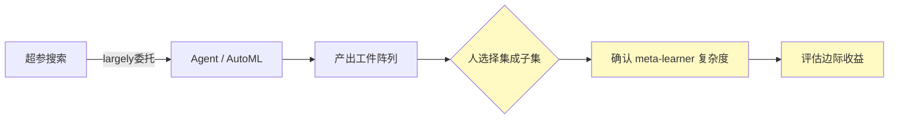

# 第21章 调优与集成：Agent 搜索，人选择

> **本章目标**：把"调参"和"集成"这两件最容易被自动化的事，讲清楚人机分工。超参搜索可以 largely 交给 Agent/AutoML，但**集成子集的选择、meta-learner 的复杂度、收益的边际递减**，这些判断必须人来下。

---

## 开篇：调参是体力活，选择是脑力活

调参和集成，是 Kaggle 里最容易被"自动化焦虑"笼罩的两件事。很多人担心：AutoML 这么强，调参还要人干嘛？集成这么复杂，Agent 一键搞定，还要人干嘛？

答案是：**调参是体力活，可以交给 Agent；选择是脑力活，必须人来做。**

这个区别，有点像逛超市。Agent 是那个推购物车跑得飞快的人，你给它一张清单，它十分钟能把整个超市跑三遍，把所有候选商品都扔进车里。但**"这 50 样里哪 5 样凑一桌菜"**，它不知道。它不知道你今晚有几个人吃饭、有没有人忌口、哪两样菜放一起会腻。这个"搭配"的判断，就是选择。

Agent 能帮你把 1000 组超参跑完，但它不知道"哪组参数背后的模型更值得进集成"。Agent 能帮你把 50 个模型加权平均，但它不知道"这 50 个里哪 5 个是真正互补的"。这些"选择"，依赖你对 OOF 质量、多样性、复杂度的判断。

先把 OOF 这个词说清楚，后面要用很多次：**OOF（折外预测，out-of-fold，说白了就是"每个样本的预测值，都来自没见过它的那次训练"）**。你可以把它理解成"每个样本的 honest 成绩单"——没有用真题练过，考出来的分才作数。



看这张图，前两步是灰色的流水线，后三步是黄色的判断题。**灰色部分可以外包，黄色部分不能。**

---

## 21.1 超参数搜索 largely 委托给 Agent/AutoML

人设定搜索空间和计算预算；Agent 执行并产出工件。

超参搜索是最适合委托的活：目标明确（CV 分数）、可枚举（参数网格）、可并行（多组同时跑）。人只需要定两件事：

- **搜索空间**：哪些参数、什么范围（比如 `learning_rate ∈ [0.01, 0.1]`）；
- **计算预算**：最多跑多少组、每组多久。

剩下的交给 Agent。它跑完 1000 组，产出 1000 个工件，按 CV 排序给你看。

这里有个很现实的问题：为什么"跑得多"这件事非得交给 Agent？因为**它是纯粹的重复劳动，且评价标准单一**。一组参数好不好，就看 CV 分数，没有第二种解释。这种"目标唯一、可并行、错了能重来"的活，正是自动化的甜区。

但也别把它想得太神。真实比赛里，冠军 solutions 的差距往往不在"搜了多少组"，而在"搜之前有没有把数据搞清楚"。社区里一位高手分享过一条经验：他先老老实实做数据探索、搭好本地验证、跑通基线，然后才谈调参；顺序反了，就是在沙子上盖楼。

```python
# src/tuning/search_space.py
"""
超参搜索空间定义：人定，Agent 执行。

这个文件刻意写得很"死"：只有空间，没有"选哪个"的逻辑。
选参数是 Agent 的事，选模型是人事，两者不要混在一个文件里。
"""
SEARCH_SPACE = {
    "lgbm": {
        "learning_rate": [0.01, 0.05, 0.1],
        "num_leaves": [31, 63, 127],
        "min_child_samples": [20, 50],
    },
    "xgb": {
        "max_depth": [4, 6, 8],
        "eta": [0.01, 0.05, 0.1],
        "subsample": [0.8, 1.0],
    },
}


def estimate_trials(space):
    """
    估算总试验数，人据此定预算。

    为什么要先算这个？因为 3 组 × 3 组 × 2 组 = 18 组看起来不多，
    但你要是同时搜 lgbm 和 xgb，再乘上 5 折，就是 180 次训练。
    先算清楚，再决定"这个预算我烧不烧得起"。
    """
    n = 1
    for v in space.values():
        n *= len(v)  # 笛卡尔积：每个维度的取值数相乘
    return n


def flatten_space(space):
    """
    把嵌套字典摊平成 Agent 能直接消费的列表。

    每项是 (模型名, {参数名: 值})，Agent 拿着这个列表去跑就行。
    """
    tasks = []
    for model_name, params in space.items():
        keys = list(params.keys())
        # 用 itertools.product 生成所有组合，避免手写多层循环
        import itertools
        for combo in itertools.product(*(params[k] for k in keys)):
            tasks.append((model_name, dict(zip(keys, combo))))
    return tasks
```

---

## 21.2 集成的"选择"不是搜索问题

哪些模型进入集成、用什么 meta-learner、权重是否稳定，需要人查看 OOF 工件的质量和相关性结构。NVIDIA 的冠军方案从 850 个模型中选出 150 个做四级 stacking，**选择过程**包含人对 OOF 质量和多样性的判断。

先解释两个词。**Stacking（堆叠）** 是说：第一层训一堆模型，把它们的预测当成新特征，再训一个"元模型"来学怎么组合。**Meta-learner（元学习器）** 就是那个负责组合的模型。

为什么集成选择不能纯自动化？因为"互补性"是个**语义判断**，不是数值优化能完全覆盖的。两个模型 CV 差不多、相关性也不高，但一个是树模型、一个是神经网络——它们大概率互补；两个都是 XGBoost 不同超参，相关性可能 0.99，堆一起没用。这种"家族层面的判断"，Agent 做不了。

说个更扎心的真实观察。有人复盘自己在一个比赛里的 12 次失败实验，发现：**几棵树模型（HGB/LGBM/XGBoost/CatBoost）互相之间几乎完全一致**，stacking 一个逻辑回归元学习器反而掉分；他特意加了一个"决策边界根本不同"的线性模型求多样性，结果**权重搜索直接给它选了 0 权重**——不是差一点，是优化器主动把多样性拒了。

这个例子特别值得记住。它说明两件事：第一，**多样性不是"加了就一定赚"**；第二，**当同质模型多到一定程度，它们的"一致"本身就是一种噪声**，你以为你在投票，其实你在复读。

```python
# src/ensembles/diversity_check.py
"""
多样性检查：相关性矩阵 + 家族标签。
人看这个表决定谁进集成。

注意：这个函数只"报数"，不"选人"。
它输出一张表，选谁进集成是人看着表拍的板。
"""
import numpy as np
import pandas as pd


def diversity_report(oofs, family_map, corr_threshold=0.98):
    """
    oofs: {模型名: OOF数组}
    family_map: {模型名: 家族标签，如 'gbm'/'nn'/'linear'}
    corr_threshold: 相关系数超过这个值，就认为"高度冗余"

    返回相关性矩阵 + 家族分布，供人判断。
    """
    names = list(oofs)
    # 把每列拼成一个矩阵：行是样本，列是模型
    M = np.column_stack([oofs[n] for n in names])
    # rowvar=False 表示"每一列是一个变量"，这是 np.corrcoef 的默认坑点
    corr = pd.DataFrame(np.corrcoef(M, rowvar=False), index=names, columns=names)

    fams = pd.Series(family_map)
    print("家族分布：", fams.value_counts().to_dict())
    print(f"高相关对（>{corr_threshold}）：")
    for i in range(len(names)):
        for j in range(i + 1, len(names)):
            if corr.iloc[i, j] > corr_threshold:
                print(f"  {names[i]} ~ {names[j]}: {corr.iloc[i, j]:.3f}")
    return corr


def family_coverage(corr, family_map, selected):
    """
    检查你选中的子集，家族覆盖够不够。

    一个常见的失败是：选中的 5 个模型全是 gbm 的不同超参，
    相关性 0.99，等于同一个模型投了五票。
    """
    fams = [family_map[n] for n in selected]
    uniq = sorted(set(fams))
    print(f"选中 {len(selected)} 个模型，覆盖 {len(uniq)} 个家族：{uniq}")
    if len(uniq) == 1:
        print("⚠️ 只有一个家族，多样性可能不足")
    return uniq
```

---

## 21.3 AutoGluon 的多层 stacking vs 人工定制的 stacking

AutoGluon 的 stacking 是自动化的强基线；人工 stack 的价值在于引入 AutoGluon 之外的模型家族。

AutoGluon 内部已经做了多层 stacking，但只在它自己的模型家族里。人工 stack 的价值是"引入外援"——TabPFN、神经网络、XGBoost，增加多样性。这就像 AutoGluon 给你炒了一桌川菜，你人工 stack 是加一道粤菜——口味越杂，覆盖越广。

不过"加外援"这件事，也别加得太随意。真实比赛里有反例：有人为了多样性硬塞线性模型，结果权重被优化器按到 0。所以"外援"要加，但加之前得先看它在 OOF 上到底有没有带来新信息。

顺便说个真实的三层结构，帮你有个具体印象。2025 年 4 月 Kaggle 的 Playground 比赛（预测播客收听时长），冠军 Chris Deotte 的做法是：从 500 个实验里挑出 75 个 Level 1 模型，用 GPU 加速的 cuML 训练，Level 2 用它们的 OOF 预测当特征，Level 3 再平均，最终本地 CV RMSE 11.54、私榜 11.44，拿了第一。季军那边是另一种风格：10 个 LGBM + 5 个 XGB + 4 个 CatBoost + 2 个随机森林 + 1 个 ExtraTrees + 4 个 HistGradientBoosting，用 Nelder-Mead 或爬山法做加权平均，最后一版把 stacking（80%）和爬山（20%）再混一次，凑成三层。

这两个例子放在一起看特别有意思：**一个靠"多而杂"，一个靠"分层混"**，但共同点都是——先有大量候选，再有人做取舍。

---

## 21.4 Agent 驱动的集成实验管理

工件规范让 Agent 可以自动做 hill climbing 的候选生成；人审核最终集成的 CV 稳定性和复杂度代价。

Agent 可以快速生成"候选集成方案"（比如 100 种不同的子集组合），但人要从里面挑出"CV 稳定 + 复杂度可接受"的那个。判断标准：

- bootstrap 下 CV 稳定吗？
- 子集里有没有冗余（相关性 > 0.98）？
- 复杂度增加是否带来成比例收益？

这里补一个很实用的真实经验。有人在比赛里先用爬山法（hill climbing）做集成器，发现一个怪现象：**加模型经常反而让 CV 变差**。换遗传算法，前 20 个模型还行，超过 20 个又出现同样的问题。最后他换成了 Ridge 回归当集成器——60 个 OOF 一分钟跑完，而且加模型几乎总能涨一点。

这个案例说明：**"用什么当集成器"本身就是一个需要人判断的选择**，而且没有标准答案。爬山法、遗传算法、Ridge、NNLS，各有各的脾气。

说到 NNLS（非负最小二乘），这里值得多说两句，因为它很符合"人做选择"的口味。NNLS 在拟合权重时**强制所有权重非负**，它的一个天然好处是"稀疏性"——不需要的模型，权重直接给 0。这就等于**自动帮你做了子集选择**：一个模型权重是 0，说明它没带来新信息；一个模型权重特别大（比如 0.7），说明集成基本靠它撑着。

还有一个很实用的诊断，叫**权重稳定性**：轮流去掉一折，重新估一遍 NNLS 权重，看每个模型的权重均值和标准差。标准差小，说明这个模型的贡献是"稳定的被需要"，不是碰巧。

```python
# src/ensembles/nnls_weights.py
"""
用 NNLS（非负最小二乘）拟合集成权重。

为什么用 NNLS 而不是普通线性回归？
  1. 权重非负：不会出现"两个模型互相抵消"的怪事；
  2. 稀疏：没用的模型权重自动变 0，等于顺手做了子集选择；
  3. 权重像"贡献占比"，好解释。
"""
import numpy as np


def fit_nnls_weights(oof_matrix, y_true):
    """
    oof_matrix: 形状 (n_samples, n_models)，每列是一个模型的 OOF 预测
    y_true: 真实标签，形状 (n_samples,)

    返回每个模型的权重（和为 1）。
    """
    # 加一个"全 1 列"当偏置项，等价于允许整体缩放
    A = np.column_stack([oof_matrix, np.ones(len(y_true))])
    # 用 scipy 的 nnls 求解；这里做个懒加载，避免没装 scipy 时整个文件报错
    from scipy.optimize import nnls
    weights, _ = nnls(A, y_true)

    # 归一化，让权重加起来等于 1，方便解释成"占比"
    total = weights.sum()
    if total > 0:
        weights = weights / total
    return weights[:-1]  # 去掉最后那个偏置项


def weight_stability(oof_matrix, y_true, fold_id, n_folds=5):
    """
    权重稳定性诊断：轮流留出一折，重新估权重，看波动。

    标准差小 → 这个模型的贡献稳定；
    标准差大 → 它的权重是"碰巧"来的，别太当真。
    """
    import pandas as pd
    rows = []
    for f in range(n_folds):
        mask = fold_id != f  # 只在不包含第 f 折的样本上估权重
        w = fit_nnls_weights(oof_matrix[mask], y_true[mask])
        rows.append(w)
    df = pd.DataFrame(rows)
    summary = pd.DataFrame({
        "mean": df.mean(),
        "std": df.std(),
    })
    print(summary)
    return summary
```

---

## 21.5 集成收益的边际递减与过拟合风险


集成不是越多越好。从 1 个到 3 个，收益明显；从 10 个到 50 个，收益递减，过拟合风险上升。**人判断"够了"的能力，比"堆更多"的能力更值钱。**

为什么"堆更多"会上瘾？因为**每一次加模型，你都能在本地看到一个"涨了一点点"的数字**。0.0003 也是涨。但问题是，本地那点涨幅，很可能只是对验证折的噪声 المزيد拟合。你加的不是信息，是噪声。

社区里有个很实在的经验值：stacking 在表格任务上通常能带来 1% 到 5% 的 RMSE 下降，这已经算不错了。你要是发现自己在为 0.1% 反复折腾，还越折腾越不稳定，那基本可以判断：**到头了，该收了。**

还有一个更隐蔽的风险：**过早 stacking**。社区里有人把这条列为"最贵的错误"——团队还没把单个模型调好、数据质量还没修，就急吼吼搭一个复杂的多层堆叠，然后为了 0.2% 的榜单收益熬夜，却对"换个特征能涨 5%"视而不见。**Stacking 是最后几个百分点的事，不是第一步的事。**

判断"够了没有"，人可以用三个问题自检：

1. 新加的模型，在**大多数折**上都稳定涨分吗？还是只靠某一折特别强撑着？
2. 它和已有模型的相关性，是不是低于 0.98？高于的话，等于没加。
3. 复杂度翻倍，收益是不是也翻倍？如果不是，那这笔账不划算。

---

## 21.6 小结

- 超参搜索 largely 委托 Agent/AutoML，人定搜索空间和预算；
- 集成子集的选择是语义判断，不是数值优化；
- AutoGluon stacking 是强基线，人工 stack 引入外援；
- Agent 生成候选，人审核稳定性与复杂度；
- 集成收益边际递减，人判断"够了"。

最后，我们把这一章的核心分工，放进一段真实对话里感受一下。你让 Agent 跑完超参搜索，它给你一份报告：

```
请在固定 CV 下跑完 configs 里的 12 组 LightGBM 参数，
按 CV 降序列出，并标出 OOF 相关性矩阵里高度相关的组。
不要自动挑"最好的"去做集成，我要自己看。
```

模型会这样汇报：

```
> （思考过程）用户明确要"列出来但不要替我选"。我按 CV 降序
> 排，标注相关性高的组（同族超参变体），并给出我的观察，
> 但强调"选哪几个进集成由你定"。

【12 组结果（CV 降序，AUC）】
  v003  0.8712  ← num_leaves=63,  lr=0.05
  v007  0.8709  ← num_leaves=63,  lr=0.03
  v001  0.8705  ← num_leaves=31,  lr=0.05
  v010  0.8698  ← num_leaves=127, lr=0.05
  ...
【高相关组（>0.98，属于同族变体）】
  v003 ~ v007 : 0.993   （只差学习率）
  v001 ~ v005 : 0.987
  v010 ~ v011 : 0.991

【我的观察】
  前 4 名里有 3 个属于"num_leaves=63"这一族，
  它们相关性极高，一起进集成意义不大（等于同一个模型投三票）。
  如果你要多样性，建议从 v003（63/0.05）、v001（31/0.05）、
  v010（127/0.05）里各留一个——它们叶子数不同，偏差结构不同。
  但这是我的建议，最终留哪些请你确认。

没有生成任何集成工件，等你决定。
```

它把"哪些是冗余的""为什么冗余""建议怎么留"都说清楚了，但**最后一句明确"没有生成任何集成工件"**。这就是第 2 章那份 `agent_policy.yaml` 在真实对话里的体现。

一句话：**Agent 帮你"搜"，人帮你"选"。** 搜索可以自动化，选择不能。

为什么"选"比"搜"难？因为搜有标准答案（CV 分数），选没有。选的时候你要同时权衡四样东西：精度、多样性、复杂度、稳定性。这四样东西还会互相打架——更复杂的模型可能更准，但更不稳；更多样的模型可能更稳，但更难维护。**Agent 擅长在单一维度上走到极致，人擅长在多个维度之间做取舍。** 这就是分工的底层原因。

> **下一章预告**：第 22 章 VibeKaggle 的策略与心态。选比赛、提交预算、团队协作、从"我会做 Kaggle"到"我会指挥系统做 Kaggle"。