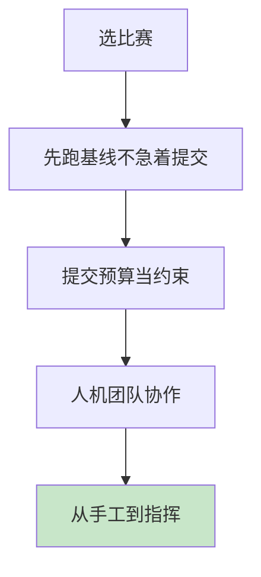
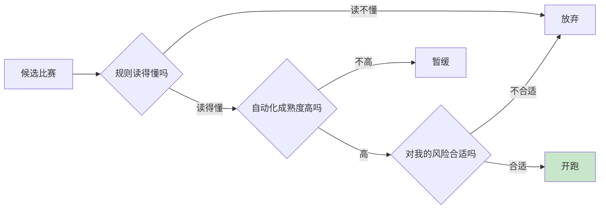
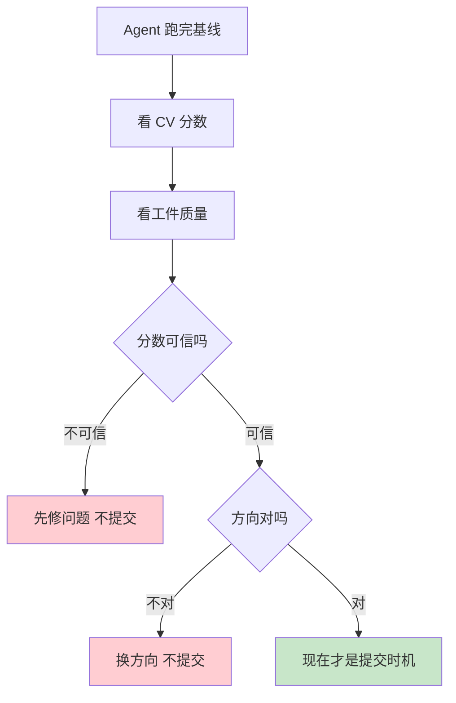

# 第22章 VibeKaggle 的策略与心态

> **本章目标**：前面二十一章都是“术”，这一章讲“道”。选了比赛、跑了基线、调了模型、做了集成，但真正决定你能走多远的，是策略和心态：怎么选比赛、怎么管提交预算、怎么和 Agent 队友协作、怎么从“我会做 Kaggle”变成“我会指挥系统做 Kaggle”。

---

## 开篇：技术之外，还有一层“决策”

你有没有见过这种人：代码写得贼溜，模型调得贼精，但每次比赛都卡在中游，上不去。

为什么？不是技术问题，是**策略问题**。他可能：

- 选了一场比赛，做到一半发现数据有坑、时间不够；
- 提交额度用得太随意，关键时候没额度了；
- 一个人闷头干，不知道讨论区早有人分享了关键 insight；
- 沉迷优化，从没退一步想“我现在该往哪使劲”。

这四条，没有一条是“代码不会写”能解释的。它们更像是开车：油门踩得再狠，方向盘打错了，也只是更快地开到沟里去。

VibeKaggle 用 Agent 放大了你的“执行力”，但执行力再强，方向错了也是白跑。所以这一章讲的就是这些“方向性”的东西。

先别急着翻结论，我们从最上游的那一步开始：选比赛。



---

## 22.1 选择比赛的标准

前面第 1.2 节讲过怎么选入门比赛，这里补充一个 Agent 时代的新维度：**自动化工具在该模态上的成熟度。**

| 模态 | 自动化成熟度 | Agent 杠杆 | 适合谁 |
|------|-------------|-----------|--------|
| 表格 | 高（AutoGluon 能打） | 高 | 新手首选，Agent 帮最多 |
| 时序 | 中（AutoGluon-TS 可用） | 中 | 学时间纪律，Agent 有边界 |
| 图像 | 中（DINOv3 微调成熟） | 中 | 学数据清洗，人要盯 |
| 文本 | 高（LLM 原生） | 高 | 但要防 LLM 幻觉 |

这张表说白了就一句话：**Agent 在表格上最能帮你，所以新手从表格起步最划算。** 表格数据规规矩矩，一行一个样本，一列一个特征，AutoGluon 这类自动机器学习工具几乎可以一键给出一个能打的基线。你在这个模态上，能最快看到“人机协作”的甜头——你定方向，它跑苦力。等熟练了，再去挑战时序、图像、文本。

不过，光看“自动化成熟度”还不够。还有两个更“土”、但 Agent 完全帮不上忙的维度，得你自己拿主意。

**第一个是规则。** Kaggle 的比赛分很多类型：Featured（正式的商业或科研难题，奖金一般比较丰厚）、Playground（拿公开数据练手）、Getting Started（纯入门）、Research（偏学术）、Recruitment（奖品是面试机会）。类型不同，规则差别很大。尤其要注意一类叫 **code competition（代码竞赛）** 的比赛：你提交的不是一个预测文件，而是一个 notebook，它在 Kaggle 的服务器上离线跑，有严格的时间限制，而且**不能联网**。这意味着什么？意味着你没法在提交里调用外部的大模型 API——你所有的“智能”，都必须塞进 Kaggle 给你的那个计算盒子里。选比赛之前先把规则读一遍，能省掉后面一整个礼拜的白干。

**第二个是确定性，也就是“这场比赛到底靠实力还是靠运气”。** 有一位 Kaggle 全球排名第一的选手在赛后复盘里把赛题粗分成两类：确定性高的赛题，大家都知道公榜高分就约等于金牌，于是竞争特别激烈，经常能看到同一家公司的几名员工各自组队参赛，有人还是带着公司 KPI 来的；确定性低的赛题，竞争会弱一些，但因为不确定性大，你最终获奖的机会也不会特别大。

有意思的是，他接着说了一句更关键的话：**“确定性”这三个字，每个人定义都不一样，这中间就存在套利空间。** 比如一个擅长 CV 的选手，觉得 CV 比赛等于白送一枚金牌；可换成本书作者这种不擅长 CV 的人，参加 CV 比赛风险就很大。同一场比赛，对不同的人是不同的难度。所以选比赛的时候，真正该问的不是“这场比赛难不难”，而是“**这场比赛对我难不难**”。

那什么时候开始做功课呢？有经验的选手给的建议是：**赛前 48 小时**。在这两天里，把评估指标是什么、数据分布有什么特点、哪些地方可能藏着数据泄露、大致该用什么特征策略、哪个模型大概率是主力、提交策略怎么设计才能防住排名反弹（shake-up），先在脑子里搭出一张作战地图。他说，比赛还没正式开始，这些人已经赢了一半——这不是天赋，是方法论。

把上面这些揉在一起，选比赛其实是一个三道筛子的过程：



新手建议还是那句老话：**先从表格开始，Agent 的杠杆最高，你能最快看到“人机协作”的甜头。**

---

## 22.2 先让 Agent 跑自动基线，但不要在第一小时就提交

先看 CV 和工件质量，再决定是否消耗提交预算。

新手最容易犯的错：跑完第一个基线，激动地马上提交，看到一个不好不坏的分数，然后就不知道该干嘛了。正确姿势是：**先跑基线，看 CV，看工件，想清楚方向，再提交。**

而且，第一版基线往往有 bug（格式错、泄漏、预处理错），急着提交可能浪费额度在一个废品上。这就好比做菜先尝一口再端上桌——你总不想把一锅没熟的菜端给客人，然后看着人家皱着眉头咽下去吧。

但这里要补一句另一半的道理：**也别拖到最后一小时。**

有一位选手在 BirdCLEF+ 2025 这场比赛里拿了金牌，他复盘时专门讲了自己的一个遗憾：最后一天多次提交出错，其实只要有一次成功提交，他就能进前五甚至更好。他给自己的教训是：**最好在倒数第二天就把最终提交方案准备好，留出足够的容错空间。** 你看，第一天太急和最后一天太赶，是同一个毛病的两个极端——都是没给“意外”留位置。

那怎么判断“基线到底行不行”？这里还有一个特别值得讲的真实案例。Kaggriculture 那场比赛里，有一支高中生领衔的队伍，整个比赛租用的 GPU 和 CPU 加起来只花了 **59.78 美元**，最后拿到金牌区第 17 名。他们做的事很朴素：用顶级选手的对局录像训练一个 Transformer，再在推理时加一层薄薄的手写规则。

真正有意思的是他们怎么选模型。按理说，选“验证损失最低”的那个存档点就行了。可他们发现：**验证损失最低的那个存档点，在循环赛里排最后。** 他们让每个候选模型和已经提交的版本在官方引擎上对打，两个座位都打一遍。最后只有最后一个存档点赢了；他们把它冻结，又用 64 个从没参与过选择的随机种子复测，结果是 92 胜 36 负。

另一支队伍也遇到了同样的事：同一个配方、不同的随机种子，验证损失几乎一样，可和参照模型打 40 场，赢的场次从 3 场到 23 场都有。

这说明什么？说明**一个数字，尤其是单一数字，是会骗人的**。验证损失衡量的是“在专家走过的那些状态上拟合得好不好”，可真正比赛时，模型要连续做几百个决策，得从它自己造成的局面里爬出来。所以选模型不能只看一个分数，得看它在“实战”里的表现。

放到 Kaggle 里，“实战”就是提交；放到别的场景里，“实战”就是**换一个来源不同的样本再看一眼**。这也是下一节要讲的东西的前置：你要先知道一个分数值不值得信，才谈得上值不值得为它花额度。



---

## 22.3 提交预算作为工作流的内置约束

Agent 让提交“零摩擦”，但零摩擦是风险。人必须保留**提交决策权和预算控制权**。

为什么这么强调？因为额度真的有限。Kaggle 对每个参赛者（或每支队伍）每天的提交次数是有限制的，一般是 2 次或 5 次，提交页面上会写得很清楚。这个设计不是平台小气，而是故意的：如果提交无限，所有人都会无脑刷，排行榜就退化成“谁手速快”。

这一点全书反复强调，这里给出一个实操的“提交决策清单”，每次提交前过一遍：

```python
# src/utils/submit_decision.py
"""
提交决策清单：每次消耗提交额度前，人过一遍。

为什么要有这个文件？
因为 Agent 让"提交"变成一件零成本的事——它不会心疼你的额度。
但额度是有限的（Kaggle 一般每人每天 2 次或 5 次），
所以"这次到底要不要花"这个判断，必须留在人这边。
"""

# 每一条都是一个问题。答不上来，就先别交。
SUBMIT_CHECKLIST = [
    # 提升幅度太小时，很可能只是随机波动，不是真的变好
    "本地 CV 有提升吗？提升超过噪声吗？",
    # 只在某一个 seed 上变好，等于没变好——换个种子就打回原形
    "多个模型/多种子结果一致吗？（还是只在某一个 seed 好？）",
    # OOF（折外预测）如果脏了，CV 分数就是假的，后面全白搭
    "OOF 质量检查过了吗？（分布、校准、泄漏）",
    # 和上次几乎一样的提交，买不到任何新信息
    "这次提交的信息量够吗？（能学到新东西还是重复已知？）",
    # 额度是稀缺资源，不是刷新按钮
    "今天提交额度还剩几次？值不值得花？",
]


def review_before_submit():
    """把清单打印出来，逼自己逐条回答，而不是凭手感点提交。"""
    print("提交前决策清单：")
    for i, item in enumerate(SUBMIT_CHECKLIST, 1):
        print(f"  [{i}] {item}")
    print("任何一条不确定，就别交。")


if __name__ == "__main__":
    review_before_submit()
```

关键心态：**每一次提交都是一次“信息购买”**。你花一次额度，换回一个 LB 分数信息。如果这次提交学不到新东西（比如和上次几乎一样），那就是浪费。

这话听起来有点抽象，我们看一个真实的、代价惨重的例子。最近结束的一场量化比赛里，有一位日本选手开源的 notebook 被很多人 fork 去提交。这个 notebook 的特征里没有引入未来信息，看起来很干净，直接提交能拿到 **0.556** 的高分。可只要做一个简单改动——把训练集最后 **134 天**的数据去掉再训练——分数就跌到了 **0.113**。

问题出在哪？出在它偷偷用验证集做了手脚：验证集分数高就选最好的那一轮预测，分数低就退回历史均值。这样一来，等于在 fit 之后，又根据验证集的表现做了 **424 次筛选**。这就是“用验证集过拟合”的极端形态：分数是刷出来的，不是学出来的。

顺带一提，那场量化比赛没有公私榜之分，榜单分数和作者自己 baseline 算出来的完全一致。所以在他看来，提交其实没有任何意义，反而拖慢迭代速度——他调侃说，所有参赛者都是“零拳超人”。

你看，这就是“不提交”的价值。它不是偷懒，它是**把额度省下来，留给真正能买到信息的那一次**。

那怎么让 Agent 帮你判断“这次值不值得花额度”？可以这样问：

```
我今天还剩 2 次提交额度。当前候选：
A) CV 0.8712（比上次 +0.0004），和上次模型高度相似
B) CV 0.8705（比上次 -0.0003），但引入了一个全新模型家族
请分析哪个更值得提交，不要替我提交。
```

模型会这样分析：

```
> （思考过程）用户要"值不值得"的判断依据，不要我动手。
> 核心逻辑：提交是买信息。A 涨 0.0004 但和上次几乎一样，
> 买到的信息量约等于零（LB 大概率也差不多）；B 本地 CV 更低，
> 但引入了新家族，能验证"这个家族在 LB 上表现如何"，信息量大。
> 我要把这个权衡讲清楚，但决定权在用户，我不能替他点提交。

【方案 A：CV +0.0004，与上次高度相似】
  信息量：低。和上次模型相关性高，LB 结果大概率可预测，
  花额度去验证一个"几乎确定"的结果，性价比差。
  风险：如果 CV 提升是噪声（0.0004 这个量级很可能就是噪声），
        这次提交等于花钱确认了一次噪声。

【方案 B：CV -0.0003，引入新家族】
  信息量：高。新家族在 LB 上的表现是未知数，
  这次提交能买到"这个家族值不值得继续投入"的关键信息。
  代价：本地 CV 略低，LB 可能也略低——但即使低，
        你仍然获得了"这个方向行不行"的答案。

【我的建议】
  如果目标是"探索新方向" → 选 B（买信息）
  如果目标是"稳住当前最好成绩" → 选 A，但我不推荐
                          （0.0004 很可能被噪声吞掉）
  另外：你也可以都不提交，把额度留到明天。

决定权在你，我没有执行任何提交。
```

注意它给出的三个选项里，最后一个是“**你也可以都不提交**”——这是很多 Agent 不会主动说的，但它说了。因为**不提交也是一种决策**，而且常常是更好的决策。

一个 Agent 会不会主动说“这事你可以不做”，其实是个很好的试金石。它说明这个 Agent 的目标函数里，“帮你赢”排在“显得有用”前面。

---

## 22.4 团队协作的新形态：人类队友 + Agent 队友

人负责方向和验证，Agent 负责实验吞吐和工件生产。

过去的 Kaggle 团队，是“人和人”组队。现在多了“Agent 队友”。新的团队形态是：

- **人类队友**：定方向、做验证、拍板提交、负责领域判断；
- **Agent 队友**：写代码、跑实验、管工件、做初筛。

说到人和人组队，老一代 Kaggle 玩家的经验里有一条很扎心：**比赛最大的忌讳，就是随机拉路人组队**，论坛上常年有人抱怨“路人队友”。但真正的高手怎么组队？他们的做法通常是：先一个人做数据探索和模型构建，**等到比赛后期（比如还剩两到三周）再组队**。理由和模型集成一模一样——两个人差异越大，越可能互补，越有可能超越单模型。

这个逻辑放到人机团队里同样成立。你要找的不是一个“什么都听你的”复读机，而是一个**和你互补**的队友：你擅长判断，它擅长吞吐；你怕麻烦，它不怕。互补才产生增量，复读不产生。

还有一句话特别值得记住。那位全球排名第一的选手说，他帮很多从没拿过金牌的“潜力型路人”拿到了人生第一块金牌，他发现这些人缺的往往不是能力，**而是对方案风险（比如过拟合）的清晰认知**。

这句话戳中了人机协作的痛点：**Agent 最缺的恰恰就是这个**。它不会主动怀疑自己，你让它优化，它就一直优化，直到你把验证集也优化进去。所以“管理 Agent 队友”的核心，不是教它更多技巧，而是给它立规矩。

答案是 Harness——第 2 章讲的验证协议、工件规范、预算策略，本质上就是“给 Agent 队友立的规矩”。规矩立得好，Agent 队友就是最佳员工；立不好，它就是个捣蛋鬼。

规矩怎么立？与其自己憋，不如让 Agent 帮你起草一版，你再改。比如这样问：

```
我们团队现在有两个人类、一个 Agent 队友。
请帮我写一份"Agent 队友岗位说明书"：
它负责什么、哪些事必须先请示、哪些事绝对不许做。
用条目列出，每条后面补一句"为什么"。
```

模型会给出这样一份说明书：

```
> （思考过程）用户要的是"岗位说明书"，不是操作手册。
> 关键在划边界：Agent 最缺的不是能力，是对风险的敬畏。
> 所以"绝对不许做"那一段要写得硬，不能留模糊空间，
> 否则它一定会把"最好别"理解成"可以做"。
> 每条后面那句"为什么"，是把规则翻译成道理，方便用户自己改。

【它负责】
1. 跑实验、记工件、出报表——吞吐是它的强项，人比不了。
   为什么：把人力从重复劳动里换出来，去做只有人能做的事。
2. 按既定验证协议切折、训练、打分——协议由人定，它只执行。
   为什么：执行可以委托，标准不可以。
3. 提交前的格式自检与断言——机械检查交给它，人不用熬夜数括号。
   为什么：机器比人更不容易漏，尤其是第 200 次检查的时候。

【必须先请示】
1. 任何会改变验证方案的改动——换折、换指标，等于换了一把尺子。
   为什么：尺子换了，之前所有的分数都作废，你还以为自己在进步。
2. 任何消耗提交额度的动作——额度花掉就没了。
   为什么：稀缺资源必须有人拍板，不能由执行者顺手决定。
3. 任何删除或覆盖旧工件的操作——工件是唯一的物理证据。
   为什么：覆盖了就再也回不去，而"回不去"在比赛里等于判死刑。

【绝对不许做】
1. 不许为了让分数好看去改测试集或验证集。
   为什么：那是作弊，不是优化；作弊换来的分数在私榜上会还回来。
2. 不许在没跑自检的情况下提交。
   为什么：格式错的提交，等于把额度扔进水里，连响声都听不到。
3. 不许隐瞒失败——跑挂了就说跑挂了。
   为什么：悄悄换个参数再跑一遍当没事，会让人在错误的结论上继续投入。

【一句话总结】
它是"手"，不是"脑"。手可以快，但方向盘必须在人手里。
```

这份东西你可以直接拿去改。它最大的价值不是条目本身，而是**逼你在开工前把“什么不能碰”想清楚**。想清楚了，Agent 的吞吐才是资产；想不清楚，它的吞吐就是负债。

---

## 22.5 从“我会做 Kaggle”到“我会指挥系统做 Kaggle”

竞赛履历的价值正在从手工能力转向**工作流设计能力和判断质量**。

这句话值得反复品。过去，Kaggle 高手 = 会写代码、会调参、会做特征。现在，这些能力 Agent 都能帮你，那你的价值在哪？

价值转移到了：

- **设计工作流**：能不能给 Agent 搭一套高效的 Harness？
- **判断质量**：能不能在关键时刻做出对的决策（选指标、定验证、挑集成、管预算）？
- **领域洞察**：能不能发现 Agent 发现不了的数据问题（纸板噪声、时间泄漏、语义偏差）？

这里有两组同时成立的真实数据，特别能说明问题。一方面，2026 年 Kaggle 上最强的队伍之一，是靠编排三个 LLM 智能体完成的：它们写了大约 **60 万行代码**，跑了 **850 次实验**。另一方面，同一年里，**超过一半的获胜团队仍然是个人**，而且还有 **9 位赢家全程只用免费的 Kaggle Notebook** 训练。

这两个事实摆在一起，说明了一件很朴素的事：**Agent 是杠杆，不是门票。** 它能把一个人的产能放大十倍，但它不会替你在 850 次实验里挑出对的那三次，也不会替你在最后一天决定“这个版本交还是不交”。杠杆放大的是你本来的判断力——判断力强，放大的是正确；判断力弱，放大的是错误。

再补一个容易被忽略的约束：前面说过，代码竞赛不能联网，你没法在提交里调用外部大模型。所以“工作流设计”里有一块很实在的内容，就是**在一个固定的计算盒子里分配算力**：哪些实验值得跑、哪些可以砍、什么时候该停下来写文档。这本质上是项目管理，不是炼丹。

这就是从“运动员”到“教练”的转变。教练不亲自上场，但他决定战术、选人、临场调整——这些才是赢球的关键。

不过这个类比要小心，别把它理解成“教练可以不懂球”。恰恰相反，好教练往往是从球员里长出来的，他知道每个位置在什么时候会累、会慌、会犯错。你只有亲手跑过基线、被泄漏坑过、在最后一小时手抖过，才做得出好的临场调整。**“不亲自上场”不等于“不懂场上发生了什么”。**

---

## 22.6 小结

- 选比赛看“自动化成熟度”，表格最适合起步；同时看清规则（代码竞赛不能联网）和“对我的风险”；
- 先跑基线不急着提交，看 CV 和工件；但也别拖到最后一小时，倒数第二天就该备好最终方案；
- 提交预算当约束，每次提交都是“信息购买”；不提交也是一种决策；
- 团队是“人类队友 + Agent 队友”，靠 Harness 管理，互补才产生增量；
- 价值从“手工能力”转向“工作流设计 + 判断质量”。

这一章没有代码、没有模型，但它可能是全书最“值钱”的一章。因为技术会被自动化，但**判断力不会**。

说到底，前面二十一章教你的是怎么把一件事做对，这一章教你的是**怎么决定去做哪件事**。前者决定你的下限，后者决定你的上限。

> **下一章预告**：第 23 章从 VibeKaggle 到实际项目。竞赛里的工件规范、验证纪律、提交控制，在生产 ML 流水线里同样是核心问题。这一章讲怎么把比赛经验迁移到真实工作。