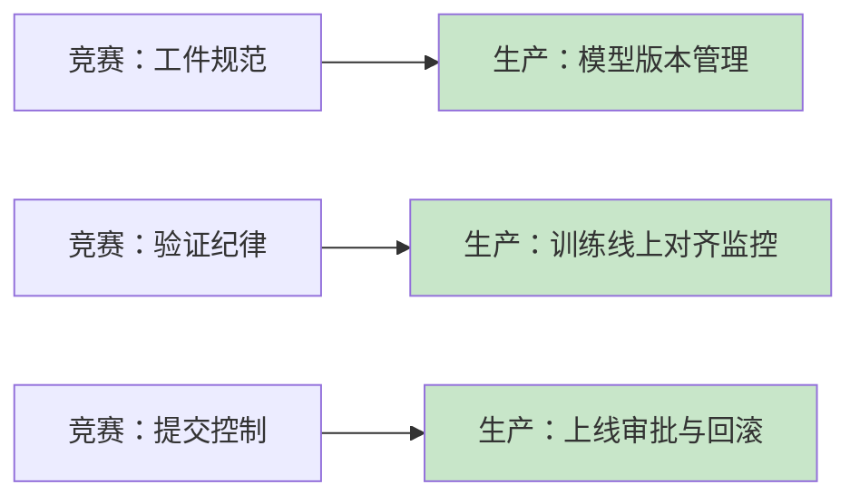
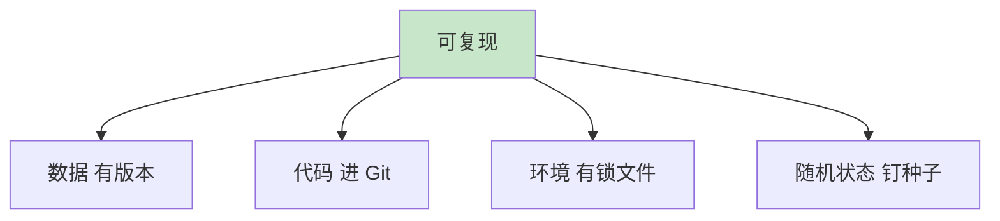
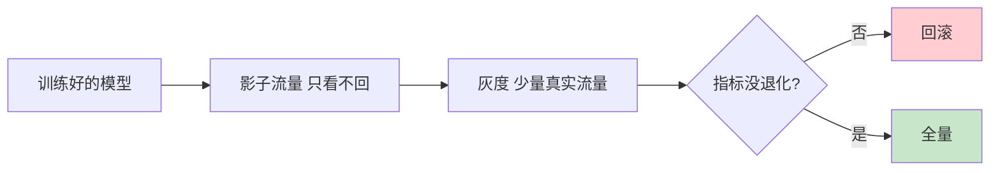

# 第23章 从 VibeKaggle 到实际项目

> **本章目标**：把竞赛里的经验迁移到真实工作。工件规范、验证纪律和提交控制，在生产 ML 流水线里同样是核心问题。本章讲怎么把 Agent 辅助的竞赛代码变成可维护项目，怎么搭一个最小的生产预测接口，以及继续学习的资源。

---

## 开篇：比赛是练兵场，不是战场

竞赛和生产项目最大的区别是什么？有人说是“数据干净不干净”，有人说是“评分机制有没有”。我觉得最大的区别是**“后果”**。

竞赛里，模型错了，你掉几个名次；生产里，模型错了，可能导致用户误贷、医疗误诊、交易损失。所以竞赛里可以允许的“快进猛出”，在生产里必须先经过审查。

这个差别有多大？看一个真实的事故就知道了。2012 年 8 月，美国一家做市商（Knight Capital）上线一套自动订单路由软件，这次更新只覆盖到了 8 台生产服务器里的 7 台，**漏掉了第 8 台**。而这次上线恰好复用了一个早就该清理掉的布尔开关（feature flag，说白了就是一个“用 if 控制走哪条路”的开关），那台没更新的旧机器上，这个开关激活了一段早该删除的旧代码路径。当时这家公司的交易量大约占美国全部上市股票交易量的 **10%**。事故之后，公司没能撑下去。

这里没有模型，没有 AI，就是一次“上线漏了一台机器”。但它说明的事情，比任何模型都重要：**在生产环境里，“差不多”不是“差不多”，是“不一样”。**

但**“工件规范、验证纪律、提交控制”**这三件事，在竞赛里是核心，在生产里更是核心。生产环境下，你不需要排行榜，但你同样需要：

- 每个模型版本产出可复现的预测工件；
- 验证方案固定，不能随意换；
- 上线前必须有人签字确认。

所以 VibeKaggle 不是教你“只能打比赛”，它教的是一套**可迁移的 ML 工程纪律**。



---

## 23.1 VibeKaggle 工作流与生产 ML 流水线的异同

| 维度 | Kaggle 竞赛 | 生产 ML 项目 |
|------|------------|-------------|
| 工件规范 | OOF/test_preds 工件 | 模型版本、特征快照、预测日志 |
| 验证纪律 | 固定 CV 折 | 训练集/线上集分布一致性监控 |
| 提交控制 | 每日提交预算 | 上线审批、回滚机制、灰度发布 |
| 数据管理 | 比赛方发一次数据，之后不变 | 数据持续变化，需要快照与版本号 |
| 失败处理 | 掉名次，重跑就行 | 用户受影响，要能定位、能回滚 |
| Agent 角色 | 跑实验、管工件 | 生成训练脚本、做特征初探、写测试用例 |
| 人的角色 | 定验证、拍板提交 | 定业务目标、做风险评估、审核上线 |

对比一看，差异不大，只是场景换了。竞赛练的“固定验证协议”，在生产里就是“建模和线上必须用同一套切分逻辑，否则监控报警无意义”；竞赛练的“提交前断言”，在生产里就是“上线前必须通过格式/范围/非负断言”。

多出来的两行，恰恰是竞赛里被“比赛方”这个甲方替你兜住的部分：数据不会变，所以你不觉得需要版本；跑挂了只是掉名次，所以你不觉得需要回滚。一进生产，这两根拐杖就没了。

顺便说一句，可复现这件事，学术圈的情况也不乐观。有技术团队引用过一项针对 NeurIPS、ICML 顶会论文的调查：**超过 60% 的论文结果无法被独立复现。** 论文尚且如此，业务代码里“在我机器上能跑”的流传程度，你大概能想象。

那到底要复现哪些东西？业界比较一致的看法是四样，缺一样就断链：



这四样，正好对应竞赛里最容易偷懒的四个地方，我们下一节一个一个补。

---

## 23.2 把 Agent 辅助的竞赛代码变成可维护项目

竞赛代码通常是“一次性脚本”，跑完就扔。要变成可维护项目，需要补四样东西：

| 竞赛一次性 | 生产可维护 | 做什么 |
|------------|------------|--------|
| 脚本到处都是 | 模块化代码 | `src/` 下按职责分模块（features/models/ensembles） |
| 乱写日志 | 实验日志系统 | JSON Lines + 元数据 Schema，可追溯 |
| 硬编码路径 | 配置管理 | YAML 配置 + 环境变量，不硬编码 |
| 跑就完了 | 可复现性检查 | 锁依赖版本、记录随机种子、保存工件哈希 |

先说依赖这件事，因为它最容易被误解。很多人以为写了 `requirements.txt` 就锁住了，其实没有——`pip install -r requirements.txt` 今天跑和下个月跑，很可能装出来不同版本的**子依赖**（你的依赖的依赖）。真正的锁文件是 `pip freeze` 导出的那种，或者 `poetry.lock`、`uv.lock` 这种把所有层级都钉死的文件。

再说随机状态。很多人以为 `np.random.seed(42)` 就完事了，其实 Python 标准库的 `random`、NumPy 的随机数、PyTorch 的随机数是三个独立的源头，**要分别钉**。如果你用了 GPU，还有一个 `torch.backends.cudnn.benchmark`，开着的时候算法会自动挑最快的实现，结果就不保证可复现，要关掉。代价是 GPU 计算会慢大概 **5% 到 10%**——这个交易通常是值得的，因为“跑得快但说不清”在生产里是负资产。

下面是一个**最小可维护项目结构**示例：

```
project/
├── src/
│   ├── __init__.py
│   ├── features/       # 特征工程（可复用）
│   ├── models/         # 模型定义与训练
│   ├── ensembles/      # 集成逻辑
│   └── utils/          # 工具（自检、CV协议、日志）
├── configs/
│   ├── cv_protocol.yaml    # 验证协议（不可变）
│   ├── agent_policy.yaml   # Agent 权限策略
│   └── model_config.yaml   # 模型超参
├── artifacts/            # 工件（Git 忽略，用 DVC/MLflow 管理）
├── tests/                # 单元测试（验证格式、防泄漏）
├── requirements.txt      # 锁依赖版本
└── README.md             # 复现说明
```

关键变化：加了 `tests/`。竞赛里可能不写测试，但生产项目必须有——验证“特征没有泄漏”“工件格式合规”“CV 折索引哈希一致”，都可以写成自动化测试，每次提交前跑一遍。

光有目录还不够，得有一个东西把“这次实验到底怎么跑的”记下来。下面这个 `repro.py` 就是干这个的：

```python
# src/utils/repro.py
"""
可复现性小工具：把"能不能重跑出同一个结果"变成一条命令。

为什么要单独写这个文件？
因为实验不可复现的根源就四样：数据、代码、环境、随机状态。
这个文件负责把后三样钉死；数据那一项靠 data_version 记录。
"""
import json
import os
import random
import subprocess
import sys
import hashlib
from dataclasses import dataclass, asdict, field

import numpy as np


@dataclass
class RunConfig:
    """一次实验的全部输入。

    注意：所有会变的东西都放这里，不要散落在代码各处。
    散落的代价是——半年后你想复现，得靠考古。
    """
    exp_name: str = "baseline"          # 实验名，决定工件存哪个目录
    seed: int = 42                      # 随机种子
    model: str = "lgbm"                 # 模型家族
    params: dict = field(default_factory=lambda: {"learning_rate": 0.05})
    data_version: str = "v1"            # 数据集快照编号，对应 artifacts/data/v1/


def set_all_seeds(seed: int) -> None:
    """把 Python / NumPy 两个随机源都钉死。

    如果你用 PyTorch，还要补两句：
        torch.manual_seed(seed)
        torch.cuda.manual_seed_all(seed)
    另外把 torch.backends.cudnn.benchmark 设为 False，
    否则 cuDNN 会自动挑"最快"的算法，结果就不保证可复现了。
    少钉一个源头，结果就可能不一样——这是最常见的"玄学"来源。
    """
    os.environ["PYTHONHASHSEED"] = str(seed)  # 影响 set/dict 的遍历顺序
    random.seed(seed)                          # Python 标准库的随机源
    np.random.seed(seed)                       # NumPy 的随机源


def file_hash(path: str) -> str:
    """算一个文件的 SHA256，用来确认"这次用的工件就是上次那个"。

    分块读是为了省内存：模型文件动辄几百 MB，一次读完容易爆。
    """
    h = hashlib.sha256()
    with open(path, "rb") as f:
        for chunk in iter(lambda: f.read(1 << 20), b""):  # 每次读 1MB
            h.update(chunk)
    return h.hexdigest()


def git_commit() -> str:
    """取当前代码的提交号。跑挂了能定位到是哪一版代码干的。"""
    try:
        out = subprocess.run(
            ["git", "rev-parse", "--short", "HEAD"],
            capture_output=True, text=True, check=True,
        )
        return out.stdout.strip()
    except Exception:
        return "unknown"   # 不在 git 仓库里也能跑，只是少了可追溯性


def start_run(cfg: RunConfig) -> dict:
    """实验开始前调用：钉种子、建目录、写元数据，返回本次运行的元信息。"""
    set_all_seeds(cfg.seed)

    # 每次实验一个独立目录，避免后一次覆盖前一次的产物
    run_dir = os.path.join("runs", cfg.exp_name)
    os.makedirs(run_dir, exist_ok=True)

    meta = asdict(cfg)
    # 环境信息也一起记下来：换台机器复现不出来，八成是版本不一样
    meta["python"] = sys.version.split()[0]
    meta["numpy"] = np.__version__
    meta["git_commit"] = git_commit()

    # indent=2 是为了让人能直接用眼睛看；ensure_ascii=False 让中文不乱码
    with open(os.path.join(run_dir, "meta.json"), "w", encoding="utf-8") as f:
        json.dump(meta, f, ensure_ascii=False, indent=2)

    return meta


if __name__ == "__main__":
    # 最小可运行示例：跑一下就能看到 runs/baseline/meta.json
    print(start_run(RunConfig(exp_name="baseline", seed=42)))
```

跑完之后，你的实验就不再是“我记得好像是这么跑的”，而是有一个 `meta.json` 躺在那里，里面写着种子、版本、代码提交号。

再往前一步，如果团队里人多，就该上实验追踪工具了。业界比较常见的组合是：用 MLflow 记录参数、指标和模型（它还有模型注册表，能把一个模型从 Staging 推到 Production），用 Feast 这类特征库保证训练和线上取到的是同一套特征，用 Kubeflow Pipelines 编排“数据→训练→评估→部署”这条流水线，用 BentoML 这类框架把模型打成带版本的服务镜像，用 Evidently 做漂移监控。工具名字不用背，记住它们各自解决什么问题就行：**一个记“做过什么”，一个记“特征长什么样”，一个记“流程走到哪一步”，一个记“怎么把它变成服务”，一个记“现在是不是还和以前一样”。**

最后还有一条容易被忽略、但特别影响信任度的规范：在一些工程标准里（比如 `ml-experiment-standards` 这类规范），**每一个点估计都必须同时给出它的不确定性**——分类指标给 bootstrap 置信区间，回归指标给各折的均值 ± 标准差。只报一个光秃秃的数字，等于只报了一半信息。你想想看：CV RMSE 0.812 和 CV RMSE 0.812±0.031 是完全不同的两件事，后者才告诉你"这次提升是不是噪声"。第 4 章那个 `bootstrap_ci.py`，在这里又派上用场了。

回到 Agent。你可以让 Agent 帮你把“竞赛代码”改造成“可维护项目”，但**改造方案要你先批**——这个场景在第 23.3 节有完整的对话示例，我们先看部署。

---

## 23.3 模型部署基础（精简保留）

部署一个预测服务，最小可行的是一个 FastAPI 接口：输入特征，返回预测值。下面是一个可直接跑的简例：

```python
# src/api/predict_api.py
"""
FastAPI 预测接口简例：最小可行的模型服务。
生产环境还需加鉴权、限流、监控、灰度，这里只展示核心骨架。
"""
from fastapi import FastAPI
from pydantic import BaseModel
import numpy as np
import joblib

# 输入校验放在单独的文件里，方便测试，也方便复用
from src.api.checks import validate_features

app = FastAPI(title="VibeKaggle Predict API")


class PredictRequest(BaseModel):
    features: dict   # 特征字典，按训练时的列名


class PredictResponse(BaseModel):
    prediction: float
    model_version: str


# 模型在启动时加载一次（生产环境建议加版本管理和热重载）
# 为什么不在每次请求里加载？因为读盘几百毫秒，扛不住真实流量
MODEL = joblib.load("artifacts/models/latest.pkl")
MODEL_VERSION = "v001"


@app.post("/predict", response_model=PredictResponse)
def predict(req: PredictRequest):
    """接收特征，返回预测。生产环境需加输入校验与断言。"""
    # 第一道闸：脏数据不许进模型。宁可报错，也不能让它悄悄给个错答案
    validate_features(req.features)

    # 按训练时的列顺序拼成一行。顺序错了，模型不会报错，只会算错
    X = np.array([list(req.features.values())]).reshape(1, -1)
    pred = float(MODEL.predict(X)[0])
    return PredictResponse(prediction=pred, model_version=MODEL_VERSION)


if __name__ == "__main__":
    import uvicorn
    uvicorn.run(app, host="0.0.0.0", port=8000)
```

上面那个 `validate_features` 长这样：

```python
# src/api/checks.py
"""
输入断言：上线前最后一道闸。

竞赛里"提交前自检"那套东西，在生产里就是这些断言。
区别只在于：竞赛里格式错了扣一次额度，生产里格式错了扣的是用户的钱。
"""

# 训练时见过的取值范围，从训练数据里统计出来，写进配置而不是拍脑袋
EXPECTED_RANGES = {
    "age": (0, 120),
    "income": (0, 10_000_000),
    "num_credit_cards": (0, 20),
}

REQUIRED_FIELDS = set(EXPECTED_RANGES)


def validate_features(features: dict) -> None:
    """不通过就抛异常，让调用方收到 422，而不是让模型收到脏数据。

    为什么用抛异常，而不是返回 False？
    因为"悄悄返回 False"会让调用方以为请求成功了；
    而抛异常会逼着上游去修数据。错误要吵，不要忍。
    """
    missing = REQUIRED_FIELDS - set(features)
    if missing:
        raise ValueError(f"缺少字段: {sorted(missing)}")

    for name, (low, high) in EXPECTED_RANGES.items():
        v = features[name]

        # None 和 NaN 都要单独挡：NaN 参与比较永远返回 False，会溜过去
        if v is None or (isinstance(v, float) and v != v):
            raise ValueError(f"{name} 不能为空")

        # 超出训练时见过的范围，模型的外推能力基本不可信
        if not (low <= v <= high):
            raise ValueError(f"{name}={v} 超出训练范围 [{low}, {high}]")
```

部署时，记得加上第 4 章那种“提交前断言”式的**输入校验**（特征范围、缺失值、类别合法性），这是生产里最容易出事的地方。

光把服务跑起来还不算完。一个模型从“训练好”到“真的在服务用户”，中间还有几道关。业界比较成熟的做法是分三级放量：



解释一下这三个词。影子部署，是把真实的线上请求复制一份喂给新模型，但**不把它的结果返回给用户**——你只对比延迟和输出，不影响任何人。灰度发布，是放一小部分真实流量（常见的是 5%）给新模型，盯着点击率、p99 延迟、预测分布这几个指标，没退化就继续加，退化了就回滚。蓝绿部署则是维护两套环境，切换在路由层完成，回滚最快。

这三招解决的是不同风险，但**没有一招能替代“回滚方案本身经过测试”**。这话听着像废话，可 2012 年那场事故就是死在“以为更新完了”上。

还有一个特别隐蔽的坑：**模型转换**。你以为把训练好的权重拷到线上就行了，其实中间往往还有一步“编译”——把框架里的动态图编译成某个运行时的静态图，有时还会降精度（比如 INT8 量化）来换速度。有团队报告过这种情况：只验证了吞吐提升，没验证精度，结果在少数但高价值的边界样本上准确率掉了，而**整体指标仍然在 SLO 范围内**，所以这个退化几周都没被发现。

教训是：验证要**分群组**看，不能只看总分。这和竞赛里“看整体 CV 不够，还要看不同子群体的表现”是同一件事，只是后果严重了一万倍。

你可以让 Agent 帮你把“竞赛代码”改造成“可维护项目”，但**改造方案要你先批**：

```
请评估我这份竞赛代码（scripts/ 下几个一次性脚本），
给出改造成可维护项目的方案：需要拆哪些模块、加哪些测试、
哪些地方有复现性风险。只给方案，不要动我的文件。
```

模型会给出这样的评估：

```
> （思考过程）用户要"评估 + 方案"，明确不要动文件。
> 我要读代码找出：硬编码路径、无测试、随机种子缺失、
> 配置散落各处。按优先级排序，并说明每项的风险。
> 最后必须写清"我没做什么"，否则用户以为我已经动手了。

【复现性风险（高优先级）】
1. scripts/train.py 里 random_state 没固定 → 每次结果不同
2. 数据路径硬编码为 "D:/data/train.csv" → 换机器就跑不了
3. 依赖版本未锁定（没有 requirements.txt）→ 半年后装不上

【结构问题（中优先级）】
4. 特征工程逻辑在 3 个脚本里重复 → 改一处忘两处
5. 没有 CV 协议文件 → 每次实验切折方式可能不同
6. 没有工件命名规范 → 文件名混乱，无法批量集成

【缺失的测试（高优先级）】
7. 无"提交格式自检" → 可能提交格式错误
8. 无"泄漏检查" → 目标编码可能泄漏
9. 无"折索引哈希校验" → 无法发现验证协议被改

【建议的模块拆分】
src/features/     ← 把重复的 3 处特征逻辑合并
src/models/       ← 训练循环
src/ensembles/    ← 集成
src/utils/        ← 自检、CV协议、日志
tests/            ← 上述 7/8/9 三项测试

【我没有做的事】
没有创建、修改、删除任何文件。等你确认方案，
我再按优先级逐项改造（建议从 1/2/7 开始，
这三项投入最小、收益最大）。
```

它把问题按“复现性风险 / 结构问题 / 缺失测试”分类，还标了优先级，最后**明确列出“我没有做的事”**。这种“交付边界声明”，是你在生产环境里最需要 Agent 养成的习惯。

---

## 23.4 继续学习的资源

竞赛结束后，想继续深入，可以看这些：

| 方向 | 资源 | 适用 |
|------|------|------|
| Agent 辅助竞赛 | MLE-Bench | 理解 Agent 在 ML 任务上的能力边界 |
| Agentic 工作流 | Agentic Kaggle Skill | 如何把 Agent 接入 Kaggle 平台 |
| 工作流设计 | Kaggle 社区中 Agent 辅助的 writeup | 学习别人怎么设计 Harness |
| 生产 ML | MLOps 相关课程/书籍 | 从竞赛代码到生产流水线 |
| 表格 AutoML | AutoGluon 官方文档 | 深入了解基线框架 |

这张表怎么用？别从头看到尾。挑一个你**下周就要用**的方向，看两小时，然后立刻在自己的项目里用一次。看完就忘，是学习的默认结局；用过一次，才算是你的。

如果实在不知道从哪开始，就选“生产 ML”那一行。因为这本书从头到尾讲的工件、验证、预算，在生产里全都要用一遍——你不是在学新东西，你是在给已经会的东西换个场景再练一遍。

---

## 23.5 全书知识点回顾

读到这里，建议你把全书的核心心法捋一遍，作为“随时查”的速查表：

1. **工件规范是物理基础**：没有工件，Agent 的高吞吐只会制造混乱；
2. **验证优先是不可让渡的判断**：验证方案人设、Agent 执行，折索引哈希防篡改；
3. **Agent 执行和枚举，人负责判断**：选指标、定验证、挑集成、管预算，都得人来；
4. **提交预算是护栏**：零摩擦是风险，预览-确认机制是必须的；
5. **时间纪律不可委托**：时序问题里，随机切分默认拒绝；
6. **领域合理性是第二道守门**：分数好不等于物理/临床可信；
7. **从运动员到教练**：你的价值不在写代码，在设计工作流和做判断。

把这七条背下来，无论打什么比赛、做什么项目，都不会跑偏。

不过背下来还不够。真正带走一本书的方式，是把它压缩成几张能随手翻的卡片。我们不妨让模型帮我们做这件事：

```
我读完了这本书。请用五行以内的"体检报告"总结：
如果我只记住五句话，应该记住哪五句？
不要展开，每句不超过 20 个字。
```

模型给出的是：

```
> （思考过程）用户要的是"能记住"，不是"能复述"。
> 五句话必须能互相独立，又要覆盖从选题到上线的完整链路。
> 每句限 20 字，就得砍掉所有修饰语，只留动词和宾语。
> 顺序按"做事的时间顺序"排，比按重要性排更好记。

1. 先定验证，再写代码。
2. 没有工件，就没有协作。
3. 提交是买信息，不是刷分。
4. 分数要分群看，别信总数。
5. 上线要能回滚，回滚要练过。
```

你看，它没有复述目录，而是把七章压成了五句能贴在显示器边上的话。这就是“读过”和“带走”的区别。

---

> **本书到此结束。** 写到这里，其实有点舍不得。

回头想想，这本书真正想说的，可能不是“怎么用 Agent 打比赛”。比赛有输赢，Agent 会换代，今天的最新模型明天就成了旧闻。真正留下来的，是那套做事的**顺序**：先想清楚怎么验证，再动手；先把工件放好，再谈协作；先想清楚这次要换回什么信息，再花额度；先备好回滚，再上线。

这套顺序，放在 Kaggle 上是名次，放在工作里是项目，放在更远的地方，是你做任何一件复杂事情时的底气。

所以，如果你只从这本书里带走一样东西，我希望是这个：**把 Agent 当成最得力的队友，而不是盲目跟随的工具。** 它可以写得比你快、跑得比你多、熬得比你久，但它不会替你决定“什么是对的”。那个决定，永远是你的。

祝你在 Kaggle 赛场和实际项目里，都能指挥得动系统，也守得住判断。

记住：指挥系统，比写代码更值钱。