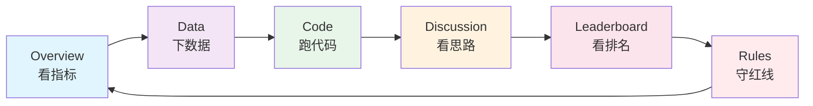
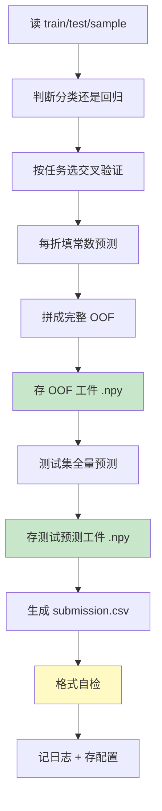

# 第1章 VibeKaggle 的工作流全景：从第一天起就在协作中工作

> **本章目标**：哪怕你还没写过一行 Kaggle 代码，读完这一章你也能拥有一个“空工作区”——里面有规范的文件夹、一份跑通的常数基线、一套提交前的自检脚本。更重要的是，你会理解：**VibeKaggle 的第一步不是写模型，而是搭工地。**

---

## 开篇：为什么第一章不教你写模型？

我们先说句掏心窝子的话。市面上绝大多数 Kaggle 教程，第一章就让你跑 Titanic 的随机森林，看着排行榜分数从 0.76 涨到 0.78，然后心满意足。可等你真把它交给一个大模型 Agent，让它“帮我优化一下”，你会发现一个尴尬的现实——

你让它优化特征，它改了一大堆代码，分数反而掉了；你让它调参，它试了几十组，本地交叉验证涨了，提交上去排行榜却原地踏步；最后你回头一看，跑了三四十个实验，电脑里躺着一堆名字乱七八糟的 `.py` 文件和几十版 `submission.csv`，**你根本说不清哪一版是怎么来的、哪一版能用、哪一版是废的**。

问题出在哪？不是模型不够强，是你**没有给 Agent 搭好工地**。

打个比方。想象你要盖一栋楼，把施工队（Agent）请来了，工人干活又快又好。但你没给工地划分材料区、没贴好“钢筋放这、水泥放那”的标签、没规定“每天只能浇筑多少次”。结果施工队一口气把 800 吨材料全倒在地上，楼盖得飞快——但全是乱码。

VibeKaggle 的第一课，就是**先搭工地、再请工人**。这一章我们要做的三件事，都发生在你写任何模型之前：

1. 认清 Kaggle 页面上那几个区域是干嘛的（很多人第一次进来是懵的）；
2. 挑一场适合新手、也适合 Agent 发挥的比赛；
3. **亲手建好那个“工地”**：规范的文件夹 + 一份能跑通的常数基线。

---

## 1.1 Kaggle 的五分钟导览

打开任意一场 Kaggle 比赛页面，比如 [Playground Series S6E3 客户流失预测](https://www.kaggle.com/competitions/playground-series-s6e3)，你会在顶部看到一排标签：`Overview`、`Data`、`Code`、`Discussion`、`Leaderboard`、`Rules`。新手最容易犯的错，就是只点其中一两个，然后一头扎进代码里。咱们挨个说清楚。

| 标签 | 中文名 | 它到底是干啥的 | 为什么 VibeKaggle 特别在意它 |
|------|--------|-----------------|--------------------------------|
| **Overview** | 概览 | 比赛背景、评价指标、时间线、奖金 | **评价指标决定了一切优化的方向**，Agent 不能自作主张换指标 |
| **Data** | 数据 | 提供 `train.csv`、`test.csv`、`sample_submission.csv` | 三份文件的**格式约定**必须由人来核对 |
| **Code** | 代码 | 别人的公开 Notebook、你自己的运行环境 | Agent 可以在这里持续跑，不用你手动点“运行” |
| **Discussion** | 讨论 | 公开思路、数据泄漏警告、基线分享 | Agent 能抓取参考，但**可信度得人来判断** |
| **Leaderboard** | 排行榜 | Public 榜、Private 榜、提交历史 | **高频提交时 Public 榜会“骗人”**，不能当唯一标准 |
| **Rules** | 规则 | 提交次数限制、外部数据规则、团队人数 | 这些红线要写进 Agent 的“禁令清单”里 |

用一个图串起来，你看一眼就明白了：



这里要特别强调**“比赛”和“数据集”的区别**——很多新手栽在这上面。一个 Kaggle **比赛（Competition）** 有评分机制、有排行榜、有截止日期、有规则；而一个 **数据集（Dataset）** 只是别人的文件托管仓库，你下载下来随便用，但没人给你打分。只有在比赛页面点过“Join Competition”（加入比赛）后，你才算正式参赛，也才能用提交次数。找错了地方，你会在那里下载一堆数据，纳闷怎么没地方交。

还有个小提醒：很多人把排行榜上的分数看得比命还重。我们要提前建立正确心态——**排行榜的 Public 榜只用了测试集的一小部分（常常 20%~30%），它天生带噪声**。这就像用考试卷子上随机抽的几道题来估算你的总分，抽到简单的题你分数虚高，抽到难的你就虚低。这个道理后面第 1.6 节还会细讲，现在先记住：别被单次排行榜分数带跑。

---

## 1.2 选择一场“自动化友好”的入门比赛

不是所有比赛都适合拿来练手。有些比赛需要领域知识（比如蛋白质结构预测），有些数据大到你的笔记本根本装不下。对于我们这种“人带着 Agent 干活”的模式，一场理想的入门比赛应该满足下面几条：

1. **评价指标明确**：就是 AUC、RMSE、LogLoss、MAPE 这种标准指标，不要是“结合了 N 个因素的自定义复杂指标”；
2. **有 `sample_submission.csv`**：有标准答案的格式模板，Agent 生成提交文件时才能自动对照；
3. **讨论区有活跃的公开 Notebook**：Agent 可以参考，你也能对照检查自己有没有走偏；
4. **数据规模不大**：训练集一百万行以内、特征两百列以内，单次训练十分钟能跑完；
5. **往届/获胜方案公开可查**：将来复盘时，能找到一个“别人做到的天花板”来对标。

**Playground Series 是理想的第一站。** 它是 Kaggle 官方做的“模拟比赛”，专门给你练手用的——数据是真实比赛数据的衍生模拟（用生成模型造出来的），指标清晰、规模可控、讨论区热闹、而且谁也不会因为你分数低而笑话你。2025 到 2026 年这一系列覆盖了从贴纸销售预测、客户流失、道路事故风险到 F1 进站预测的各种表格任务。

我给你的具体建议是：第一场去练 **Playground S6E3（客户流失预测）**，二分类、AUC 指标、大约 16 万行 × 13 列，朴实无华但五脏俱全；或者 **S5E1（贴纸销售预测）**，时序回归、MAPE 指标，能顺便练时序。挑一个你觉得名字顺眼的就行，别纠结。

> **一个小插曲**：NVIDIA 的工程师 Chris Deotte 就是在 2026 年 3 月的 Playground 客户流失预测比赛里，带着三个大模型 Agent（GPT-5.4 Pro、Gemini 3.1 Pro、Claude Opus 4.6）拿了冠军。他们生成了超过 60 万行代码、跑了 850 个实验、最后拼出一个 150 个模型的四级堆叠。这个案例我们会在第 4 章深度拆解——但现在你只需要知道：**这条路是通的，而且有人走到了终点。**

---

## 1.3 三份核心文件与提交格式

每场表格比赛的数据页面，至少给你三个文件。别看就三份，新手有一半的“提交失败”都栽在没搞懂它们的约定上。

| 文件 | 里面有什么 | 关键约定 | Agent 该怎么自检 |
|------|-----------|----------|------------------|
| `train.csv` | 特征 + 目标列（答案） | 有目标列，行数 = 训练样本数 | 读进来先看：目标列在不在？缺多少？类别平不平衡？ |
| `test.csv` | 只有特征，没有答案 | 行数 = 测试样本数，**列名和 train 一样（除了目标列）** | 检查列名对不对齐、类型一致不一致、有没有残留答案列 |
| `sample_submission.csv` | `id` 列 + 目标列占位 | **行数 = test 行数，列名必须一模一样** | **这是最要命的检查**：你交上去的文件，形状、列名、id 顺序都得和它完全一致 |

这里补充一个真正踩过坑的细节。很多比赛（尤其是二分类）要你交的是**概率**，不是 0/1 标签。`sample_submission.csv` 里可能填的全是 `0.5` 这种占位数字，看起来像让你填标签，其实人家要的是“这个人流失的概率是 0.83”这样的连续值。你要是傻乎乎填了一堆 0 和 1，分数会低一大截。怎么确认？**去 Overview 页面读“Submission Format”那段**，白纸黑字写着“predict a probability”。这个坑在 Kaggle 讨论区被吐槽过无数次，我们一定要避开。

如果你还是不确定，可以直接问模型。比如这样问：

```
我第一次打 Kaggle，sample_submission.csv 里 target 列全是 0.5，
我是要填 0/1 的类别，还是填 0 到 1 之间的概率？
```

模型会这样回答你：

```
> （思考过程）用户是新手，对提交格式有疑问。这个问题不能靠猜，
> 因为不同比赛要求不同。我应该先说明"以 Overview 的 Submission
> Format 为准"，再给出常见情况：二分类多数要概率（AUC/LogLoss），
> 少数要类别（Accuracy/F1）。最后给一个自查方法：看 sample 里
> 的值是 0/1 还是 0.5，以及看指标类型。

以比赛 Overview 页面的 "Submission Format" 为准，这是唯一权威。
不过可以给你一个快速判断的经验：

1. 看指标：AUC、LogLoss 这类指标，几乎都要**概率**；
   Accuracy、F1 这类，可能要**类别**（0/1）。
2. 看 sample_submission：如果占位值是 0.5，通常是概率；
   如果是 0 或 1，通常是类别。
3. 保险做法：先交一版概率，如果报错或分数异常，再换类别。

如果你把比赛的 Overview 段落贴给我，我可以帮你确认。
```

你看，模型没有硬猜，而是先告诉你“以官方说明为准”，再给经验判断——这就是好的协作方式：**它负责给线索，你负责拍板。**

好，现在我们把“提交前自检”这件事写成一段**每次提交前都跑一遍的代码**。这段代码不长，但它能替你挡掉至少一半的低级错误。我把注释写得事无巨细，你对照着看：

```python
# utils/submission_check.py
"""
提交文件格式自检脚本。
作用：在把 submission.csv 交上去之前，先跟自己较一次劲，
     确认形状、列名、id 顺序、数值范围都跟 sample_submission 对得上。
用法：assert_submission_format("submission.csv", "data/sample_submission.csv")
失败：会抛出 AssertionError，把问题说清楚，Agent 可以捕获后自动修。
"""

import pandas as pd


def assert_submission_format(
    submission_path: str,   # 你生成的要提交的文件
    sample_path: str,       # 官方给的格式模板
    id_col: str = "id",     # 身份列的名字（多数比赛叫 id）
    target_col: str = "target",  # 目标列的名字（按比赛改）
) -> None:
    """
    对提交文件做 5 项体检。任何一项不过，直接报错。
    """
    # 把两个文件都读进来
    sub = pd.read_csv(submission_path)
    sample = pd.read_csv(sample_path)

    # 体检 1：形状必须完全一致（行数、列数都对得上）
    assert sub.shape == sample.shape, (
        f"形状不匹配：提交 {sub.shape}，模板 {sample.shape}"
    )

    # 体检 2：列名必须一模一样，顺序也不能变
    assert list(sub.columns) == list(sample.columns), (
        f"列名不匹配：提交 {list(sub.columns)}，模板 {list(sample.columns)}"
    )

    # 体检 3：id 列的每一个值、顺序都得对上
    # 这一项最容易被忽略，但提交系统对顺序很敏感
    assert (sub[id_col] == sample[id_col]).all(), "id 列不一致（顺序或数值对不上）"

    # 体检 4：目标列不能有空值
    assert sub[target_col].notna().all(), "目标列存在缺失值，不能提交"

    # 体检 5：数值范围检查
    #   分类任务交概率，值应该在 0 到 1 之间；
    #   回归任务数值范围大，用一个宽松的界兜底即可。
    if sub[target_col].dtype.kind in "fc":  # f=浮点，c=复数
        in_prob_range = sub[target_col].between(0, 1).all()
        in_reg_range = sub[target_col].between(-1e6, 1e6).all()
        assert in_prob_range or in_reg_range, "数值范围看起来不对（既不像概率也不像回归值）"

    # 全部通过，打印一句让人安心的话
    print(f"✅ 提交文件体检通过：{submission_path}")


# 直接运行本文件时的示例；实际使用请把路径换成你比赛的真实路径
if __name__ == "__main__":
    assert_submission_format("submission.csv", "data/sample_submission.csv")
```

这段代码的意义远超“检查一个文件”。它是 VibeKaggle 里那种**“挡在提交前面的护栏”**的雏形——后面我们会把它升级成更完整的“门禁”，但核心思想现在就有了：**让程序替你守住格式底线，这样你才能真正只操心“预测得准不准”这件事。**

---

## 1.4 第一个动作：建立工件目录，而不是先写模型

现在进入本章的重头戏。我要非常认真地跟你说一句话：

> **在跑任何模型之前，先建好工件目录、定好命名规范。**

这句话听起来平平无奇，但它是整本书反复要用的地基。先解释一个词——**工件（artifact）**。它是我们从工程领域借来的说法，指“一个流程跑完之后产出的、可以被反复使用的成品文件”。在 Kaggle 里，最典型的工件就是：

- **OOF 预测**（Out-of-Fold predictions，折外预测）：把训练集切成 5 份，每次拿 4 份训练、剩下 1 份预测，轮着来，最后每个训练样本都有一个“模型没见过它时给出的预测”。这东西是宝贝，后面做集成全靠它。
- **测试集预测**：把整个模型拿去预测 `test.csv`，得到要提交的预测值。
- **实验日志**：记下这次实验用了什么模型、什么参数、交叉验证得了多少分。

为什么这些东西必须**规范地存起来**？给你三个特别实在的理由：

1. **可组合**：后面要把好几个模型的结果混合（叫集成/Stacking），你只需要把它们的 OOF 文件读进来算一算，不用把每个模型重新训练一遍。省的是几个小时的电费和等待。
2. **可追溯**：三个月后你回头看“当时那版分数为什么高”，日志里记得清清楚楚，不用靠回忆。
3. **可审计**：Agent 干活快，但可能偷偷“作弊”（比如换了验证方式刷分）。规范存下来的日志，让你一眼就能查出猫腻。这一点在第 2 章会展开。

好，现在动手建工地。在终端里敲（或者在 Notebook 里用 `!mkdir -p ...`）：

```bash
# 终端里执行；Windows 上如果用 cmd，把 -p 换成逐个 mkdir 也行
mkdir -p artifacts/oof artifacts/test_preds artifacts/logs artifacts/configs
```

建完之后，你的目录长这样：

```
artifacts/
├── oof/                    # 折外预测（验证集上的预测）
│   ├── train_oof_autogluon_v001.npy
│   └── train_oof_lgbm_v001.npy
├── test_preds/             # 测试集预测
│   ├── test_preds_autogluon_v001.npy
│   └── test_preds_lgbm_v001.npy
├── logs/                   # 实验日志（一行一个实验）
│   └── exp_autogluon_v001.jsonl
└── configs/                # 实验配置快照（方便人看）
    └── cfg_autogluon_v001.yaml
```

**命名规范**（全书统一，你要背下来）：

- OOF 文件：`train_oof_[模型名]_[版本号].npy`
- 测试预测：`test_preds_[模型名]_[版本号].npy`
- 日志：`exp_[模型名]_[版本号].jsonl`
- 配置：`cfg_[模型名]_[版本号].yaml`

模型名用大写字母加下划线（`AUTOGLUON`、`LGBM`、`XGB`），版本号用 `v` 加三位数字（`v001`、`v002`），这样排序不会乱。

> **为啥用 `.npy` 而不是 `.csv`？** 因为 `.npy` 是 NumPy 的二进制格式，读写比 CSV 快十倍以上，而且浮点数精度一点不丢。工件是给程序读的，不是给人看的——想看内容，用 `np.load()` 读出来瞄一眼就行。

### 写第一个基线：常数预测也要产出合规工件

你可能想：“常数基线？太小儿科了吧，谁不会写‘全都预测成平均值’？”没错，它确实简单，但它的作用根本不是拿分。它的作用是**把整条流水线从头到尾打通一遍**，确保：数据能读 → 交叉验证切分正常 → 预测能生成 → 工件能落盘 → 提交文件能自检通过。这就像新买的打印机，先打一张测试页确认墨盒、纸张、驱动全正常，再打印正式文件。

下面这段代码，我建议你逐行读一遍，因为里面每一个变量、每一个步骤，后面都会反复出现。注释写得很密，别嫌啰嗦：

```python
# baselines/constant_baseline.py
"""
常数基线：二分类就输出正类的平均概率，回归就输出目标的平均值。
唯一目的：把"读数据→切折→预测→存工件→生提交→记日志→存配置"
这整条流水线跑通，顺便产出一份格式完全合规的工件。
"""

import numpy as np
import pandas as pd
import json
import yaml
from pathlib import Path
from sklearn.model_selection import StratifiedKFold, KFold
from sklearn.metrics import roc_auc_score, mean_squared_error

# ========== 下面这块是配置区，换比赛时只改这里 ==========
DATA_DIR = Path("data")                     # 原始数据目录
ARTIFACT_DIR = Path("artifacts")            # 工件根目录
OOF_DIR = ARTIFACT_DIR / "oof"
TEST_DIR = ARTIFACT_DIR / "test_preds"
LOG_DIR = ARTIFACT_DIR / "logs"
CFG_DIR = ARTIFACT_DIR / "configs"

# 把所有目录都建好（exist_ok=True 表示已存在也不报错）
for d in [OOF_DIR, TEST_DIR, LOG_DIR, CFG_DIR]:
    d.mkdir(parents=True, exist_ok=True)

VERSION = "v001"          # 版本号
MODEL_NAME = "constant"   # 模型名
TARGET_COL = "target"     # 目标列名（按比赛改）
ID_COL = "id"             # id 列名
N_FOLDS = 5               # 5 折交叉验证
RANDOM_STATE = 42         # 随机种子，固定它才能复现
# ========== 配置区结束 ==========


def main():
    # ---- 第 1 步：读数据 ----
    train = pd.read_csv(DATA_DIR / "train.csv")
    test = pd.read_csv(DATA_DIR / "test.csv")
    sample_sub = pd.read_csv(DATA_DIR / "sample_submission.csv")

    # 把目标列拿出来作为答案 y；特征列就用剩下的（去掉 id）
    y = train[TARGET_COL].values
    X = train.drop(columns=[TARGET_COL, ID_COL], errors="ignore")
    X_test = test.drop(columns=[ID_COL], errors="ignore")

    # ---- 第 2 步：判断这是分类还是回归，决定常数值 ----
    # 如果目标是整数/无符号整数/布尔，且只有两个不同取值 → 二分类
    if y.dtype.kind in "iub" and len(np.unique(y)) == 2:
        task = "binary"
        const_val = float(y.mean())   # 二分类的"常数预测"= 正类出现的比例
    else:
        task = "regression"
        const_val = float(y.mean())   # 回归的"常数预测"= 目标平均值
    print(f"任务类型：{task}，常数预测值：{const_val:.6f}")

    # ---- 第 3 步：按任务类型选交叉验证方式 ----
    # 分类要分层（保持每折正负样本比例），回归就直接 K 折
    if task == "binary":
        cv = StratifiedKFold(n_splits=N_FOLDS, shuffle=True, random_state=RANDOM_STATE)
    else:
        cv = KFold(n_splits=N_FOLDS, shuffle=True, random_state=RANDOM_STATE)

    oof = np.zeros(len(train), dtype=np.float32)  # 预分配 OOF 数组
    fold_scores = []                               # 记录每折的分数

    # ---- 第 4 步：逐折预测，拼出完整 OOF ----
    for fold, (trn_idx, val_idx) in enumerate(cv.split(X, y)):
        # 常数模型"不需要训练"：训练集算出来是什么常数，就用它预测验证集
        fold_pred = np.full(len(val_idx), const_val, dtype=np.float32)
        oof[val_idx] = fold_pred   # 把这一折的预测填进 OOF 对应位置

        # 算这一折的分数（只是记录用，常数模型分数肯定很一般）
        if task == "binary":
            score = roc_auc_score(y[val_idx], fold_pred)
        else:
            # 回归用负 RMSE，这样统一成"越大越好"，方便比较
            score = -mean_squared_error(y[val_idx], fold_pred, squared=False)
        fold_scores.append(score)
        print(f"  第 {fold} 折：{score:.6f}")

    cv_mean = float(np.mean(fold_scores))
    cv_std = float(np.std(fold_scores))
    print(f"交叉验证：{cv_mean:.6f} ± {cv_std:.6f}")

    # ---- 第 5 步：保存 OOF 工件 ----
    oof_path = OOF_DIR / f"train_oof_{MODEL_NAME}_{VERSION}.npy"
    np.save(oof_path, oof)
    print(f"✅ OOF 已保存：{oof_path}")

    # ---- 第 6 步：对整个测试集做预测，保存工件 ----
    test_preds = np.full(len(test), const_val, dtype=np.float32)
    test_path = TEST_DIR / f"test_preds_{MODEL_NAME}_{VERSION}.npy"
    np.save(test_path, test_preds)
    print(f"✅ 测试预测已保存：{test_path}")

    # ---- 第 7 步：生成提交文件并运行格式体检 ----
    submission = sample_sub.copy()
    submission[TARGET_COL] = test_preds
    sub_path = ARTIFACT_DIR / f"submission_{MODEL_NAME}_{VERSION}.csv"
    submission.to_csv(sub_path, index=False)
    # 复用第 1.3 节写的自检函数
    from utils.submission_check import assert_submission_format
    assert_submission_format(sub_path, DATA_DIR / "sample_submission.csv", ID_COL, TARGET_COL)

    # ---- 第 8 步：把这次实验写进日志（JSON Lines，一行一个实验） ----
    log_entry = {
        "model": MODEL_NAME,
        "version": VERSION,
        "task": task,
        "cv_scheme": f"{N_FOLDS}折{'分层' if task == 'binary' else ''}",
        "cv_scores": fold_scores,
        "cv_mean": cv_mean,
        "cv_std": cv_std,
        "oof_path": str(oof_path),
        "test_path": str(test_path),
        "submission_path": str(sub_path),
        "constant_value": const_val,
        "n_train": int(len(train)),
        "n_test": int(len(test)),
    }
    log_path = LOG_DIR / f"exp_{MODEL_NAME}_{VERSION}.jsonl"
    with open(log_path, "w", encoding="utf-8") as f:
        f.write(json.dumps(log_entry, ensure_ascii=False) + "\n")
    print(f"✅ 实验日志已记录：{log_path}")

    # ---- 第 9 步：存一份人看着舒服的配置快照（YAML 比 JSON 好读） ----
    cfg_path = CFG_DIR / f"cfg_{MODEL_NAME}_{VERSION}.yaml"
    with open(cfg_path, "w", encoding="utf-8") as f:
        yaml.dump(log_entry, f, allow_unicode=True)
    print(f"✅ 配置快照已保存：{cfg_path}")


if __name__ == "__main__":
    main()
```

跑完这段，你手里就有了四样东西：`train_oof_constant_v001.npy`、`test_preds_constant_v001.npy`、一份日志、一份配置。它们分数很难看（常数预测嘛），但它们是**完全合规的**——这正是我们要的。

用一张图看清楚这九步是怎么串起来的：



---

## 1.5 三种提交路径及其安全边界

数据齐了、工件通了，下一步就是“提交”。Kaggle 给你三条路，我们得知道各自的风险，因为 **Agent 时代最大的危险恰恰是“提交变得太容易”**。

| 提交方式 | 怎么做 | 好处 | 坑 | VibeKaggle 怎么用 |
|----------|--------|------|-----|-------------------|
| **网页手动上传** | 浏览器里点 Submit | 最可控，强制你亲眼看一下 | 慢，不适合高频实验 | 用在最终提交、关键节点 |
| **Kaggle 命令行（CLI）** | `kaggle competitions submit ...` | 能写进脚本，有记录 | 没有预览确认 | Agent 可以调，但**必须先预演** |
| **MCP 驱动** | Agent 调用 MCP 服务里的提交工具 | 零摩擦，能编排进流水线 | **“零摩擦”本身就是风险** | 核心护栏：**先预览、再确认**，加每天次数上限 |

我特别想强调中间那句话：**Agent 能让提交变得“零摩擦”，但零摩擦是风险，不是优势。**

你可以这么想。以前你想提交，得手动下载数据、跑模型、生成文件、拖到网页上点提交，中间有十几个需要你亲手确认的空档。现在好了，Agent 一口气从读数据干到生成提交，你只要说一句“交吧”，它就交了。听着很爽，可一旦它某个特征搞错了、或者不小心用上了未来信息，你连这 50 次宝贵的提交机会是怎么耗光的都不知道。

所以我们给提交这件事加一个“预演（dry-run）”机制。所谓预演，就是**先让 Agent 把要提交的东西摆出来给你看**——文件多大、格式对不对、大概什么分数——你看明白了，再放行。下面是一个简化版的 MCP 提交工具，注意它默认 `dry_run=True`：

```python
# mcp_tools/kaggle_submit.py
"""
MCP 服务端的提交工具（简化示意）。
核心护栏：dry_run 默认是 True，只预览不真提交。
人在看完预览后，才把 dry_run 改成 False 真正放行。
"""
from typing import Optional
from pydantic import BaseModel


class SubmitRequest(BaseModel):
    competition: str            # 比赛代号
    file_path: str              # 要提交的文件路径
    message: str                # 提交留言（会显示在提交历史里）
    dry_run: bool = True        # 默认 True：只预览，不真交！


class SubmitResponse(BaseModel):
    success: bool
    message: str
    submission_id: Optional[str] = None
    public_score: Optional[float] = None
    dry_run: bool


async def kaggle_submit(req: SubmitRequest) -> SubmitResponse:
    """提交工具：dry_run 时只体检+预览，不消耗提交次数。"""
    if req.dry_run:
        # 预览模式下，我们只做格式体检、报告文件大小，绝不真提交
        import os
        size_mb = os.path.getsize(req.file_path) / 1e6 if os.path.exists(req.file_path) else 0
        return SubmitResponse(
            success=True,
            message=(
                f"[预演] 准备把 {req.file_path}（{size_mb:.2f} MB）"
                f"提交到 {req.competition}，留言：{req.message}"
            ),
            dry_run=True,
        )

    # 下面是真正提交的逻辑（调用 Kaggle API），故意留空示意
    # 真实实现见附录 F
    return SubmitResponse(
        success=True, message="提交成功", submission_id="12345",
        public_score=0.85, dry_run=False,
    )
```

**人机分工就此定下来**：
- Agent 负责：生成合规的提交文件、调用 `dry_run=True` 把预览信息摆给你、汇总历史提交记录；
- 人负责：看预览信息、拍板“这一次值不值得花一次提交额度”、把 `dry_run` 改成 `False` 放行。

这个“预览—确认”的节奏，后面每一章都会出现。现在你先记住这个手感。

---

## 1.6 排行榜解读：为什么它经常“骗人”

排行榜（Leaderboard）是新手最爱盯的地方，但它恰恰是最容易误导人的。原因有三个，咱们一个一个说：

1. **Public 榜只用了测试集的一部分。** Kaggle 通常把测试集拆成 Public 和 Private 两份，比赛期间你能看到的是 Public 那份的分数，往往只占总测试集的 20%~30%。样本一小，波动就大——你运气好抽到的 30% 刚好都预测对了，分数就虚高；运气差就虚低。
2. **“挑最好的那一次”本身就是过拟合。** 你一天提交 20 次，总会有一次分数特别漂亮。可这一次之所以漂亮，可能只是因为它碰巧在 Public 那 30% 上表现好，换个数据集就未必。这在统计学上叫“多重比较”：试的次数越多，越容易蒙到好结果。
3. **测试集可能和训练集分布不一样。** 现实世界的数据会变，模型在训练集上学到的规律未必适用于未来。

所以 VibeKaggle 立下一条纪律：**本地交叉验证（CV）才是主裁判，Public 榜只是参考。** 只有当本地 CV 稳定提升、并且好几个不同模型都一致看涨的时候，才值得考虑动用一次提交额度。

那 CV 和 LB（排行榜）出现差异时，怎么解读？给你一张对照表：

| CV 变化 | LB 变化 | 传统解释 | VibeKaggle 怎么想 |
|---------|---------|----------|-------------------|
| 涨 | 涨 | 挺好 | 正常，放心继续 |
| 涨 | 跌 | 过拟合 | **警铃大作**：检查验证方案是不是泄漏了、特征有没有用到未来信息、工件有没有被污染 |
| 跌 | 涨 | 运气好 | **不可复现**，直接把这个方向丢掉，别留念 |
| 跌 | 跌 | 变差 | 回滚，回去分析原因 |

你看，有了规范存下来的 OOF 工件，诊断这些情况就特别方便——因为 OOF 是“训练集上每个样本被没见过的模型预测”的结果，你可以拿它事后算任何指标、试任何切分，都不用重跑模型。这就是第 1.4 节坚持要存工件的回报。

---

## 1.7 规则红线（精简版）

在自己或 Agent 大干快上之前，**先把比赛规则的几条红线刻进脑子**，并且把它们写进 Agent 的“禁令文件”。违规轻则取消资格，重则封号，犯不上。

| 红线类别 | 典型条款 | 怎么落实到工作流里 |
|----------|----------|--------------------|
| **外部数据** | 有的比赛禁止用任何外部数据 | 工具白名单：Agent 只能读 `data/` 目录，禁止联网下载 |
| **预训练模型** | 只允许某些开源模型 | 模型白名单：配置里列清楚能用哪些骨干网络 |
| **自动化披露** | 要声明用了 Agent 辅助 | 提交留言模板里强制写上 “Agent: 模型名-版本号” |
| **团队合并** | 截止前才能合并 | 预算控制：团队成员共享每天提交上限 |
| **代码公开** | 获奖可能要开源 | 输出目录里必备复现脚本 |

实操建议：把这些红线写成一个 `configs/rules.yaml` 文件，Agent 一启动就读它，每个动作之前都对照检查一遍。这比你在聊天框里口头叮嘱“别联网啊”靠谱多了——口头叮嘱 Agent 转头就忘，写进配置它每次都得看。

---

## 1.8 小结

写到这儿，第 1 章该收尾了。你现在应该手里有这几样东西：

1. ✅ 一个**带工件目录的空工作区**（`artifacts/oof/`、`artifacts/test_preds/`、`artifacts/logs/`、`artifacts/configs/`）；
2. ✅ 一份**跑通的常数基线工件**（OOF + 测试预测 + 提交文件 + 日志 + 配置，五件套齐全）；
3. ✅ 脑子里装进了**三种提交路径**的风险地图；
4. ✅ 一个正确的心态：**本地 CV 是主裁判，Public 榜是参考。**

我想让你体会的是这一章背后那个更大的转变：**VibeKaggle 不是“用 AI 写代码”，而是“给 AI 搭工地”。** 你把文件夹、命名规范、自检脚本、提交护栏这些“工地设施”建好，Agent 这台高速运转的机器才能产出整齐、可组合、可审计的东西。没有工地，它的高速只会变成高速的混乱。

最后给你一个小练习，把这一章真正跑进手里：**把常数基线改成“按类别均值预测”**——比如数据里有个 `category` 列，那你就按 `category` 分组，每组的预测值取该组目标均值，重新跑一遍流水线。看看 CV 比纯常数高了多少，再把两个版本的 OOF 拉出来算个相关性。做完这个练习，你就把“存工件 → 对比工件”这个核心循环亲手走了一遍。

> **下一章预告**：第 2 章我们要把本章这套“工地”升级成整套**操作系统**——把工件规范写成正式协议、把验证方案固定成不可篡改的“宪法”、给 Agent 划清能干和不能干的边界、再配一条带安全护栏的 MCP 流水线。第 1 章是打地基，第 2 章就是把这栋楼真正盖起来。
