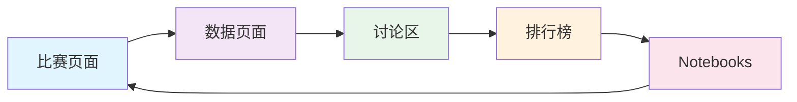
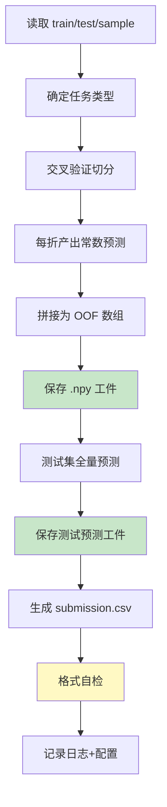

# 第1章 VibeKaggle 的工作流全景：从第一天起就在协作中工作

> **本章目标**：在跑任何模型之前，建立起一个**带工件目录的空工作区**，跑通常数基线，理解三种提交路径与提交预算的护栏作用。你将看到 VibeKaggle 从“第零步”就开始把人机协作写进肌肉记忆。

---

## 1.1 Kaggle 的五分钟导览

打开任意一场 Kaggle 比赛页面（例如 [Playground Series - Season 6, Episode 3](https://www.kaggle.com/competitions/playground-series-s6e3)），你会看到五大核心区域：

| 区域 | 位置 | 作用 | VibeKaggle 视角的关键点 |
|------|------|------|-------------------------|
| **比赛页面** | 顶部标签栏 `Overview` | 规则、评价指标、时间线、奖金、数据下载 | 指标决定优化方向，**Agent 不能自主选择指标** |
| **数据页面** | 标签栏 `Data` | `train.csv`、`test.csv`、`sample_submission.csv` 下载 | 三份核心文件的**格式契约**必须由人确认 |
| **讨论区** | 标签栏 `Discussion` | 公开方案、数据泄漏报告、基线分享 | Agent 可抓取公开 Notebook 作为参考，**但人要判断可信度** |
| **排行榜** | 标签栏 `Leaderboard` | Public LB / Private LB、提交历史 | **Public LB 在高频实验下噪声被放大**，不能作为唯一验证标准 |
| **Notebooks** | 标签栏 `Code` | 交互式运行环境、GPU/TPU 配额 | Agent 通过 MCP 在沙箱中持续运行，**不是手动点击运行** |



> **区分“比赛”与“数据集”**：比赛有评价指标、排行榜、提交截止日期、规则红线；数据集只是文件托管，没有评分机制。新手常把两者混淆——**只在比赛页面点击“Join Competition”才算正式参赛**。

---

## 1.2 选择一场“自动化友好”的入门比赛

并非所有比赛都适合 VibeKaggle 的起步练习。理想的首战应满足：

1. **指标明确**：AUC、RMSE、LogLoss、MAPE 等标准指标，无自定义复杂指标；
2. **有 `sample_submission.csv`**：提交格式有参考，Agent 生成提交文件时可自检；
3. **讨论区有活跃的公开 Notebook**：Agent 可参考公开代码结构，人可对照验证思路；
4. **数据规模可控**：训练集行数 < 100 万、列数 < 200，单次训练 < 10 分钟；
5. **获胜方案公开可查**：复盘时有地标。

**Playground Series 是理想的第一站**：2025—2026 年的 Playground 覆盖了从贴纸销售预测到客户流失、从道路事故风险到 F1 进站预测的多种表格任务，数据规模可控，评估指标清晰，且获胜方案公开可查。

> **建议第一场练手**：Playground Series S6E3 客户流失预测（二分类、AUC、约 16 万行 × 13 列），或 S5E1 贴纸销售预测（时序回归、MAPE、约 5 万行）。

---

## 1.3 三份核心文件与提交格式

每场表格比赛的数据页面至少提供三个文件：

| 文件 | 内容 | 约束 | Agent 自检清单 |
|------|------|------|----------------|
| `train.csv` | 特征 + 目标列 | 含目标列，行数 = 训练样本数 | 读取后检查目标列是否存在、缺失值比例、类别分布 |
| `test.csv` | 仅特征，无目标 | 行数 = 测试样本数，**列名与 train 一致**（除目标列） | 检查列名对齐、数据类型一致、无目标列残留 |
| `sample_submission.csv` | `id` + 目标列占位 | **行数 = test.csv 行数、列名完全一致** | **核心自检**：生成的提交文件必须与 sample_submission 形状、列名、ID 顺序**完全一致** |

**Agent 生成提交文件时的格式自检清单**（请把这段代码存入工具库，每次提交前跑一次）：

```python
# utils/submission_check.py
import pandas as pd
from pathlib import Path

def assert_submission_format(
    submission_path: str,
    sample_path: str,
    id_col: str = "id",
    target_col: str = "target"
) -> None:
    """
    提交文件格式断言：形状、列名、ID 顺序、数值范围。
    失败抛出 AssertionError，Agent 可捕获并自动修复。
    """
    sub = pd.read_csv(submission_path)
    sample = pd.read_csv(sample_path)
    
    # 1. 形状一致
    assert sub.shape == sample.shape, f"形状不匹配: sub {sub.shape} vs sample {sample.shape}"
    
    # 2. 列名一致
    assert list(sub.columns) == list(sample.columns), f"列名不匹配: {list(sub.columns)} vs {list(sample.columns)}"
    
    # 3. ID 列完全一致（顺序、值）
    assert (sub[id_col] == sample[id_col]).all(), "ID 列不一致"
    
    # 4. 目标列无缺失
    assert sub[target_col].notna().all(), "目标列存在缺失值"
    
    # 5. 分类任务：概率在 [0,1]；回归任务：无极端异常值
    if sub[target_col].dtype.kind in 'fc':  # float
        assert sub[target_col].between(0, 1).all() or sub[target_col].between(-1e6, 1e6).all(), "数值范围异常"
    
    print(f"✅ 提交文件格式通过: {submission_path}")

# 使用示例
if __name__ == "__main__":
    assert_submission_format("submission.csv", "data/sample_submission.csv")
```

---

## 1.4 VibeKaggle 的第一个动作：建立工件目录，而不是先写模型

**这是全书最重要的肌肉记忆**：在跑任何模型之前，先创建工件目录并确定命名规范。

```bash
# 终端执行（或在 Notebook 中用 !mkdir -p）
mkdir -p artifacts/oof artifacts/test_preds artifacts/logs artifacts/configs
```

目录结构与命名规范：

```
artifacts/
├── oof/                    # Out-of-Fold 预测（验证集预测）
│   ├── train_oof_autogluon_v001.npy
│   ├── train_oof_lgbm_v001.npy
│   └── train_oof_xgb_v001.npy
├── test_preds/             # 测试集预测
│   ├── test_preds_autogluon_v001.npy
│   ├── test_preds_lgbm_v001.npy
│   └── test_preds_xgb_v001.npy
├── logs/                   # 实验日志（JSON Lines 格式）
│   ├── exp_autogluon_v001.jsonl
│   └── exp_lgbm_v001.jsonl
└── configs/                # 实验配置快照
    ├── cfg_autogluon_v001.yaml
    └── cfg_lgbm_v001.yaml
```

**命名约定**（全书统一）：
- OOF 文件：`train_oof_[MODEL]_[VERSION].npy`
- 测试预测文件：`test_preds_[MODEL]_[VERSION].npy`
- 日志文件：`exp_[MODEL]_[VERSION].jsonl`
- 配置文件：`cfg_[MODEL]_[VERSION].yaml`

> **为什么用 `.npy` 而不是 `.csv`？** 二进制格式读写快 10 倍以上，且精度无损。工件是给程序读的，不是给人看的。

### 第一个基线——常数预测也要产出合规工件

不要小看常数基线。它的作用是**验证工件流水线打通**：数据读取 → 验证切分 → 预测生成 → 工件落盘 → 格式自检 → 提交预演。

```python
# baselines/constant_baseline.py
"""
常数基线：为二分类输出正类均值，为回归输出目标均值。
核心目的：跑通工件流水线，而非追求分数。
"""
import numpy as np
import pandas as pd
from pathlib import Path
from sklearn.model_selection import StratifiedKFold, KFold
import json
import yaml

# ========== 配置区 ==========
DATA_DIR = Path("data")
ARTIFACT_DIR = Path("artifacts")
OOF_DIR = ARTIFACT_DIR / "oof"
TEST_DIR = ARTIFACT_DIR / "test_preds"
LOG_DIR = ARTIFACT_DIR / "logs"
CFG_DIR = ARTIFACT_DIR / "configs"

for d in [OOF_DIR, TEST_DIR, LOG_DIR, CFG_DIR]:
    d.mkdir(parents=True, exist_ok=True)

VERSION = "v001"
MODEL_NAME = "constant"
TARGET_COL = "target"  # 根据比赛修改
ID_COL = "id"
N_FOLDS = 5
RANDOM_STATE = 42
# ========== 配置区结束 ==========

def main():
    # 1. 读取数据
    train = pd.read_csv(DATA_DIR / "train.csv")
    test = pd.read_csv(DATA_DIR / "test.csv")
    sample_sub = pd.read_csv(DATA_DIR / "sample_submission.csv")
    
    y = train[TARGET_COL].values
    X = train.drop(columns=[TARGET_COL, ID_COL], errors='ignore')
    X_test = test.drop(columns=[ID_COL], errors='ignore')
    
    # 2. 确定任务类型与常数值
    if y.dtype.kind in 'iub' and len(np.unique(y)) == 2:
        task = "binary"
        const_val = float(y.mean())  # 正类概率均值
    else:
        task = "regression"
        const_val = float(y.mean())
    
    print(f"任务类型: {task}, 常数预测值: {const_val:.6f}")
    
    # 3. 交叉验证产出 OOF
    if task == "binary":
        cv = StratifiedKFold(n_splits=N_FOLDS, shuffle=True, random_state=RANDOM_STATE)
    else:
        cv = KFold(n_splits=N_FOLDS, shuffle=True, random_state=RANDOM_STATE)
    
    oof = np.zeros(len(train), dtype=np.float32)
    fold_scores = []
    
    for fold, (trn_idx, val_idx) in enumerate(cv.split(X, y)):
        # 常数模型：训练集均值即预测值
        fold_pred = np.full(len(val_idx), const_val, dtype=np.float32)
        oof[val_idx] = fold_pred
        
        # 计算折分数（仅作记录）
        from sklearn.metrics import roc_auc_score, mean_squared_error
        if task == "binary":
            score = roc_auc_score(y[val_idx], fold_pred)
        else:
            score = -mean_squared_error(y[val_idx], fold_pred, squared=False)  # 负 RMSE 便于统一“越大越好”
        fold_scores.append(score)
        print(f"  Fold {fold}: {score:.6f}")
    
    cv_mean = np.mean(fold_scores)
    cv_std = np.std(fold_scores)
    print(f"CV: {cv_mean:.6f} ± {cv_std:.6f}")
    
    # 4. 保存 OOF 工件
    oof_path = OOF_DIR / f"train_oof_{MODEL_NAME}_{VERSION}.npy"
    np.save(oof_path, oof)
    print(f"✅ OOF 已保存: {oof_path}")
    
    # 5. 测试集预测
    test_preds = np.full(len(test), const_val, dtype=np.float32)
    test_path = TEST_DIR / f"test_preds_{MODEL_NAME}_{VERSION}.npy"
    np.save(test_path, test_preds)
    print(f"✅ 测试预测已保存: {test_path}")
    
    # 6. 生成提交文件并自检
    submission = sample_sub.copy()
    submission[TARGET_COL] = test_preds
    sub_path = ARTIFACT_DIR / f"submission_{MODEL_NAME}_{VERSION}.csv"
    submission.to_csv(sub_path, index=False)
    
    # 复用自检函数
    from utils.submission_check import assert_submission_format
    assert_submission_format(sub_path, DATA_DIR / "sample_submission.csv", ID_COL, TARGET_COL)
    print(f"✅ 提交文件已生成并通过自检: {sub_path}")
    
    # 7. 记录实验日志（JSON Lines）
    log_entry = {
        "model": MODEL_NAME,
        "version": VERSION,
        "task": task,
        "cv_scheme": f"{N_FOLDS}折{'分层' if task=='binary' else ''}",
        "cv_scores": fold_scores,
        "cv_mean": float(cv_mean),
        "cv_std": float(cv_std),
        "oof_path": str(oof_path),
        "test_path": str(test_path),
        "submission_path": str(sub_path),
        "constant_value": const_val,
        "n_train": int(len(train)),
        "n_test": int(len(test)),
    }
    log_path = LOG_DIR / f"exp_{MODEL_NAME}_{VERSION}.jsonl"
    with open(log_path, 'w') as f:
        f.write(json.dumps(log_entry, ensure_ascii=False) + '\n')
    print(f"✅ 实验日志已记录: {log_path}")
    
    # 8. 保存配置快照
    cfg_path = CFG_DIR / f"cfg_{MODEL_NAME}_{VERSION}.yaml"
    with open(cfg_path, 'w') as f:
        yaml.dump(log_entry, f, allow_unicode=True)
    print(f"✅ 配置快照已保存: {cfg_path}")

if __name__ == "__main__":
    main()
```

运行后，你会得到：
- `artifacts/oof/train_oof_constant_v001.npy` — 可直接用于后续集成
- `artifacts/test_preds/test_preds_constant_v001.npy` — 可直接集成
- `artifacts/logs/exp_constant_v001.jsonl` — 可被 Agent 读取汇总
- `artifacts/configs/cfg_constant_v001.yaml` — 复现依据

> **关键心法**：**没有工件，Agent 的高吞吐量只会制造混乱**。第一个基线的验收标准不是分数，而是**产出合规的 OOF 和 test prediction 文件**。



---

## 1.5 三种提交路径及其安全边界

| 路径 | 方式 | 优点 | 风险 | VibeKaggle 建议 |
|------|------|------|------|-----------------|
| **手动网页上传** | 浏览器点击 Submit | 最可控、强制人工确认 | 慢、不适合高频实验 | 最终提交、关键节点使用 |
| **Kaggle CLI** | `kaggle competitions submit -c <comp> -f <file> -m <msg>` | 可脚本化、有记录 | 无预览确认机制 | Agent 可调用，**必须配合 dry-run** |
| **MCP 驱动提交** | Agent 调用 MCP Server 的 `submit` 工具 | 零摩擦、可编排进流水线 | **零摩擦是风险不是优势** | **核心护栏**：预览-确认双调用、每日提交预算、不可逆操作默认关闭 |

**核心原则**：Agent 可以让提交“零摩擦”，但**零摩擦是风险不是优势**。提交预算和预览-确认机制是工作流的护栏。

### MCP 提交预演（dry-run）示例

```python
# mcp_tools/kaggle_submit.py
"""
MCP Server 侧的提交工具（伪代码，实际部署见附录 F）。
核心护栏：dry_run=True 时只预览，不真正提交。
"""
from typing import Optional
from pydantic import BaseModel

class SubmitRequest(BaseModel):
    competition: str
    file_path: str
    message: str
    dry_run: bool = True  # 默认预览模式！

class SubmitResponse(BaseModel):
    success: bool
    message: str
    submission_id: Optional[str] = None
    public_score: Optional[float] = None
    dry_run: bool

async def kaggle_submit(req: SubmitRequest) -> SubmitResponse:
    if req.dry_run:
        # 只做格式校验、显示文件大小、预估分数范围
        return SubmitResponse(
            success=True,
            message=f"[DRY-RUN] 准备提交 {req.file_path} 到 {req.competition}，留言: {req.message}",
            dry_run=True
        )
    
    # 真实提交逻辑（调用 Kaggle API）
    # ...
    return SubmitResponse(success=True, message="提交成功", submission_id="12345", public_score=0.85, dry_run=False)
```

**人机分工**：
- Agent 负责：生成合规提交文件、调用 `dry_run=True` 预览、汇总历史提交记录
- 人负责：阅读预览信息、决定是否消耗一次提交预算、执行 `dry_run=False` 的最终确认

---

## 1.6 排行榜解读

### Public LB 在 Agent 高频实验下噪声被放大

当你一天跑 50 个实验、各提交一次时，Public LB 分数的波动主要来自：
1. **采样噪声**：Public LB 通常只用测试集 20%-30% 的数据；
2. **多重比较问题**：选最好的那个分数，本质上是在 LB 上过拟合；
3. **分布偏移**：测试集可能与训练集不完全同分布。

**VibeKaggle 纪律**：**本地 CV 是主验证，Public LB 仅作参考**。只有当本地 CV 稳定提升、且多个模型 CV 一致看涨时，才考虑消耗提交预算。

### 本地 CV 与 LB 的差异在 Agent 时代的解读方式

| 现象 | 传统解释 | VibeKaggle 解释 |
|------|----------|-----------------|
| CV↑ LB↑ | 好事 | 正常，继续 |
| CV↑ LB↓ | 过拟合 | **检查验证方案是否泄漏、特征是否含未来信息、工件是否污染** |
| CV↓ LB↑ | 运气好 | **不可复现，丢弃该方向** |
| CV↓ LB↓ | 变差 | 回滚，分析原因 |

> **工件让诊断成为可能**：有了 OOF 工件，你可以事后计算任意指标、任意切分下的分数，而不必重跑模型。

---

## 1.7 规则红线（精简版）

在让 Agent 自动化运行前，**人必须先读完比赛规则**，并把红线写入 Harness 配置：

| 红线类别 | 典型条款 | Harness 中的体现 |
|----------|----------|------------------|
| **外部数据** | 禁止/允许特定来源 | 工具白名单：只允许读取 `data/` 目录，禁止联网下载 |
| **预训练模型** | 仅允许特定开源模型 | 模型白名单：配置允许的 backbone 列表 |
| **自动化行为披露** | 需在提交说明中声明 Agent 使用 | 提交留言模板强制包含 `Agent: <model>-<version>` |
| **团队合并** | 截止日期前合并 | 预算控制：团队共享每日提交上限 |
| **代码公开** | 获奖需开源 | 输出目录强制包含复现脚本 |

> **实操建议**：把规则红线写成 `configs/rules.yaml`，Agent 启动时读取并校验每个动作。

---

## 1.8 小结

本章结束时，你应该拥有：

1. ✅ 一个**带工件目录的空工作区**（`artifacts/oof/`, `artifacts/test_preds/`, `artifacts/logs/`, `artifacts/configs/`）
2. ✅ 一个已跑通的**常数基线工件**（OOF + 测试预测 + 提交文件 + 日志 + 配置）
3. ✅ 理解**三种提交路径**的风险与护栏
4. ✅ 建立**本地 CV 为主、Public LB 为辅**的验证心智

> **下一章预告**：第 2 章将把工件规范升级为全书的**基础协议**，建立验证优先的判断纪律，定义 Agent 能力边界，配置 MCP 安全流水线。

---

## 本章关键代码汇总

| 文件 | 用途 |
|------|------|
| `utils/submission_check.py` | 提交文件格式自检（每次提交前必跑） |
| `baselines/constant_baseline.py` | 第一个基线：跑通工件流水线 |
| `mcp_tools/kaggle_submit.py` | MCP 提交工具（含 dry-run 护栏） |

> **练习**：把常数基线改成“按类别均值预测”（如按 `category` 列分组取目标均值），重新跑一遍流水线，观察 CV 变化，并对比两个版本的 OOF 相关性。