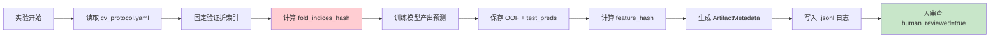
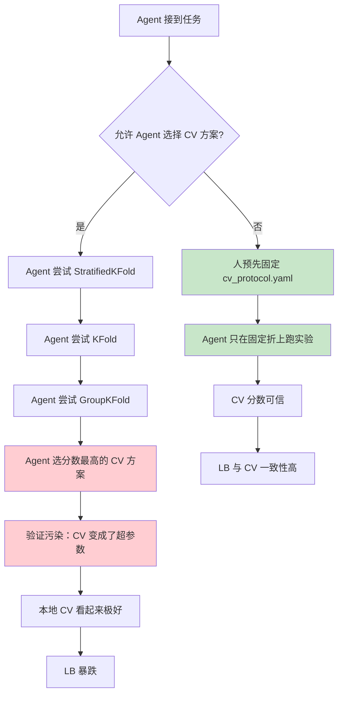
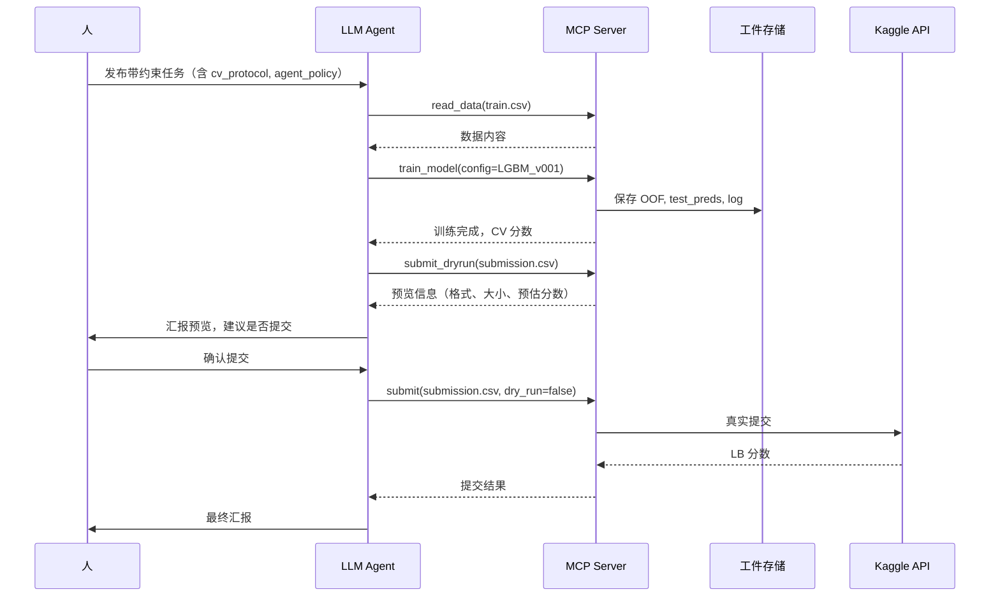

# 第2章 VibeKaggle 的操作系统：工件、验证、Agent、预算

> **本章目标**：把第 1 章的“肌肉记忆”升级为**全书通用的基础协议**。你将建立工件规范、固定验证协议、划定 Agent 能力边界、配置 MCP 安全流水线。本章结束时，你将拥有一套**可复用的操作系统**，后续每一场比赛都在其上运行。

---

## 2.1 工件规范：VibeKaggle 的物理基础

### 为什么工件规范必须是“物理基础”？

想象一下：Agent 在固定 CV 下跑了 200 个实验，每个实验产出 OOF 和测试预测。如果没有统一的命名、目录、元数据：
- 你无法用脚本自动收集所有 OOF 做集成；
- 你无法追溯某个工件是哪个版本、哪个模型、哪个 CV 方案产出的；
- 你无法检查“验证污染”——Agent 是否偷偷换了 CV 方案刷分；
- 甚至无法把工件喂给下一个 Agent 做 Stacking。

**工件规范就是让“工件可组合、可追溯、可审计”的物理协议。**

### 2.1.1 目录结构（全书统一）

```
<project_root>/
├── artifacts/                    # 所有工件的根目录（Git 忽略，或用 DVC 管理）
│   ├── oof/                      # Out-of-Fold 预测：形状 (n_train,)
│   │   └── train_oof_[MODEL]_[VERSION].npy
│   ├── test_preds/               # 测试集预测：形状 (n_test,)
│   │   └── test_preds_[MODEL]_[VERSION].npy
│   ├── logs/                     # 实验日志：JSON Lines，每行一个实验
│   │   └── exp_[MODEL]_[VERSION].jsonl
│   ├── configs/                  # 配置快照：YAML，便于人阅读
│   │   └── cfg_[MODEL]_[VERSION].yaml
│   ├── submissions/              # 生成的提交文件备份
│   │   └── submission_[MODEL]_[VERSION].csv
│   └── ensembles/                # 集成产出的工件
│       ├── oof_ensemble_[NAME]_[VERSION].npy
│       └── test_ensemble_[NAME]_[VERSION].npy
├── data/                         # 原始数据（只读）
│   ├── train.csv
│   ├── test.csv
│   └── sample_submission.csv
├── src/                          # 可复用源码
│   ├── utils/
│   ├── baselines/
│   ├── features/
│   ├── models/
│   └── ensembles/
├── configs/                      # 项目级配置（非实验级）
│   ├── rules.yaml                # 比赛规则红线
│   ├── cv_protocol.yaml          # 验证协议（人设定，不可变）
│   └── agent_policy.yaml         # Agent 权限策略
├── notebooks/                    # 探索性笔记本（不产出工件）
└── scripts/                      # 一次性脚本
```

### 2.1.2 命名约定（强制）

| 要素 | 格式 | 示例 | 说明 |
|------|------|------|------|
| 模型标识 | `[A-Z0-9_]+` | `AUTOGLUON`, `LGBM`, `XGB`, `TABPFN`, `NN`, `ENSEMBLE` | 大写，下划线分隔 |
| 版本号 | `v` + 3 位数字 | `v001`, `v012`, `v100` | 严格递增，便于排序 |
| 任务后缀 | 可选 | `_cls`, `_reg`, `_rank` | 多任务时区分 |

**完整文件名模式**：
- OOF：`train_oof_{MODEL}_{VERSION}.npy`
- 测试预测：`test_preds_{MODEL}_{VERSION}.npy`
- 日志：`exp_{MODEL}_{VERSION}.jsonl`
- 配置：`cfg_{MODEL}_{VERSION}.yaml`
- 提交：`submission_{MODEL}_{VERSION}.csv`
- 集成 OOF：`oof_ensemble_{NAME}_{VERSION}.npy`

### 2.1.3 每个工件必须附带的最小元数据

每个 `.jsonl` 日志行必须包含以下字段（Agent 自动生成，人审查）：

```python
# src/utils/artifact_schema.py
from pydantic import BaseModel, Field
from typing import List, Optional, Literal
from datetime import datetime

class ArtifactMetadata(BaseModel):
    # 身份
    model: str                    # 模型标识，如 "AUTOGLUON"
    version: str                  # 版本，如 "v001"
    task_type: Literal["binary", "multiclass", "regression", "ranking"]
    
    # 验证协议（关键：防验证污染）
    cv_scheme: str                # 如 "StratifiedKFold_5_42" 或 "GroupKFold_5_group_col_42"
    cv_fold_indices_hash: str     # 验证折索引的 SHA256，确保协议未被篡改
    
    # 性能
    cv_scores: List[float]        # 每折分数
    cv_mean: float
    cv_std: float
    metric: str                   # 如 "auc", "rmse", "logloss"
    
    # 工件路径
    oof_path: str                 # 相对 artifacts/ 路径
    test_path: str
    submission_path: Optional[str] = None
    
    # 数据血统
    n_train: int
    n_test: int
    feature_hash: str             # 训练特征矩阵的哈希（排除目标列）
    preprocessing_hash: str       # 预处理管线哈希
    
    # 变更描述（人工填写或 Agent 摘要）
    change_desc: str              # 一行描述：如 "增加交互特征 X*Y"、"调整 learning_rate 0.05->0.01"
    
    # 时间戳
    created_at: datetime = Field(default_factory=datetime.utcnow)
    agent_model: Optional[str] = None  # 如 "claude-opus-4.8"
    human_reviewed: bool = False       # 人是否已审查
    
    class Config:
        json_encoders = {datetime: lambda v: v.isoformat()}

# 验证函数
def validate_artifact_metadata(meta: ArtifactMetadata) -> bool:
    """校验工件元数据完整性"""
    # 1. 必填字段非空
    assert meta.model and meta.version and meta.change_desc
    # 2. CV 折数一致
    assert len(meta.cv_scores) >= 2
    # 3. 路径存在
    from pathlib import Path
    assert Path(meta.oof_path).exists()
    assert Path(meta.test_path).exists()
    # 4. 分数合理
    assert all(0 <= s <= 1 or -1e6 < s < 1e6 for s in meta.cv_scores)
    return True
```

> **没有工件规范，“人看 OOF 做判断”是空话，“Agent 自动做 hill climbing”无从谈起，“验证污染”也无从检查。**



---

## 2.2 验证优先：不可委托的判断纪律

### 2.2.1 什么是“验证优先”？

**验证方案的设计（折数、分层、分组、时间切分）必须由人完成，Agent 只负责执行。**

这听起来像常识，但在 Agent 高吞吐量下极易被打破：

> **验证污染**：当 Agent 被允许“尝试多种 CV 方案并选最好的那个”时，验证本身就成了搜索空间的一部分。



### 2.2.2 `cv_protocol.yaml`：验证协议的“宪法”

每个项目开始时，**人必须先写好这个文件**，之后全程**只读不改**：

```yaml
# configs/cv_protocol.yaml
# 由人编写，Agent 只读，全程不可变
# 修改此文件 = 重启项目（所有工件作废）

protocol_version: "1.0"
created_at: "2026-01-15T10:00:00Z"
author: "human"

# 任务类型决定默认 CV 类型
task_type: "binary"  # binary / multiclass / regression / ranking

# 核心 CV 方案（二选一，或自定义）
cv_scheme:
  type: "StratifiedKFold"  # 可选: KFold, StratifiedKFold, GroupKFold, TimeSeriesSplit, Custom
  n_splits: 5
  random_state: 42
  shuffle: true
  
  # GroupKFold 时必填
  group_column: null       # 如 "customer_id", "store_id"
  
  # TimeSeriesSplit 时必填
  time_column: null        # 如 "date"
  gap: 0                   # 训练集与验证集的间隔
  max_train_size: null     # 可选：滚动窗口大小

# 分层列（分类任务时通常是目标列）
stratify_column: "target"  # 仅 StratifiedKFold 使用

# 禁用的 CV 方案（防止 Agent 尝试）
forbidden_schemes:
  - "KFold"           # 分类任务禁用普通 KFold
  - "ShuffleSplit"    # 禁用随机重采样
  - "LeaveOneOut"     # 计算量太大且易泄漏

# 验证集比例（用于单次 Holdout 备选）
holdout_ratio: 0.2
holdout_random_state: 42

# 指标（Agent 不可自行更换）
metric:
  name: "auc"           # auc / logloss / rmse / mape / r2 / accuracy / f1
  direction: "maximize" # maximize / minimize
  threshold: null       # 二分类阈值相关指标时使用

# 泄漏检查清单（人审查时核对）
leakage_checks:
  - "目标编码是否仅用训练折计算"
  - "时间特征是否包含未来信息"
  - "分组列是否跨折泄漏"
  - "预处理拟合是否仅在训练折上"
```

### 2.2.3 验证折索引哈希：防篡改的技术手段

Agent 每次运行时，**必须**计算并记录验证折索引的哈希值，写入工件元数据：

```python
# src/utils/cv_protocol.py
import hashlib
import numpy as np
import pandas as pd
from sklearn.model_selection import StratifiedKFold, KFold, GroupKFold, TimeSeriesSplit
from pathlib import Path
import yaml

def load_cv_protocol(config_path: str = "configs/cv_protocol.yaml") -> dict:
    with open(config_path) as f:
        return yaml.safe_load(f)

def get_cv_splitter(protocol: dict, X: pd.DataFrame, y: np.ndarray):
    """根据协议返回 CV 分割器，并生成折索引数组"""
    scheme = protocol['cv_scheme']
    cv_type = scheme['type']
    n_splits = scheme['n_splits']
    rs = scheme.get('random_state', 42)
    
    if cv_type == "StratifiedKFold":
        stratify_col = protocol.get('stratify_column', 'target')
        stratify = X[stratify_col] if stratify_col in X.columns else y
        cv = StratifiedKFold(n_splits=n_splits, shuffle=scheme.get('shuffle', True), random_state=rs)
        splits = list(cv.split(X, stratify))
    elif cv_type == "GroupKFold":
        group_col = scheme['group_column']
        groups = X[group_col]
        cv = GroupKFold(n_splits=n_splits)
        splits = list(cv.split(X, y, groups))
    elif cv_type == "TimeSeriesSplit":
        cv = TimeSeriesSplit(
            n_splits=n_splits,
            gap=scheme.get('gap', 0),
            max_train_size=scheme.get('max_train_size')
        )
        splits = list(cv.split(X))
    elif cv_type == "KFold":
        cv = KFold(n_splits=n_splits, shuffle=scheme.get('shuffle', True), random_state=rs)
        splits = list(cv.split(X, y))
    else:
        raise ValueError(f"Unsupported CV type: {cv_type}")
    
    return cv, splits

def compute_fold_indices_hash(splits: list, n_samples: int) -> str:
    """计算折索引的 SHA256，用于检测 CV 协议是否被篡改"""
    # 构建一个 (n_samples,) 数组，值为折编号 0..n_splits-1
    fold_indices = np.full(n_samples, -1, dtype=np.int32)
    for fold_idx, (_, val_idx) in enumerate(splits):
        fold_indices[val_idx] = fold_idx
    assert (fold_indices >= 0).all(), "有样本未分配到验证折"
    
    # 哈希
    return hashlib.sha256(fold_indices.tobytes()).hexdigest()[:16]

def verify_cv_protocol_unchanged(protocol: dict, current_hash: str, log_dir: Path) -> bool:
    """检查历史日志中是否有不同的 fold_indices_hash"""
    import json
    for log_file in log_dir.glob("exp_*.jsonl"):
        with open(log_file) as f:
            for line in f:
                entry = json.loads(line)
                if 'cv_fold_indices_hash' in entry:
                    if entry['cv_fold_indices_hash'] != current_hash:
                        print(f"⚠️ 检测到 CV 协议不一致！")
                        print(f"  当前: {current_hash}")
                        print(f"  历史 ({log_file.name}): {entry['cv_fold_indices_hash']}")
                        print(f"  历史模型: {entry['model']}_{entry['version']}")
                        return False
    return True

# 使用示例
if __name__ == "__main__":
    protocol = load_cv_protocol()
    train = pd.read_csv("data/train.csv")
    y = train["target"].values
    X = train.drop(columns=["target", "id"], errors='ignore')
    
    cv, splits = get_cv_splitter(protocol, X, y)
    fold_hash = compute_fold_indices_hash(splits, len(train))
    print(f"CV 协议哈希: {fold_hash}")
    
    # 检查历史
    from pathlib import Path
    if not verify_cv_protocol_unchanged(protocol, fold_hash, Path("artifacts/logs")):
        raise RuntimeError("CV 协议已被篡改，请检查！")
    print("✅ CV 协议一致性检查通过")
```

> **人必须固定验证协议**。这是不可让渡的判断纪律——Agent 的吞吐量越高，这个护栏越重要。

---

## 2.3 LLM Agent 的能力边界：执行和枚举，而非判断

### 2.3.1 Agent 擅长什么（可委托）

| 类别 | 典型任务 | VibeKaggle 中的体现 |
|------|----------|---------------------|
| **代码生成** | EDA 脚本、baseline pipeline、特征工程函数、训练循环 | Agent 生成 `src/features/`, `src/models/` 下的模块 |
| **批量执行** | 50 种特征变换的 CV 对比、100 组超参搜索、20 个模型家族的基线 | Agent 循环调用训练函数，产出工件阵列 |
| **结果汇总** | 读取所有 `exp_*.jsonl`，生成排行榜表格、相关性热力图、CV 趋势图 | Agent 输出 `reports/weekly_summary.md` |
| **工件管理** | 按命名规范重命名、搬移、校验完整性、计算 OOF 相关性矩阵 | Agent 维护 `artifacts/` 目录整洁 |
| **候选生成** | Stacking 的元学习器候选、Blending 权重搜索空间枚举 | Agent 生成 `ensemble_candidates_v001.yaml` |

### 2.3.2 Agent 不擅长什么（不可委托）

| 类别 | 典型任务 | 原因 |
|------|----------|------|
| **方向判断** | “该不该做特征选择？”、“要不要试神经网络？” | 需要领域直觉、资源权衡、风险评估 |
| **验证方案设计** | “用 5 折还是 10 折？”、“要不要 GroupKFold？” | 验证污染风险，必须由人把关 |
| **语义合理性** | “这个交互特征 X*Y 有业务意义吗？”、“目标编码会不会泄漏？” | 需要数据生成机制的因果理解 |
| **提交决策** | “这版 CV 提升 0.001 值不值得消耗一次提交？” | 提交预算是稀缺资源，涉及机会成本 |
| **异常诊断** | “CV 突然掉了 0.01，是数据变了还是代码坏了？” | 需要系统性排查，Agent 易产生幻觉解释 |

### 2.3.3 给 Agent 的指令模板：带约束的请求

**❌ 错误指令**：“帮我建个模型提高分数”
**✅ 正确指令**：

```markdown
## Agent Task: 批量训练 LightGBM 变体

### 约束条件（硬性）
- CV 协议：严格遵循 `configs/cv_protocol.yaml`，fold_indices_hash 必须一致
- 工件命名：`train_oof_LGBM_v{3位版本号}.npy`，`test_preds_LGBM_v{3位版本号}.npy`
- 日志格式：`ArtifactMetadata` Schema，change_desc 必填
- 禁止操作：修改 CV 方案、使用外部数据、联网下载模型

### 搜索空间（软性）
- 模型参数组合（共 12 组）：
  - learning_rate: [0.01, 0.05, 0.1]
  - num_leaves: [31, 63, 127]
  - min_child_samples: [20, 50]
  - feature_fraction: [0.8, 1.0]
- 固定参数：n_estimators=2000, early_stopping_rounds=100, random_state=42

### 验收标准
1. 所有 12 个实验产出合规工件（.npy + .jsonl）
2. 无验证协议违规（fold_indices_hash 一致）
3. 生成汇总报告：按 CV 降序排列，含 OOF 相关性矩阵
4. 标记出 CV 前 3 名供人审查

### 输出交付物
- `artifacts/logs/exp_LGBM_v001.jsonl` ~ `v012.jsonl`
- `artifacts/oof/train_oof_LGBM_v001.npy` ~ `v012.npy`
- `artifacts/test_preds/test_preds_LGBM_v001.npy` ~ `v012.npy`
- `reports/lgbm_sweep_v001.md`（汇总报告）
```

> **核心原则**：人向 Agent 发出的指令应该是**带约束的请求**，而不是“帮我建个模型”。约束来自 Harness（验证协议、工件规范、预算、工具白名单）。

---

## 2.4 AutoML 与表格基础模型：强基线的快速来源

### 2.4.1 为什么每场比赛第一步都是 AutoML？

- **建立“不费力竞争基线”**：AutoGluon 的多层 Stacking 能在 10-30 分钟内给出强基线，人据此判断“当前数据上不费力能做到多好”；
- **多样性来源**：AutoGluon 内部集成了多种模型家族（GBM、NN、RF、XT、KNN），其 OOF 天然具有多样性，适合后续人工 Stacking；
- **校准工件流水线**：AutoGluon 产出的 OOF/预测可直接落盘为标准工件，验证流水线是否打通。

### 2.4.2 AutoGluon 基线适配器（产出合规工件）

```python
# baselines/autogluon_baseline.py
"""
AutoGluon 基线：产出合规的 OOF 和测试预测工件。
核心逻辑：用 TabularPredictor.fit() 获得 OOF，手动预测测试集，按规范落盘。
"""
import numpy as np
import pandas as pd
from pathlib import Path
import json
import yaml
from datetime import datetime
from autogluon.tabular import TabularPredictor
from sklearn.metrics import roc_auc_score, log_loss, mean_squared_error

# ========== 配置 ==========
DATA_DIR = Path("data")
ARTIFACT_DIR = Path("artifacts")
MODEL_NAME = "AUTOGLUON"
VERSION = "v001"
TIME_LIMIT = 300  # 秒
PRESETS = "best_quality"  # "medium_quality", "good_quality", "best_quality"
# ========== 配置结束 ==========

def main():
    # 1. 读取数据与验证协议
    train = pd.read_csv(DATA_DIR / "train.csv")
    test = pd.read_csv(DATA_DIR / "test.csv")
    sample_sub = pd.read_csv(DATA_DIR / "sample_submission.csv")
    
    from src.utils.cv_protocol import load_cv_protocol, get_cv_splitter, compute_fold_indices_hash
    protocol = load_cv_protocol()
    
    target_col = "target"  # 根据比赛修改
    id_col = "id"
    y = train[target_col].values
    X = train.drop(columns=[target_col, id_col], errors='ignore')
    X_test = test.drop(columns=[id_col], errors='ignore')
    
    # 2. 获取固定 CV 折
    cv, splits = get_cv_splitter(protocol, X, y)
    fold_hash = compute_fold_indices_hash(splits, len(train))
    print(f"CV 协议哈希: {fold_hash}")
    
    # 3. 训练 AutoGluon（使用自定义 CV）
    # 注意：AutoGluon 不直接支持传入预定义折，这里用全量训练 + 手动 OOF
    # 更严谨的做法见下文的 "严格 OOF 模式"
    
    predictor = TabularPredictor(
        label=target_col,
        eval_metric=protocol['metric']['name'],
        path=str(ARTIFACT_DIR / f"autogluon_{MODEL_NAME}_{VERSION}"),
    ).fit(
        train_data=train,
        time_limit=TIME_LIMIT,
        presets=PRESETS,
        num_bag_folds=protocol['cv_scheme']['n_splits'],
        num_stack_levels=2,  # 多层 stacking
        verbosity=2,
    )
    
    # 4. 产出 OOF（AutoGluon 内部 OOF）
    # 注意：AutoGluon 的 OOF 是基于 bagging 折的，可能与我们的固定折不同
    # 严格模式：用 predictor.predict_proba_oof() 获取，但折可能不一致
    # 这里演示：用固定折重新训练每折模型（慢但严谨）
    oof = np.zeros(len(train), dtype=np.float32)
    fold_scores = []
    
    for fold, (trn_idx, val_idx) in enumerate(splits):
        print(f"  训练 Fold {fold}...")
        fold_train = train.iloc[trn_idx].reset_index(drop=True)
        fold_val = train.iloc[val_idx].reset_index(drop=True)
        
        fold_predictor = TabularPredictor(
            label=target_col,
            eval_metric=protocol['metric']['name'],
            path=str(ARTIFACT_DIR / f"autogluon_{MODEL_NAME}_{VERSION}_fold{fold}"),
        ).fit(
            train_data=fold_train,
            time_limit=TIME_LIMIT // protocol['cv_scheme']['n_splits'],
            presets=PRESETS,
            verbosity=0,
        )
        
        if protocol['task_type'] in ['binary', 'multiclass']:
            fold_pred = fold_predictor.predict_proba(fold_val.drop(columns=[target_col, id_col], errors='ignore'))
            if protocol['task_type'] == 'binary':
                fold_pred = fold_pred.iloc[:, 1].values  # 正类概率
        else:
            fold_pred = fold_predictor.predict(fold_val.drop(columns=[target_col, id_col], errors='ignore')).values
        
        oof[val_idx] = fold_pred.astype(np.float32)
        
        # 计算折分数
        if protocol['metric']['name'] == 'auc':
            score = roc_auc_score(y[val_idx], fold_pred)
        elif protocol['metric']['name'] == 'logloss':
            score = -log_loss(y[val_idx], fold_pred)  # 负 logloss 越大越好
        elif protocol['metric']['name'] == 'rmse':
            score = -mean_squared_error(y[val_idx], fold_pred, squared=False)
        else:
            score = 0
        fold_scores.append(score)
        print(f"    Fold {fold}: {score:.6f}")
    
    cv_mean = np.mean(fold_scores)
    cv_std = np.std(fold_scores)
    print(f"CV: {cv_mean:.6f} ± {cv_std:.6f}")
    
    # 5. 测试集预测（用全量训练的模型）
    if protocol['task_type'] in ['binary', 'multiclass']:
        test_pred = predictor.predict_proba(X_test)
        if protocol['task_type'] == 'binary':
            test_pred = test_pred.iloc[:, 1].values
    else:
        test_pred = predictor.predict(X_test).values
    test_pred = test_pred.astype(np.float32)
    
    # 6. 保存工件
    OOF_DIR = ARTIFACT_DIR / "oof"
    TEST_DIR = ARTIFACT_DIR / "test_preds"
    LOG_DIR = ARTIFACT_DIR / "logs"
    CFG_DIR = ARTIFACT_DIR / "configs"
    SUB_DIR = ARTIFACT_DIR / "submissions"
    for d in [OOF_DIR, TEST_DIR, LOG_DIR, CFG_DIR, SUB_DIR]:
        d.mkdir(parents=True, exist_ok=True)
    
    np.save(OOF_DIR / f"train_oof_{MODEL_NAME}_{VERSION}.npy", oof)
    np.save(TEST_DIR / f"test_preds_{MODEL_NAME}_{VERSION}.npy", test_pred)
    
    # 7. 生成提交文件
    submission = sample_sub.copy()
    submission[target_col] = test_pred
    sub_path = SUB_DIR / f"submission_{MODEL_NAME}_{VERSION}.csv"
    submission.to_csv(sub_path, index=False)
    
    # 8. 记录日志
    log_entry = {
        "model": MODEL_NAME,
        "version": VERSION,
        "task_type": protocol['task_type'],
        "cv_scheme": f"{protocol['cv_scheme']['type']}_{protocol['cv_scheme']['n_splits']}_{protocol['cv_scheme'].get('random_state', 42)}",
        "cv_fold_indices_hash": fold_hash,
        "cv_scores": [float(s) for s in fold_scores],
        "cv_mean": float(cv_mean),
        "cv_std": float(cv_std),
        "metric": protocol['metric']['name'],
        "oof_path": f"oof/train_oof_{MODEL_NAME}_{VERSION}.npy",
        "test_path": f"test_preds/test_preds_{MODEL_NAME}_{VERSION}.npy",
        "submission_path": f"submissions/submission_{MODEL_NAME}_{VERSION}.csv",
        "n_train": int(len(train)),
        "n_test": int(len(test)),
        "change_desc": f"AutoGluon {PRESETS} preset, time_limit={TIME_LIMIT}s",
        "agent_model": "autogluon-1.0",
        "human_reviewed": False,
    }
    
    log_path = LOG_DIR / f"exp_{MODEL_NAME}_{VERSION}.jsonl"
    with open(log_path, 'w') as f:
        f.write(json.dumps(log_entry, ensure_ascii=False) + '\n')
    
    cfg_path = CFG_DIR / f"cfg_{MODEL_NAME}_{VERSION}.yaml"
    with open(cfg_path, 'w') as f:
        yaml.dump(log_entry, f, allow_unicode=True)
    
    print(f"✅ AutoGluon 基线完成: CV={cv_mean:.6f}±{cv_std:.6f}")

if __name__ == "__main__":
    main()
```

### 2.4.3 TabPFN：零调参的表格基础模型

对于中小规模数据（n < 10k, d < 100），TabPFN 能在秒级给出强基线，**无需超参搜索**：

```python
# baselines/tabpfn_baseline.py
"""
TabPFN 基线：零调参、极快、中小数据极强。
适合作为多样性来源，与树模型 OOF 互补。
"""
import numpy as np
import pandas as pd
from pathlib import Path
import json
import yaml
from tabpfn import TabPFNClassifier, TabPFNRegressor
from sklearn.metrics import roc_auc_score, mean_squared_error

# 配置
MODEL_NAME = "TABPFN"
VERSION = "v001"
# ...

def main():
    # 读取数据、CV 协议...
    # TabPFN 不支持原生 CV，必须手动循环折
    for fold, (trn_idx, val_idx) in enumerate(splits):
        X_trn, y_trn = X.iloc[trn_idx], y[trn_idx]
        X_val = X.iloc[val_idx]
        
        if task_type == 'binary':
            model = TabPFNClassifier(device='cuda', N_ensemble_configurations=32)
        else:
            model = TabPFNRegressor(device='cuda')
        
        model.fit(X_trn, y_trn)
        pred = model.predict_proba(X_val)[:, 1] if task_type == 'binary' else model.predict(X_val)
        oof[val_idx] = pred
        # 计算分数...
    
    # 测试集：全量训练
    model.fit(X, y)
    test_pred = model.predict_proba(X_test)[:, 1] if task_type == 'binary' else model.predict(X_test)
    
    # 保存工件（同规范）...
```

> **关键点**：AutoGluon/TabPFN 产出的是**第一个有 CV 分数的合规工件**。人据此判断“不费力能做到多好”，决定是否投入更多 Agent 实验资源。

---

## 2.5 MCP：让 Agent 持续操作平台，安全是内置的

### 2.5.1 MCP 的核心价值

**MCP (Model Context Protocol)** 让 Agent 能够：
- 下载比赛数据 → EDA → 训练 → 工件落盘 → 提交预演 → 真实提交
- 成为**一条可持续运行的流水线**，而非一次性脚本

### 2.5.2 安全机制：流水线的护栏

| 护栏 | 实现方式 | 位置 |
|------|----------|------|
| **预览-确认双调用** | 所有写操作（提交、删除、修改配置）默认 `dry_run=true`，人确认后再 `dry_run=false` | MCP Tool 定义 |
| **每日提交预算** | `agent_policy.yaml` 设定 `daily_submit_limit: 3`，MCP Server 计数拦截 | MCP Server 状态 |
| **不可逆操作默认关闭** | `allow_destructive: false`，需人显式开启 | Agent Policy |
| **工具白名单** | Agent 只能调用 `train`, `predict`, `submit_dryrun`, `read_log`，不能调用 `rm`, `wget`, `pip install` | MCP Server 暴露工具集 |
| **审计日志** | 所有 MCP 调用记录到 `artifacts/logs/mcp_audit.jsonl` | MCP Server 中间件 |

### 2.5.3 `agent_policy.yaml`：Agent 权限策略

```yaml
# configs/agent_policy.yaml
policy_version: "1.0"

# 提交预算
submit_budget:
  daily_limit: 3           # 每天最多 3 次真实提交
  total_limit: 50          # 整场比赛最多 50 次
  require_human_approval: true  # 每次提交必须人工确认

# 工具白名单（MCP Server 只暴露这些工具）
allowed_tools:
  - "read_data"           # 读取 data/ 目录文件
  - "read_artifact"       # 读取 artifacts/ 目录文件
  - "write_artifact"      # 写入 artifacts/ 目录（按命名规范）
  - "train_model"         # 训练模型（内置算法或自定义脚本）
  - "predict"             # 预测并产出工件
  - "submit_dryrun"       # 提交预演
  - "submit"              # 真实提交（需人工批准）
  - "list_experiments"    # 列出历史实验
  - "compute_oof_corr"    # 计算 OOF 相关性矩阵
  - "generate_report"     # 生成汇总报告

# 禁止工具（默认拒绝）
forbidden_tools:
  - "shell_exec"          # 任意命令执行
  - "pip_install"         # 安装包
  - "wget"                # 下载文件
  - "git_push"            # 推送代码
  - "delete_file"         # 删除文件

# 计算资源约束
resource_limits:
  max_concurrent_trials: 4
  max_gpu_memory_per_trial: "8GB"
  max_runtime_per_trial: "30min"

# 数据访问约束
data_access:
  allow_external: false   # 禁止访问外部数据
  allow_pretrained:       # 允许的预训练模型
    - "tabpfn-v2"
    - "autogluon-builtin"
  forbidden_paths:
    - "/root"
    - "/home"
    - "~/.kaggle"
    - "~/.ssh"
```

### 2.5.4 MCP 流水线示意



---

## 2.6 本章的验收任务

在同一个表格数据集上（建议用 Playground S6E3 客户流失或 S5E1 贴纸销售），完成以下三项：

### 任务 1：AutoGluon 跑出合规基线工件
- 运行 `baselines/autogluon_baseline.py`
- 验证产出：`artifacts/oof/train_oof_AUTOGLUON_v001.npy`、`artifacts/test_preds/test_preds_AUTOGLUON_v001.npy`、`artifacts/logs/exp_AUTOGLUON_v001.jsonl`
- 检查日志中 `cv_fold_indices_hash` 与 `configs/cv_protocol.yaml` 一致

### 任务 2：LLM Agent 生成 EDA 代码并执行，人工标注
```python
# 让 Agent 生成的 EDA 任务示例
"""
请生成 EDA 脚本，要求：
1. 读取 train.csv，输出：缺失值统计、数值列分布、类别列基数、目标分布
2. 绘制：目标类别分布图、数值特征箱线图（按目标分组）、相关性热力图（前 20 特征）
3. 检查：训练/测试集列名一致性、数据类型一致性、ID 列唯一性
4. 保存图表到 artifacts/eda/，保存统计表到 artifacts/logs/eda_v001.jsonl
5. 代码风格：函数化、可复用、含 docstring
"""
```
- **人审查产出**：哪些结论是数据支持的？哪些是幻觉或过度概括？（如“特征 X 与目标高度相关”需查看分布图确认，而非只信相关系数）

### 任务 3：配置一次 MCP 提交预演
- 启动 MCP Server（见附录 F 部署指南）
- Agent 调用 `submit_dryrun`，人阅读预览信息
- 确认无误后，人授权 `submit`（或选择不提交）

> **完成标志**：你拥有一套**可复用的操作系统**——工件规范、验证协议、Agent 策略、MCP 护栏——后续每一章都在其上运行。

---

## 本章关键文件汇总

| 文件 | 用途 |
|------|------|
| `configs/cv_protocol.yaml` | 验证协议宪法（人写，只读不改） |
| `configs/agent_policy.yaml` | Agent 权限策略（预算、工具白名单） |
| `configs/rules.yaml` | 比赛规则红线 |
| `src/utils/artifact_schema.py` | 工件元数据 Schema（Pydantic） |
| `src/utils/cv_protocol.py` | CV 协议加载、折索引哈希、一致性校验 |
| `baselines/autogluon_baseline.py` | AutoGluon 合规基线（产出标准工件） |
| `baselines/tabpfn_baseline.py` | TabPFN 零调参基线 |
| `baselines/constant_baseline.py` | 常数基线（流水线打通验证） |

---

## 思考题

1. **为什么 `cv_fold_indices_hash` 只取前 16 位？** 完整 SHA256 有 64 位，16 位（64 bit）碰撞概率在 10 亿次实验下约 2.7e-10，足够安全且便于人工对比。
2. **如果比赛中途发现验证协议有问题（如发现数据有时间泄漏），怎么处理？** 修改 `cv_protocol.yaml` → `protocol_version` 升级 → **所有历史工件作废** → 重新跑基线。这是痛苦但必要的“重启”。
3. **Agent Policy 中为什么禁止 `pip_install`？** 环境一致性、安全性、复现性。所有依赖应在项目初始化时由人安装并锁版本（`requirements.txt` / `uv.lock`）。