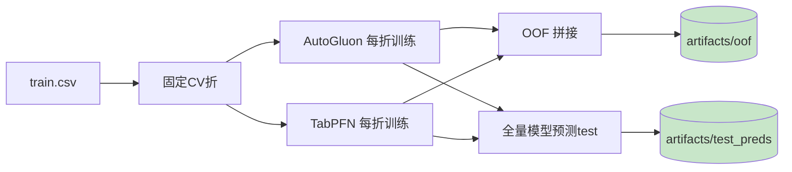
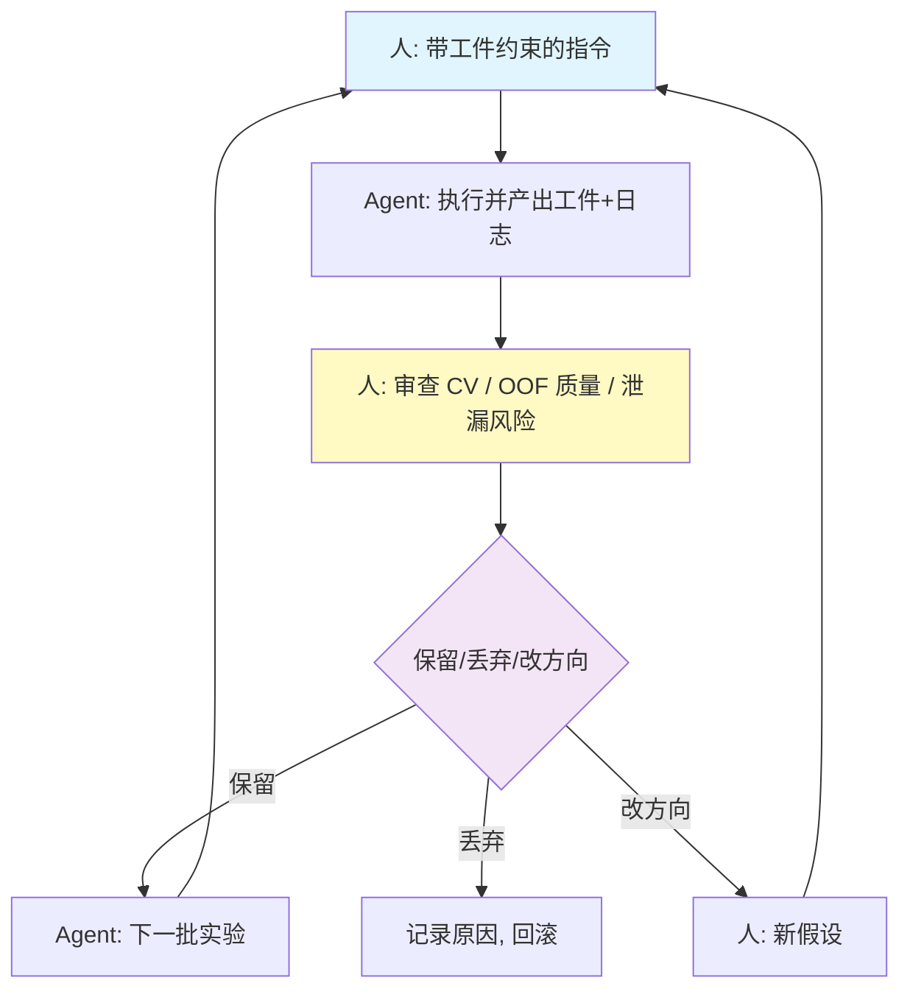

# 第3章 表格数据的 Vibe 工作流：从自动基线到人机迭代

> **本章目标**：在一张表格数据集上跑通完整的 Vibe 循环——自动基线产出合规工件 → Agent 执行 EDA 与特征变体 → 人设定验证协议并审查工件 → 人决定保留/丢弃 → Agent 产出下一批。**本章的循环模板将在全书反复复用。**

---

## 3.1 第一个动作：自动基线 + 工件落盘

### 3.1.1 验收标准不是分数，而是合规工件

新手最容易犯的错误：跑完 AutoGluon 就盯着排行榜分数看。**VibeKaggle 的验收标准完全不同**：

> 第一个自动基线的验收标准不是“AUC 达到多少”，而是**产出了合规的 OOF 和 test prediction 文件**，且元数据完整、可被后续流程消费。

为什么？因为分数会骗人（CV 可能泄漏、LB 可能噪声），但**工件是物理事实**。有了合规工件，你才能：
- 用 OOF 做集成（不需要重跑模型）
- 用 OOF 算相关性矩阵判断模型多样性
- 用日志追溯每个实验的配置
- 用哈希校验验证协议没被篡改

### 3.1.2 AutoGluon 拟合 + 工件保存

```python
# src/baselines/auto_baseline.py
"""
表格自动基线：AutoGluon 主基线 + TabPFN 多样性基线。
两个模型都在同一 CV 协议下产出合规工件，供后续集成使用。

关键点：
1. CV 折索引由人固定的 cv_protocol.yaml 决定，Agent 不得更改
2. 每个模型产出 OOF + test_preds + 日志 + 配置四件套
3. 产出后立即做格式自检与协议一致性校验
"""
import json
import hashlib
from pathlib import Path
from datetime import datetime

import numpy as np
import pandas as pd
import yaml
from autogluon.tabular import TabularPredictor
from sklearn.metrics import roc_auc_score
from tabpfn import TabPFNClassifier

# ---------- 路径与常量 ----------
ROOT = Path(__file__).resolve().parents[2]
DATA_DIR = ROOT / "data"
ART = ROOT / "artifacts"
for sub in ["oof", "test_preds", "logs", "configs", "submissions"]:
    (ART / sub).mkdir(parents=True, exist_ok=True)

TARGET = "target"
ID = "id"


def load_protocol() -> dict:
    """读取人设定的验证协议（只读，不得修改）。"""
    with open(ROOT / "configs" / "cv_protocol.yaml", encoding="utf-8") as f:
        return yaml.safe_load(f)


def get_splits(X: pd.DataFrame, y: np.ndarray, protocol: dict):
    """按协议生成固定折索引，并计算折索引哈希用于防篡改校验。"""
    from sklearn.model_selection import StratifiedKFold, KFold, GroupKFold, TimeSeriesSplit

    sch = protocol["cv_scheme"]
    n = sch["n_splits"]
    rs = sch.get("random_state", 42)

    if sch["type"] == "StratifiedKFold":
        col = protocol.get("stratify_column", TARGET)
        strat = X[col] if col in X.columns else y
        cv = StratifiedKFold(n_splits=n, shuffle=sch.get("shuffle", True), random_state=rs)
        splits = list(cv.split(X, strat))
    elif sch["type"] == "KFold":
        cv = KFold(n_splits=n, shuffle=sch.get("shuffle", True), random_state=rs)
        splits = list(cv.split(X, y))
    elif sch["type"] == "GroupKFold":
        cv = GroupKFold(n_splits=n)
        splits = list(cv.split(X, y, X[sch["group_column"]]))
    elif sch["type"] == "TimeSeriesSplit":
        cv = TimeSeriesSplit(n_splits=n, gap=sch.get("gap", 0),
                             max_train_size=sch.get("max_train_size"))
        splits = list(cv.split(X))
    else:
        raise ValueError(sch["type"])

    # 折索引哈希：把每个样本分到第几折编码成数组再哈希
    fold_of = np.full(len(X), -1, dtype=np.int16)
    for k, (_, va) in enumerate(splits):
        fold_of[va] = k
    h = hashlib.sha256(fold_of.tobytes()).hexdigest()[:16]
    return splits, h


def save_artifact(model: str, version: str, oof: np.ndarray, test_pred: np.ndarray,
                  fold_scores, protocol: dict, fold_hash: str, change_desc: str,
                  n_train: int, n_test: int, agent_model: str = "autogluon"):
    """把一次实验的四件套写入 artifacts/，符合第2章规范。"""
    oof_p = ART / "oof" / f"train_oof_{model}_{version}.npy"
    tp_p = ART / "test_preds" / f"test_preds_{model}_{version}.npy"
    np.save(oof_p, oof.astype(np.float32))
    np.save(tp_p, test_pred.astype(np.float32))

    entry = {
        "model": model, "version": version,
        "task_type": protocol["task_type"],
        "cv_scheme": f"{protocol['cv_scheme']['type']}_{protocol['cv_scheme']['n_splits']}_{protocol['cv_scheme'].get('random_state', 42)}",
        "cv_fold_indices_hash": fold_hash,
        "cv_scores": [float(s) for s in fold_scores],
        "cv_mean": float(np.mean(fold_scores)),
        "cv_std": float(np.std(fold_scores)),
        "metric": protocol["metric"]["name"],
        "oof_path": str(oof_p.relative_to(ART)),
        "test_path": str(tp_p.relative_to(ART)),
        "n_train": int(n_train), "n_test": int(n_test),
        "change_desc": change_desc,
        "agent_model": agent_model,
        "human_reviewed": False,
        "created_at": datetime.utcnow().isoformat(),
    }
    with open(ART / "logs" / f"exp_{model}_{version}.jsonl", "w", encoding="utf-8") as f:
        f.write(json.dumps(entry, ensure_ascii=False) + "\n")
    with open(ART / "configs" / f"cfg_{model}_{version}.yaml", "w", encoding="utf-8") as f:
        yaml.dump(entry, f, allow_unicode=True)
    return entry


def run_autogluon(train, test, X, X_test, y, protocol, splits, fold_hash):
    """AutoGluon 主基线：全量训练 + 固定折 OOF。"""
    model, version = "AUTOGLUON", "v001"
    oof = np.zeros(len(train), dtype=np.float32)
    scores = []
    for k, (tr, va) in enumerate(splits):
        p = TabularPredictor(label=TARGET, eval_metric=protocol["metric"]["name"],
                             path=str(ART / f"_ag_{model}_{version}_f{k}"))
        p.fit(train.iloc[tr], time_limit=120, presets="medium_quality", verbosity=0)
        pr = p.predict_proba(train.iloc[va].drop(columns=[TARGET, ID], errors="ignore"))
        pr = pr.iloc[:, 1].values if pr.ndim == 2 else pr
        oof[va] = pr
        scores.append(roc_auc_score(y[va], pr))
    p_full = TabularPredictor(label=TARGET, eval_metric=protocol["metric"]["name"],
                              path=str(ART / f"_ag_{model}_{version}_full"))
    p_full.fit(train, time_limit=180, presets="medium_quality", verbosity=0)
    tp = p_full.predict_proba(X_test)
    tp = tp.iloc[:, 1].values if tp.ndim == 2 else tp
    return save_artifact(model, version, oof, tp, scores, protocol, fold_hash,
                         "AutoGluon medium_quality 全量+固定折OOF", len(train), len(test),
                         agent_model="autogluon")


def run_tabpfn(X, X_test, y, protocol, splits, fold_hash, n_train, n_test):
    """TabPFN 多样性基线：零调参，作为集成多样性来源。"""
    model, version = "TABPFN", "v001"
    oof = np.zeros(n_train, dtype=np.float32)
    scores = []
    for k, (tr, va) in enumerate(splits):
        clf = TabPFNClassifier(device="cuda")
        clf.fit(X.iloc[tr], y[tr])
        pr = clf.predict_proba(X.iloc[va])[:, 1]
        oof[va] = pr
        scores.append(roc_auc_score(y[va], pr))
    clf = TabPFNClassifier(device="cuda")
    clf.fit(X, y)
    tp = clf.predict_proba(X_test)[:, 1]
    return save_artifact(model, version, oof, tp, scores, protocol, fold_hash,
                         "TabPFN 零调参基线", n_train, n_test, agent_model="tabpfn")


def main():
    protocol = load_protocol()
    train = pd.read_csv(DATA_DIR / "train.csv")
    test = pd.read_csv(DATA_DIR / "test.csv")
    y = train[TARGET].values
    X = train.drop(columns=[TARGET, ID], errors="ignore")
    X_test = test.drop(columns=[ID], errors="ignore")

    splits, fold_hash = get_splits(X, y, protocol)
    print(f"CV 折索引哈希: {fold_hash}（必须与历史一致）")

    e1 = run_autogluon(train, test, X, X_test, y, protocol, splits, fold_hash)
    print(f"AutoGluon CV = {e1['cv_mean']:.5f} ± {e1['cv_std']:.5f}")
    e2 = run_tabpfn(X, X_test, y, protocol, splits, fold_hash, len(train), len(test))
    print(f"TabPFN   CV = {e2['cv_mean']:.5f} ± {e2['cv_std']:.5f}")
    print("✅ 两个合规工件已落盘，可进入集成阶段")


if __name__ == "__main__":
    main()
```



---

## 3.2 Agent 执行、人审查的 EDA

### 3.2.1 人机分工：Agent 生成代码，人判断结论

EDA（探索性数据分析）是 Agent 最擅长的任务之一：它能秒生成几十张图、几十个统计量。**但 EDA 的结论不能全信**——Agent 容易把“相关系数高”说成“强相关”，把“分布相似”说成“同分布”，这些都是过度概括。

正确姿势：**Agent 出代码和图表，人出判断**。

我们让 Agent 生成 EDA 脚本：

```
请读取 data/train.csv 和 data/test.csv，生成一份 EDA 脚本，要求：
1. 输出训练集/测试集的行数、列数、列名差异
2. 对数值列：缺失率、均值、标准差、偏度、唯一值数
3. 对类别列：基数（unique 数）、 top5 频次
4. 绘制目标列分布图、数值列按目标分组的箱线图、相关性热力图（前 20 特征）
5. 所有图保存到 artifacts/eda/，统计表写入 artifacts/logs/eda_v001.jsonl
6. 代码含 docstring，函数化
```

模型输出（节选）：

```
> （思考过程）用户需要一份可复用的 EDA 脚本。我先规划函数：
> load_data、profile_numeric、profile_categorical、plot_target_dist、
> plot_box_by_target、plot_corr_heatmap、main。注意缺失率计算要用
> len(df) 做分母，类别列 top5 用 value_counts().head(5)。绘图用
> matplotlib 避免 seaborn 依赖问题，中文字体需设置。

import pandas as pd
import numpy as np
import matplotlib.pyplot as plt
from pathlib import Path
import json

ROOT = Path(__file__).resolve().parents[2]
DATA, ART = ROOT / "data", ROOT / "artifacts"
(ART / "eda").mkdir(parents=True, exist_ok=True)


def load_data():
    """读取训练集与测试集。"""
    return pd.read_csv(DATA / "train.csv"), pd.read_csv(DATA / "test.csv")


def profile_numeric(df):
    """数值列画像：缺失率、均值、标准差、偏度、唯一值数。"""
    num = df.select_dtypes(include=[np.number])
    return pd.DataFrame({
        "missing": num.isna().mean(),
        "mean": num.mean(),
        "std": num.std(),
        "skew": num.skew(),
        "nunique": num.nunique(),
    })


def profile_categorical(df):
    """类别列画像：基数与 top5 频次。"""
    cat = df.select_dtypes(include="object")
    rows = []
    for c in cat.columns:
        vc = df[c].value_counts().head(5)
        rows.append({"col": c, "cardinality": df[c].nunique(),
                     "top5": vc.to_dict()})
    return rows


def plot_target_dist(train):
    """目标列分布。"""
    fig, ax = plt.subplots(figsize=(6, 4))
    train["target"].value_counts(normalize=True).sort_index().plot(
        kind="bar", ax=ax, color=["#4C72B0", "#DD8452"])
    ax.set_title("Target Distribution")
    fig.savefig(ART / "eda" / "target_dist.png", dpi=120, bbox_inches="tight")
    plt.close(fig)


def main():
    train, test = load_data()
    # ... 省略绘图与 jsonl 写入细节 ...
    print("✅ EDA 完成")


if __name__ == "__main__":
    main()
```

### 3.2.2 人审查：哪些结论可信，哪些是幻觉

拿到 Agent 的 EDA 输出后，**人必须逐条核对**：

| Agent 可能给出的结论 | 人的审查动作 | 判定 |
|----------------------|--------------|------|
| “特征 A 与目标相关系数 0.85，强相关” | 打开箱线图，看分布是否真的单调分离 | 若箱线图重叠严重 → **过度概括，需核实** |
| “训练集与测试集同分布” | 比较数值列均值/方差差异，做 KS 检验 | 若 p < 0.05 → **不同分布，需处理** |
| “缺失值随机分布” | 按目标分组看缺失率是否有差异 | 若某类缺失率显著高 → **非随机缺失，需插补策略** |
| “类别列 X 基数 1000，建议丢弃” | 看 X 与目标的关系、是否高基数但有效 | 高基数不一定无用 → **人判断** |

> **人的 EDA 重点放在 Agent 容易忽略的地方**：缺失值的语义（为什么缺失？缺失本身是否携带信息？）、目标偏态对验证空间的影响（长尾目标下 RMSE 会被极值主导）。

---

## 3.3 特征构造：人类判断力最该介入的地方

### 3.3.1 人提出假设，Agent 生成对比工件

AutoGluon 能自动生成交互特征，但**领域驱动的组合特征**仍是人工优势。流程是：

1. **人提出特征假设**（基于业务理解）
2. **Agent 在同一 CV 协议下生成对比工件**
3. **人根据 CV 和工件质量决定是否保留**

例如电信客户流失，人提出假设：“月费 × 使用年限”可能刻画“高价值但低忠诚”的客户。

我们让 Agent 实现并对比：

```
请在固定 CV 协议下（configs/cv_protocol.yaml），基于 AUTOGLUON v001 的 OOF，
新增特征 tenure_x_monthlycharges = tenure * MonthlyCharges，训练 LightGBM，
产出 train_oof_LGBM_FE_v001.npy 与 test_preds_LGBM_FE_v001.npy，
change_desc 写明新增特征，日志写入 artifacts/logs/。
```

模型输出（节选）：

```
> （思考过程）需要复用第2章的 cv_protocol 与 save_artifact。LightGBM
> 用 sklearn API，early_stopping 用验证折。新增特征只需在 X 上
> 加一列。注意 change_desc 必须写清楚，便于人审查。

import lightgbm as lgb
from sklearn.metrics import roc_auc_score
import numpy as np

def add_feature(df):
    """新增业务特征：在网时长 × 月费。"""
    df = df.copy()
    df["tenure_x_monthlycharges"] = df["tenure"] * df["MonthlyCharges"]
    return df

# 在每折上：X_tr = add_feature(X.iloc[tr]) ...
# 训练 LGBM，产出 OOF，调用 save_artifact("LGBM_FE", "v001", ...)
```

### 3.3.2 人根据 CV 与工件质量决定保留/丢弃

判断清单：

- **CV 是否提升**？提升幅度是否超过噪声（通常 > 0.001 AUC 才算信号）？
- **OOF 相关性**：新特征模型与基线的 OOF 相关性是否 < 0.95？若太高，多样性不足，集成价值低。
- **语义合理性**：`tenure × MonthlyCharges` 是否有业务含义？还是纯数值巧合？
- **验证折索引哈希**是否与协议一致（防止 Agent 偷偷换 CV）？

> **原则**：特征工程的深度依然是人可以胜过纯自动化的领域，但 Agent 让枚举变体的成本几乎归零。

---

## 3.4 验证协议：人设定，Agent 执行

### 3.4.1 人决定折数与切分方式

| 数据性质 | 推荐 CV | 理由 |
|----------|---------|------|
| 普通二分类，样本独立 | StratifiedKFold 5 折 | 保持类别比例，稳定 |
| 类别极不平衡（正类 < 1%） | StratifiedKFold 5-10 折 | 每折正类足够 |
| 有分组结构（客户/商店） | GroupKFold | 同组不跨折，防泄漏 |
| 时间序列 | TimeSeriesSplit / 前向切分 | 不能用未来预测过去 |
| 数据量小（< 2000 行） | 重复 5 折取平均 | 降低方差 |

### 3.4.2 Agent 执行 CV，人检查折索引

Agent 执行 CV 时，**人必须抽查**：
- 每折验证集索引是否与 `cv_fold_indices_hash` 对应
- 目标编码、标准化等预处理是否只在训练折上 fit
- 是否有任何特征使用了验证折的目标值

```python
# src/utils/leakage_check.py
def check_target_encoding_leakage(oof, y, splits):
    """
    检测目标编码泄漏：若 OOF 在验证折上的 AUC 异常高（> 0.99），
    且特征中有目标编码列，高度怀疑泄漏。
    """
    from sklearn.metrics import roc_auc_score
    for k, (_, va) in enumerate(splits):
        s = roc_auc_score(y[va], oof[va])
        if s > 0.99:
            print(f"⚠️ Fold {k} AUC={s:.4f} 异常高，请检查目标编码是否泄漏")
```

> **验证方案的设计和泄漏检查是人不可让渡的职责。**

---

## 3.5 从工件到集成：Agent 做搜索，人做判断

### 3.5.1 AutoGluon 已做多层 stacking，人工 stack 的价值在哪？

AutoGluon 内部已做 stacking，但只在**它自己的模型家族内**。人工 stack 的价值在于**引入 AutoGluon 之外的模型家族**（如 TabPFN、神经网络、XGBoost），增加多样性。

### 3.5.2 用 OOF 工件做 hill climbing 与 meta-model stacking

```python
# src/ensembles/stack_oof.py
"""
基于 OOF 工件的集成：读取所有合规 OOF，做加权/Stacking。
Agent 负责生成候选，人负责确认进入最终集成的子集。
"""
import numpy as np
import pandas as pd
from pathlib import Path
from sklearn.linear_model import LogisticRegression, Ridge
from sklearn.metrics import roc_auc_score

ART = Path(__file__).resolve().parents[2] / "artifacts"


def load_oof(pattern="train_oof_*.npy"):
    """加载所有 OOF 工件，返回 {模型名: oof数组}。"""
    oofs = {}
    for p in (ART / "oof").glob(pattern):
        name = p.stem.replace("train_oof_", "")
        oofs[name] = np.load(p)
    return oofs


def greedy_hill_climb(oofs, y, metric=roc_auc_score, maximize=True):
    """
    贪心 hill climbing：从空集开始，每次加入使 CV 最优的模型。
    这是“候选生成”，最终子集由人确认。
    """
    names = list(oofs)
    selected, best = [], 0.5 if maximize else 1.0
    while True:
        improved, best_name, best_score = False, None, best
        for n in names:
            if n in selected:
                continue
            cand = selected + [n]
            score = metric(y, np.mean([oofs[m] for m in cand], axis=0))
            if (maximize and score > best_score) or (not maximize and score < best_score):
                best_score, best_name, improved = score, n, True
        if improved:
            selected.append(best_name)
            best = best_score
        else:
            break
    return selected, best


def stack_meta(oofs, y, selected):
    """用选中的 OOF 训练 meta-model（Ridge/LogisticRegression）。"""
    X = np.column_stack([oofs[m] for m in selected])
    meta = LogisticRegression(max_iter=1000)
    meta.fit(X, y)
    return meta
```

### 3.5.3 人的判断：哪些模型进入集成

人审查：
- **OOF 相关性结构**：相关性矩阵中是否有两组高度相关（> 0.98）？只留一个。
- **权重是否稳定**：bootstrap 重采样下，hill climbing 选出的子集是否稳定？
- **复杂度是否值得**：从 3 个模型到 10 个模型，CV 提升是否覆盖复杂度代价？

> **Agent 做候选生成和初步筛选，进入最终 stack 的模型子集由人确认。**

---

## 3.6 表格 Vibe 循环的操作模板（全书复用）



**模板文字版**（每一章都套用）：
1. 人给出**带工件约束的指令**（CV 协议、命名、验收标准）
2. Agent 执行并产出**工件 + 日志**
3. 人审查 **CV、OOF 质量、泄漏风险**
4. 人决定**保留 / 丢弃 / 修改方向**
5. Agent 执行下一批

---

## 3.7 小结

- 自动基线的验收标准是**合规工件**，不是分数；
- EDA 由 Agent 生成、人审查结论；
- 特征构造是**人提出假设、Agent 枚举变体、人决定保留**；
- 验证协议**人设定、Agent 执行**，折索引哈希防篡改；
- 集成是 **Agent 搜索候选、人确认子集**；
- 五步循环模板将在全书复用。

> **下一章预告**：第 4 章用 Playground S6E3 客户流失预测完整演示这套循环，并深入 NVIDIA 冠军方案的 850→150 门控规则。