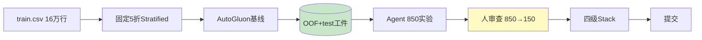
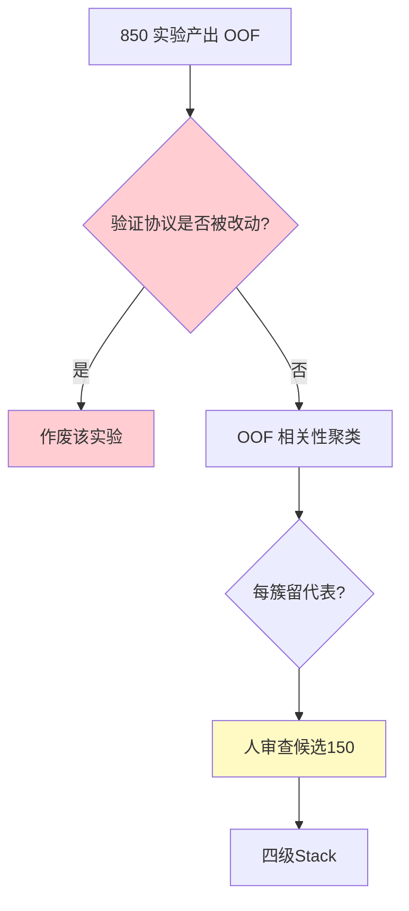

# 第4章 表格比赛详解：Playground S6E3 客户流失预测（2026，NVIDIA LLM Agent 夺冠）

> **本章目标**：用一场真实比赛完整演示 VibeKaggle 循环。这场比赛是“标准示范”：Agent 的高吞吐量、工件规范和人的验证纪律在同一场比赛中全部可见。核心教学点不是“复制 850 个实验的规模”，而是**理解门控规则**。

---

## 4.1 比赛与数据

电信客户流失二分类，AUC 指标。Playground Series S6E3，2026 年 3 月。

数据规模：约 16 万行 × 13 列，类别不平衡（正类约 26%）。三份核心文件：

| 文件 | 行数 | 列 |
|------|------|-----|
| `train.csv` | ~160k | `id` + 12 特征 + `target` |
| `test.csv` | ~80k | `id` + 12 特征 |
| `sample_submission.csv` | ~80k | `id` + `target` |



---

## 4.2 自动基线 + 合规工件

沿用第 3 章的 `run_autogluon` 与 `run_tabpfn`，产出 `AUTOGLUON_v001` 与 `TABPFN_v001` 两套工件。人检查：

- **概率分布**：OOF 正类概率均值应接近真实正类率 0.26；若偏离严重，提示校准问题。
- **AUC 置信区间**：用 bootstrap 重采样 1000 次，看 95% CI 宽度；若 CI 宽度 > 0.01，说明 CV 方差大，后续实验需谨慎解读 0.001 级提升。

```python
# src/utils/bootstrap_ci.py
import numpy as np
from sklearn.metrics import roc_auc_score

def auc_ci(y, p, n_boot=1000, alpha=0.05, seed=42):
    """bootstrap 计算 AUC 的置信区间，判断 CV 方差是否可接受。"""
    rng = np.random.default_rng(seed)
    vals = []
    n = len(y)
    for _ in range(n_boot):
        idx = rng.integers(0, n, n)
        if len(np.unique(y[idx])) < 2:
            continue
        vals.append(roc_auc_score(y[idx], p[idx]))
    lo, hi = np.percentile(vals, [100 * alpha / 2, 100 * (1 - alpha / 2)])
    return float(np.mean(vals)), float(lo), float(hi)
```

---

## 4.3 Agent 批量实验与人的验证门控

### 4.3.1 NVIDIA 方案：850 个实验，150 个模型

NVIDIA 的方案中，三个 LLM Agent（GPT-5.4 Pro、Gemini 3.1 Pro、Claude Opus 4.6）在**固定验证协议**下运行了 850 个实验，从 850 个模型中选出 150 个构建四级 stack。

**关键不是规模，而是门控规则**：



### 4.3.2 门控规则（Agent 被允许做什么、不被允许做什么）

| 允许（Agent 自主） | 禁止（人把关） |
|--------------------|----------------|
| 在固定 CV 折上枚举模型/特征组合 | 修改 CV 折数、分层方式、随机种子 |
| 产出任意数量 OOF/test 工件 | 删除或覆盖他人工件 |
| 生成候选集成子集 | 直接提交（必须 dry-run + 人确认） |
| 记录实验日志 | 修改 `cv_protocol.yaml` |

### 4.3.3 人检查“换 CV 刷分”的迹象

Agent 可能“无意”地尝试换 CV 方案来获得更好分数。检测方法：

```python
# src/utils/audit_cv.py
import json
from pathlib import Path

def audit_cv_consistency(log_dir, expected_hash):
    """扫描所有日志，找出 cv_fold_indices_hash 与协议不一致的实验。"""
    bad = []
    for p in Path(log_dir).glob("exp_*.jsonl"):
        for line in open(p, encoding="utf-8"):
            e = json.loads(line)
            if e.get("cv_fold_indices_hash") != expected_hash:
                bad.append((p.name, e["model"], e["version"], e.get("change_desc")))
    if bad:
        print("⚠️ 发现 CV 协议不一致的实验：")
        for b in bad:
            print("  ", b)
    else:
        print("✅ 所有实验 CV 协议一致")
    return bad
```

> 人检查实验日志中是否有 Agent 尝试“换一个 CV 方案来获得更好分数”的迹象——一旦发现，该实验工件作废。

---

## 4.4 工件审查：从 850 到 150 的选择

人审查三件事：

1. **OOF 相关性结构**：把 850 个 OOF 做相关性矩阵，聚类。同一簇内模型高度相关（> 0.98），只留 1-2 个代表。
2. **模型多样性**：最终 150 个应覆盖不同家族（GBM、NN、TabPFN、线性模型），而非同一家族的 150 个超参变体。
3. **集成后的 CV 稳定性**：bootstrap 下 150 模型 stack 的 CV 是否稳定（CI 宽度 < 0.005）。

```python
# src/ensembles/cluster_oof.py
import numpy as np
from scipy.cluster.hierarchy import linkage, fcluster

def cluster_oofs(oofs, threshold=0.02):
    """
    对 OOF 做层次聚类（距离 = 1 - 相关性），返回每簇代表。
    threshold 越小，簇越多，保留的模型越多。
    """
    names = list(oofs)
    M = np.column_stack([oofs[n] for n in names])
    corr = np.corrcoef(M, rowvar=False)
    dist = 1 - corr
    Z = linkage(dist[np.triu_indices(len(names), 1)], method="average")
    labels = fcluster(Z, t=threshold, criterion="distance")
    reps = {}
    for n, l in zip(names, labels):
        reps.setdefault(l, []).append(n)
    return reps
```

---

## 4.5 提交纪律

提交预算的消耗点、概率校准检查、格式核对。

### 4.5.1 概率校准检查

AUC 对校准不敏感，但若比赛用 LogLoss 或需要阈值，校准很重要。检查 OOF 的可靠性曲线（reliability diagram）。

### 4.5.2 提交文件生成 + 断言检查

```python
# src/submit/make_submission.py
import numpy as np
import pandas as pd
from pathlib import Path

ROOT = Path(__file__).resolve().parents[2]
ART = ROOT / "artifacts"

def make_submission(test_preds_path, sample_path, out_path, target="target", id="id"):
    """生成提交文件并做断言检查。"""
    sample = pd.read_csv(sample_path)
    preds = np.load(test_preds_path)
    assert len(preds) == len(sample), "预测长度与 sample 不一致"
    sub = sample.copy()
    sub[target] = preds
    # 断言：概率范围
    assert sub[target].between(0, 1).all(), "概率越界"
    sub.to_csv(out_path, index=False)
    # 二次读回校验
    chk = pd.read_csv(out_path)
    assert list(chk.columns) == list(sample.columns)
    assert (chk[id] == sample[id]).all()
    print(f"✅ 提交文件通过断言: {out_path}")
```

---

## 4.6 小结

这场比赛展示了 VibeKaggle 的完整循环——**Agent 的吞吐、工件的可组合性、人的验证门控和选择判断**。

核心要点：
- 850 个实验的价值不在数量，而在**固定验证协议下的可组合工件**；
- 门控规则让 Agent 自由枚举、人守住验证与提交；
- 从 850 到 150 是**人的选择判断**，不是自动 hill climbing。

> **下一章预告**：第 5 章用 Playground S5E10 道路事故风险预测，展示 AutoGluon 作为起点、Agent 扩大候选池、人做互补性判断的完整流程。