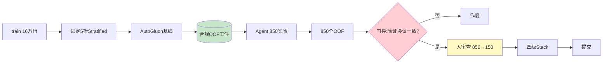

# 第4章 表格比赛详解：Playground S6E3 客户流失预测（2026，NVIDIA LLM Agent 夺冠）

> **本章目标**：用一场真实比赛，把第 3 章的 Vibe 循环完整走一遍，并且看一个“天花板级”的案例——NVIDIA 用三个大模型 Agent 跑了 850 个实验、拼出 150 个模型的四级堆叠拿了冠军。但本章的重点**不是让你复制这个规模**，而是让你看懂那条“门控规则”：Agent 能放手干到什么程度，人又必须在哪几个闸口守着。

---

## 开篇：一场把 VibeKaggle 演到极致的比赛

如果要用一场比赛向你证明“VibeKaggle 这条路走得通”，那就是 2026 年 3 月的 Playground S6E3 客户流失预测。

NVIDIA 的工程师 Chris Deotte 带着三个当时最强的大模型（GPT-5.4 Pro、Gemini 3.1 Pro、Claude Opus 4.6），让它们像不知疲倦的实习生一样写代码、跑实验。一晚上过去，Agent 们生成了超过 60 万行代码、跑了 850 个实验。最后，从这 850 个模型里挑出 150 个，拼成一个“四级堆叠”（four-level stack），拿了第一名。

你可能会想：“这也太夸张了，我怎么可能做到？”别急。**这一章不是让你复制 850 这个数字，而是让你理解它背后的纪律。** 因为如果 850 个实验没有纪律约束，它只会变成 850 堆垃圾——谁也不知道哪个模型是啥、用了什么验证方式、能不能用。真正让 850 个实验变成冠军的，是三件事：**固定的验证协议、规范的工件、人的门控**。这三件事，你前两章已经全部学过了。

我们先把这场比赛的路线画出来：



---

## 4.1 比赛与数据

电信客户流失二分类，指标是 AUC（ROC 曲线下面积，可以理解成“随便抽一个会走的客户和一个不会走的客户，模型把会走的排在前面”的概率）。

数据规模大约 16 万行 × 13 列，正类（流失）约占 26%，属于轻度不平衡。三份核心文件：

| 文件 | 行数 | 列 |
|------|------|-----|
| `train.csv` | 约 16 万 | `id` + 12 特征 + `target` |
| `test.csv` | 约 8 万 | `id` + 12 特征 |
| `sample_submission.csv` | 约 8 万 | `id` + `target`（占位） |

特征大多是类别型的（合同类型、付费方式、网络服务等）和一些数值型（月费、在网时长等）。这种“类别特征多、目标二分类”的表格，是 AutoGluon 和梯度提升树最擅长的战场。

---

## 4.2 自动基线 + 合规工件

按第 3 章的流程，第一步是跑 AutoGluon 和 TabPFN 基线，产出 `AUTOGLUON_v001` 和 `TABPFN_v001` 两套工件。

跑完之后，人要做两件“防忽悠”的检查，这两件事机器不会替你做：

**检查一：概率分布对不对。** OOF 里预测为正类的平均概率，应该接近真实流失率 0.26。如果平均值差得远（比如只有 0.05，或者高达 0.9），说明模型的概率校准出了问题，后面做集成会受连累。

**检查二：AUC 的置信区间有多宽。** 光看一个 CV 分数不够，得看它的波动范围。我们用 bootstrap（自助抽样，就是把数据有放回地重抽很多次）来估一个置信区间：

```python
# src/utils/bootstrap_ci.py
"""
用 bootstrap 估 AUC 的置信区间，判断 CV 方差是否可接受。
如果 95% 区间宽度 > 0.01，说明 CV 噪声大，
后面 0.001 级别的"提升"很可能是噪声，别当真。
"""
import numpy as np
from sklearn.metrics import roc_auc_score


def auc_ci(y, p, n_boot=1000, alpha=0.05, seed=42):
    """返回 (均值, 下限, 上限)。"""
    rng = np.random.default_rng(seed)
    vals = []
    n = len(y)
    for _ in range(n_boot):
        idx = rng.integers(0, n, n)          # 有放回抽样
        if len(np.unique(y[idx])) < 2:       # 抽到全是一类就跳过
            continue
        vals.append(roc_auc_score(y[idx], p[idx]))
    lo, hi = np.percentile(vals, [100 * alpha / 2, 100 * (1 - alpha / 2)])
    return float(np.mean(vals)), float(lo), float(hi)
```

这个小函数后面会被反复用到。它的意义在于：**它告诉你“一个分数到底靠不靠谱”**。CV 涨了 0.001 但置信区间有 0.02 宽，那基本是噪声，不值得为它烧一次提交。

---

## 4.3 Agent 批量实验与人的验证门控

### 4.3.1 850 个实验是怎么来的？

NVIDIA 的方案里，三个 Agent 分工干活：一个负责特征工程变体，一个负责模型调参，一个负责集成探索。它们在一个**固定不变的验证协议**下，疯狂地试：

- 不同的特征组合（原始特征、交互特征、目标编码……）；
- 不同的模型家族（XGBoost、LightGBM、CatBoost、神经网络、TabPFN……）；
- 不同的超参数。

每跑一个实验，就产出一份 OOF 和测试预测，按规范命名存好。850 个实验 = 850 对 OOF/测试预测工件。这些工件是后面集成的“零件库”。

### 4.3.2 关键不是规模，是门控规则

如果你只记住这一章的一句话，请记住这句：**850 个实验的价值，不在数量，而在“固定验证协议下的可组合工件”。**

我们用一张表把“Agent 能自主做什么、人必须守什么”说清楚：

| Agent 可以自主做 | 人必须把关 |
|------------------|------------|
| 在固定 CV 折上枚举各种模型/特征组合 | 改 CV 折数、分层方式、随机种子 |
| 产出任意数量的 OOF/测试工件 | 删除或覆盖别人的工件 |
| 生成候选集成子集 | 直接提交（必须先预演 + 人确认） |
| 记录实验日志 | 修改 `cv_protocol.yaml` |

这张表就是“门控规则”。它规定了 Agent 的自由活动范围，也圈定了人必须亲自到场的几个闸口。

### 4.3.3 人怎么查“Agent 偷偷换 CV 刷分”？

你可能会担心：Agent 这么能干，会不会偷偷换个验证方式，把一个好看但虚假的分数报给你？

这正是第 2 章那个“折索引哈希”存在的意义。我们写一个小脚本，扫一遍所有实验日志，凡是验证协议哈希和当前不一致的，全揪出来：

```python
# src/utils/audit_cv.py
"""
审计：扫描所有日志，找出 cv_fold_indices_hash 与协议不一致的实验。
一旦发现，该实验工件作废——因为它的验证方式变了，分数不可比。
"""
import json
from pathlib import Path


def audit_cv_consistency(log_dir, expected_hash):
    bad = []
    for p in Path(log_dir).glob("exp_*.jsonl"):
        for line in open(p, encoding="utf-8"):
            e = json.loads(line)
            if e.get("cv_fold_indices_hash") != expected_hash:
                bad.append((p.name, e["model"], e["version"], e.get("change_desc")))
    if bad:
        print("⚠️ 发现验证协议不一致的实验：")
        for b in bad:
            print("   ", b)
    else:
        print("✅ 所有实验验证协议一致")
    return bad
```

这个脚本就是人的“第三只眼”。Agent 跑得再快，也逃不过哈希的比对。一旦查出来，那个实验的工件直接作废，不进入集成。

---

## 4.4 工件审查：从 850 到 150 的选择

850 个模型全塞进集成不行吗？不行。一是算不动，二是高度相关的模型堆在一起不会涨分，反而增加过拟合风险。所以要从 850 里挑出 150 个“既强又互补”的。

人审查三件事：

1. **OOF 相关性结构**：把 850 个 OOF 两两算相关性，做聚类。同一簇里的模型高度相关（> 0.98），只留 1-2 个代表。
2. **模型多样性**：最终 150 个要覆盖不同家族（GBM、NN、TabPFN、线性模型），而不是同一家族的 150 个超参变体。
3. **集成后的 CV 稳定性**：bootstrap 下，150 个模型 stack 的 CV 稳不稳（置信区间宽度 < 0.005）。

第一个“去冗余”的动作，可以用层次聚类来做：

```python
# src/ensembles/cluster_oof.py
"""
对 OOF 做层次聚类（距离 = 1 - 相关性），每一簇留一个代表。
threshold 越小，簇越多，保留模型越多。
"""
import numpy as np
from scipy.cluster.hierarchy import linkage, fcluster


def cluster_oofs(oofs, threshold=0.02):
    names = list(oofs)
    M = np.column_stack([oofs[n] for n in names])
    corr = np.corrcoef(M, rowvar=False)       # 相关性矩阵
    dist = 1 - corr                            # 距离 = 1 - 相关
    Z = linkage(dist[np.triu_indices(len(names), 1)], method="average")
    labels = fcluster(Z, t=threshold, criterion="distance")
    reps = {}
    for n, l in zip(names, labels):
        reps.setdefault(l, []).append(n)
    return reps                                 # {簇编号: [该簇的模型列表]}
```

> **从 850 到 150，是人的“选择判断”，不是自动 hill climbing 一键搞定。** Agent 帮你算好相关性、聚好类、列出候选；但“这一簇留谁”“哪些家族必须保留”，是人拍板。

---

## 4.5 提交纪律

冠军方案最后也要靠“提交”这一步落地，而提交恰恰是最容易出事的环节。

### 4.5.1 概率校准检查

AUC 对概率校准不敏感，但如果比赛用 LogLoss（对概率很敏感），或者需要设阈值，那校准就关键了。检查方法：画可靠性曲线（reliability diagram），看“预测 0.7 的样本里，真实正类比例是不是也接近 0.7”。

### 4.5.2 生成提交 + 断言检查

```python
# src/submit/make_submission.py
"""
生成提交文件并做断言检查。任何一项不过就拒绝生成。
"""
import numpy as np
import pandas as pd
from pathlib import Path

ROOT = Path(__file__).resolve().parents[2]
ART = ROOT / "artifacts"


def make_submission(test_preds_path, sample_path, out_path, target="target", id_col="id"):
    sample = pd.read_csv(sample_path)
    preds = np.load(test_preds_path)
    assert len(preds) == len(sample), "预测长度与 sample 不一致"
    sub = sample.copy()
    sub[target] = preds
    assert sub[target].between(0, 1).all(), "概率越界（必须在 0~1）"
    sub.to_csv(out_path, index=False)
    # 二次读回校验，确保写盘没写坏
    chk = pd.read_csv(out_path)
    assert list(chk.columns) == list(sample.columns)
    assert (chk[id_col] == sample[id_col]).all()
    print(f"✅ 提交文件通过断言：{out_path}")
```

提交前，人还要过一遍清单：概率在 0~1、ID 顺序对齐、CV 和 LB 方向一致（LB 若大跌就回滚）。

---

## 4.6 小结

这场比赛把 VibeKaggle 的完整循环演了一遍：

- **Agent 的吞吐**：850 个实验、60 万行代码，人手动不可能做到；
- **工件的可组合性**：850 对 OOF 能被聚类、筛选、堆叠，全靠规范存工件；
- **人的验证门控**：固定协议、哈希审计，挡住了“换 CV 刷分”；
- **人的选择判断**：从 850 到 150 的取舍，是人的活儿。

一句话：**规模是 Agent 给的，可信度是人的纪律给的。** 少了任何一半，850 个实验都会变成 850 堆垃圾。

> **下一章预告**：第 5 章换一场回归比赛——Playground S5E10 道路事故风险预测。你会看到 AutoGluon 怎么当“起点”、Agent 怎么把候选池从几个扩到 40 个、人又怎么用 Greedy NNLS 和 LassoCV 从 40 个里挑出最互补的 4-6 个。