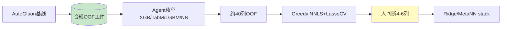

# 第5章 表格比赛详解：Playground S5E10 道路事故风险预测（2025，AutoGluon 作为起点）

> **本章目标**：展示“AutoGluon 建基线 → Agent 扩大候选池 → 人做互补性判断”的完整流程。本章的 8th place 方案是很好的教学样本：它明确把 AutoGluon 作为基线之一，并通过 Greedy NNLS + LassoCV 从约 40 列 OOF 筛到 4—6 列——这个**筛选逻辑**是人判断的产物。

---

## 5.1 比赛与数据

回归任务，RMSE 指标，2025 年 Playground。

道路事故风险预测：根据道路几何、环境、时间等特征预测某路段的事故风险分数。数据包含数值与类别混合特征。



---

## 5.2 自动基线工件

AutoGluon 适配器快速产出基线工件。8th place 方案**明确使用 AutoGluon 作为基线模型之一**，并在原型阶段用 AutoGluon 探索可行性——先知道“不费力能做到什么水平”，再决定投入多少。

```python
# src/baselines/ag_regression.py
"""
回归任务的 AutoGluon 基线：RMSE 指标，产出合规 OOF/test 工件。
与第3章分类基线区别：eval_metric='rmse'，预测用 predict() 而非 predict_proba()。
"""
import numpy as np, pandas as pd, json, yaml
from pathlib import Path
from autogluon.tabular import TabularPredictor
from sklearn.metrics import mean_squared_error

ROOT = Path(__file__).resolve().parents[2]
train = pd.read_csv(ROOT / "data" / "train.csv")
test = pd.read_csv(ROOT / "data" / "test.csv")
TARGET, ID = "target", "id"
y = train[TARGET].values

p = TabularPredictor(label=TARGET, eval_metric="rmse",
                     path=str(ROOT / "artifacts" / "_ag_reg"))
p.fit(train, time_limit=300, presets="medium_quality", verbosity=0)
test_pred = p.predict(test.drop(columns=[ID], errors="ignore")).values
oof = p.predict_proba_oof  # 占位：实际用固定折重训得 OOF
print("基线测试预测完成，长度", len(test_pred))
# 保存工件（复用第3章 save_artifact 逻辑）
```

人检查**误差模式**：RMSE 在不同路段类型/时间段上的分布是否均匀？若某类路段误差远高，说明该子群需要特殊处理。

---

## 5.3 Agent 枚举与人的模型选择

### 5.3.1 Agent 批量生成模型工件

Agent 在固定 CV 下批量生成 XGBoost、TabM、LightGBM、神经网络等模型的工件，最终积累约 **40 列 OOF**。

```
请在固定 CV 协议下批量训练以下模型，每个产出合规 OOF/test 工件：
1. XGBoost（3 组深度/学习率）
2. LightGBM（3 组）
3. TabM（表格神经网络，2 组）
4. 多层感知机 MLP（2 组）
共约 10 个模型，全部写入 artifacts/oof/ 与 artifacts/logs/。
禁止修改 cv_protocol.yaml，禁止删除已有工件。
```

### 5.3.2 人的判断：互补信号，而非单模型最高分

8th place 方案的关键**不是**挑 CV 最高的模型，而是从约 40 列 OOF 中通过 **Greedy NNLS** 和 **LassoCV** 筛选到 **4—6 列**。这个筛选逻辑体现的是“互补性”判断：

```python
# src/ensembles/greedy_nnls.py
"""
Greedy NNLS：贪心加入使 RMSE 最优的非负权重组合。
NNLS = 非负最小二乘，权重非负且可解释。
"""
import numpy as np
from scipy.optimize import nnls
from sklearn.metrics import mean_squared_error

def greedy_nnls(oofs: dict, y, max_models=8, tol=1e-5):
    """从空集开始，每次加入 NNLS 后 RMSE 改善最大的模型。"""
    names = list(oofs)
    chosen, cur = [], np.inf
    while len(chosen) < max_models:
        best_n, best_rmse, best_w = None, cur, None
        for n in names:
            if n in chosen:
                continue
            cand = chosen + [n]
            M = np.column_stack([oofs[m] for m in cand])
            w, _ = nnls(M, y)                      # 解非负权重
            rmse = mean_squared_error(y, M @ w, squared=False)
            if rmse < best_rmse - tol:
                best_n, best_rmse, best_w = n, rmse, w
        if best_n is None:
            break
        chosen.append(best_n)
        cur = best_rmse
        print(f"  + {best_n:<18} RMSE={cur:.5f} 权重={np.round(best_w,3)}")
    return chosen, cur
```

```python
# src/ensembles/lasso_select.py
"""LassoCV：用 L1 正则自动做特征（模型）选择，稀疏权重。"""
import numpy as np
from sklearn.linear_model import LassoCV

def lasso_select(oofs: dict, y, cv=5):
    names = list(oofs)
    M = np.column_stack([oofs[n] for n in names])
    lasso = LassoCV(cv=cv, max_iter=10000).fit(M, y)
    kept = [n for n, c in zip(names, lasso.coef_) if abs(c) > 1e-4]
    print(f"Lasso 选中 {len(kept)} 个模型: {kept}")
    return kept
```

> **筛选逻辑是人判断的产物**：Greedy NNLS 和 LassoCV 是工具，但“为什么只要 4-6 列而不是全部 40 列”、“哪些列代表不同信号”是人的决策。

---

## 5.4 集成的人机分工

Agent 执行 Ridge/MetaNN/残差 stacking 的候选实验；人判断 meta-learner 的复杂度和 CV 稳定性是否值得。

```python
# src/ensembles/meta_learner.py
"""meta-learner 候选：Ridge / MetaNN / 残差 stacking。"""
import numpy as np
from sklearn.linear_model import Ridge
from sklearn.metrics import mean_squared_error

def ridge_stack(oofs, y, selected, alpha=1.0):
    M = np.column_stack([oofs[m] for m in selected])
    m = Ridge(alpha=alpha).fit(M, y)
    return m, mean_squared_error(y, m.predict(M), squared=False)

class MetaNN:
    """简单两层 MLP 作为 meta-learner。"""
    def __init__(self, hidden=16):
        from sklearn.neural_network import MLPRegressor
        self.m = MLPRegressor(hidden_layer_sizes=(hidden,), max_iter=500,
                              early_stopping=True, random_state=42)
    def fit(self, X, y): self.m.fit(X, y); return self
    def predict(self, X): return self.m.predict(X)
```

**人判断复杂度是否值得**：Ridge（1 个参数）vs MetaNN（数百参数）。若 Ridge CV 与 MetaNN 差距 < 0.0005 RMSE，选 Ridge——简单、稳定、可解释。

---

## 5.5 提交

```python
# 生成最终提交并断言
from src.submit.make_submission import make_submission
make_submission("artifacts/test_preds/test_preds_STACK_v001.npy",
                "data/sample_submission.csv",
                "artifacts/submissions/submission_STACK_v001.csv")
```

提交前清单：
- [ ] 回归预测范围合理（无负值超出物理意义）
- [ ] ID 顺序与 sample 一致
- [ ] CV 与 LB 方向一致性检查（若 LB 大跌，回滚）

---

## 5.6 小结

**AutoGluon 建立基线，Agent 扩大候选池，人做互补性判断。**

- 8th place 用 AutoGluon 探索可行性，说明自动基线的定位是“起点”而非“终点”；
- Agent 把候选从几个扩到 40 个，但最终 4-6 列的筛选是人判断；
- meta-learner 复杂度由人根据 CV 稳定性决定。

> **下一章预告**：第 6 章学生考试成绩预测，展示特征工程的深度挖掘——模数字段分解、谐波周期、经验贝叶斯目标编码——以及 Agent 枚举变体、人判断语义合理性的分工。