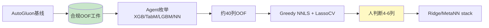

# 第5章 表格比赛详解：Playground S5E10 道路事故风险预测（2025，AutoGluon 作为起点）

> **本章目标**：看一个“回归 + 多模型筛选”的完整案例。8th place 方案的做法很教学：先用 AutoGluon 探路，再让 Agent 把候选模型从几个扩到约 40 个，最后用 Greedy NNLS 和 LassoCV 从 40 列 OOF 里挑出 4-6 列最互补的。**核心不是“挑分数最高的”，而是“挑最互补的”**——这个筛选逻辑，是人判断的产物。

---

## 开篇：为什么“分数最高”往往是陷阱

上一章我们看了一个“堆量”的冠军案例。这一章反过来，看一个“做减法”的案例。

新手做集成，最自然的想法是：把 CV 分数最高的几个模型一平均，不就完了？但老手都知道，这经常不管用，甚至越平均越差。为什么？因为如果几个模型都很强、但它们犯的错高度相似（比如都是 XGBoost 的不同超参），那平均之后，错的地方还是错，没有互相补救。

真正有用的集成，要的是**互补**：A 模型错的地方，B 模型恰好对；B 模型错的地方，C 模型恰好对。这样平均下来，错误互相抵消，分数才涨。S5E10 的 8th place 方案，干的就是“从一堆模型里挑出互补的那几个”这件事。

先看路线图：



---

## 5.1 比赛与数据

回归任务，指标 RMSE（均方根误差，越小越好）。道路事故风险预测：根据道路几何、环境、时间等特征，预测某路段的事故风险分数。数据是数值与类别混合的表格。

和 S6E3 不同，这是回归，所以基线里 `eval_metric` 要换成 `rmse`，预测用 `predict()` 而不是 `predict_proba()`。别小看这个区别，新手常在这里翻车——把回归当分类跑，或者预测出负数还傻乎乎提交。

---

## 5.2 自动基线工件

AutoGluon 适配器快速产出基线工件。8th place 方案**明确把 AutoGluon 作为基线模型之一**，并且在原型阶段就用 AutoGluon 探索可行性——先知道“不费力能做到什么水平”，再决定投入多少。

```python
# src/baselines/ag_regression.py
"""
回归任务的 AutoGluon 基线：RMSE 指标，产出合规 OOF/test 工件。
与分类基线的区别：eval_metric='rmse'，预测用 predict() 而非 predict_proba()。
"""
import numpy as np
import pandas as pd
from pathlib import Path
from autogluon.tabular import TabularPredictor
from sklearn.metrics import mean_squared_error

ROOT = Path(__file__).resolve().parents[2]
train = pd.read_csv(ROOT / "data" / "train.csv")
test = pd.read_csv(ROOT / "data" / "test.csv")
TARGET, ID = "target", "id"
y = train[TARGET].values

# 全量训练一个基线模型（示意；严格 OOF 见第 3 章 save_artifact 流程）
p = TabularPredictor(label=TARGET, eval_metric="rmse",
                     path=str(ROOT / "artifacts" / "_ag_reg"))
p.fit(train, time_limit=300, presets="medium_quality", verbosity=0)
test_pred = p.predict(test.drop(columns=[ID], errors="ignore")).values
print("基线测试预测完成，长度", len(test_pred))
# 保存工件（复用第 3 章 save_artifact 逻辑）
```

跑完，人检查**误差模式**：RMSE 在不同路段类型、不同时间段上是不是均匀？如果某类路段误差远高，说明这个子群需要特殊处理（比如单独建模或加特征）。

---

## 5.3 Agent 枚举与人的模型选择

### 5.3.1 Agent 批量生成模型工件

Agent 在固定 CV 下批量生成 XGBoost、TabM（一种表格神经网络）、LightGBM、多层感知机等模型的工件，最终积累约 **40 列 OOF**。你可以这样指挥它：

```
请在固定 CV 协议下批量训练以下模型，每个产出合规 OOF/test 工件：
1. XGBoost（3 组深度/学习率）
2. LightGBM（3 组）
3. TabM（表格神经网络，2 组）
4. 多层感知机 MLP（2 组）
共约 10 个模型，全部写入 artifacts/oof/ 与 artifacts/logs/。
禁止修改 cv_protocol.yaml，禁止删除已有工件。
```

注意最后一句“禁止删除已有工件”——这是防止 Agent 为了“腾地方”把别人的成果清了。

### 5.3.2 人的判断：要互补信号，不要单模型最高分

8th place 方案的关键，不是挑 CV 最高的模型，而是从约 40 列 OOF 里，用 **Greedy NNLS** 和 **LassoCV** 筛到 **4-6 列**。这两个工具，一个管“贪心选互补”，一个管“稀疏筛选”。

先解释 **NNLS（非负最小二乘）**：普通最小二乘求权重时，权重可正可负；NNLS 强制权重非负。为什么非负重要？因为负权重意味着“把某个模型的预测反过来用”，这通常不可解释、也不稳。非负权重更像“加权平均”，稳健、好解释。

```python
# src/ensembles/greedy_nnls.py
"""
Greedy NNLS：贪心加入使 RMSE 最优的非负权重组合。
从空集开始，每次尝试加入一个模型，用 NNLS 解最优非负权重，
选让 RMSE 降得最多的那个，直到加不动为止。
"""
import numpy as np
from scipy.optimize import nnls
from sklearn.metrics import mean_squared_error


def greedy_nnls(oofs: dict, y, max_models=8, tol=1e-5):
    names = list(oofs)
    chosen, cur = [], np.inf
    while len(chosen) < max_models:
        best_n, best_rmse, best_w = None, cur, None
        for n in names:
            if n in chosen:
                continue
            cand = chosen + [n]
            M = np.column_stack([oofs[m] for m in cand])   # 拼成矩阵
            w, _ = nnls(M, y)                               # 解非负权重
            rmse = mean_squared_error(y, M @ w, squared=False)
            if rmse < best_rmse - tol:                      # 有改善才换
                best_n, best_rmse, best_w = n, rmse, w
        if best_n is None:                                  # 加不动了，停
            break
        chosen.append(best_n)
        cur = best_rmse
        print(f"  + {best_n:<18} RMSE={cur:.5f} 权重={np.round(best_w, 3)}")
    return chosen, cur
```

再看 **LassoCV**：Lasso 是带 L1 正则的线性回归，它有个神奇特性——能把不重要的特征权重压成 0，等于自动做“特征选择”。用在我们这儿，就是自动挑出“有用的模型”。

```python
# src/ensembles/lasso_select.py
"""LassoCV：用 L1 正则自动做模型选择，留下稀疏的几列。"""
import numpy as np
from sklearn.linear_model import LassoCV


def lasso_select(oofs: dict, y, cv=5):
    names = list(oofs)
    M = np.column_stack([oofs[n] for n in names])
    lasso = LassoCV(cv=cv, max_iter=10000).fit(M, y)
    kept = [n for n, c in zip(names, lasso.coef_) if abs(c) > 1e-4]  # 权重非零的
    print(f"Lasso 选中 {len(kept)} 个模型：{kept}")
    return kept
```

> **筛选逻辑是人判断的产物**：Greedy NNLS 和 LassoCV 是工具，但“为什么只要 4-6 列而不是全部 40 列”“哪些列代表不同信号”，是人的决策。工具帮你算，判断得你自己下。

我们把“算”的部分交给 Agent，但把“选”的部分留给自己。可以这样问它：

```
我有约 40 个模型的 OOF 工件在 artifacts/oof/ 下。
请做两件事：
1. 算两两相关性矩阵，把相关性 > 0.98 的模型对列出来（只是冗余，不代表错）
2. 跑 Greedy NNLS，给出加入顺序和每步 RMSE
不要直接生成提交文件，我要先看结果再决定保留哪几个。
```

模型会给出类似这样的报告：

```
> （思考过程）用户要的是"诊断 + 候选"，不是"一键提交"。
> 我先聚类去冗余，再跑 NNLS 贪心，输出每步的 RMSE 和权重。
> 最后要提醒：NNLS 权重非负，可解释；但"选几个"是用户的判断。

【冗余对（相关性 > 0.98）】
  LGBM_v001 ~ LGBM_v002 : 0.991
  LGBM_v001 ~ LGBM_v003 : 0.987
  XGB_v001  ~ XGB_v002  : 0.994
  → 建议每对只留一个，但留哪个由你定（可看单模型 CV）

【Greedy NNLS 加入顺序】
  + LGBM_v001        RMSE=0.1842  权重=[1.00]
  + XGB_v001         RMSE=0.1836  权重=[0.62, 0.38]
  + TABPFN_v001      RMSE=0.1831  权重=[0.55, 0.30, 0.15]
  + NN_v001          RMSE=0.1829  权重=[0.50, 0.28, 0.14, 0.08]
  + CATBOOST_v001    RMSE=0.1829  权重不变（无改善，已停止）

【我的建议】4 个模型后收益基本消失（第 5 个 RMSE 无改善），
  所以 4 个是性价比拐点。但最终保留哪 4 个，请你确认——
  特别是 LGBM_v001 和 XGB_v001 是否都要（它们相关性 0.94，
  不算冗余，但如果你想要更强的多样性，可以只留一个）。
```

注意最后一句：它把“4 个是拐点”这个**数据事实**告诉你，但把“最终留哪 4 个”这个**判断**交回给你。这就是人机分工的正确姿势。

---

## 5.4 集成的人机分工

Agent 执行 Ridge / MetaNN / 残差 stacking 的候选实验；人判断 meta-learner（元学习器）的复杂度和 CV 稳定性值不值。

```python
# src/ensembles/meta_learner.py
"""meta-learner 候选：Ridge（简单）/ MetaNN（复杂）/ 残差 stacking。"""
import numpy as np
from sklearn.linear_model import Ridge
from sklearn.metrics import mean_squared_error


def ridge_stack(oofs, y, selected, alpha=1.0):
    """Ridge 堆叠：一个参数 alpha，简单稳定。"""
    M = np.column_stack([oofs[m] for m in selected])
    m = Ridge(alpha=alpha).fit(M, y)
    return m, mean_squared_error(y, m.predict(M), squared=False)


class MetaNN:
    """两层 MLP 作为 meta-learner，参数多、更灵活。"""
    def __init__(self, hidden=16):
        from sklearn.neural_network import MLPRegressor
        self.m = MLPRegressor(hidden_layer_sizes=(hidden,), max_iter=500,
                              early_stopping=True, random_state=42)
    def fit(self, X, y):
        self.m.fit(X, y)
        return self
    def predict(self, X):
        return self.m.predict(X)
```

**人判断复杂度值不值**：Ridge 只有 1 个参数，MetaNN 有几百个。如果 Ridge 的 CV 和 MetaNN 差不到 0.0005 RMSE，那就选 Ridge——简单、稳定、可解释。这就是“奥卡姆剃刀”：能用简单模型解决，就别上复杂的。

---

## 5.5 提交

```python
# 生成最终提交并断言（复用第 4 章 make_submission）
from src.submit.make_submission import make_submission
make_submission("artifacts/test_preds/test_preds_STACK_v001.npy",
                "data/sample_submission.csv",
                "artifacts/submissions/submission_STACK_v001.csv")
```

提交前清单：
- [ ] 回归预测范围合理（无超出物理意义的负值）；
- [ ] ID 顺序与 sample 一致；
- [ ] CV 与 LB 方向一致性检查（LB 大跌就回滚）。

---

## 5.6 小结

**AutoGluon 建立基线，Agent 扩大候选池，人做互补性判断。**

- 8th place 用 AutoGluon 探路，说明自动基线的定位是“起点”不是“终点”；
- Agent 把候选从几个扩到 40 个，但最终 4-6 列的筛选是人的判断；
- meta-learner 的复杂度，由人根据 CV 稳定性决定。

这一章和上一章正好互补：上一章教你“怎么让 Agent 大规模产出”，这一章教你“怎么从一大堆产出里做减法”。**会做加法更要会做减法**，这是集成的基本功。

> **下一章预告**：第 6 章学生考试成绩预测，进入特征工程的深水区——模数字段分解、谐波周期、经验贝叶斯平滑目标编码。Agent 能批量生成这些变体，但“周期选 7 还是 30”“平滑强度 α 取多少”这些，得靠你对数据生成机制的理解。