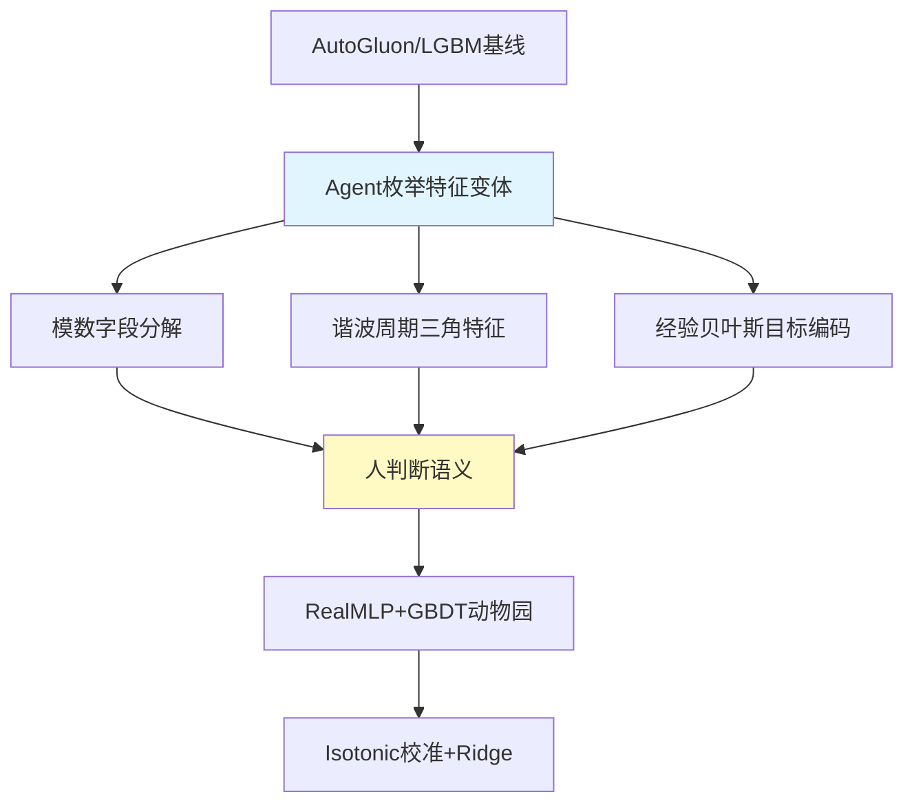

# 第6章 表格比赛详解：Playground S6E1 学生考试成绩预测（2025—2026，特征工程的深度挖掘）

> **本章目标**：展示特征工程的深度依然是人可以胜过纯自动化的领域，但 Agent 让枚举变体的成本几乎归零。1st place 方案包含模数字段分解、谐波周期三角函数、经验贝叶斯平滑目标编码、PyTabKit RealMLP + GBDT 模型动物园、Centered Isotonic Regression 校准 + Ridge stacking——Agent 可批量生成这些变体的工件，但**“模数字段分解是否合理”“谐波周期选哪些”需要人根据数据生成机制判断**。

---

## 6.1 比赛与数据

连续目标 `exam_score`，RMSE 指标。

学生考试成绩预测：根据学习行为、家庭背景、课程参与等特征预测考试分数。数据可能包含时间戳、周期性行为字段（如每周学习时长）。



---

## 6.2 自动基线工件

AutoGluon / LightGBM 基线工件，产出 OOF 与 test 预测。RMSE 指标下，人先看**目标分布**：`exam_score` 若有天花板/地板效应（大量 0 或满分），RMSE 会被极值主导，需考虑目标变换。

---

## 6.3 Agent 枚举特征变体，人判断哪些有语义合理性

### 6.3.1 1st place 的特征清单

| 特征 | 含义 | 人的判断点 |
|------|------|-----------|
| 模数字段分解 | 对时间戳取模（日/周/月周期） | 周期长度是否符合数据生成机制？ |
| 谐波周期三角函数 | sin/cos(2πt/周期) | 选哪些周期？7 天？30 天？ |
| 经验贝叶斯平滑目标编码 | 类别 → 目标均值，向全局均值收缩 | 平滑强度 α 是否合理？是否仅用训练折？ |
| RealMLP + GBDT 动物园 | 多种模型并行 | 哪些模型互补？ |

### 6.3.2 模数字段分解：人判断周期

我们让 Agent 实现模数字段分解：

```
请实现模数字段分解：对 timestamp 列分别取 mod 7（周）、mod 30（月）、
mod 365（年），并生成对应 sin/cos 谐波特征。产出对比工件 LGBM_FE_v001。
change_desc 写明新增特征。固定 CV 协议不变。
```

模型输出（节选）：

```
> （思考过程）timestamp 可能是 Unix 秒或日期字符串。先转成 datetime，
> 再取 .dt.dayofweek、.dt.day、.dt.dayofyear。谐波用 2π/period。
> 注意：如果 timestamp 是 ID 而非真实时间，这些特征无意义——
> 这一点需要人确认，我在 change_desc 里标注“假设 timestamp 为真实时间”。

import numpy as np, pandas as pd

def add_time_features(df, ts_col="timestamp"):
    """模数字段分解 + 谐波周期特征。"""
    df = df.copy()
    ts = pd.to_datetime(df[ts_col])
    df["dow"] = ts.dt.dayofweek        # 周周期 0-6
    df["dom"] = ts.dt.day              # 月周期 1-31
    df["doy"] = ts.dt.dayofyear        # 年周期 1-366
    for col, period in [("dow", 7), ("dom", 30.44), ("doy", 365.25)]:
        ang = 2 * np.pi * df[col] / period
        df[f"{col}_sin"] = np.sin(ang)
        df[f"{col}_cos"] = np.cos(ang)
    return df
```

**人的判断**：Agent 假设 timestamp 是真实时间——人必须核实。若 timestamp 只是行号，这些特征全是噪声，应丢弃。

### 6.3.3 经验贝叶斯平滑目标编码：防泄漏

```python
# src/features/target_encoding.py
"""
经验贝叶斯平滑目标编码：类别 → (类别目标和 + α·全局均值)/(类别计数 + α)。
关键：在每折训练集上 fit，验证/测试集 transform，绝不使用验证折目标。
"""
import numpy as np
import pandas as pd

def smooth_target_encode(train_df, val_df, col, target, alpha=10.0):
    """在 train_df 上计算平滑目标编码，应用到 val_df。"""
    glob = train_df[target].mean()
    stats = train_df.groupby(col)[target].agg(["sum", "count"])
    smooth = (stats["sum"] + alpha * glob) / (stats["count"] + alpha)
    return val_df[col].map(smooth).fillna(glob).values, glob
```

> **人检查 Agent 是否在目标编码中使用了验证折的目标值**——这是最常见的泄漏。检测方法：看 OOF AUC 是否异常高（> 0.99）。

---

## 6.4 验证纪律与过拟合门控

人设定固定的 5 折 CV；Agent 在固定折上迭代特征和模型。

**过拟合门控清单**：
- 新增特征后，CV 提升是否 > 0.001 RMSE？
- OOF 与基线相关性是否 < 0.95（多样性）？
- 特征在验证折上是否分布漂移（PSI > 0.2 警惕）？

```python
# src/utils/psi.py
def psi(expected, actual, bins=10):
    """群体稳定性指数：衡量特征在训练/验证上的分布漂移。"""
    import numpy as np
    e, _ = np.histogram(expected, bins=bins)
    a, _ = np.histogram(actual, bins=bins)
    e = e / max(e.sum(), 1); a = a / max(a.sum(), 1)
    return float(np.sum((a - e) * np.log((a + 1e-8) / (e + 1e-8))))
```

---

## 6.5 集成与提交

多工件集成 + 提交核对。1st place 用 Centered Isotonic Regression 校准 + Ridge stacking：

```python
# src/ensembles/calibrated_stack.py
"""Centered Isotonic 校准 + Ridge stacking。"""
import numpy as np
from sklearn.isotonic import IsotonicRegression
from sklearn.linear_model import Ridge

def centered_isotonic(y_true, y_pred):
    """中心化 isotonic：先对预测做等距回归校准。"""
    iso = IsotonicRegression(out_of_bounds="clip")
    iso.fit(y_pred, y_true)
    return iso.predict(y_pred)

def ridge_stack(oofs, y, selected, alpha=1.0):
    M = np.column_stack([oofs[m] for m in selected])
    return Ridge(alpha=alpha).fit(M, y)
```

提交前用第 4 章的 `make_submission` 断言检查。

---

## 6.6 小结

**特征工程的深度依然是人可以胜过纯自动化的领域，但 Agent 让枚举变体的成本几乎归零。**

- 模数字段分解、谐波周期——**周期选择是领域判断**；
- 经验贝叶斯目标编码——**平滑强度与防泄漏是人的职责**；
- RealMLP + GBDT 动物园——Agent 枚举，人挑互补；
- Isotonic 校准 + Ridge——复杂度由人权衡。

> **下一章预告**：第 7 章进入科学表格数据——NeurIPS Open Polymer Prediction 2025，展示物理合理性如何成为验证纪律之外的第二道守门。