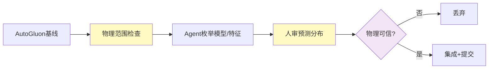

# 第7章 表格比赛详解：NeurIPS Open Polymer Prediction 2025（2025，科学表格数据的验证特殊性）

> **本章目标**：科学表格竞赛中，人的判断不仅是验证纪律，还包括**领域合理性的守门**。本章 $50,000 奖金竞赛是“分数好但物理上不可信”的典型场景——CV 再高，预测值超出物理范围就是废品。

---

## 7.1 比赛与数据

NeurIPS 2025 的聚合物性质预测，$50,000 奖金竞赛，回归/多任务表格任务。

给定聚合物的分子描述符与实验条件，预测多个目标性质（如玻璃化转变温度 Tg、密度等）。多任务结构意味着不同目标量纲差异大，需分别标准化。



---

## 7.2 自动基线工件与领域约束

AutoGluon 基线工件；人检查预测值是否落在**物理合理的范围内**。

科学数据的验证不能只看 CV——**领域约束是人的判断**。例如：
- 玻璃化转变温度 Tg 不可能低于绝对零度（-273°C）；
- 密度必须为正；
- 某些性质有理论上下界。

```python
# src/utils/physical_constraints.py
"""
物理约束断言：预测值必须满足领域常识范围。
违反约束的模型即使 CV 高也应丢弃。
"""

# 各目标的性质约束（人根据领域知识填写）
CONSTRAINTS = {
    "Tg":        {"min": 0.0,   "max": 500.0},   # 玻璃化温度 °C
    "density":   {"min": 0.5,   "max": 2.5},     # g/cm³
    "Tg_v2":     {"min": -50.0, "max": 300.0},
}

def check_physical(oof_dict: dict, y_dict: dict) -> dict:
    """
    检查每个目标 OOF 的预测范围是否满足物理约束。
    返回 {目标: 是否通过}。
    """
    report = {}
    for target, preds in oof_dict.items():
        c = CONSTRAINTS.get(target)
        if c is None:
            report[target] = True
            continue
        ok = (preds.min() >= c["min"]) and (preds.max() <= c["max"])
        report[target] = bool(ok)
        if not ok:
            print(f"⚠️ {target} 预测越界: [{preds.min():.2f}, {preds.max():.2f}] "
                  f"允许 [{c['min']}, {c['max']}]")
    return report
```

---

## 7.3 Agent 批量实验，人审核物理合理性

Agent 枚举模型和特征变体；人审查工件中的预测分布和异常值，判断是否存在“分数好但物理上不可信”的模型。

**真实案例场景**：某 Agent 产出的模型 CV RMSE 最低，但预测中有 3% 的样本 Tg < -200°C。人审查发现该模型在训练集外区域外推失控——虽然 CV 好，但**外推不可靠**，丢弃。

```python
# src/utils/out_of_distribution.py
"""检测 OOF 中超出训练范围的预测（外推风险）。"""
import numpy as np

def extrapolation_ratio(oof, y_train, z=3):
    """OOF 中偏离训练目标均值 > z 倍标准差的比例。"""
    mu, sd = y_train.mean(), y_train.std()
    return float(np.mean(np.abs(oof - mu) > z * sd))
```

人的审查问题：
1. 预测分布是否与训练目标分布形状相似？
2. 是否有大量样本落在训练集从未出现的区域？
3. 多任务间预测是否物理一致（如密度与体积的关系）？

---

## 7.4 集成与提交

```python
# src/submit/physical_submit.py
"""提交前做物理约束断言，违反则拒绝生成提交。"""
import numpy as np, pandas as pd
from pathlib import Path
from src.utils.physical_constraints import CONSTRAINTS

def make_physical_submission(pred_dict, sample_path, out_path, id="id"):
    """pred_dict: {target: 测试预测数组}。"""
    sample = pd.read_csv(sample_path)
    sub = sample.copy()
    for target, preds in pred_dict.items():
        c = CONSTRAINTS.get(target)
        if c and ((preds.min() < c["min"]) or (preds.max() > c["max"])):
            raise ValueError(f"{target} 预测违反物理约束，拒绝提交")
        sub[target] = preds
    sub.to_csv(out_path, index=False)
    print(f"✅ 物理约束通过，提交已生成: {out_path}")
```

---

## 7.5 小结

**科学表格竞赛中，人的判断不仅是验证纪律，还包括领域合理性的守门。**

- CV 高 ≠ 可信，物理越界直接否决；
- 外推风险检测是 Agent 不会自动做的；
- 多任务物理一致性需要领域知识。

> **下一章预告**：第二部分结束，第三部分进入时序数据——第 8 章时序 Vibe 工作流，强调时间纪律不可委托。