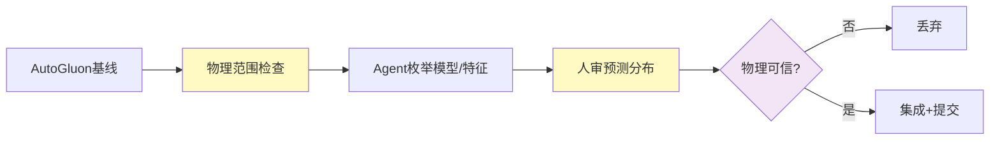

# 第7章 表格比赛详解：NeurIPS Open Polymer Prediction 2025（2025，科学表格数据的验证特殊性）

> **本章目标**：进入科学表格数据。这一章你会遇到一个全新的问题：**分数好，不等于结果对。** 一个模型 CV 分数漂亮，但预测出“玻璃化转变温度低于绝对零度”，那它就是废品。科学竞赛里，人的判断不只是验证纪律，还包括**领域合理性的守门**——这是 Agent 完全帮不上忙的地方。

---

## 开篇：当“分数”和“物理”打架

前面几章，我们判断一个模型好坏，主要看 CV 分数。这在商业比赛里基本够用。但科学竞赛不一样。

设想你预测某种聚合物的玻璃化转变温度（Tg，就是材料从硬变软的那个温度）。模型 CV 的 RMSE 很低，看着很美。可你一看预测值，发现有 3% 的样本预测出了 -250°C——比绝对零度（-273°C）高一点点，但物理上根本不可能，聚合物的 Tg 不可能这么低。

这就是“分数好但物理上不可信”。CV 只告诉你“预测值和真实值的平均差距小”，它不告诉你“预测值在物理上是否可能”。**在科学竞赛里，一个违反物理常识的预测，哪怕数值上很准，也是不可接受的**——因为它意味着模型在某个区域完全失控，只是碰巧那个区域样本少，没拉高平均误差。

所以这一章，我们要在“验证纪律”之外，加一道“领域合理性”的守门。这道门，Agent 守不了——它不懂物理。



---

## 7.1 比赛与数据

NeurIPS 2025 的聚合物性质预测，$50,000 奖金，回归/多任务表格任务。

给定聚合物的分子描述符与实验条件，预测多个目标性质（玻璃化转变温度 Tg、密度等）。**多任务**意味着不同目标量纲差异大（温度是几百，密度是 1 左右），需要分别标准化，不能一锅炖。

数据特点：
- 特征：分子描述符（分子量、链长、官能团计数等）+ 实验条件（温度、压力）；
- 目标：多个性质，每个有自己的物理范围；
- 陷阱：某些目标在训练集里样本少，模型容易在外推区域（训练集没覆盖的范围）失控。

---

## 7.2 自动基线工件与领域约束

AutoGluon 基线工件；人检查预测值是否落在**物理合理的范围内**。

科学数据的验证不能只看 CV——**领域约束是人的判断**。我们先定义每个目标的物理范围（这份表得人来填，Agent 不知道）：

```python
# src/utils/physical_constraints.py
"""
物理约束断言：预测值必须满足领域常识范围。
违反约束的模型，即使 CV 高也应丢弃。
这份表由人根据领域知识填写，Agent 只读。
"""

# 各目标的合理范围（人填）
CONSTRAINTS = {
    "Tg":      {"min": 0.0,   "max": 500.0},   # 玻璃化温度 °C，不可能低于 0
    "density": {"min": 0.5,   "max": 2.5},     # 密度 g/cm³，必须为正
    "Tg_v2":   {"min": -50.0, "max": 300.0},
}


def check_physical(oof_dict: dict) -> dict:
    """
    检查每个目标 OOF 的预测范围是否满足物理约束。
    返回 {目标: 是否通过}。
    """
    report = {}
    for target, preds in oof_dict.items():
        c = CONSTRAINTS.get(target)
        if c is None:
            report[target] = True
            continue
        ok = (preds.min() >= c["min"]) and (preds.max() <= c["max"])
        report[target] = bool(ok)
        if not ok:
            print(f"⚠️ {target} 预测越界：[{preds.min():.2f}, {preds.max():.2f}] "
                  f"允许范围 [{c['min']}, {c['max']}]")
    return report
```

跑完基线，先过一遍这个检查。如果有目标越界，哪怕 CV 好看，也要先弄清楚为什么。

---

## 7.3 Agent 批量实验，人审核物理合理性

Agent 枚举模型和特征变体；人审查工件中的预测分布和异常值，判断是否存在“分数好但物理上不可信”的模型。

**一个真实会发生的场景**：Agent 跑了 20 个模型，其中 XGBoost 的 CV RMSE 最低。你正准备用它，先做物理检查——发现它 3% 的预测 Tg < -200°C。你去查，发现这些样本的特征值在训练集里从没出现过（外推区域），模型在那里完全乱来。虽然 CV 分数好看（因为那 3% 样本少，没拉高平均误差），但**外推不可靠**，果断丢弃。

怎么系统地检测这种“外推失控”？看预测值偏离训练目标分布的程度：

```python
# src/utils/out_of_distribution.py
"""检测 OOF 中超出训练范围的预测（外推风险）。"""
import numpy as np


def extrapolation_ratio(oof, y_train, z=3):
    """
    OOF 中偏离训练目标均值 > z 倍标准差的比例。
    这个比例高，说明模型在"训练集没覆盖的区域"乱预测。
    """
    mu, sd = y_train.mean(), y_train.std()
    return float(np.mean(np.abs(oof - mu) > z * sd))
```

人的审查问题清单：
1. 预测分布的形状，和训练目标分布像吗？（画个直方图叠一起看）
2. 有没有大量样本落在训练集从未出现的区域？
3. 多任务之间预测物理一致吗？（比如密度和体积的关系对不对）

> **Agent 不会主动做这些检查**——它只会报 CV 分数。物理合理性这道门，只能人守。

---

## 7.4 集成与提交

```python
# src/submit/physical_submit.py
"""
提交前做物理约束断言，违反则拒绝生成提交。
这是最后一道闸：宁可交不上去，也不交一个物理上荒谬的结果。
"""
import numpy as np
import pandas as pd
from src.utils.physical_constraints import CONSTRAINTS


def make_physical_submission(pred_dict, sample_path, out_path, id_col="id"):
    """pred_dict: {目标: 测试预测数组}。"""
    sample = pd.read_csv(sample_path)
    sub = sample.copy()
    for target, preds in pred_dict.items():
        c = CONSTRAINTS.get(target)
        if c and ((preds.min() < c["min"]) or (preds.max() > c["max"])):
            raise ValueError(f"{target} 预测违反物理约束，拒绝提交")
        sub[target] = preds
    sub.to_csv(out_path, index=False)
    print(f"✅ 物理约束通过，提交已生成：{out_path}")
```

注意这里的设计哲学：**宁可交不上去，也不交一个荒谬的结果。** 在科学竞赛里，一个物理上不可能的答案，比一个分数稍低的合理答案更糟——因为它说明你根本没理解问题。

---

## 7.5 小结

**科学表格竞赛中，人的判断不仅是验证纪律，还包括领域合理性的守门。**

- CV 高 ≠ 可信，物理越界直接否决；
- 外推风险检测（`extrapolation_ratio`）是 Agent 不会自动做的；
- 多任务物理一致性需要领域知识；
- 提交前的物理断言，是最后一道闸。

这一章给你的启发可以推广到所有“有领域约束”的问题：医疗（预测值不能是负的剂量）、金融（预测收益率不能离谱）、气象（预测温度不能超出物理极限）。**凡是现实有约束的地方，验证就不能只看数字。**

> **下一章预告**：第二部分（表格）结束，第三部分进入时序数据。第 8 章建立时序 Vibe 工作流，核心只有一句话：**时间纪律不可委托。** 你会在那里看到，为什么“随机划分”在时序问题里是头号大敌。