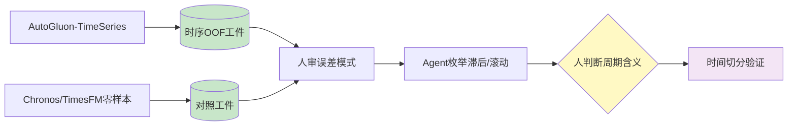

# 第8章 时序数据的 Vibe 工作流：自动化枚举与人工时间纪律

> **本章目标**：进入第二部分——时序数据。这一章只讲一件事，但这件事是时序竞赛的命根子：**时间纪律不可委托。** Agent 可以帮你批量枚举几百个滞后和滚动特征，但“哪些阶数有周期含义”“时间该怎么切”，必须你来定。本章建立时序 Vibe 循环模板，后面三章（S5E1、S5E10、Jane Street）都复用它。

---

## 开篇：时序问题里，最大的敌人是“偷看未来”

先说一个让人后背发凉的事实：时序竞赛里，最常见的错误不是模型不够好，而是**模型偷看了未来**。

什么叫偷看未来？假设你要预测某家店明天的贴纸销量。如果你随机地把数据切成训练集和验证集，那很可能出现这种情况：训练集里有 1 月 5 日的数据，验证集里有 1 月 3 日的数据——模型在“未来”训练，却去预测“过去”。这在现实中根本不可能（你不可能用明天的数据训练一个预测昨天的模型），但在随机切分下，它就这么发生了。

结果就是：你的 CV 分数高得离谱，一提交，LB 暴跌。因为你训练时偷看了未来，线上却只能看到过去。

所以时序问题的第一纪律是：**永远用过去预测未来，切分必须严格按时间顺序。** 这条纪律，Agent 最容易违反——它看到“交叉验证”四个字，条件反射就是 `KFold`，完全不管数据有没有时间性。

这一章，我们就把这条纪律，用制度和代码焊死。



---

## 8.1 时序自动基线 + 工件落盘

AutoGluon-TimeSeries 快速基线；基础模型（Chronos / TimesFM）的零样本预测作为对照工件。

先解释两个新词：
- **AutoGluon-TimeSeries**：AutoGluon 的时序版本，专门做“预测未来一段时间”的任务；
- **零样本（zero-shot）预测**：像 Chronos 这种“时序基础模型”，在无数条时间序列上预训练过，你直接把新数据丢给它，不用训练就能预测。它就像一个见过无数股票曲线、销售曲线、气温曲线的“老分析师”，看一眼新曲线就能大致外推。

```python
# src/baselines/timeseries_baseline.py
"""
时序自动基线：AutoGluon-TimeSeries + Chronos 零样本。
产出与表格一致的 OOF/test 工件规范，便于集成。
"""
import numpy as np
import pandas as pd
from pathlib import Path
from autogluon.timeseries import TimeSeriesPredictor

ROOT = Path(__file__).resolve().parents[2]
# 时序数据通常长这样：item_id（序列编号）、timestamp（时间）、target（值）
train = pd.read_csv(ROOT / "data" / "train.csv")

# AutoGluon-TimeSeries 要求长格式：item_id, timestamp, target
predictor = TimeSeriesPredictor(
    prediction_length=28,          # 预测未来 28 天
    target="target",
    eval_metric="MAPE",            # 平均绝对百分比误差
    path=str(ROOT / "artifacts" / "_ag_ts"),
).fit(train, time_limit=300, verbosity=0)

# 产出预测工件（示意；严格 OOF 见后文时间切分）
print("AutoGluon-TimeSeries 基线完成")
```

跑完，人检查**不同序列的误差模式**：哪些 item 的 MAPE 远高于平均？是新品（历史数据少）、促销期（波动大）还是数据稀疏？这些问题的答案，决定了你后面该往哪个方向使劲。

---

## 8.2 Agent 执行、人审查的特征工程

日期拆分交给 Agent；滞后阶数和滚动窗口的**候选枚举**交给 Agent，但**哪些阶数有周期含义**由人根据 EDA 判断。

先解释两个核心特征：
- **滞后特征（lag）**：把过去第 k 天的值拿过来当特征。比如“昨天的销量”对预测今天很有用。
- **滚动窗口（rolling）**：把过去 w 天的统计量（均值、标准差、最大最小值）当特征。比如“过去 7 天平均销量”刻画短期趋势。

把这段话丢给 Agent：

```
请为时序数据生成滞后与滚动特征：
- 滞后：1, 7, 14, 28 天
- 滚动窗口：7, 14, 28 天，统计量 mean/std/min/max
产出对比工件 LGBM_TS_v001。固定时间切分协议不变。
```

模型输出（节选，注意那个 `shift(1)`）：

```
> （思考过程）滞后特征用 groupby(item_id)[target].shift(k)。
> 滚动用 groupby(item_id)[target].rolling(w).mean() 等。
> 注意：滚动统计必须 shift(1) 避免用当天值（泄漏）——
> 如果直接 rolling 会把当天数据算进去，等于偷看答案。

def add_lag_roll(df, item_col, ts_col, target):
    """滞后 + 滚动特征，严格避免当天泄漏。"""
    df = df.sort_values([item_col, ts_col]).copy()
    g = df.groupby(item_col)[target]
    for k in [1, 7, 14, 28]:
        df[f"lag_{k}"] = g.shift(k)               # 滞后 k 天
    for w in [7, 14, 28]:
        r = g.shift(1).rolling(w)                 # shift(1) 防泄漏！
        df[f"roll_mean_{w}"] = r.mean()
        df[f"roll_std_{w}"] = r.std()
    df["dow"] = pd.to_datetime(df[ts_col]).dt.dayofweek
    df["is_weekend"] = (df["dow"] >= 5).astype(int)
    return df
```

那个 `shift(1)` 是时序特征工程的命门。如果不写，滚动窗口会把当天（也就是你要预测的那天）的值算进均值里——这等于考试时偷看了答案，CV 会虚高，线上必崩。

**人的判断**：零售数据有周周期（周末销量高）、月度效应（月初月末不同）。滞后 7、14、28 天有业务含义；滞后 3、5 天可能只是噪声。滚动窗口 28 天覆盖一个完整月周期，合理。**这些“哪个阶数有意义”的判断，Agent 给不了，它只会把所有阶数都试一遍。**

---

## 8.3 时间验证：不可委托的纪律

人设定时间切分方案，Agent 执行；**Agent 的任何“随机划分”建议应被默认拒绝。**

验证协议（时序版）长这样：

```yaml
# configs/cv_protocol.yaml（时序版）
task_type: "regression"
cv_scheme:
  type: "TimeSeriesSplit"   # 时序切分：训练集时间永远早于验证集
  n_splits: 5
  gap: 28                   # 训练与验证间隔 = 预测跨度，防自相关泄漏
  time_column: "timestamp"
forbidden_schemes:
  - "KFold"            # 时序禁用随机 KFold！
  - "ShuffleSplit"
  - "StratifiedKFold"
```

那个 `gap: 28` 也值得解释。如果你预测未来 28 天，那训练集和验证集之间最好隔 28 天以上——否则训练集末尾的数据和验证集开头的数据高度相关（相邻日期的销量本来就相似），模型又会“偷看”。

**人检查工件中的验证折索引是否符合时间顺序**：

```python
# src/utils/time_order_check.py
"""
验证折索引必须严格按时间顺序：
折 k 的验证集时间，必须晚于折 k 的训练集时间。
只要有一个样本"时间倒流"，就报错。
"""
import numpy as np


def check_time_order(splits, timestamps):
    ts = np.asarray(timestamps)
    for k, (tr, va) in enumerate(splits):
        if ts[tr].max() >= ts[va].min():
            print(f"⚠️ 第 {k} 折时间顺序错误：训练集最大时间 >= 验证集最小时间")
            return False
    print("✅ 所有折时间顺序正确")
    return True
```

> Agent 的任何“随机划分”建议应被默认拒绝——这是时序竞赛的第一红线。它如果说“用 10 折交叉验证更稳”，你要立刻警觉：时序数据不能用随机 KFold。

那 Agent 到底会给出什么建议？你试一次就知道了：

```
我的时序数据想做交叉验证。用哪种切分方式？请说明理由，
不要直接改我的 cv_protocol.yaml。
```

模型会这样答：

```
> （思考过程）用户要的是"方案 + 理由"。关键判断：
> 这份数据有 item_id（多条序列）和 timestamp，
> 既有分组结构又有时间性。我要说明为什么普通 KFold 错、
> 为什么 TimeSeriesSplit 对，以及 gap 该设多少。

推荐：TimeSeriesSplit（时间前向切分），不要用 KFold。

【为什么 KFold 在这里会出事】
你的数据是"多天连续记录"。随机 KFold 会把 3 月 10 日
放进训练集、3 月 5 日放进验证集——模型就用"未来"训练，
去预测"过去"。这在真实上线时不可能发生，所以 CV 分数会虚高，
一上线就崩。

【TimeSeriesSplit 怎么工作】
把时间轴顺序排好，第 1 折用最早的一段训练、紧接着的一段验证；
第 2 折把验证数据也并入训练，再往后取一段验证。
每一折的训练时间都严格早于验证时间。

【gap 该设多大】
gap = 你的预测跨度。也就是你要预测未来 28 天，
那训练集和验证集之间至少隔 28 天（gap=28）。
原因是：训练集末尾的数据和验证集开头的数据如果挨得太近，
相邻日期本来就相似，模型会"顺手"猜对——这也是一种偷看。
如果你预测跨度不是 28 天，gap 要跟着改。

【一个我没把握的点】
你的多条序列（item_id）之间长度可能不同。TimeSeriesSplit
是按"行"切的，不是按"序列"切的，如果各序列长度差异大，
切出来的折可能会让某些序列在训练集里完全缺席。
要不要我先统计一下各序列的长度分布，看看有没有这个问题？
```

它把“错在哪”“对的是什么”“gap 为什么重要”讲清楚了，还主动提出一个**你没问但确实存在的隐患**（序列长度差异导致切分不均）。这就是好的协作——它不只回答问题，还帮你发现下一个问题。

---

## 8.4 基础模型与树模型的工件级融合

基础模型工件和树模型工件并列；人判断融合方式（简单加权、残差建模、将基础模型预测作为特征送入树模型）。

三种融合方式，各有适用场景：

```python
# src/ensembles/ts_fusion.py
"""三种融合方式：加权、残差、基础模型预测作特征。"""
import numpy as np


def weighted_fusion(p_tree, p_base, w=0.5):
    """简单加权。w 由人根据 CV 决定。"""
    return w * p_tree + (1 - w) * p_base


def residual_fusion(y_true, p_base, tree_model, X):
    """残差建模：树模型学 y - p_base 的残差（基础模型没预测对的部分）。"""
    residual = y_true - p_base
    tree_model.fit(X, residual)
    return p_base + tree_model.predict(X)
```

**人判断**：
- 如果基础模型（Chronos）在稳定期表现好、树模型在促销期好 → 用残差融合，让树模型专门补基础模型的短板；
- 如果两者误差模式互补 → 用加权；
- 如果基础模型的预测本身就是强信号 → 把它当特征喂给树模型。

这些判断，都建立在你对“两个模型各自擅长什么”的理解上。Agent 不知道 Chronos 擅长什么、树模型擅长什么，它只会把三个公式都跑一遍。

---

## 8.5 小结

- 时序自动基线产出合规工件，人审误差模式；
- 滞后/滚动特征 Agent 枚举，**周期含义人判断**；
- 时间验证纪律**不可委托**，随机划分默认拒绝，`shift(1)` 防泄漏；
- 基础模型与树模型融合方式由人决定。

这一章反复出现一个主题：**时序问题里，Agent 的“聪明”反而是危险的。** 它见多识广，会给你提各种“优化”建议，但其中很多在时序场景下是错的（比如随机 CV、用未来数据）。你的职责，就是把这些建议挡在门外。

> **下一章预告**：第 9 章贴纸销售预测，把这套循环落到入门级时序比赛。你会看到 Top 15% 的方案都在用 Group K-Fold——**时间/分组纪律，从入门级比赛就是核心**，不是高级技巧。