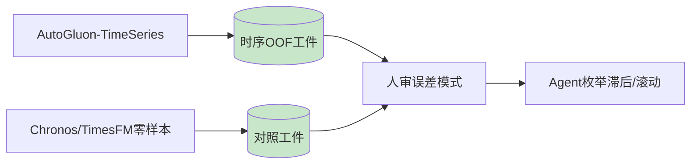

# 第8章 时序数据的 Vibe 工作流：自动化枚举与人工时间纪律

> **本章目标**：进入第二部分。时序数据的核心不是模型复杂度，而是**时间验证纪律**。Agent 可以批量枚举滞后与滚动特征，但哪些阶数有周期含义、时间切分怎么设，必须由人决定。本章建立时序 Vibe 循环模板，后续三章复用。

---

## 8.1 时序自动基线 + 工件落盘

AutoGluon-TimeSeries 快速基线；基础模型（Chronos/TimesFM）的零样本预测作为对照工件。



```python
# src/baselines/timeseries_baseline.py
"""
时序自动基线：AutoGluon-TimeSeries + Chronos 零样本。
产出与表格一致的 OOF/test 工件规范，便于集成。
"""
import numpy as np, pandas as pd
from pathlib import Path
from autogluon.timeseries import TimeSeriesPredictor

ROOT = Path(__file__).resolve().parents[2]
# 时序数据通常有 id（序列）、timestamp、target 三列
train = pd.read_csv(ROOT / "data" / "train.csv")

# AutoGluon-TimeSeries 要求长格式：item_id, timestamp, target
pred = TimeSeriesPredictor(
    prediction_length=28,          # 预测未来 28 天
    target="target",
    eval_metric="MAPE",
    path=str(ROOT / "artifacts" / "_ag_ts"),
).fit(train, time_limit=300, verbosity=0)

# 产出预测工件（简化示意）
print("AutoGluon-TimeSeries 基线完成")
```

人检查**不同序列的误差模式**：哪些 item 的 MAPE 远高于均值？是新品、促销期还是数据稀疏？

---

## 8.2 Agent 执行、人审查的特征工程

日期拆分交给 Agent；滞后阶数和滚动窗口的**候选枚举**交给 Agent，但**哪些阶数有周期含义**由人根据 EDA 判断。

```
请为时序数据生成滞后与滚动特征：
- 滞后：1, 7, 14, 28 天
- 滚动窗口：7, 14, 28 天，统计量 mean/std/min/max
产出对比工件 LGBM_TS_v001。固定时间切分协议不变。
```

模型输出（节选）：

```
> （思考过程）滞后特征用 groupby(item_id)[target].shift(k)。
> 滚动用 groupby(item_id)[target].rolling(w).mean() 等。
> 注意：滚动统计必须 shift(1) 避免用当天值（泄漏）。
> 日期拆分：year, month, day, dayofweek, weekofyear, is_weekend。

def add_lag_roll(df, item_col, ts_col, target):
    """滞后 + 滚动特征，严格避免当天泄漏。"""
    df = df.sort_values([item_col, ts_col]).copy()
    g = df.groupby(item_col)[target]
    for k in [1, 7, 14, 28]:
        df[f"lag_{k}"] = g.shift(k)               # 滞后 k 天
    for w in [7, 14, 28]:
        r = g.shift(1).rolling(w)                 # shift(1) 防泄漏
        df[f"roll_mean_{w}"] = r.mean()
        df[f"roll_std_{w}"] = r.std()
    df["dow"] = pd.to_datetime(df[ts_col]).dt.dayofweek
    df["is_weekend"] = (df["dow"] >= 5).astype(int)
    return df
```

**人的判断**：零售数据有周周期（周末销量高）、月度效应（月初/月末）。滞后 7、14、28 天有业务含义；滞后 3、5 天可能只是噪声。滚动窗口 28 天覆盖一个完整月周期，合理。

---

## 8.3 时间验证：不可委托的纪律

人设定时间切分方案，Agent 执行；**Agent 的任何“随机划分”建议应被默认拒绝**。

```yaml
# configs/cv_protocol.yaml（时序版）
task_type: "regression"
cv_scheme:
  type: "TimeSeriesSplit"
  n_splits: 5
  gap: 28              # 训练与验证间隔 = 预测跨度，防泄漏
  time_column: "timestamp"
forbidden_schemes:
  - "KFold"            # 时序禁用随机 KFold
  - "ShuffleSplit"
  - "StratifiedKFold"
```

**人检查工件中的验证折索引是否符合时间顺序**：

```python
# src/utils/time_order_check.py
"""验证折索引必须严格按时间顺序：折 k 的验证集时间 > 折 k 的训练集时间。"""
import numpy as np

def check_time_order(splits, timestamps):
    ts = np.asarray(timestamps)
    for k, (tr, va) in enumerate(splits):
        if ts[tr].max() >= ts[va].min():
            print(f"⚠️ Fold {k} 时间顺序错误：训练集最大时间 >= 验证集最小时间")
            return False
    print("✅ 所有折时间顺序正确")
    return True
```

> Agent 的任何“随机划分”建议应被默认拒绝——这是时序竞赛的第一红线。

---

## 8.4 基础模型与树模型的工件级融合

基础模型工件和树模型工件并列；人判断融合方式（简单加权、残差建模、将基础模型预测作为特征送入树模型）。

```python
# src/ensembles/ts_fusion.py
"""三种融合方式：加权、残差、基础模型预测作特征。"""
import numpy as np

def weighted_fusion(p_tree, p_base, w=0.5):
    """简单加权。w 由人根据 CV 决定。"""
    return w * p_tree + (1 - w) * p_base

def residual_fusion(y_true, p_base, tree_model, X):
    """残差建模：树模型学 y - p_base 的残差。"""
    residual = y_true - p_base
    tree_model.fit(X, residual)
    return p_base + tree_model.predict(X)
```

**人判断**：若基础模型（Chronos）在稳定期表现好、树模型在促销期好，用残差融合；若两者误差模式互补，用加权。

---

## 8.5 小结

- 时序自动基线产出合规工件，人审误差模式；
- 滞后/滚动特征 Agent 枚举，**周期含义人判断**；
- 时间验证纪律**不可委托**，随机划分默认拒绝；
- 基础模型与树模型融合方式由人决定。

> **下一章预告**：第 9 章贴纸销售预测，把这套循环落到入门级时序比赛，强调 Group K-Fold 时间纪律。