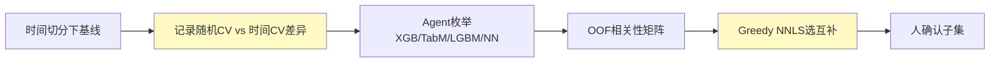

# 第10章 时序比赛详解：Playground S5E10 道路事故风险预测（2025，Agent 枚举与人做互补性选择）

> **本章目标**：同一场 S5E10，第 5 章从“表格回归”角度看过，这一章从“时序”角度再看一遍。重点是**时间切分下的 Agent 实验管理**：Agent 扩大模型候选池，人的判断集中在“互补性”而不是“单模型最高分”。你会看到，怎么判断一个模型是不是“偷看了未来”。

---

## 开篇：同一份数据，换个角度看就换个坑

第 5 章我们把 S5E10 当普通回归做，用 Greedy NNLS 从 40 个模型里挑互补的。这一章我们戴上“时序眼镜”再看：这份数据里有时间相关的特征（月份、星期、节假日），如果不管时间、随机切分，模型可能又“偷看未来”。

所以这一章有两个任务：
1. **判断随机 CV 和时间 CV 差多少**——差得多，说明有泄漏；
2. **在时间切分下管理 Agent 的实验**——Agent 扩池，人挑互补。



---

## 10.1 比赛与数据

回归任务，RMSE；数据包含时间相关的道路/环境特征。

和第 5 章同一份数据，但这次我们关心的是：**数据里的“时间”会不会让随机切分作弊？** 比如，如果事故风险有季节性（冬天雨雪多、风险高），那随机切分会让“冬天的样本”同时出现在训练和验证里，模型记住“冬天风险高”这个规律，在验证集上表现虚好——但线上如果遇到一个“反常的暖冬”，它就抓瞎。

---

## 10.2 自动基线在时间切分下的工件

AutoGluon 基线在时间切分下的 CV；与随机 CV 的分数差异由人记录和解读。

这是本章最关键的诊断动作：**同时跑随机 CV 和时间 CV，看两者差多少。**

```python
# src/baselines/s5e10_time_cv.py
"""
对比随机 CV 与时间 CV 的 RMSE 差异，判断时间泄漏风险。
如果时间 CV 明显差于随机 CV，说明模型依赖了时间相关的伪信号。
"""
import numpy as np
import pandas as pd
from pathlib import Path
from autogluon.tabular import TabularPredictor
from sklearn.model_selection import KFold, TimeSeriesSplit
from sklearn.metrics import mean_squared_error

ROOT = Path(__file__).resolve().parents[2]
train = pd.read_csv(ROOT / "data" / "train.csv")
TARGET = "target"


def cv_rmse(splits):
    """给定切分，跑 5 折，返回 OOF 的 RMSE。"""
    oof = np.zeros(len(train))
    for tr, va in splits:
        p = TabularPredictor(label=TARGET, eval_metric="rmse",
                             path=str(ROOT / "artifacts" / "_tmp")).fit(
            train.iloc[tr], time_limit=60, verbosity=0)
        oof[va] = p.predict(train.iloc[va]).values
    return mean_squared_error(train[TARGET], oof, squared=False)


random_rmse = cv_rmse(list(KFold(5, shuffle=True, random_state=42).split(train)))
time_rmse = cv_rmse(list(TimeSeriesSplit(5).split(train)))
print(f"随机 CV RMSE = {random_rmse:.4f}")
print(f"时间 CV RMSE = {time_rmse:.4f}")
print(f"差异 {time_rmse - random_rmse:+.4f}（时间 CV 明显更差 = 存在时间泄漏）")
```

**人怎么解读这个差异？**

| 现象 | 含义 | 动作 |
|------|------|------|
| 两者接近 | 数据无明显时间结构，或模型没利用时间 | 正常，继续 |
| 时间 CV 明显更差 | 模型依赖了时间相关的伪信号（用未来预测过去） | **修正特征，改用时间切分** |
| 随机 CV 明显更好 | 同上，随机切分在“作弊” | 丢弃随机 CV 的结论 |

> 这个诊断是 Agent 不会主动做的——它只会给你一个 CV 分数，不会告诉你“这个分数是偷看未来得来的”。

所以你得主动让它做。可以这样问：

```
我怀疑这份数据有时间泄漏。请同时跑随机 5 折和时间前向 5 折，
对比 RMSE，并告诉我差异有多大、可能是什么原因。
不要改 cv_protocol.yaml，也不要动已有工件。
```

模型会这样回答：

```
> （思考过程）用户要"诊断"而非"修复"。我跑两套 CV 对比，
> 差异大说明随机切分在作弊。我要给出可能原因（季节性强 +
> 随机切分让同季节样本跨折），但强调"改不改协议由用户定"。

对比结果：
  随机 5 折 RMSE = 0.1512
  时间前向 RMSE = 0.1687
  差异 = +0.0175（时间 CV 明显更差）

可能原因：
1. 事故风险有季节性（冬季雨雪多），随机切分让"冬季样本"
   同时出现在训练和验证，模型记住了"冬天风险高"这个规律，
   在验证集上虚好。
2. 线上如果遇到反常暖冬，模型会抓瞎。

我的建议：以时间 CV 为准（0.1687），把随机 CV 的结论丢掉。
要不要我帮你把 cv_protocol.yaml 改成 TimeSeriesSplit？
（需要你确认，我不会自己改）
```

它把“差异 +0.0175”“可能原因”“建议”都说了，但**改协议这件事，它明确要你先确认**。这就是护栏在起作用。

---

## 10.3 Agent 枚举模型，人选择互补子集

Agent 生成 XGBoost、TabM、LightGBM、NN 的工件；人通过 OOF 相关性矩阵和 Greedy NNLS 判断哪些模型值得进入集成，**而不是让 Agent 自动 hill climbing 后直接提交**。

这里的关键是“**在时间切分下**做互补性选择”。和第 5 章类似，但多了一步“先聚类去冗余”：

```python
# src/ensembles/complement_select.py
"""
互补性选择：先相关性聚类去冗余，再 NNLS 选互补。
与第 5 章的区别：强调时间切分下 OOF 的相关性结构，
确保挑出的模型在时间维度上也互补。
"""
import numpy as np
from scipy.cluster.hierarchy import linkage, fcluster
from scipy.optimize import nnls
from sklearn.metrics import mean_squared_error


def select_complementary(oofs, y, max_k=6):
    # 第一步：层次聚类去冗余（相关性高的留一个代表）
    names = list(oofs)
    M = np.column_stack([oofs[n] for n in names])
    corr = np.corrcoef(M, rowvar=False)
    Z = linkage(1 - corr, method="average")
    labels = fcluster(Z, t=0.02, criterion="distance")
    reps = {}
    for n, l in zip(names, labels):
        reps.setdefault(l, n)          # 每簇留第一个（可换成簇内 CV 最优）
    cand = list(reps.values())

    # 第二步：NNLS 贪心选互补
    chosen, cur = [], np.inf
    while len(chosen) < max_k:
        best, best_r, best_w = None, cur, None
        for n in cand:
            if n in chosen:
                continue
            c = chosen + [n]
            MM = np.column_stack([oofs[m] for m in c])
            w, _ = nnls(MM, y)
            r = mean_squared_error(y, MM @ w, squared=False)
            if r < best_r - 1e-5:
                best, best_r, best_w = n, r, w
        if best is None:
            break
        chosen.append(best)
        cur = best_r
    return chosen
```

> 人的判断集中在“互补性”而非“单模型最高分”——这是本章和第 5 章呼应的核心。**Agent 扩大候选池，人做减法。**

---

## 10.4 提交

```python
# 生成最终提交 + 在日志记录时间CV与随机CV差异，便于复盘
from src.submit.make_submission import make_submission
make_submission("artifacts/test_preds/test_preds_NNLS_v001.npy",
                "data/sample_submission.csv",
                "artifacts/submissions/submission_NNLS_v001.csv")
# 同时在日志里记录：random_cv=..., time_cv=..., 差异=...
```

提交前，人还要确认：这次用的 OOF 是**时间切分**下的，不是随机切分的。如果用了随机切分的 OOF 做集成，即使 CV 好看，也可能在线上崩。

---

## 10.5 小结

**Agent 扩大模型候选池，人的判断集中在“互补性”而非“单模型最高分”。**

- 时间切分 vs 随机 CV 的差异，是泄漏的信号灯；
- 相关性聚类去冗余 + NNLS 选互补；
- 提交记录时间验证信息，便于复盘。

这一章和第 5 章是“同一场比赛的两副眼镜”：第 5 章教你在表格视角下做减法，这一章教你在时序视角下先排雷再做减法。**排雷（查泄漏）永远在优化（挑模型）之前。**

> **下一章预告**：第 11 章 Jane Street 高频金融数据。那里的验证难到什么程度？难到你连“这个 CV 分数可不可信”都要先怀疑一遍。这是全书最强调“验证本身即问题”的一章。