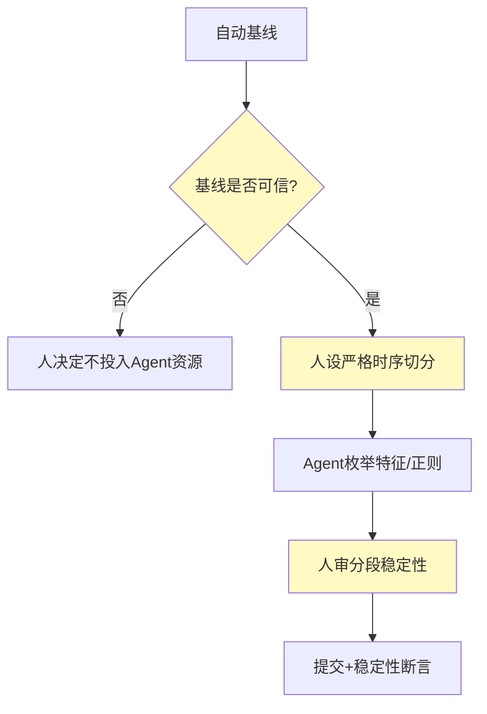

# 第11章 时序比赛详解：Jane Street Real-Time Market Data Forecasting（2024—2025，非平稳时序的验证极限）

> **本章目标**：当验证本身极其困难时，人的判断不是“选一个分数”，而是“判断这个分数是否可信”。本章是全书最强调“Agent 不应自主选择验证方案”的一章。

---

## 11.1 比赛与数据

金融高频数据，加权零均值 R²（R2 for `responder_6`），2024 年 10 月—2025 年 7 月。

数据的肥尾、非平稳和突变特征使标准 CV 假设几乎全部失效：
- **肥尾**：极端行情下收益分布尾部极厚，RMSE/R² 被极值主导；
- **非平稳**：市场结构随时间变化，训练期与测试期分布不同；
- **突变**：政策、黑天鹅事件导致参数跳变。



---

## 11.2 自动基线的局限

AutoGluon-TimeSeries / 树模型基线在非平稳金融数据上的表现往往不稳定；人必须**先判断自动基线是否可信**，再决定是否投入 Agent 实验资源。

```python
# src/baselines/jane_street_baseline.py
"""
Jane Street 基线：线性模型 + 稳健标准化。
树模型在肥尾非平稳数据上易过拟合，线性基线更稳。
"""
import numpy as np, pandas as pd
from pathlib import Path
from sklearn.linear_model import Ridge
from sklearn.preprocessing import RobustScaler
from sklearn.metrics import r2_score

ROOT = Path(__file__).resolve().parents[2]
train = pd.read_csv(ROOT / "data" / "train.csv")
# 特征列 f_1..f_79，目标 responder_6
feats = [c for c in train.columns if c.startswith("f_")]
X, y = train[feats].values, train["responder_6"].values

scaler = RobustScaler().fit(X)          # 稳健标准化，抗肥尾
m = Ridge(alpha=10.0).fit(scaler.transform(X), y)
print("训练 R2:", r2_score(y, m.predict(scaler.transform(X))))
```

**人判断基线是否可信**：
- 若训练 R2 很低（< 0.01），说明信号弱，Agent 实验也难有作为；
- 若训练 R2 高但分段 R2 波动大，说明非平稳，需分段验证。

---

## 11.3 时间验证的极端纪律

官方评估 API 强制模型不能“向前看”。人设定严格的时序切分；Agent 的任何交叉验证建议都必须经过人审核。

```yaml
# configs/cv_protocol.yaml（Jane Street 版）
task_type: "regression"
cv_scheme:
  type: "TimeSeriesSplit"
  n_splits: 5
  gap: 5              # 间隔至少 5 个时间步，防自相关泄漏
  time_column: "date_id"
forbidden_schemes:
  - "KFold"
  - "StratifiedKFold"
  - "ShuffleSplit"
  - "GroupKFold"      # 金融时序不能随机分组
```

> **这是全书最强调“Agent 不应自主选择验证方案”的一章。**

Agent 可能建议“用 10 折交叉验证更稳”——**默认拒绝**，因为金融时序的 IID 假设不成立。

---

## 11.4 Agent 枚举特征与模型，人审核非平稳性

Agent 可以批量尝试不同特征组合和正则化强度；人审查工件在不同时间段上的稳定性，而不是只看全局 CV。

```python
# src/utils/segment_stability.py
"""
分段稳定性：把 OOF 按时间分段，看每段 R2 是否稳定。
全局 R2 高但分段 R2 忽高忽低 = 不可信。
"""
import numpy as np
from sklearn.metrics import r2_score

def segment_r2(oof, y, dates, n_seg=5):
    """按时间分 n 段，返回每段 R2。"""
    order = np.argsort(dates)
    chunks = np.array_split(order, n_seg)
    return [r2_score(y[c], oof[c]) for c in chunks]

# 人审查：若某段 R2 为负，说明该时段模型失效
```

**人审查问题**：
1. 分段 R2 是否全为正？若某段为负，该段行情下模型反向；
2. 正则化强度 α 变化对分段稳定性的影响；
3. 特征是否在不同时段符号翻转（非平稳信号）。

---

## 11.5 提交

```python
# 提交文件生成 + 稳定性断言
import numpy as np, pandas as pd
from pathlib import Path

def make_stable_submission(oof, y, dates, test_pred, sample_path, out_path,
                           target="responder_6", id="row_id", min_seg_r2=0.0):
    """提交前断言：所有分段 R2 > min_seg_r2。"""
    from src.utils.segment_stability import segment_r2
    segs = segment_r2(oof, y, dates)
    assert all(s > min_seg_r2 for s in segs), f"分段不稳定: {segs}"
    sample = pd.read_csv(sample_path)
    sub = sample.copy(); sub[target] = test_pred
    sub.to_csv(out_path, index=False)
    print(f"✅ 稳定性断言通过，提交: {out_path}, 分段R2={[round(s,4) for s in segs]}")
```

---

## 11.6 小结

**当验证本身极其困难时，人的判断不是“选一个分数”，而是“判断这个分数是否可信”。**

- 基线可信度由人判断，决定是否投入资源；
- 时序切分极端严格，Agent 的 CV 建议默认拒绝；
- 分段稳定性是核心审查维度。

> **下一章预告**：第三部分结束，第四部分进入图像数据——第 12 章图像 Vibe 工作流，基础模型时代的人机分工。