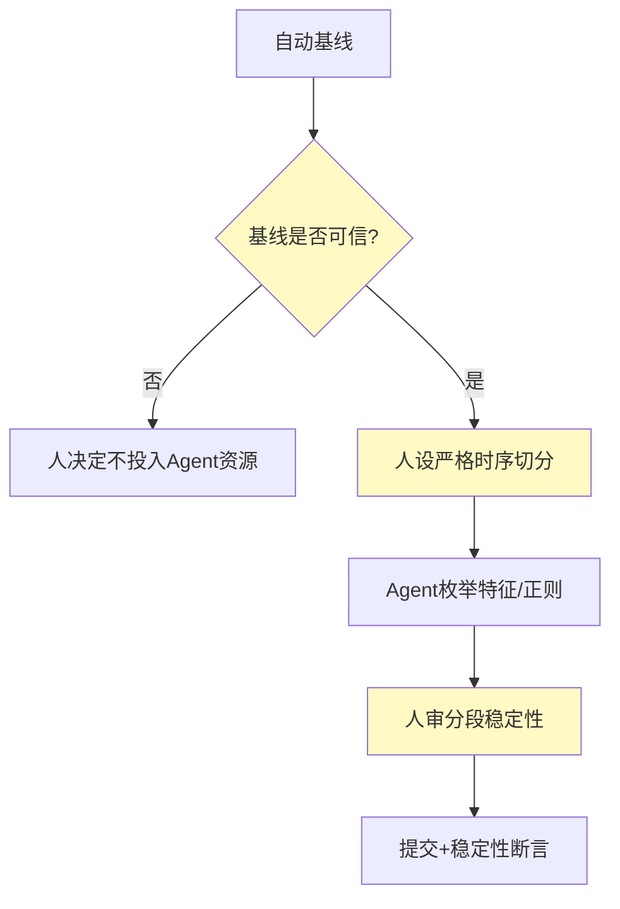

# 第11章 时序比赛详解：Jane Street Real-Time Market Data Forecasting（2024—2025，非平稳时序的验证极限）

> **本章目标**：当验证本身都变得极其困难时，人的判断不再是“选一个分数”，而是“判断这个分数到底信不信得过”。Jane Street 高频金融数据，肥尾、非平稳、突变，让标准的 CV 假设几乎全部失效。这是全书最强调“Agent 不应自主选择验证方案”的一章——因为在金融时序里，验证方案选错的代价，比模型选错还大。

---

## 开篇：金融数据，是个“会变心”的对象

前面几章的时序数据（贴纸销量、道路事故），虽然有时间结构，但底层的“规律”相对稳定：周末销量高、冬天事故多，这些规律几年不变。

金融数据完全不同。它是个“会变心”的对象：
- **肥尾**：极端行情（暴涨暴跌）出现的频率，远比正态分布预测的高。一两天的极端波动，能把整个 RMSE 拉爆；
- **非平稳**：市场的“玩法”会变。去年管用的信号，今年可能反向；
- **突变**：政策出台、黑天鹅事件，一夜之间参数跳变。

这三点加起来，导致一个可怕的结论：**你训练集上学到的规律，在测试集上可能根本不成立。** 更糟的是，你甚至无法用 CV 可靠地检验“规律还成不成立”——因为如果 CV 假设（样本独立同分布）本身就是错的，CV 分数就不可信。

所以这一章反复讲一件事：**在金融时序里，先怀疑验证，再谈优化。**



---

## 11.1 比赛与数据

金融高频数据，指标是加权零均值 R²（R2 for `responder_6`），2024 年 10 月—2025 年 7 月。

- `responder_6`：要预测的那个“响应变量”（具体含义脱敏了）；
- 特征 `f_1` 到 `f_79`：79 个匿名特征，可能是各种技术指标、市场微观结构信号；
- `date_id`：时间步编号；
- 加权零均值 R²：一个对“预测信号相关性”敏感、对绝对偏差不敏感的指标。

数据的肥尾、非平稳和突变特征，使标准 CV 假设几乎全部失效。

---

## 11.2 自动基线的局限

AutoGluon-TimeSeries / 树模型基线在非平稳金融数据上的表现往往不稳定；人必须**先判断自动基线是否可信**，再决定是否投入 Agent 实验资源。

这一步很反常识：**别人都是先跑一堆模型再说，这里却要“先判断值不值得跑”。** 为什么？因为金融数据里，如果信号本身极弱（模型根本学不到规律），你让 Agent 跑 1000 个实验也是白费电。所以先跑一个稳健的线性基线看看。

为什么用线性而不是树模型？因为树模型在肥尾非平稳数据上特别容易过拟合——它会把训练集里的“偶然规律”当真理记住。线性模型（带强正则）更老实。

```python
# src/baselines/jane_street_baseline.py
"""
Jane Street 基线：线性模型 + 稳健标准化。
树模型在肥尾非平稳数据上易过拟合，线性基线更稳、更可信。
"""
import numpy as np
import pandas as pd
from pathlib import Path
from sklearn.linear_model import Ridge
from sklearn.preprocessing import RobustScaler
from sklearn.metrics import r2_score

ROOT = Path(__file__).resolve().parents[2]
train = pd.read_csv(ROOT / "data" / "train.csv")
# 特征列 f_1..f_79，目标 responder_6
feats = [c for c in train.columns if c.startswith("f_")]
X, y = train[feats].values, train["responder_6"].values

scaler = RobustScaler().fit(X)          # 稳健标准化：用中位数和四分位距，抗肥尾
m = Ridge(alpha=10.0).fit(scaler.transform(X), y)  # 强正则，防过拟合
print("训练 R²：", r2_score(y, m.predict(scaler.transform(X))))
```

**人判断基线是否可信**：
- 若训练 R² 很低（< 0.01），说明信号弱，Agent 实验也难有作为——不如省点算力；
- 若训练 R² 高但分段 R² 波动大，说明非平稳严重——需要分段验证，不能只看全局。

---

## 11.3 时间验证的极端纪律

官方评估 API 强制模型不能“向前看”。人设定严格的时序切分；Agent 的任何交叉验证建议都必须经过人审核。

```yaml
# configs/cv_protocol.yaml（Jane Street 版）
task_type: "regression"
cv_scheme:
  type: "TimeSeriesSplit"
  n_splits: 5
  gap: 5              # 间隔至少 5 个时间步，防自相关泄漏
  time_column: "date_id"
forbidden_schemes:
  - "KFold"
  - "StratifiedKFold"
  - "ShuffleSplit"
  - "GroupKFold"      # 金融时序不能随机分组
```

> **这是全书最强调“Agent 不应自主选择验证方案”的一章。**

Agent 可能建议“用 10 折交叉验证更稳”——**默认拒绝**，因为金融时序的 IID（独立同分布）假设不成立。它可能建议“用 GroupKFold 按天分组”——**也拒绝**，因为相邻日期的数据高度相关（Overlapping returns），按天分组仍会泄漏。

这里有个特别反直觉的点，值得展开：**GroupKFold 在普通时序里是好的，但在金融里反而是坏的。** 因为金融里相邻时间段的收益高度重叠（比如你预测 20 天收益，相邻两天的 20 天窗口重叠 19 天），按“天”分组也挡不住泄漏。解决办法是“时间顺序切分 + 间隔（embargo）”。这就是为什么 `gap: 5` 这么重要。

---

## 11.4 Agent 枚举特征与模型，人审核非平稳性

Agent 可以批量尝试不同特征组合和正则化强度；人审查工件在不同时间段上的稳定性，而不是只看全局 CV。

“分段稳定性”是这一章的核心审查方法。把 OOF 按时间切成几段，看每段的 R² 稳不稳：

```python
# src/utils/segment_stability.py
"""
分段稳定性：把 OOF 按时间分段，看每段 R² 是否稳定。
全局 R² 高但分段忽高忽低 = 不可信（模型只在某些时段管用）。
"""
import numpy as np
from sklearn.metrics import r2_score


def segment_r2(oof, y, dates, n_seg=5):
    """按时间分 n 段，返回每段 R²。"""
    order = np.argsort(dates)
    chunks = np.array_split(order, n_seg)
    return [r2_score(y[c], oof[c]) for c in chunks]
```

**人审查问题清单**：
1. 分段 R² 是不是全为正？若某段为负，说明那段行情下模型方向都反了；
2. 正则化强度 α 变化，对分段稳定性影响多大？（越稳越好）
3. 特征在不同时段的符号有没有翻转？（翻转说明非平稳）

一个具体的例子：如果某模型全局 R² = 0.05（看着还行），但分段是 `[0.10, 0.08, -0.15, 0.12, 0.09]`——第三段是负的，说明在某个行情阶段模型完全失效。这种模型再好看也不能信。

---

## 11.5 提交

```python
# src/submit/make_stable_submission.py
"""
提交前断言：所有分段 R² 都 > 阈值。
宁可少交一次，也不交一个"在某段行情完全失效"的模型。
"""
import numpy as np
import pandas as pd
from src.utils.segment_stability import segment_r2


def make_stable_submission(oof, y, dates, test_pred, sample_path, out_path,
                           target="responder_6", id_col="row_id", min_seg_r2=0.0):
    segs = segment_r2(oof, y, dates)
    assert all(s > min_seg_r2 for s in segs), f"分段不稳定：{segs}"
    sample = pd.read_csv(sample_path)
    sub = sample.copy()
    sub[target] = test_pred
    sub.to_csv(out_path, index=False)
    print(f"✅ 稳定性断言通过，提交：{out_path}，分段 R²={[round(s, 4) for s in segs]}")
```

---

## 11.6 小结

**当验证本身极其困难时，人的判断不是“选一个分数”，而是“判断这个分数是否可信”。**

- 基线可信度由人判断，决定是否投入资源；
- 时序切分极端严格，Agent 的 CV 建议默认拒绝；
- GroupKFold 在金融里也会泄漏，需要 embargo（间隔）；
- 分段稳定性是核心审查维度。

这一章给所有时序问题一个通用警示：**CV 分数不是护身符。** 只有当数据的 IID 假设成立时，CV 才可信。金融数据、非平稳系统、突变环境，IID 都不成立，这时候你必须自己设计更贴近“真实上线”的验证方式。

> **下一章预告**：第二部分（时序）结束，第三部分进入图像数据。第 12 章建立图像 Vibe 工作流——那个时代，预训练骨干微调是主路径，但数据清洗、增强策略、提交前的通道/归一化检查，仍是人的战场。