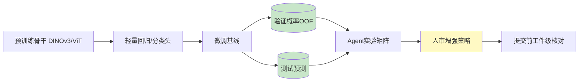

# 第12章 图像数据的 Vibe 工作流

> **本章目标**：进入第四部分——图像数据。那个时代，预训练骨干（DINOv3、ViT）微调是主路径，Agent 能帮你管一大堆实验矩阵。但有三件事 Agent 干不了：**判断增强策略会不会改变病变特征、处理类别不平衡的临床含义、提交前逐项核对通道/归一化/ID**。本章建立图像 Vibe 循环，后面三章（CSIRO、RSNA Knee、Image Matching）都复用它。

---

## 开篇：图像竞赛里，Agent 是“实验管理员”，不是“主刀医生”

图像竞赛和表格竞赛最大的不同，是**算力和时间**。表格模型几分钟跑完，图像微调一次可能几小时。所以图像竞赛里，Agent 的价值不是“跑得快”，而是“管得齐”——帮你把几十个骨干 × 分辨率 × 增强组合的实验管得井井有条，产出整齐的工件。

但图像有个表格没有的特点：**人眼能看出机器看不出的事**。一块纸板背景、一个方向不对的翻转、一个被增强抹掉的病灶——这些 Agent 看像素看不出来，人一眼就知道。所以图像竞赛的人机分工，更像“主刀医生（人）+ 实验管理员（Agent）”，而不是“指挥官 + 施工队”。



---

## 12.1 默认起点：预训练骨干 + 微调，工件先行

DINOv3、ViT 等预训练骨干的微调是主路径；第一个微调基线必须产出验证集概率（OOF）和测试集预测工件。

先解释几个词：
- **骨干（backbone）**：图像模型里负责“把图像变成特征”的那部分，通常是在海量图上预训练好的。DINOv3 是 Meta 出的自监督视觉基础模型，70 亿参数、17 亿张图预训练，冻结不用微调就能用；
- **微调（fine-tune）**：在预训练骨干后面接一个小的“头”（分类/回归层），用你的数据训练这个头（或连同骨干一起小幅调整）；
- **冻结（freeze）**：把骨干参数锁住不更新，只训头部。数据少时冻结能防过拟合。

```python
# src/baselines/image_baseline.py
"""
图像微调基线：DINOv3 骨干 + 轻量头，产出 OOF 概率与测试预测。
用 timm 加载预训练骨干，冻结前 50% 层加速收敛、防过拟合。
"""
import numpy as np
import torch
import torch.nn as nn
import timm

ROOT = "data"


class DinoRegressor(nn.Module):
    """DINOv3 骨干 + 回归头。"""

    def __init__(self, backbone="vit_huge_plus_patch16_dinov3.lvd1689m", out_dim=1):
        super().__init__()
        # num_classes=0 表示只要骨干的特征，不要它自带的分类头
        self.backbone = timm.create_model(backbone, pretrained=True, num_classes=0)
        self.head = nn.Linear(self.backbone.num_features, out_dim)

    def forward(self, x):
        f = self.backbone(x)          # 图像 -> 特征向量
        return self.head(f).squeeze(-1)


def freeze_first_half(model, ratio=0.5):
    """冻结前 ratio 比例的 transformer 层，降低过拟合与显存占用。"""
    blocks = model.backbone.blocks
    n_freeze = int(len(blocks) * ratio)
    for blk in blocks[:n_freeze]:
        for p in blk.parameters():
            p.requires_grad = False   # 锁住，不更新
    print(f"冻结前 {n_freeze}/{len(blocks)} 层")


def extract_features(model, loader, device):
    """提取特征，用于后续线性探测或工件。"""
    model.eval()
    feats = []
    with torch.no_grad():
        for x, _ in loader:
            feats.append(model.backbone(x.to(device)).cpu())
    return torch.cat(feats).numpy()
```

人检查：各类别/目标的预测概率分布、混淆矩阵。如果某类概率全挤在 0.5 附近，说明模型没学到东西。

---

## 12.2 Agent 管理实验矩阵，人审查增强策略

Agent 批量运行不同骨干、分辨率、增强组合的微调实验，汇总工件和验证分数；**增强策略必须与验证方案一起评估**，更激进的增强是否匹配数据特性由人判断。

Agent 可以这样管矩阵：

```python
# src/experiments/image_matrix.py
"""
实验矩阵：骨干 × 分辨率 × 增强强度。
Agent 生成配置、产出工件；人审查增强是否合理。
"""
EXPERIMENT_MATRIX = [
    {"backbone": "vit_base_patch16_dinov3", "img_size": 224, "aug": "mild"},
    {"backbone": "vit_base_patch16_dinov3", "img_size": 384, "aug": "mild"},
    {"backbone": "vit_huge_plus_patch16_dinov3", "img_size": 224, "aug": "strong"},
]


def train_one(cfg):
    """训练单个配置，返回 OOF 与测试预测（示意）。"""
    # 数据加载、增强、训练循环...
    return oof, test_pred
```

**人审查增强策略**（这是 Agent 干不了的）：
- 医学图像：强增强（大角度旋转、翻转）可能改变病变特征 → 需谨慎；
- 自然图像：强增强通常有益；
- 卫星图像：旋转增强合理（无绝对方向），但翻转可能不符物理。

参考真实案例：医学脑肿瘤分类里，增强必须“戴着镣铐跳舞”——旋转限制在 ±10°、平移 ≤0.1、缩放 ≤10%、亮度 0.8~1.2，禁止 ±90° 大旋转和 >15% 激进缩放，因为那会把肿瘤形态扭曲掉。这些红线，Agent 不会主动遵守，得你写进配置。

---

## 12.3 类别不平衡与指标特殊性

医学图像中，Agent 的自动类别加权可能忽视临床意义上的差异；人根据指标判断加权策略。

比如一个皮肤病数据集，正类（恶性）只有 343 个，负类 40 万个，比例 1165:1。Agent 默认用 “balanced” 权重，但临床上漏诊（把恶性判成良性）的代价远高于误诊。这时候人要把阳性类权重调更高。

```python
# src/utils/class_weight.py
"""
类别加权：Agent 默认用 balanced 权重，但医学场景需人调整。
例如：漏诊代价远高于误诊，应提高阳性类权重。
"""
import numpy as np


def clinical_class_weight(y, pos_weight=3.0):
    """按临床代价加权，而非简单 balanced。"""
    w = np.where(y == 1, pos_weight, 1.0)   # 正类加权 pos_weight 倍
    return w / w.mean()                      # 归一化，保持总权重不变
```

处理不平衡的常用武器还有：
- **Weighted Random Sampler**：每个 epoch 强制正负样本各占一半；
- **Downsampling**：负类下采样到正类的 10 倍；
- **Class weights**：在损失函数里给少数类加权。

选哪个，取决于数据规模和临床代价——这是人的判断。

---

## 12.4 提交前的工件级检查（人执行）

图像提交的错误代价高：通道顺序、归一化方式、ID 映射、TTA 后的概率校准。人对照工件和 `sample_submission` 逐项核对。

```python
# src/submit/image_submit_check.py
"""
图像提交前检查清单（人执行）：
1. 通道顺序：RGB 还是 BGR（cv2 读出来是 BGR，PIL 是 RGB，搞混就全错）
2. 归一化：ImageNet 的 mean/std 是否和训练时一致
3. ID 映射：文件名 → sample_submission 顺序
4. TTA（测试时增强）后的概率校准
"""
import numpy as np
import pandas as pd


def check_image_submission(sub_path, sample_path, id_col="id", target="target"):
    sub = pd.read_csv(sub_path)
    sample = pd.read_csv(sample_path)
    assert list(sub.columns) == list(sample.columns), "列名不一致"
    assert (sub[id_col] == sample[id_col]).all(), "ID 顺序不一致"
    assert sub[target].between(0, 1).all(), "概率越界"
    print("✅ 图像提交检查通过")
```

那个“通道顺序”的坑，值得多说一句。`cv2.imread` 读出来是 BGR（蓝绿红），`PIL.Image.open` 是 RGB（红绿蓝）。如果你用 cv2 读图、却按 RGB 的 mean/std 归一化，模型看到的就是“颜色错乱”的图，预测全废。**这种错误不会报错，只会让分数莫名其妙地低。** 提交前必须核对。

---

## 12.5 小结

- 预训练骨干微调是主路径，工件先行；
- Agent 管实验矩阵，人审增强策略（医学增强有红线）；
- 类别不平衡需临床判断（漏诊代价 vs 误诊代价）；
- 提交前逐项核对通道/归一化/ID/TTA。

图像竞赛的人机分工，可以浓缩成一句：**Agent 帮你把实验管整齐，人帮你把“看图”这件事做对。** 机器看像素，人看语义。

> **下一章预告**：第 13 章 CSIRO Image2Biomass，看一个真实案例——4th place 方案靠“人工识别并裁剪纸板背景噪声”涨了 0.01 LB。这种数据质量问题，Agent 永远不会自动发现，只有人眼能看出来。