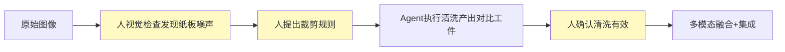

# 第13章 图像比赛详解：CSIRO Image2Biomass Prediction（2025—2026，DINOv3 多模态融合）

> **本章目标**：看一个“人眼胜过模型”的真实案例。4th place 方案的关键增益之一，来自**人工数据清洗**——识别并裁剪图像里的“纸板”背景噪声，带来 +0.01 的 LB 提升。Agent 看像素看不出纸板，人一眼就能看出来。这一章讲两件事：**人工数据清洗**和**多模态融合的人机分工**。

---

## 开篇：Agent 看得见像素，看不见“纸板”

先讲个真实的故事。CSIRO 这场比赛要从牧场图像预测生物量（草有多少）。4th place 的选手翻训练数据时，发现有些图里有一大块“纸板”一样的东西——那是拍摄时垫在底下的背景板，跟生物量毫无关系。

模型可不管这些，它老老实实把纸板的花纹也学进去了，当成“生物量信号”。选手手动把这些纸板区域裁掉，重新训练，LB 涨了 0.01。

这个故事完美诠释了图像竞赛的人机分工：**Agent 能处理几百万张图，但它不知道“纸板”是噪声；人看一张图就知道。** 这不是模型能力问题，是“语义理解”问题——而语义，恰恰是人的主场。



---

## 13.1 比赛与数据

从牧场图像 + 表格传感器数据（NDVI、高度）预测生物量，2025 年 10 月—2026 年 1 月。

**多模态**：图像提供纹理/形态信息，传感器提供植被指数（NDVI，归一化植被指数，值越高植被越茂密）与地形高度，两者互补。这种“图像 + 表格”的组合，在遥感、农业、医疗里很常见。

---

## 13.2 自动基线工件

DINOv3 ViT 骨干 + 轻量回归头的基线工件。4th place 方案使用 `vit_huge_plus_patch16_dinov3.lvd1689m`，**前 50% 层冻结**（数据量有限，全解冻会过拟合）。

```python
# src/baselines/image2biomass.py
"""
CSIRO 基线：DINOv3 ViT-Huge + 回归头，前 50% 层冻结。
产出 OOF 与测试预测工件。
"""
import torch
import torch.nn as nn
import timm


def freeze_first_half(model, ratio=0.5):
    """冻结前 ratio 比例的层，降低过拟合与显存占用。"""
    blocks = model.blocks
    n_freeze = int(len(blocks) * ratio)
    for i, blk in enumerate(blocks[:n_freeze]):
        for p in blk.parameters():
            p.requires_grad = False
    print(f"冻结前 {n_freeze}/{len(blocks)} 层")


model = timm.create_model("vit_huge_plus_patch16_dinov3.lvd1689m",
                          pretrained=True, num_classes=1)
freeze_first_half(model, 0.5)
```

真实 CSIRO 方案里还有几个值得学的工程点（来自公开 writeup）：
- **分块（tiling）**：1024×2048 大图切成 512×512 小块分别过骨干，保留局部纹理；
- **Toroidal Roll 增强**：把图像像素上下左右“环绕平移”，模拟“无限牧场”，让模型关注纹理密度而非绝对位置；
- **分位数回归**：每个目标输出 3 个分位数（0.1/0.5/0.9），刻画不确定性。

这些都是“人设计、Agent 执行”的典型——人想出“环绕平移”这个点子，Agent 负责把它跑成工件。

---

## 13.3 Agent 实验矩阵，人判断数据清洗

4th place 的关键增益来自**人工数据清洗**：识别并裁剪“纸板”背景噪声。

**Agent 不会自动发现这种问题**——它看到的是像素，人看到的是“背景里有块硬纸板占了两成画面”。

我们让人工检查流程成为工作流的一部分。Agent 负责生成“接触表”（contact sheet，把很多图拼成一张大图），人负责一眼扫过：

```python
# src/eda/visual_inspection.py
"""
人工视觉检查辅助：生成接触表（contact sheet）供人快速浏览。
Agent 负责生成，人负责判断。
"""
import matplotlib.pyplot as plt
from pathlib import Path
from PIL import Image


def make_contact_sheet(paths, out_path, n_cols=5, n_rows=4, labels=None):
    """把多张图拼成一张大图，方便人一眼扫过找异常。"""
    fig, axes = plt.subplots(n_rows, n_cols, figsize=(n_cols * 3, n_rows * 3))
    for i, ax in enumerate(axes.flatten()):
        ax.axis("off")
        if i < len(paths):
            ax.imshow(Image.open(paths[i]).convert("RGB"))
            if labels:
                ax.set_title(labels[i], fontsize=8)
    fig.savefig(out_path, dpi=120, bbox_inches="tight")
    plt.close(fig)
    print(f"✅ 接触表已生成：{out_path}")
```

**人提出清洗规则**（写成可执行规格交给 Agent）：

```
请实现图像裁剪清洗：
1. 检测图像中亮度高、纹理方差低（无纹理）的矩形区域，判定为"纸板背景"
2. 裁剪掉该区域，保留主体
3. 在固定 5 折 CV 下训练基线模型，产出对比工件 IMAGE_CLEAN_v001
4. change_desc 写明清洗规则与受影响样本比例
```

“亮度高 + 纹理方差低”是纸板的典型特征（均匀、无纹理）。但这条规则是不是对所有图都成立？会不会误伤“ genuinely 平坦的草地”？这得人来抽查。**Agent 负责执行规则，人负责确认规则没伤及无辜。**

我们把“找噪声”这件事拆成两半：Agent 出候选，人做确认。可以这样问它：

```
我怀疑训练集里有些图有"纸板背景"噪声。
请帮我做两件事：
1. 用"亮度高 + 纹理方差低"的规则，找出疑似噪声图，
   生成接触表 artifacts/eda/suspect_sheet.png
2. 统计受影响样本比例，按 country 分组
不要自动裁剪，也不要改数据，我要先看图确认。
```

模型会这样回应：

```
> （思考过程）用户要"候选 + 可视化"，明确不要自动改数据。
> 我实现检测规则，生成接触表，统计比例。要提醒：
> 规则可能误伤"genuinely 平坦的草地"，需要人抽检。

已完成，结果如下：

【检测结果】
  疑似噪声样本：1,847 / 32,000（5.8%）
  按国家分布：
    Country_A  12.3%  ← 明显高于其他
    Country_B   3.1%
    Country_C   1.4%

【接触表】artifacts/eda/suspect_sheet.png（20 张样例）

【我的观察】
  Country_A 比例异常高，可能那里拍摄时普遍垫了纸板，
  也可能是"平坦草地"被误判。建议你重点看接触表前 5 张，
  确认是纸板还是草地。

【我没有做的事】
  没有裁剪任何图像，没有修改 data/ 下任何文件。
  等你确认规则可靠，我再写清洗脚本。
```

注意它主动提出“可能是平坦草地被误判”这个**反例**——这是好的协作：它不只顺着你的假设跑，还会指出假设可能错在哪。

---

## 13.4 多模态融合的人机分工

Agent 枚举图像特征与表格特征的融合方式；人根据领域含义判断融合策略的合理性。

4th place 方案使用辅助任务训练和多模态融合，这些设计选择需要人的领域判断。

```python
# src/models/multimodal.py
"""
多模态融合：图像特征 + 表格传感器特征（NDVI/高度）。
三种融合方式，Agent 枚举，人按领域含义选择。
"""
import torch
import torch.nn as nn


class FusionModel(nn.Module):
    def __init__(self, img_feat_dim, tab_feat_dim, mode="concat"):
        super().__init__()
        self.mode = mode
        if mode == "concat":
            # 最简单：直接拼接
            self.head = nn.Sequential(
                nn.Linear(img_feat_dim + tab_feat_dim, 256),
                nn.ReLU(), nn.Dropout(0.2), nn.Linear(256, 1))
        elif mode == "gated":
            # 门控：让模型自己学"该信图像还是信传感器"
            self.gate = nn.Linear(img_feat_dim + tab_feat_dim, 1)
            self.head = nn.Sequential(
                nn.Linear(img_feat_dim + tab_feat_dim, 256),
                nn.ReLU(), nn.Linear(256, 1))
        elif mode == "aux_task":
            # 辅助任务：同时预测一个相关量（如植被高度），共享骨干
            self.head = nn.Sequential(
                nn.Linear(img_feat_dim + tab_feat_dim, 256),
                nn.ReLU(), nn.Linear(256, 2))   # [生物量, 高度]

    def forward(self, img_f, tab_f):
        x = torch.cat([img_f, tab_f], dim=1)
        if self.mode == "gated":
            w = torch.sigmoid(self.gate(x))     # 门控权重 0~1
            x = x * w
        return self.head(x)
```

**人判断**：
- `concat`：最简单，先做基线；
- `gated`：当图像质量差（部分图被遮挡）时，让门控降低不可靠模态权重——**领域含义明确，有用**；
- `aux_task`：生物量与植被高度强相关，辅助任务提供额外监督——**领域上合理**。

这些“哪个融合方式有道理”的判断，来自你对“图像和传感器各自可靠吗”的理解。Agent 只会把三个都跑一遍，报三个分数。

---

## 13.5 集成与提交

```python
# src/ensembles/image_blend.py
"""多骨干工件集成 + 提交核对。"""
import numpy as np


def blend_oofs(oofs, weights):
    """按人确认的权重融合多个骨干的 OOF。"""
    mats = [oofs[k] for k in weights]
    w = np.array(list(weights.values()))
    w = w / w.sum()                              # 归一化权重
    return np.tensordot(w, np.stack(mats), axes=(0, 0))
```

提交前用第 12 章的 `check_image_submission` 核对通道/归一化/ID。

---

## 13.6 小结

**基础模型提供强基线，但数据清洗和融合设计仍然是人的判断领域。**

- 人工数据清洗（纸板噪声）+0.01 LB——Agent 不会自动发现；
- 接触表（contact sheet）是让人做视觉判断的高效工具；
- 融合方式的选择依据是领域含义，不是分数。

这一章最值得记住的是那个“纸板”的故事。它告诉你：**在图像竞赛里，最值钱的往往不是更花哨的模型，而是人眼发现的那个数据问题。** Agent 的吞吐让你能处理海量数据，但“哪块是噪声”这个问题，永远得人来答。

> **下一章预告**：第 14 章 RSNA Knee，前沿形态——LLM Agent 不只是执行代码，还能**生成辅助监督信号**（从报告抽标签、给图像写描述）。但哪些 LLM 监督在临床可信、哪些会引入偏差，守门人还是人。