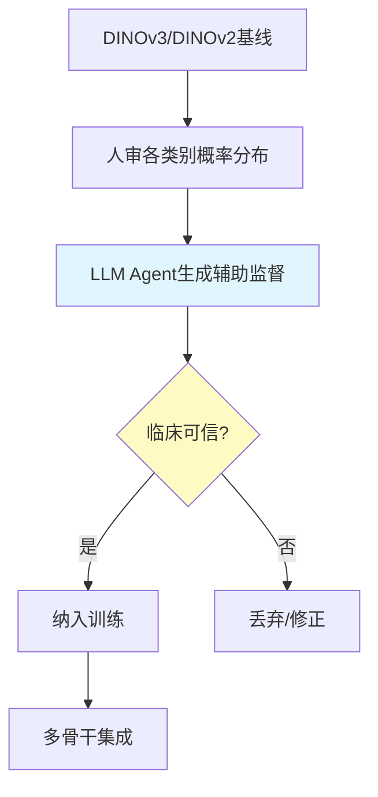

# 第14章 图像比赛详解：RSNA Knee Abnormality Detection（2026，医学影像 + LLM Agent 监督）

> **本章目标**：看 VibeKaggle 的一个前沿形态。2026 年 RSNA Knee 的 1st place 方案，用 **frontier LLM agents 来获取训练集的不同类型监督信号**——Agent 不只是执行代码，还能**生成辅助监督**（从报告抽标签、给图像写描述）。但哪些 LLM 监督在临床可信、哪些会引入系统性偏差，守门人仍然是人。这一章教你“怎么审计 LLM 生成的标签”。

---

## 开篇：当 Agent 开始“造标签”

前面所有章节，Agent 的角色都是“执行者”：你让它写代码、跑实验、管工件。这一章，Agent 多了一个新角色——**“监督信号生成者”**。

什么意思？传统监督学习，你需要人工标注的标签（金标准），贵、慢、量小。但 2026 年 RSNA Knee 的冠军方案换了个思路：让 LLM 去读放射科报告、读图像描述，自动生成额外的“弱标签”和“注意力提示”。比如 LLM 读一份报告，抽出“半月板撕裂：有；韧带损伤：无；积液：有”，这就成了额外的监督。

这很诱人，但也很危险。**LLM 会幻觉**——它可能描述一个根本不存在的病灶，或者系统性地忽略罕见病。所以这一章的核心不是“怎么用 LLM 造标签”，而是“**怎么判断 LLM 造的标签可不可信**”。



---

## 14.1 比赛与数据

膝关节 MRI 多标签异常检测，12 类临床异常，2026 年 RSNA 挑战赛。

**多标签**：每个病例可能同时有几种异常（半月板撕裂 + 韧带损伤 + 积液）。指标通常是列平均 AUC（每个标签算 AUC，再平均）。

数据特点：
- 膝关节 MRI 有固定扫描方向（不能大角度旋转）；
- 左右膝解剖不同（不能水平翻转）；
- 类别不平衡（某些异常很少见）；
- 有放射科报告文本（这是 LLM 能利用的金矿）。

---

## 14.2 自动基线工件

DINOv3 / DINOv2 骨干微调基线；人检查各类别的预测概率分布和混淆矩阵。

```python
# src/baselines/rsna_baseline.py
"""
RSNA 多标签基线：DINOv3 骨干 + 12 头输出。
指标为列平均 AUC，各类别独立评估。
"""
import torch
import torch.nn as nn
import timm
import numpy as np
from sklearn.metrics import roc_auc_score

NUM_LABELS = 12


class MultiLabelModel(nn.Module):
    def __init__(self, backbone="vit_base_patch16_dinov3"):
        super().__init__()
        self.backbone = timm.create_model(backbone, pretrained=True, num_classes=0)
        self.head = nn.Linear(self.backbone.num_features, NUM_LABELS)

    def forward(self, x):
        return self.head(self.backbone(x))    # 输出 12 个 logit


def col_mean_auc(y_true, y_prob):
    """列平均 AUC：每个标签算 AUC 再平均。"""
    aucs = [roc_auc_score(y_true[:, i], y_prob[:, i])
            for i in range(y_true.shape[1])]
    return float(np.mean(aucs)), aucs
```

人审查：哪些类别 AUC 低？混淆矩阵显示哪些类别互相误判（半月板撕裂 vs 韧带损伤）？

---

## 14.3 LLM Agent 作为监督来源（本章的核心新内容）

2026 年 RSNA Knee 的 1st place 方案，用 **frontier LLM agents 来获取训练集的不同类型监督信号**。

**什么是“LLM 生成辅助监督”？** 三种典型：
- LLM 读放射科报告文本，抽结构化异常标签 → 弱标签；
- LLM 对图像生成“病变区域描述” → 注意力监督；
- LLM 生成“鉴别诊断候选” → 辅助任务。

我们让 Agent 从报告抽标签。把这段话丢给它：

```
请读取 train.csv 中的影像报告文本列 report，用 LLM 抽取结构化异常标签：
1. 对 12 类异常，每类输出 0/1（存在/不存在/不确定）
2. 输出置信度 0-1
3. 结果写入 artifacts/weak_labels/llm_labels_v001.npy，形状 (n_train, 12)
4. 同时记录抽取失败的样本索引到 artifacts/logs/llm_extract_fail.json
```

模型输出（节选）：

```
> （思考过程）需要调用 LLM API 批量处理报告文本。设计 prompt 要求
> 严格 JSON 输出：{"label_1": {"present": 0/1, "confidence": 0.0-1.0}, ...}。
> 对"不确定"的样本标 confidence < 0.5，训练时降权。
> 注意：LLM 可能幻觉，需人抽样复核。

import json
import numpy as np
import pandas as pd
from pathlib import Path


def extract_labels_with_llm(reports, labels, api_client):
    """用 LLM 从报告抽取结构化标签。"""
    out = np.zeros((len(reports), len(labels)), dtype=np.float32)
    conf = np.zeros_like(out)
    fails = []
    for i, text in enumerate(reports):
        prompt = f"从以下放射科报告抽取异常标签，严格JSON输出：{labels}\n报告：{text}"
        try:
            r = json.loads(api_client.chat(prompt))
            for j, lb in enumerate(labels):
                out[i, j] = r[lb]["present"]
                conf[i, j] = r[lb]["confidence"]
        except Exception:
            fails.append(i)
    return out, conf, fails
```

### 人的判断：哪些 LLM 监督信号临床可信？

这是本章的核心。**人必须逐类审查**：

| LLM 监督类型 | 可信度风险 | 人的审查动作 |
|--------------|-----------|--------------|
| 从报告抽取的结构化标签 | 报告本身可能有错/不完整 | 抽样 50 例人工核对 |
| 图像区域描述 | LLM 视觉幻觉（描述不存在的病灶） | 对照影像确认 |
| 鉴别诊断候选 | 引入先验偏差（LLM 偏好常见病） | 检查是否系统性忽略罕见病 |
| 软标签置信度 | LLM 过度自信 | 校准检查（confidence 与真实准确率的相关性） |

怎么系统地审计？用 Cohen's Kappa（一致性系数）在抽样上比对 LLM 标签和金标准：

```python
# src/utils/weak_label_audit.py
"""
弱标签审计：人抽样核对 LLM 标签与金标准的一致性。
Cohen's Kappa：衡量两个标注者的一致性，1 完全一致，0 等于瞎猜。
Kappa < 0.4 说明 LLM 标签不可信。
"""
import numpy as np
from sklearn.metrics import cohen_kappa_score


def audit_weak_labels(llm_labels, gold_labels, sample_idx):
    """在抽样样本上计算每个标签的 Kappa。"""
    kappas = []
    for j in range(llm_labels.shape[1]):
        k = cohen_kappa_score(gold_labels[sample_idx, j],
                              llm_labels[sample_idx, j])
        kappas.append(k)
        flag = "⚠️ 低可信" if k < 0.4 else "✅"
        print(f"  标签 {j}: Kappa={k:.3f} {flag}")
    return kappas
```

> **人的判断在于：哪些 LLM 生成的监督信号在临床上是可信的，哪些可能引入系统性偏差。** 这不是“跑个分数”能解决的，得靠临床知识抽样核对。

---

## 14.4 Agent 枚举骨干与增强，人审核临床合理性

Agent 批量运行 DINOv3、DINOv2 等骨干的微调工件；人根据医学图像的语义判断增强策略是否可能改变病变特征。

**医学图像增强的红线**（比第 12 章更严格）：
- 旋转：膝关节 MRI 有固定扫描方向，大角度旋转不符合临床 → 限制在 ±15°；
- 翻转：左右膝关节解剖不同，水平翻转会制造“不存在的镜像病例” → 禁止或谨慎；
- 强度扰动：MRI 信号强度有物理意义，过度扰动可能抹掉病变对比 → 轻度。

```python
# src/augment/medical_aug.py
"""
医学图像安全增强：限制在临床上合理的变换。
"""
import torchvision.transforms as T


def medical_safe_aug(img_size=224):
    """临床上合理的增强：轻度旋转、亮度/对比度微扰、无翻转。"""
    return T.Compose([
        T.Resize((img_size, img_size)),
        T.RandomRotation(degrees=15),                    # 限制角度
        T.ColorJitter(brightness=0.1, contrast=0.1),     # 轻度
        T.ToTensor(),
        T.Normalize(mean=[0.485, 0.456, 0.406],
                    std=[0.229, 0.224, 0.225]),
    ])
```

Agent 可能建议“加个水平翻转增强，数据集能翻倍”——**默认拒绝**，因为左右膝解剖不同，翻转会制造错误样本。

---

## 14.5 集成与提交

```python
# src/ensembles/multilabel_blend.py
"""多骨干集成 + 提交核对（列平均 AUC）。"""
import numpy as np


def blend_multilabel(oofs, weights):
    """按权重融合多骨干的 OOF（形状 n×12）。"""
    w = np.array(list(weights.values()))
    w = w / w.sum()
    return np.tensordot(w, np.stack(list(oofs.values())), axes=(0, 0))
```

提交前用第 12 章的 `check_image_submission` 核对。

---

## 14.6 小结

**医学影像中 Agent 可以参与监督生成，但临床合理性的守门人仍然是人。**

- LLM 生成辅助监督是前沿形态（从报告抽标签、写描述）；
- 弱标签必须用 Kappa 抽样审计；
- 增强策略受临床解剖约束（禁翻转、限旋转）。

这一章把 VibeKaggle 的边界又推了一步：**Agent 不再只是“执行”，它开始“创造”训练信号。** 但创造出来的东西可不可信，仍然得人来判。这就像你请了个很有想法的实习生，它能给你提一百个点子，但哪个点子靠谱，得你拍板。

> **下一章预告**：第 15 章 Image Matching Challenge 2025。几何视觉里，数值指标经常“看不出问题”，但人眼一看匹配可视化就知道哪里错了。这一章讲“为什么人的视觉审查不可替代”。